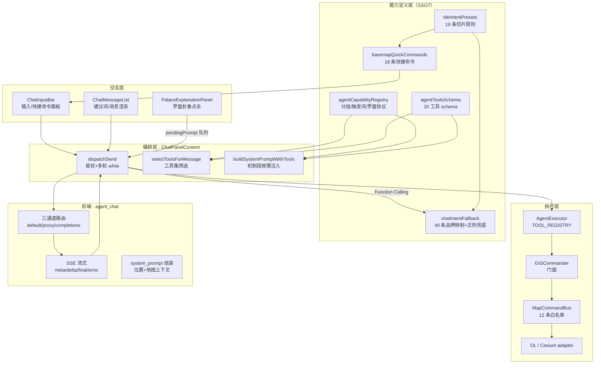

# Agent 能力系统架构

> **日期**：2026-11-27（统一版本 V3.7.15 基线；V3.7.16–30 为同批内部迭代号，已归并）
> **状态**：✅ 反映最新能力（能力注册表 + Code Review 全修后）
> **适用范围**：前端 `frontend/src/domains/common/chat/`、后端 `backend/api/agent_chat/`
> **关联文档**：[配额与账号](account-system-ai-quota.md) · [双引擎](ol-cesium-dual-engine.md) · [底图源系统](basemap-source-system.md) · [L3 方案](../TODO/2026-11-27-agent-capability-registry-plan.md)

---

## 1. 定位与设计原则

Agent 能力系统是「AI 对话式地图操作」的核心：用户用自然语言下达地图指令，Agent 通过 Function Calling 调用白名单工具操作 OL/Cesium 双引擎。

**四条设计原则**（V3.7.19–27 迭代得出，改动前必读）：

1. **工具执行在浏览器**：20 个工具全部操作浏览器内存里的地图实例，经 `MapCommandBus` 白名单落地。不引入 MCP 等跨进程协议层。
2. **能力定义单一事实来源**：工具层元数据（分组/触发词/机制段）集中在 `agentCapabilityRegistry.ts`；切片语义集中在 `tileIntentPresets.ts`；品牌映射集中在 `chatIntentFallback.ts`。三份数据各司其职，不互相复制。
3. **机制写清，决策放手**：跨轮次交互协议（罗盘三段式）是客观平台机制，必须逐字写清；场景判断与参数估算只给依据，交给模型自行决策。
4. **按需分发降 token**：工具 schema 是 token 大头（20 工具 8,752 字符，是 System Prompt 的 9 倍），按意图分发子集；罗盘协议段仅含 `enable_compass` 时注入。

---

## 2. 总体架构

---

## 3. 能力定义层（SSOT）

### 3.1 `agentCapabilityRegistry.ts` — 工具层注册表

| 导出 | 说明 |
|---|---|
| `CapabilityGroup` | 7 组：`core / weather / geocode / compass / layer / export / view` |
| `CORE_CAPABILITIES` | 4 个常驻工具：`search_and_zoom / switch_basemap / get_map_state / list_layers` |
| `CAPABILITY_GROUPS` | 6 组 `{group, names, triggers}`，触发词从 V3.7.19 router 原样迁入 |
| `REGISTERED_TOOL_NAMES` | 20 工具名集合，用于未登记工具兜底常驻 |
| `buildTriggerPatterns(group)` | 编译触发词为正则：纯 ASCII 加 `\b`，中文子串匹配，`i` 标志 |
| `COMPASS_MECHANISM_PROMPT` | 罗盘三段式协议原文（931 字符），逐字保留避免措辞漂移 |

**边界**：不纳入底图品牌映射（49 条数据字典）、切片规则（19 条已是 SSOT）、工具 parameters schema、description 全文（措辞敏感，V3.7.22/23 教训——零漂移优先）。

### 3.2 `agentToolsSchema.ts` — 工具声明与 Prompt

- `AGENT_TOOLS`：20 个工具，每项 `{type:'function', function:{name, description, parameters}}`。
- `buildSystemPromptWithTools(toolNames?)`：5 段结构——角色声明 / 上下文 / 能力边界 / `${mechanism}`（按需）/ 降级格式。**无参数时向后兼容**（含机制段）。
- `formatToolResultForLLM` / `formatToolResultForUser`：LLM 结构化摘要（30+ 透传字段，GeoJSON 截断 6000 字符）与用户可见单行摘要分离。
- `parseToolCallsFromText`：三级降级解析 `tool_call` 块 → `json` 块 → 裸 JSON。

### 3.3 `tileIntentPresets.ts` — 切片语义

19 条规则（`TILE_INTENT_RULES`），高德 7 + Google 12，含 V3.7.21 补登记的 `google_backend_proxy_satellite`。

- `resolveTileIntentByText`：短语权重 = 长度²，通用来源词权重 1，provider 一致 +12 / 不一致 -8，`bestScore >= 6` 才命中。
- `resolveTileBasemapArg`：命中 → `{presetId}` 或把 `__TILE_PROXY_BASE_URL__` 替换为运行时基址的 `{url}`；高德单要素语义返回明确 error。
- `TILE_INTENT_UNSUPPORTED`：高德不能单拆水系/土地利用、带 key 的第三方 URL、瓦片只能换底图槽位——这些语义必须如实拒绝，不得改写参数强行满足。

### 3.4 `chatIntentFallback.ts` — 正则兜底

`detectGISIntent` 顺序：空/URL/图层意图直接返回 null → 天气（动词+时间词剥离）→ 搜索 → 底图。

底图路径 V3.7.27 改为**规则表优先**：先 `resolveTileBasemapArg`，未命中才走 49 条品牌映射（按关键词长度降序，最长匹配；同数据优先代理版）。这消除了 V3.7.21「改了规则表漏了兜底表」的双表不同步。

### 3.5 `basemapQuickCommands.ts` — 快捷命令

18 条预设（高德 7 + Google 11），intent 为规则表 `userPhrases` 原文。`validateQuickCommandsAgainstRules()` 校验 intent 命中规则且 provider 一致，供回归脚本调用。点击后本地解析 + 直接执行 `switch_basemap`，**零 LLM 调用**。

---

## 4. 工具能力全景（20 项）

| 组 | 工具 | 能力 |
|---|---|---|
| core | `search_and_zoom` | 搜索地名/POI 并在当前激活视图定位（高德四级降级 → Nominatim） |
| core | `switch_basemap` | 切底图：`presetId` / `url` / `intent` 三选一 |
| core | `get_map_state` | 只读引擎/中心/zoom/相机/底图/图层数 |
| core | `list_layers` | 列出可操作图层，图层变更前置（先取 id） |
| weather | `get_weather` | 中国城市天气只读查询，`base` 实况 / `all` 4 天预报 |
| geocode | `geocode` / `reverse_geocode` | 地名↔WGS84 坐标，只读不移动地图 |
| compass | `enable_compass` | 当前中心启用罗盘，三段式交互第一步 |
| layer | `get_layer_info` / `get_measure_result` | 单图层详情 / 最近测量结果，只读 |
| layer | `set_layer_visibility` / `set_layer_opacity` | 显隐 / 透明度，可逆 |
| layer | `zoom_to_layer` / `solo_layer` | 缩放到图层 / 只显示该图层 |
| layer | `remove_layer` | 删除图层，**不可撤销**，须先 `list_layers` |
| export | `export_layer_geojson` | `download` 生成文件 / `inline` 回复文本 |
| view | `set_map_view` / `set_view_center` | 2D↔3D 切换 / 移动中心（2D zoom ↔ 3D height） |
| view | `set_camera_orientation` / `zoom_to_extent` | Cesium 姿态（仅 3D）/ 缩放到 WGS84 bbox |

**执行链**：`AgentExecutor.TOOL_REGISTRY`（20 工具名 → Commander 方法）→ `GISCommander`（门面，只读工具直连、变更走 bus）→ `MapCommandBus`（12 条白名单 + `supportedViews` 校验）→ OL/Cesium adapter。串行执行避免动画竞争；未知命令 `UNKNOWN_COMMAND`、视图不支持 `COMMAND_UNSUPPORTED_FOR_VIEW`、适配器未就绪 `MAP_RUNTIME_NOT_READY`。

---

## 5. 编排层

### 5.1 发送编排（`dispatchSend`）

1. 前置守卫：空/在途直接返回；后端代理模式服务未就绪或配额耗尽 → 错误气泡；历史裁剪。
2. `activeTools = selectToolsForMessage(userMsg)`（核心 4 + 命中组 + 未登记兜底），**首轮与后续轮复用同一集合**。
3. `systemPrompt = buildSystemPromptWithTools(new Set(activeTools.map(t => t.function.name)))`。
4. 首轮 `callLLM`（流式增量写气泡）→ 提取工具调用；无工具时 `detectGISIntent` 正则兜底；导出强制 `download`。
5. `executeToolsAndUpdateUI`：推 `isToolStatus` 消息 → 串行执行 → 状态回写 → `recordMapAction` → `buildSettledMapContext`。
6. **多轮 while 循环**：`MAX_TOOL_ROUNDS = 10`，`history: pendingHistory.slice(-8)`；`stableToolSignature` 检测原地打转并中止。
7. 收尾：后端代理模式 `reloadAgentConfig(false)` 并用各轮 cost 之和覆盖 `lastCallCost`。

### 5.2 工具分发算法

`selectToolsForMessage`：空消息 → 全量兜底；否则核心 4 常驻 + 命中分组整组追加 + 未登记工具常驻；保持 `AGENT_TOOLS` 声明顺序。实测载荷：闲聊 2,095 字符（较全量降 76%）。

### 5.3 罗盘三段式交互（机制，非决策）

**第一轮**：「分析当前范围」直接 `enable_compass` 不问地点半径；「分析指定地点」先 `search_and_zoom`；半径按 `compassRadiusHintMeters` 或 zoom/cameraHeight 估算；启用后提示点卦象，**本轮止步**。

**第二轮**：用户点卦象 → `PalaceExplanationPanel.buildAgentQuestion`（主题/层号/宫位名 + 逆地理 + 半径）→ `chatStore.requestPrompt` 队列 → `ChatPanelContent.flushPendingPrompt`（三守卫：不在途/服务就绪/未配额耗尽）→ `dispatchSend`。模型直接知识解答，**不重复启用罗盘**。一次性会话标志 `ANALYSIS_ARM_TTL_MS = 5min`。

---

## 6. 后端链路

### 6.1 三通道

| 通道 | 端点 | 配置/配额 |
|---|---|---|
| default-proxy | `/api/agent/chat/default-proxy[/stream]` | 管理员配置 `default_ai_*`，**不扣额度**（`cost:0`） |
| proxy（个人 Key） | `/api/agent/chat/proxy[/stream]` | 请求体 `api_key/base_url/model`，**不消耗平台配额** |
| completions（后端代理） | `/api/agent/chat/completions[/stream]` | 三层运行时配置 + Key 候选；429 预检 + 按 usage 扣费 |

### 6.2 流式 SSE

`meta / delta / reasoning / final / error` 事件，`data: [DONE]` 终止。`final.rawData` 必须与非流式归一化形状逐字段一致（否则 `extractToolCalls` 走原生分支拿到空数组，文本降级解析永不触发）。多 Key 候选轮换，`stream_locked` 防止首字节后重复。

### 6.3 system_prompt 传输

前端 `llmCall.ts` 三通道均传 `system_prompt`；后端 `schemas.py` 上限 16,000 字符，`_build_agent_system_prompt` 追加位置上下文与地图状态摘要（只读数据，512 字符上限，JSON 转义）。

> **system_prompt 传输（本批已修复）**：`agent.ts` 三个 body builder 现已统一把 `payload.system_prompt` 写入请求体，覆盖非流式/流式 × 三通道 6 条路径。V3.7.17–27 曾因两个 builder 遗漏该字段，导致默认 AI 与后端代理通道实际使用后端默认提示词——修复后前端组装的能力边界与罗盘协议段才真正生效。后端 6 个端点均读取该字段，schema 上限 16,000 字符（前端 Prompt 实测约 1,759 字符）。

### 6.4 错误回传

`httpx.ConnectError` 等传输异常：非流式 → `HTTPException(502/504)`；流式 → SSE `error` 事件「流式中断：<类名>: <原因>」，若已流出内容则不换候选（避免内容重复）。前端 `agentChatStream` 收集 `error` 事件并抛出，`ChatPanelContent` catch 显示「请求失败：<message>」。

---

## 7. 渲染管线

`renderAnswerHtml` 顺序（V3.7.24–26 修复后）：

1. `parseThinkAndAnswer` 拆思考块；
2. 疑似原始 HTML → 直接 `sanitizeHtml`（不二次解析）；
3. `extractMathExpressions`：公式 → `MATHPLACEHOLDER<n>END` 占位符；
4. `normalizeEmphasisSpacing`：掩蔽代码块 → 逐行扫描 `**` 两两配对 → 去内侧空格 + 按左右邻词字符补外侧空格（奇数个末个视为流式未闭合跳过）；
5. `marked.parse`（GFM + 自定义代码块 renderer）；
6. `sanitizeHtml`（DOMPurify 白名单，fail-closed）；
7. `renderMathInHtml`（sanitize 之后回代 KaTeX）。

**V3.7.24–26 三类加粗瑕疵**：① 内侧空格 `** word**`；② 左边界 CJK `中的**加粗**`；③ 右边界 + 跨对误配（双正则自身回归）→ 改为状态机顺序配对。14 项用例回归基线。

---

## 8. 维护指南

| 改动 | 改哪里 | 同步检查 |
|---|---|---|
| 新增工具 | `agentToolsSchema.AGENT_TOOLS` + `AgentExecutor.TOOL_REGISTRY` + bus/适配器 | 注册表未登记会兜底常驻（能力不丢但不按需）；跑 20 工具断言 |
| 改工具触发场景 | `agentCapabilityRegistry.CAPABILITY_GROUPS` | router 与 Prompt 自动派生 |
| 改罗盘交互协议 | `agentCapabilityRegistry.COMPASS_MECHANISM_PROMPT` | **逐字改**，跑 7 项协议断言；勿重写措辞 |
| 改切片语义 | `tileIntentPresets.TILE_INTENT_RULES` | 跑 18 条快捷命令命中校验 + 建议词校验 |
| 改底图品牌映射 | `chatIntentFallback.BASEMAP_PRESET_MAPPING` | 规则表优先，品牌表只兜底未覆盖品牌 |
| 改 Prompt 结构 | `agentToolsSchema.buildSystemPromptWithTools` | 跑自主判断措辞 + 机制注入断言 |

**回归基线**（V3.7.27 实测）：工具数 20 / schema 8,752 字符 / 规则 19 / 快捷命令 18 / 基线 8 项全绿。项目未安装 vitest/jest，回归用临时 Node 脚本（用完即删）；后续若引入测试框架应固化这些断言。
