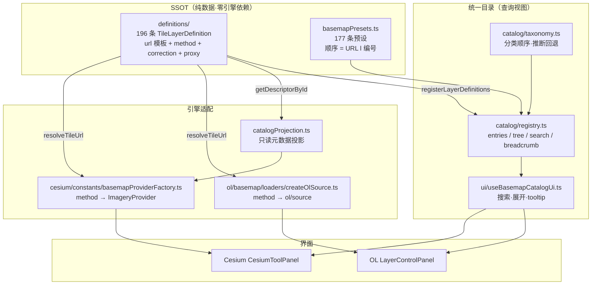
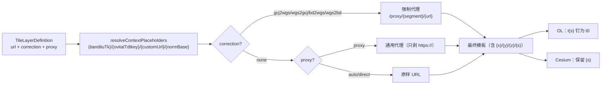
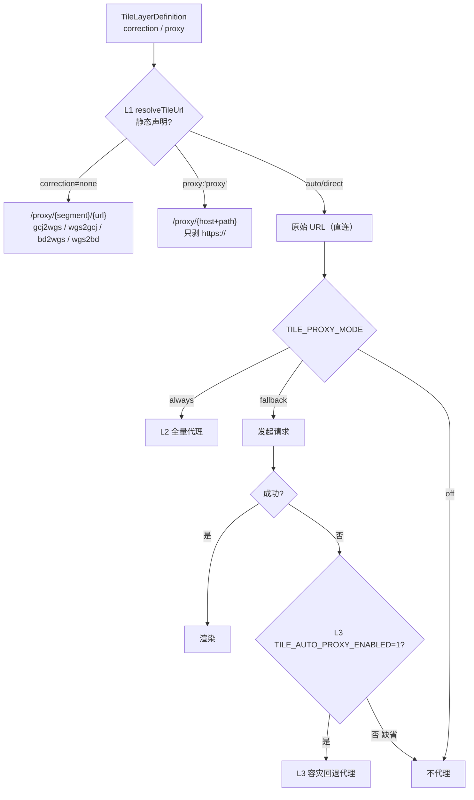
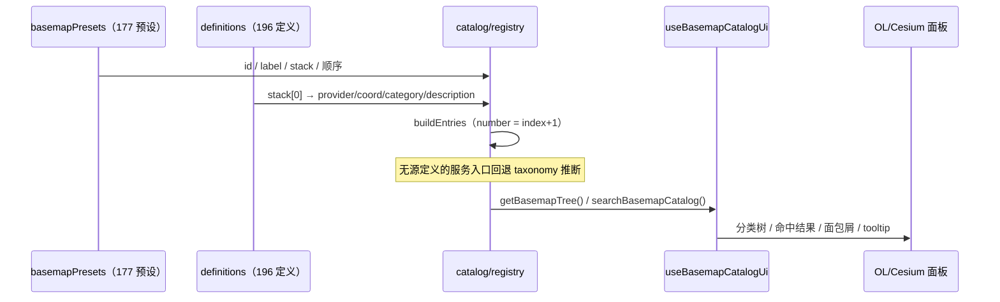
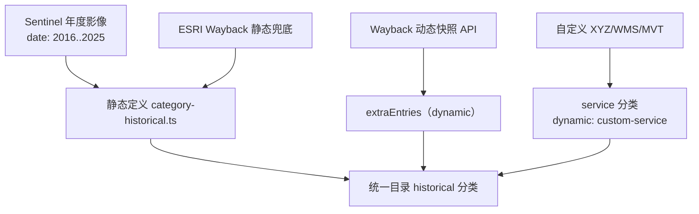
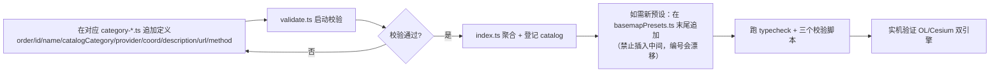

# 底图系统架构：声明式定义 + 统一目录（已落地）
> 架构核对：2026-11-28 · V3.7.18（以当前代码为准；历史决策记录 `decisions/` 不改写；文中行号仅作导航，以符号名为准）。


> 状态：✅ 已落地（V3.7.16 定义层重构 + V3.7.16 遗留项修复；本文为**现状架构文档**）
> 日期：2026-11-27 初稿 · 2026-11-28 按实际代码重写
> 需求来源：[`../TODO/2026-11-27-basemap-catalog-requirements.md`](../TODO/2026-11-27-basemap-catalog-requirements.md)
> 实施日志：[`../LLM_record/26-11/2026-11-27/2026-11-27-basemap-definition-refactor.md`](../LLM_record/26-11/2026-11-27/2026-11-27-basemap-definition-refactor.md)

---

## 1. 定位与不变量

底图系统由两套 SSOT 分工，二者**互不重复**：

| 关注点 | SSOT | 内容 |
|---|---|---|
| 图层技术定义 | `common/basemap/definitions/` | 196 条 `TileLayerDefinition`：URL 模板、加载方式、纠偏/代理、引擎能力 |
| 预设与编号 | `common/basemap/basemapPresets.ts` | 177 条 `{id,label,stack}`，数组顺序即 URL `l` 的 1-based 编号 |

统一目录 `common/basemap/catalog/` 是**查询视图**（只读投影），不持有第三份数据：预设条目从 `basemapPresets` 取顺序与 id，元数据从 definitions 按 `stack[0]` 取，缺失时回退 `taxonomy.ts` 推断。

**不可破坏的契约**：

1. URL 参数 `l` 为 1-based 预设序号；管理页 `default_basemap_index` 为 0-based。
2. `ALL_BASEMAP_PRESETS` / `URL_LAYER_OPTIONS` / `BASEMAP_OPTIONS` 的既有顺序与 label 的「编号 + 名称」格式不变。
3. 历史 layer id、代理前缀路径与 XYZ 索引语义不变。
4. 默认预设 `custom_China_Blender_preset_2` 不变。
5. `TileLayerDefinition.order` 覆盖 1..196 且唯一（加载时 `validate.ts` 强校验，错误直接抛错）。

---

## 2. 总体架构图



依赖方向单向：`common` 不导入任何引擎；`ol`/`cesium` 只单向依赖 `common`。Cesium 对 OL 的静态依赖已由注册式投影消除。

---

## 3. 声明式图层定义（definitions）

### 3.1 数据类型

`TileLayerDefinition`（`definitions/types.ts`）关键字段：

| 字段 | 语义 |
|---|---|
| `order` / `id` | 原始顺序（禁改）/ 稳定标识 |
| `catalogCategory` / `provider` / `coord` / `description` | 统一目录元数据，每条显式声明 |
| `zBand` | 渲染带：`'label'`（注记层，150~196）/ `'basemap'`（底图，0~99），缺省 = basemap；替代旧 `category === 'label'` 判断 |
| `url` | **原始上游 URL 模板**，含占位符；不写代理前缀 |
| `method` | `xyz` / `wmts` / `wms` / `mvt` / `osm` / `custom` |
| `correction` | `none` / `gcj2wgs` / `wgs2gcj` / `bd2wgs` / `wgs2bd`（行为指令） |
| `proxy` | `direct` / `proxy` / `auto`（默认 `auto`） |
| `wms` / `wmts` / `styleUrl` / `maxZoom` / `tilePixelRatio` / `subdomains` | 技术参数 |
| `needsContext` | 运行时占位符：`tiandituTk` / `ovitalTdtkey` / `customUrl` |
| `nonStandardAdapter` / `engines` / `skipHighResTile` | 非标准适配器 / 双引擎能力 / 注记高清优化 |

**`coord` 与 `correction` 各司其职**：`coord` 是**纠偏后输出坐标系**（渲染对齐用），`correction` 是引擎要做的变换；源坐标系由 correction 左侧推导，不单独存字段。加载时强校验二者一致性：

```text
gcj2wgs → WGS84    wgs2gcj → GCJ02    bd2wgs → WGS84    wgs2bd → BD09
```

### 3.2 文件组织

```text
common/basemap/definitions/
├─ types.ts               TileLayerDefinition 等类型
├─ resolveTileUrl.ts      纯函数：占位符替换 + 纠偏/代理拼装
├─ validate.ts            加载期校验（error 抛错 / warning 打印）
├─ index.ts               聚合 196 条 → TILE_LAYER_DEFINITIONS；登记到 catalog；启动校验
├─ category-recommended.ts  精选底图显式清单（20 条 preset id，可自由增删改）
└─ category-*.ts          六类分片：service / imagery / terrain / electronic / historical / vector
```

`index.ts` 同时提供 `getDescriptorById()`（返回定义本身，全量透传，不再字段子集复制）与 `resolveRuntimeTokenPoolKey()`（依据 `needsContext` 判定密钥池，供容灾轮换）。

### 3.3 URL 解析管线



要点：

- 纠偏只能在 VPS 代理上做 → `correction != 'none'` 时强制走代理，`proxy:'direct'` 属非法组合（校验拦截）。
- 通用代理只剥 `https://` 前缀，`http://` 保留（船舶网 ships66 上游仅支持 http）。
- `proxy:'auto'` 在定义层**只返回原始 URL**；运行时是否回退代理由引擎侧按代理架构（见 §3.4）处理。
- OL 的 `renderXYZTemplate` 不展开 `{s}`，天地图 `t{s}` 钉为 `t0`；Cesium 会展开，保留 `{s}`。

### 3.4 瓦片代理架构（三层）

代理不是单一机制，而是**声明驱动 + 运行时策略 + 容灾回退**三层，职责严格分离：

| 层 | 触发条件 | 实现位置 | 配置 |
|---|---|---|---|
| **L1 定义层静态代理** | `correction != 'none'` 或 `proxy:'proxy'` | `definitions/resolveTileUrl.ts` | 无开关，定义声明即生效 |
| **L2 显式全量代理** | `TILE_PROXY_MODE=always` | OL `tileLifecycle.ts` / Cesium `wrapProviderWithFetchFallback()` | `VITE_TILE_PROXY_MODE`（fallback/always/off） |
| **L3 容灾回退代理** | 直连 403/429/网络错误 | 同上 | `VITE_TILE_AUTO_PROXY_ENABLED`（V3.7.16 新增，**缺省 0 关**） |



**后端路由契约**：`/proxy/{target_url:path}`（通用，透传第三方）/ `/proxy/{gcj2wgs|wgs2gcj|bd2wgs|wgs2bd}/{url}`（纠偏，服务端逐瓦片重采样）。

**双引擎实现差异**（同一语义，不同防护强度）：

| 能力 | OL（`tileLifecycle.ts`） | Cesium（`basemapProviderFactory.ts`） |
|---|---|---|
| 同源 URL 排除 | ✅ `canProxyTileUrl()` 排除同源、`/proxy/*`、`/tiles/*` | ❌ 仅排除 `TILE_PROXY_MODE=off`（外部域为主，未触发实际问题） |
| OSM 403 拦截图回退 | 靠 `prioritizeTileSourceRequest` 的 Referrer 策略规避 | ✅ 检测 6987 字节拦截图 → 回退 OSM 德国社区镜像 |
| `always` 全量代理 | ✅ | ✅ |
| `TILE_AUTO_PROXY_ENABLED` 门控 | ✅ | ✅ |

**配置开关表**（详见 `Docs/Guide/configuration.md`）：`VITE_TILE_PROXY_BASE_URL`（代理基址）、`VITE_TILE_PROXY_MODE`（fallback/always/off，缺省 fallback）、`VITE_TILE_AUTO_PROXY_ENABLED`（容灾回退，缺省 0）。

> 设计原则：`TILE_PROXY_MODE` 不进入定义层 `resolveTileUrl` 的 context——定义层只做声明驱动的静态拼装，运行时策略（L2/L3）由引擎读全局配置处理。V3.7.16 移除了此前误导性的 `tileProxyMode` 死参数。

---

## 4. 统一目录（catalog）与检索

### 4.1 数据流



`buildEntries()` 按 layers 登记版本缓存。推荐分类由 `definitions/category-recommended.ts` 显式清单决定（V3.7.16）：清单内的 preset id 归入 `recommended`，其余条目的主分类取源定义的 `catalogCategory`。清单与预设顺序完全解耦，可自由增删改；源定义主分类同时写入 `tags`，因此推荐条目仍出现在其原始分类中（快捷入口，允许重复）。`check-basemap-catalog` 校验推荐 id 必须存在于预设表且无重复。

### 4.2 分类与搜索

- 一级分类：`service` / `recommended` / `imagery` / `terrain` / `electronic` / `historical` / `vector`，顺序由 `taxonomy.CATEGORY_ORDER` 固定。
- 层级：分类 → 服务商（`PROVIDER_ORDER`）→ 坐标系（`COORD_ORDER`）→ 条目。
- 搜索：空格分词后全部命中；纯数字 token 精确匹配 `number`（即 URL `l`）；命中结果显示「分类 / 服务商 / 坐标系」面包屑。
- Wayback 动态快照作为 `extraEntries` 传入 `searchBasemapCatalog()`，并入同一棵树，不另起 UI 分支。

### 4.3 公共出口

`catalog/index.ts` 统一导出 `types` / `taxonomy` / `layers` / `registry`。预设与编号常量仍由 `basemapPresets.ts` / `basemapOptions.ts` 直接提供（消费者已全部直连，无兼容转发层）。

---

## 5. 双引擎适配

### 5.1 OL：`createOlSource`

唯一入口 `createOlSource(definition, ctx)` → `ol/source`，取代 196 条定义里各自的 `createSource` 工厂：

| method | 实现方式 |
|---|---|
| `xyz`（无适配器） | `prioritizeTileSourceRequest(new XYZ({url, maxZoom, tilePixelRatio}))` |
| `xyz`（nonStandardAdapter） | `createXYZSourceFromUrl(url, {adapters})`，不套 prioritize |
| `wmts` | `createConfiguredServiceSource` → XYZ（GetTile 模板形态，未拉 Capabilities） |
| `wms` | `createConfiguredServiceSource` → TileWMS |
| `mvt` | `createVectorTileSourceFromUrl` + `styleUrl` |
| `osm` | `prioritizeTileSourceRequest(new OSM())` |
| `custom` | `customUrl` 为空返回 null，否则 `createXYZSourceFromUrl` |

`skipHighResTile` 的定义包 `withSkipHighResTile()`（注记图层跳过 zDirection 高清瓦片优化）。

### 5.2 Cesium：`basemapProviderFactory`

- `createCesiumImageryProvider()` 从同一 `TileLayerDefinition` 按 `method` 构造 `UrlTemplateImageryProvider` / WMS / WMTS。
- `mvt` 回退 `vector_tianditu`；`custom` 走 `customUrl`；MFF / maps-for-free 返回 null（定义上 `engines: ['ol']`）。
- URL 与 OL 共用 `resolveTileUrl()`（同一条管线），差异仅在 `{s}` 展开与 `normBase` 占位符。
- 直连失败由 `wrapProviderWithFetchFallback()` 按 `TILE_PROXY_MODE` 回退代理。

### 5.3 投影层

`catalogProjection.ts` 保留为只读元数据桥：OL 目录模块加载时通过 `publishBasemapCatalogProjection()` 发布 3 个纯查询函数（`resolvePresetLayerIds` / `getDescriptorById` / `resolveRuntimeTokenPoolKey`）。未发布即调用**直接抛错**（装配错误必须暴露）。V3.7.16 起 `BasemapTileSourceDescriptor = TileLayerDefinition`，Cesium 也能拿到 `order/catalogCategory/provider/coord` 全量字段。

---

## 6. 历史影像与动态源



- Sentinel：`category: historical` / `provider: Sentinel` / `coord: WGS84` / `date: 2016..2025`。
- ESRI Wayback：静态兜底项保留；动态快照并入同一棵树，空结果时静态节点不消失。
- 自定义服务：`provider: Custom` / `coord: NONE` / `dynamic: 'custom-service'`，归 `service` 一级分类。

---

## 7. 校验与门禁

| 脚本 | 作用 | 命令 |
|---|---|---|
| `check-basemap-catalog.mjs` | 177 预设数量/唯一性/首尾 id，锁定 `l` 编号契约 | `npm run check:basemap-catalog` |
| `check-layer-definitions.mjs` | 定义层 id/order/必填字段校验 | `npm run check:layer-definitions` |
| `check-basemap-migration.mjs` | 196 条定义迁移前后逐字段等价 + OL/Cesium URL 抽查（天地图/高德/百度/WMS/WMTS/MVT/Sentinel） | `npm run check:basemap-migration` |

运行期还有 `validate.ts` 的加载期校验（id/order 唯一且连续、必填字段、method/correction/proxy 合法、wms/wmts 参数、纠偏与 coord 一致），错误直接抛错。

**验收命令**：

```bash
cd frontend
npm run typecheck
npm run check:basemap-catalog
npm run check:layer-definitions
npm run check:basemap-migration
```

---

## 8. 实施记录与遗留

| 阶段 | 状态 | 落地内容 |
|---|---|---|
| 0 现状与文档 | ✅ | 三路调查，需求与架构文档。 |
| 1 catalog 骨架 | ✅ | `catalog/{types,taxonomy,layers,registry,compat,index}.ts`；`check-basemap-catalog` 锁定 177 预设。 |
| 2 定义层重构 | ✅ | 199 条迁入 `common/basemap/definitions/`，按六类分片；`url + createSource` 合并为单定义 + 引擎适配器；删除 `basemapConfig.ts`/`basemapCore.ts`/`group-1~4.ts`。 |
| 3 OL 下拉 | ✅ | 常驻搜索 + 分类树；Wayback 动态项并入。 |
| 4 Cesium 统一 | ✅ | 共用目录树与 `resolveTileUrl`；描述符全量透传。 |
| 5 遗留修复 | ✅ | A1：`url:'None'` 占位（orders 94/95）修正为真实 URL；A2：`validate.ts` 新增 correction↔coord 一致性不变量。 |
| 6 旧兼容字段清理 | ✅ | V3.7.16：删除名存实亡的 `TileLayerDefinition.category/group`（199 条定义从未填值，查询恒返回 `theme`/`专题`）；新增 `zBand` 字段承载渲染带；删除 `LayerCategory`/`LayerGroup`/`legacyCategory` 类型与 `getLayerCategory`/`getLayerGroup` 全链路（12 文件）；`isBasemapLayerId` 改用 `getDescriptorById()` 精确判断；Cesium Picker 颜色改用 `catalogCategory`。 |
| 7 遗留清理 | ✅ | 删除零引用死文件 `catalog/compat.ts`；`url:'None'` 由 warning 升级为 error（A1 已清零，硬失败防回潮）；`check-basemap-migration.mjs` 登记为 `npm run check:basemap-migration`。 |
| 8 精选底图显式化 | ✅ | V3.7.16：新增 `definitions/category-recommended.ts`（20 条 preset id 显式清单，与预设顺序解耦、可自由增删改）；`registry` 改按清单判定推荐，废弃 `RECOMMENDED_FIRST_N` + `CATEGORY_OVERRIDES`；推荐条目通过 tags 仍出现在原分类（允许重复）；`check-basemap-catalog` 增校验。V3.7.16 清理：修正 CesiumToolPanel 中「前 20 条 preset 归入精选底图」的过时注释。 |

| 9 代理架构审核 | ✅ | V3.7.16：审核暂存区代理实现，新增 §3.4 三层代理架构（L1 定义层静态 / L2 always 全量 / L3 auto-enabled 容灾回退）；删除 `resolveTileUrl` 的 `tileProxyMode` 死参数及两处传入；清理误 stage 的临时 `renumber.cjs`；记录 OL/Cesium 同源排除与 OSM 镜像差异。方案：[2026-11-28-tile-proxy-architecture-review](../TODO/archive/2026-11-28-tile-proxy-architecture-review.md)。 |

**设计取舍（非遗留，不清理）**：

- `wmts` 以 XYZ（GetTile 模板）形态加载：同步工厂无法拉 Capabilities、手写 tileGrid 属猜测，保留与旧行为一致。
- `coord` 只描述纠偏后输出坐标系，源坐标系靠 `correction` 推导：满足当前全部单向纠偏场景，双向纠偏链属于新需求而非包袱。
- Cesium `imageryProviderBuilders.ts` 的 `google/custom/tianditu` 分支服务于原生 BaseLayerPicker 的 ViewModel 机制，是**活功能**，不是兼容残留；与 `basemapProviderFactory` 并列但职责不同。

**遗留项**：无。

---

## 9. 新增底图流程



注意：`order` 必须覆盖 1..N 且唯一；新增定义应追加在分类分片末尾并保持全局 `order` 连续。`basemapPresets.ts` 中插入条目会导致后续所有 `l` 编号漂移，**只能追加**。
