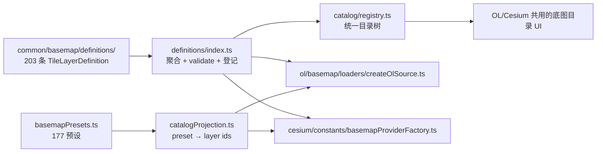

# 丰富底图源体系架构说明（V3.7.16 现状）

> 架构核对：2026-11-28 · V3.7.18（以当前代码为准；历史决策记录 `decisions/` 不改写；文中行号仅作导航，以符号名为准）。
>
> 本文描述**当前实现**。V3.7.16 之前「OL 定义 + `basemapConfig.ts` 门面 + Cesium 描述符派生」的历史实现已整体删除；历史脉络见 [`decisions/2026-08-02-basemap-ssot-refactor.md`](decisions/2026-08-02-basemap-ssot-refactor.md) 与 [`basemap-catalog-redesign.md`](basemap-catalog-redesign.md)。

日期：2026-07-21（初稿）；2026-11-28 按 V3.7.16 代码全量重写。

## 1. 功能定位

为 WebGIS 提供 **203 条统一图层定义 / 182 个预设**，覆盖天地图、高德、Google、Bing、Mapbox、MapTiler、CARTO、ESRI、OSM、USGS、NASA、OpenSeaMap、OpenRailwayMap、腾讯、GeoQ、MFF、图新、MineMap、Wayback 历史影像等，并支持自定义 XYZ。

核心目标：**一次定义，双引擎消费**。定义层零引擎依赖，OL 与 Cesium 各自通过适配器把同一条定义转成引擎源。

CARTO Basemaps 已按官方文档接入 **7 种栅格 PNG + 6 种 MapLibre 矢量样式**：栅格 URL 与矢量 `styleUrl` 均带 `?key=`；6 条矢量定义使用官方 tileJSON 解析出的版本化 MVT 模板 `.../v/20261118-01/.../{z}/{x}/{y}.mvt?key=…`，仅 OL 支持（`engines:['ol']`）。key 明文方案遵循用户确认与 MapTiler 既有惯例，实际滥用控制依赖 CARTO dashboard 域名限制。

## 2. 当前文件结构（SSOT）

| 路径 | 职责 |
|---|---|
| `common/basemap/definitions/category-*.ts` | **图层定义 SSOT**（203 条）：原始 URL + `method` / `correction` / `proxy` / `engines` / `zBand` / `nonStandardAdapter` 等声明 |
| `common/basemap/definitions/types.ts` | `TileLayerDefinition`、`TileLoadMethod`、`CoordCorrection`、`ProxyMode`、`TileLayerContext` |
| `common/basemap/definitions/resolveTileUrl.ts` | 纯函数：`{s}` / `{tk}` 等占位符替换 + 纠偏/直通 URL 拼装，零 `publicRuntime` 依赖 |
| `common/basemap/definitions/validate.ts` | 启动校验：id/order 唯一、order 连续 1..203、`correction→coord` 不变量 |
| `common/basemap/definitions/index.ts` | 聚合 `TILE_LAYER_DEFINITIONS`，登记到 `catalog/layers` |
| `common/basemap/catalog/` | 目录元数据：`taxonomy`（分类/服务商/坐标排序）、`registry`（目录树）、`layers`（id→definition） |
| `common/basemap/basemapPresets.ts` | 182 个预设 + `URL_LAYER_OPTIONS`（URL `l` 参数的 1-based 编号） |
| `common/basemap/catalogProjection.ts` / `comboBasemaps.ts` | 预设→图层 id 解析、组合条目判定 |
| `ol/basemap/loaders/createOlSource.ts` | OL 适配器：XYZ / WMTS / WMS / MVT / OSM / MFF / Bing quadkey |
| `ol/basemap/loaders/nonStandardAdapters.ts` | 非标准 URL 适配器注册表（MFF、Bing a/r/h） |
| `ol/tile-source/tileLifecycle.ts` | 单瓦片 `fetch` + AbortController + 超时中断 + 可选备用服务切换 |
| `ol/basemap/resilience/useBasemapResilience.ts` | 切换验证、加载监测与异常通知；不再做自动降级 |
| `cesium/constants/basemapProviderFactory.ts` | Cesium 适配器：`UrlTemplateImageryProvider` / WMS / WMTS / OSM，统一包装 fetch 中断 |
| `frontend/scripts/check-*.mjs` | 预设、定义、迁移三项门禁 |

已删除且**不再是 SSOT**：`ol/basemap/constants/basemapConfig.ts`、`basemapCore.ts`、`definitions/group-1.ts`~`group-4.ts`、`sourceDescriptors.ts`。

## 3. 双引擎数据流

定义只描述「是什么」，不含任何 `ol` / `cesium` import；引擎差异收敛在两个 loader。Bing 使用 quadkey，目前只有 OL 适配器，故三条 Bing 定义标 `engines:['ol']`。

## 4. 预设栈与编号

`basemapPresets.ts` 数组顺序即 URL `l` 参数编号（1-based）。编号冻结约束：首两个锚点 `local_tiles_preset` / `custom` 不变；新增预设只能追加到末尾。`check-basemap-catalog.mjs` 用数量下界 + 首部锚点守护，追加预设无需改门禁。

## 5. 请求生命周期与容错

1. `prioritizeTileSourceRequest` 包装 source 的 `tileLoadFunction`，改为 `fetch()` + Blob URL，绑定 source 级 AbortController 与单瓦片超时。
2. 切图/换源时 `epoch++` + `controller.abort()` + 缓存 tile 标错 + `source.clear()` 四层释放。
3. OSM 直连拦截时先尝试德国社区镜像；这是图源策略，不是服务切换。
4. `VITE_TILE_AUTO_PROXY_ENABLED=0`（默认）：直连失败/超时**不再自动切换**备用服务；`VITE_TILE_PROXY_MODE=always` 的显式全量模式与定义里的 `correction` / `proxy:'proxy'` 不受影响。

纠偏/直通 URL 由 `resolveTileUrl.ts` 统一拼装；服务端的逐瓦片重采样与 Grid 对齐见 [`tile-rectify-system.md`](tile-rectify-system.md)。

## 6. 运行时 token

天地图定义写 `{tiandituTk}` 占位符并声明 `needsContext:['tiandituTk']`，由 `resolveTileUrl` 在加载时注入；token 池来自 `/api/runtime-config/map-tokens`。细节见 [`runtime-map-token-pool.md`](runtime-map-token-pool.md)。

## 7. 扩展新图源

1. 在对应 `category-*.ts` 增加一条定义（id 唯一、order 追加在当前最大值后并全量重排连续）。
2. 如需非标准 URL，在 `nonStandardAdapters.ts` 注册适配器；若仅 OL 可用，写 `engines:['ol']`。
3. 在 `basemapPresets.ts` 末尾追加预设，保持编号只增不改。
4. 运行 `npm run check:layer-definitions` + `npm run check:basemap-catalog`；order 不连续、id 重复、枚举值非法、重复 payload 会直接失败。

## 8. 门禁

| 脚本 | 校验 |
|---|---|
| `check-layer-definitions.mjs` | 203 定义、order 唯一且连续、id 唯一、`correction→coord`、枚举值、同 URL 重复 payload、preset stack 可解析 |
| `check-basemap-catalog.mjs` | 预设数量下界 177、首部锚点、AMAP/Google 组合数量、精选清单可解析 |
| `check-basemap-migration.mjs` | HEAD 与当前定义数一致时逐字段等价；基线不一致显式 NOT RUN（退出码 2） |

## 9. 风险与边界

- Bing quadkey 仅 OL 支持，Cesium 目录会显示但不加载。
- NASA MODIS 使用固定日期 `2026-11-20`；如需近实时需扩展日期占位符。
- 模板中的服务基址为公开 URL，不属于密钥；鉴权 token 由用户中心配置并走后端下发。
