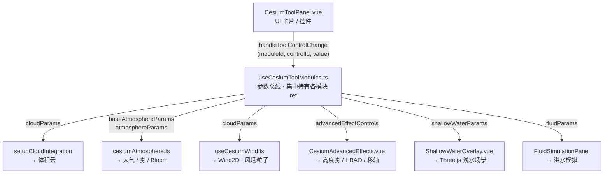
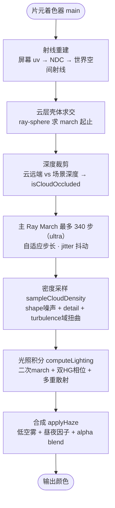
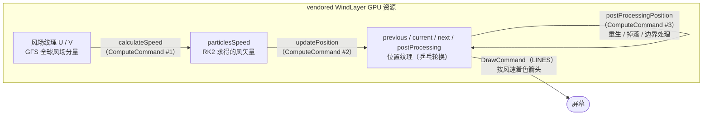

# Cesium 三维特效架构说明
> 架构核对：2026-11-28 · V3.7.18（以当前代码为准；历史决策记录 `decisions/` 不改写；文中行号仅作导航，以符号名为准）。

日期：2026-07-21

适用范围：`frontend/src/domains/cesium/` 下的三维特效相关模块，包括 `modules/cloud/`（体积云）、`modules/wind/Wind2D.ts` + `modules/wind/useCesiumWind.ts`（风场粒子，内置 vendored `index.mjs` 的 `WindLayer`）、`composables/scene/cesiumAtmosphere.ts` + `composables/scene/useCesiumBeautify.ts` + `components/CesiumAdvancedEffects.vue`（大气与后处理），以及集成入口 `composables/toolModules/useCesiumToolModules.ts` / `components/CesiumToolPanel.vue` / `components/CesiumContainer.vue`。

本文是长期参考文档，说明 WebGIS 3.0 中"三维特效"功能的实现原理、文件组织、GPU 渲染管线与参数集成机制，供后续维护、调参与算法升级时对照。洪水淹没模拟（`FluidSimulation/`）已有独立文档 [`cesium-fluid-flood-simulation.md`](./cesium-fluid-flood-simulation.md)，本文只在 §10 说明它与本组特效的关系，不再展开。

> **⚠️ 准确性声明（务必先读）**
>
> **本文以当前工作区代码的真实实现为准，版本信息以[根 README](../../README.md)为唯一真相源。** 根 README 的"版本记录"中描述的部分三维特效已被删除或替换，**当前代码中并不存在**，包括但不限于：
>
> - **独立 TAAU 时序抗锯齿 / 16x 时序上采样模块**（`useCesiumTemporalUpsampling.js`）——已不存在；但体积云管线自带 `history` 纹理 + `u_prevViewProjection` 重投影与 `temporalEnabled` 开关（见 §5.5），并非完全没有时序处理；
> - **独立 `shadowResolveShaders.js` 文件**——已不存在；等价能力并入 `Cloud/lib/ShadowResolvePass.ts`（BSM atlas + depth-velocity atlas 的 variance clipping + temporalAlpha 解析，见 §5.5）；
> - **大气散射 LUT 纹理集成**（`atmosphereLutResources.js` 及 `atmosphere/` 目录 14 个文件）——已整体删除；
> - **wind-core 风场 TS 模块**（10 个 TS 源文件、`useWindLayer` / `windLayerController` / `windSampleData`）——`wind-core/` 目录已不存在；其 GPU 能力现由 `wind/index.mjs`（内置 vendored `WindLayer`）就地提供：3 个 `ComputeCommand` + `DrawCommand` + `calculateSpeedByRungeKutta2`。
>
> 上述功能的现状详见 §2「README 描述与代码现状差异」。下文凡描述"实现"之处，均指当前真实存在的代码；凡涉及已删除功能，都会显式标注。

## 1. 功能定位

"三维特效"是 Cesium 三维视图下的一组**视觉增强模块**，由统一的工具面板（`CesiumToolPanel.vue`）开关与调参。当前真实存在的特效分为五类：

1. **体积云**（`Cloud/`）：基于 `PostProcessStage` 的屏幕空间 ray marching 体积云，Frostbite 风格的密度采样 + 光照积分，支持三档质量预设（smooth / balanced / ultra）。
2. **风场粒子**（`Wind2D.ts` + 内置 `index.mjs`）：`Wind2D.ts` 只是对 vendored `WindLayer` 的薄包装；真正的 WebGL2 GPU 管线在 `modules/wind/index.mjs` 内：3 个 `ComputeCommand`（速度计算 / 位置更新 / 后处理）+ 1 个 `DrawCommand`（按风速着色绘制箭头/线段），粒子推进用 `calculateSpeedByRungeKutta2`（二阶 Runge-Kutta）。
3. **热带浅水**（`ShallowWater/`）：一套**独立的 Three.js 渲染场景**，以透明叠加层形式盖在 Cesium canvas 之上（含水面折射/反射、焦散、天空、云穹、闪电），属于演示性场景而非 Cesium 原生特效。
4. **地形提供者**（`providers/terrain/`）：天地图高度图地形、ArcGIS 地形增强包装器及配套解码 worker；`util.ts` 仅残留一个无引用的 `loadProto`（死代码）。
5. **大气与后处理**（`composables/scene/cesiumAtmosphere.ts`、`composables/scene/useCesiumBeautify.ts`、`CesiumAdvancedEffects.vue`）：调用 **Cesium 原生** `SkyAtmosphere` / 雾 / Bloom 并调参，外加自定义的高度雾、HBAO、移轴模糊后处理级。

**重要边界**：除体积云与洪水模拟外，本组特效均为**视觉近似**而非物理求解器。风场粒子是运动学平流（虽用 RK2 求速度，但无动力学方程），热带浅水是离线渲染场景（不求解浅水方程），大气效果复用 Cesium 内置模型（无自研散射 LUT）。各模块的精度边界见 §11。

## 2. README 描述与代码现状差异

本节如实列出[根 README](../../README.md)「版本记录」中提及、但**经逐一核实当前代码已不存在或已换形**的内容，避免按 README 误判现有实现。核实方式为对 `frontend/src` 全量文件名检索与关键字检索；表中「出处」列统一指向版本记录的唯一真相源。

| README 描述 | 出处 | 当前代码现状（已核实） |
|------|------|------|
| TAAU 16x 时序上采样、方差裁剪、速度重投影、STBN 蓝噪声（`useCesiumTemporalUpsampling.js`） | [根 README](../../README.md) | **独立模块不存在**。全库无此文件；场景级抗锯齿仅 **FXAA**（见 §9.2 `useCesiumBeautify.ts`）。但体积云内部自带 `history` 纹理与 `u_prevViewProjection` 重投影、`temporalEnabled` 开关（见 §5.5），三档预设当前均关闭 temporal。 |
| BSM Shadow TAA 时序抗锯齿（`shadowResolveShaders.js`） | [根 README](../../README.md) | **独立文件不存在**。等价能力已并入 `Cloud/lib/ShadowResolvePass.ts`（418 行）：BSM atlas + depth-velocity atlas → variance clipping + temporalAlpha 解析，含 history 重投影；三档预设 `shadowResolveEnabled` 均为 true（见 §5.5）。 |
| 大气散射 LUT 纹理集成（`atmosphereLutResources.js`、大气透视合成、天空辐照度计算） | [根 README](../../README.md) | **不存在**。无 `atmosphereLut` 引用；当前大气为 **Cesium 原生 `SkyAtmosphere`** 调参（见 §9.1）。 |
| wind-core 目录：10 个核心 TS 源文件、`useWindLayer` / `windLayerController` / `windSampleData` | [根 README](../../README.md) | **`wind-core/` 目录已不存在**。其原承担的 GPU 能力现由 `modules/wind/index.mjs`（vendored `WindLayer`）就地提供：3 个 `ComputeCommand` + `DrawCommand` + `calculateSpeedByRungeKutta2`；`Wind2D.ts` 是其薄包装（见 §6）。 |
| `cesium-wind-layer` npm 依赖 | [根 README](../../README.md) | **不作为外部依赖存在**：WindLayer 以 `index.mjs` 形式 vendored 在 `modules/wind/` 内（源码注释仍沿用旧名 `cesium-wind-layer`）。风场入口为 `modules/wind/useCesiumWind.ts`。 |
| 旧 `Clouds/` 目录（12 文件） | [根 README](../../README.md) | **不存在**。已被 TypeScript 重写的 `Cloud/` 模块取代（见 §5）。 |

**保留至今的历史结论**：[根 README](../../README.md)中「删除 atmosphere 目录 + 旧 Clouds/ 目录、新增 `useCesiumBeautify.ts` / `ShallowWater/` / 大气高度阈值」「`ArcGISTerrainProvider` 增强包装器」「体积云独立模块 `Cloud/`（TypeScript 重构）」等记录均与当前代码一致。

> 一句话总结：**当前没有独立 TAAU 模块、没有独立 `shadowResolveShaders.js`、没有自研大气散射 LUT、没有 wind-core 目录**；场景抗锯齿=FXAA，体积云内部含 shadowResolve + history 重投影管线（三档预设仅 shadowResolve 开启、temporal 关闭），大气=Cesium 原生 SkyAtmosphere，风场=`Wind2D.ts` 薄包装 vendored `WindLayer`（3 ComputeCommand + DrawCommand + RK2）。

## 3. 文件结构

下表仅列出**当前真实存在**且与三维特效直接相关的文件（行数为近似值）。

| 文件 | 职责 |
|------|------|
| `modules/cloud/index.ts` | 体积云模块统一导出 |
| `modules/cloud/cloudParamsApply.ts` | 体积云参数应用：桥接参数到 uniform |
| `modules/cloud/cloudQualityPresets.ts` | 三档质量预设（smooth/balanced/ultra）：迭代数、步长、多散射阶数、阴影/TAA 开关 |
| `modules/cloud/setupCloudIntegration.ts` | 集成桥接：将 `cloudParams`/`atmosphereParams` watcher 接到云管理器；lil-gui 参数定义 |
| `modules/cloud/assetConfig.ts` | 体积云纹理资产路径配置 |
| `modules/cloud/lib/` | 体积云核心库：ThreeGeospatial 大气管线、`ShadowResolvePass.ts`、`cloudFragmentShader.ts`（内含 `getCloudFragmentShader()`）、着色器加载等 |
| `modules/wind/index.mjs` | vendored `WindLayer`：3 个 `ComputeCommand`（calculateSpeed / updatePosition / postProcessingPosition）+ `DrawCommand` 箭头绘制 + `calculateSpeedByRungeKutta2` |
| `modules/wind/Wind2D.ts` | 风场粒子主类：对 `WindLayer`（`index.mjs`）的薄包装（约 105 行），负责默认参数、粒子数钳制与 show/flyTo/destroy 转发 |
| `modules/wind/useCesiumWind.ts` | 风场 Composable：按需 `fetch('./json/wind_globe.json')` + `normalizeWindData()`，创建/销毁 `Wind2D` |
| `composables/scene/cesiumAtmosphere.ts` | 配置 Cesium 原生大气/雾/光照/Bloom，并提供状态快照与恢复 |
| `composables/scene/useCesiumBeautify.ts` | 场景美化：HDR + PBR 色调映射 + FXAA + 定向光 + 天空微调 + 分辨率缩放 |
| `components/CesiumAdvancedEffects.vue` | "Cinematic FX" 面板：高度雾 / HBAO / 移轴 / 大气+Bloom 四个后处理开关 + FPS 图表 |
| `composables/toolModules/useCesiumToolModules.ts` | 特效参数总线：集中管理各模块响应式参数与控件定义（约 238 行） |
| `components/CesiumToolPanel.vue` | 工具面板 UI：模块卡片 + 控件渲染（约 2703 行） |
| `components/CesiumContainer.vue` | 容器组件：装配上述所有模块、watcher 与清理逻辑 |

## 4. 集成与参数总线

三维特效不是孤立组件，而是通过一条统一的参数链路装配进 Cesium 视图：

参数状态由 `composables/toolModules/fxState.ts` 集中持有（`useCesiumToolModules.ts` 负责装配与路由）。关键参数对象（默认值见 `fxState.ts`）：

- `advancedEffectControls`：`{ fog, hbao, tiltShift, atmosphere }`，**全部默认关闭**。
- `baseAtmosphereParams`：晨昏半球相关（`enableLighting` / `showGroundAtmosphere` / 太阳/月亮/星空盒显示 / 大气强度与色相偏移 / 雾参数）。
- `atmosphereParams`：Tellux 风格日夜/月光/星空参数（`dayNightEnabled` / `moonLightIntensity` / `ambientIntensity` / `starsIntensity`）。
- `cloudParams`：体积云开关与全部散射/密度/雾/几何参数（`cloudsEnabled` 默认 `false`）。
- `shallowWaterVisible` + `shallowWaterParams`：浅水场景开关与太阳角度/清澈度/焦散/浪高/反射/云量/闪电参数。

体积云由 `composables/core/useCesiumBootstrap.ts` 调用 `setupCloudIntegration` 桥接；大气通过 `applyBaseAtmosphereParams` / `applyAtmosphereParams` 双函数管理（注释明确说明二者分工以避免"双写冲突"）。

## 5. 体积云（Cloud/）：PostProcessStage Ray Marching

### 5.1 总体方案

体积云是一个 **全屏后处理级**（`Cesium.PostProcessStage`），片元着色器由 `Cloud/lib/cloudFragmentShader.ts` 的 `getCloudFragmentShader()`（TS 文件内嵌 GLSL 模板，约 823 行）提供，实现完整的 Frostbite 风格体积云渲染。后处理 stage 由 `Cloud/lib/createCloudAtmosphere.ts` 经 `ThreeGeospatialPipeline._createCloudStage()` 创建：非分离模式返回一个 `PostProcessStage`，分离模式返回 `PostProcessStageComposite`（rayStage + composeStage）；创建后按 `cloudsEnabled` 控制 `enabled`。全库无 `CloudManager` 类，也没有 1×1 fallback 纹理逻辑（`ThreeGeospatialPipeline.ts:1183-1214`）。

着色器所需的相机位置、逆投影/逆视图矩阵、太阳方向、椭球半径等由 `ThreeGeospatialPipeline` 的 uniform 表每帧同步注入；运行时切换质量预设会重建 stage（同文件 `:1216` 起）。

### 5.2 渲染流程（getCloudFragmentShader() `main`）

1. **射线重建**：从屏幕 `v_textureCoordinates` 还原 NDC，经 `u_inverseProjection` / `u_inverseView` 重建世界空间射线方向。
2. **云层壳体求交**：`getCloudLayerIntersections` 把云层当作 `ellipsoidRadii + [minHeight, maxHeight]` 的**球壳**，按相机在云底之下/云顶之上/云层之中三种情况求 ray-sphere 交点，确定 march 起止距离。
3. **深度裁剪**：读取 `depthTexture`，将云远端点投影到 clip space 与场景深度比较（`isCloudOccluded`，针对 Cesium 反向对数深度做了处理），云被地形/几何完全遮挡时直接跳过。
4. **主 Ray March**（`marchClouds`，最多 340 步 / ultra，smooth 为 144、balanced 为 220）：自适应步长——云内缩小步长（`*0.8`）、空区域按 `perspectiveStepScale` 递增、云层外大步长跳过；透射率低于 `minTransmittance` 早停；含基于屏幕坐标的 jitter 抖动。
5. **合成**：`applyHaze` 叠加低空解析雾，乘昼夜因子后以 alpha blend 输出。

### 5.3 密度模型（sampleCloudDensity）

密度 = 天气覆盖率 × 高度密度剖面（`cloudDensityProfile`，含底部增强、顶部侵蚀、中部隆起），再经：

- **Shape 噪声**（`uniform sampler3D u_shapeTexture`）侵蚀基础密度；
- **Shape Detail**（`uniform sampler3D u_shapeDetailTexture`，按高度混合）补充高频细节；
- **Turbulence 域扭曲**（`uniform sampler2D u_turbulenceTexture` 偏移采样位置）；
- **STBN 蓝噪声**（`uniform sampler3D u_stbnTexture`）与 `u_blueNoise` 用于抖动采样。

**当前着色器直接以 WebGL2 `sampler3D` 采样 3D 体积纹理**（`cloudFragmentShader.ts:20-24`），不存在 `sample3DAs2D` 的 2D 重映射路径，也没有 Perlin/FBM 程序化噪声降级——要出云必须加载对应纹理资产。此外着色器声明了 `u_historyTexture` / `u_prevViewProjection` / `u_temporalEnabled`（`cloudFragmentShader.ts:121-125`），在合成阶段做云增量的历史重投影（见 §5.5）。

### 5.4 光照模型（computeLighting）

- 向太阳方向做**二次 ray march** 累积光学厚度（`maxIterationCountToSun`，步长倍增）；
- **双 Henyey-Greenstein 相位函数**混合（前向 `g1` + 后向 `g2`）；
- **多重散射近似**（`approximateMultipleScattering`，按 `multiScatteringOctaves` 阶数迭代）；
- 天空光梯度 + 地面反弹光 + **Powder 效应**（`1 - powderScale·exp(-extinction·150)`）；
- 夜间光照：按 `dayLightFactor` 混入月光 + 环境光（`nightColor`）。

主循环用 **Frostbite 能量守恒积分**：`scatteringIntegral = (radiance - radiance·transmittance) / extinction`，逐段累积辐射度并衰减透射率。

### 5.5 质量预设（cloudQualityPresets.ts）

三档预设 smooth / balanced / ultra，默认 `smooth`（`DEFAULT_CLOUD_QUALITY`，:224）。下表取自 `CLOUD_QUALITY_PRESETS`（smooth :19 / balanced :94 / ultra :160）：

| 预设 | maxSteps | min/maxStepSize | 多重散射阶 | maxStepsToSun | cloudResolutionScale | shadowResolve / temporal |
|------|------|------|------|------|------|------|
| smooth（默认） | 144 | 85 / 1200 | 1 | 3 | 0.67 | true / false |
| balanced | 220 | 60 / 1100 | 2 | 5 | 0.85 | true / false |
| ultra | 340 | 45 / 1100 | 6 | 6 | 1.0 | true / false |

**阴影解析与时间域**：三档 `shadowResolveEnabled` 均为 true、`temporalEnabled` 均为 false。`Cloud/lib/ShadowResolvePass.ts`（418 行）把 BSM atlas + depth-velocity atlas 经 variance clipping + temporalAlpha 解析为时序稳定的阴影；`cloudFragmentShader.ts` 的 `u_historyTexture` / `u_prevViewProjection` / `u_temporalEnabled`（:121-125、:774-800）实现云增量的历史重投影与有效性判定（当前三档预设均关闭 temporal）。

### 5.6 参数桥接

`setupCloudIntegration.ts` 的 `setupCloudIntegration` 用 `ensurePipeline()` 保证**单实例**（Promise 复用、幂等）：首次启用时动态 import `createCloudAtmosphere` 创建管线；参数变化由 `cloudParamsApply.ts` 的 `applyCloudPanelParams` 写入 `pipeline.params` 与三层云 layers（面板字段如 `layer0Altitude` / `layer0Coverage` 按层号映射），并在 deep watch 中经下一帧 rAF 合并应用以降低主线程抖动。`atmosphereParams` 形参仅保留兼容、当前不直接使用（不消费夜间光照映射）。调用点在 `composables/core/useCesiumBootstrap.ts:387`；不存在 `useVolumetricCloud.ts` 等价桥接。

## 6. 风场粒子（Wind2D.ts + vendored WindLayer）：3 ComputeCommand + RK2

### 6.1 总体方案

风场由两层构成：`modules/wind/Wind2D.ts`（约 105 行）是对 vendored `WindLayer`（`modules/wind/index.mjs`）的**薄包装**，只负责默认参数、粒子数钳制（16~512）与 `show` / `flyTo` / `updateOptions` / `destroy` 的转发；真正的 WebGL2 GPU 管线全部在 `index.mjs` 中。它包含 3 个 `ComputeCommand`（calculateSpeed / updatePosition / postProcessingPosition）与 1 个 `DrawCommand`（粒子线段绘制），粒子速度由 `calculateSpeedByRungeKutta2` 以**二阶 Runge-Kutta**求得。这与已不存在的旧 wind-core 是同一类能力，但这里是 vendored 在目录内的实现，不是外部 npm 依赖（见 §2）。

### 6.2 数据组织：GFS wind_globe.json 的 U/V 双纹理

`useCesiumWind.ts` 按需 `fetch('./json/wind_globe.json')`（GFS 全球风场 U/V 分量），由 `normalizeWindData()`（`useCesiumWind.ts:146-167`）把 `raw[0]` / `raw[1]` 的 `data` 与 `header.min/max/extent/nx/ny` 归一化为 `WindData`：`{ u, v, bounds: { west, south, east, north }, width, height }`。`WindLayer` 再把 U/V 上传为两张浮点纹理并按经纬度范围采样；`processWindData` 按 `max(|min|, |max|)` 把分量缩放到 [-1,1]。

### 6.3 粒子状态：五张纹理乒乓

`index.mjs` 创建 5 张 `particlesTextureSize²` 的浮点纹理：

粒子数量 = `particlesTextureSize²`（默认 256²，钳制 16~512），避免超大纹理拖垮帧率。

### 6.4 计算 pass：RK2 速度求解与位置推进

`calculateSpeed` 的片元着色器以 `calculateSpeedByRungeKutta2(lonLat)` 在 U/V 纹理上做二阶 Runge-Kutta 采样（而非一阶 Euler），叠加 `frameRateAdjustment` 后写入 `particlesSpeed`。`updatePosition` 用当前位置 + 速度推进到 `nextParticlesPosition`；`postProcessingPosition` 按 `dropRate` / `dropRateBump` 与视野范围处理重生、掉落与环绕，结果写回 `postProcessingPosition`，并在 `preExecute` 中轮换 ping/pong 指针。

### 6.5 绘制 pass（DrawCommand）

`WindParticlesRendering` 用 `LINES` 图元绘制箭头/线段，按 `speedRange` 归一化速度经色带着色（`WIND_COLORS`：青 → 绿 → 黄 → 橙 → 红）。更新阶段用的是 `Cesium.ComputeCommand`（3 个），绘制阶段用 `DrawCommand`；`Wind2D.ts` 的 `flyTo` 转发到 `WindLayer.zoomTo()`。

### 6.6 每帧驱动与封装

`useCesiumWind.ts` 负责按需创建/销毁 `Wind2D`：`loadWindFromGlobe()` 在 viewer 就绪且用户启用时 fetch + normalize + 创建实例，并 `acquireContinuous` 声明连续渲染（风场 compute pass 逐帧执行）；`clearWind2D()` 销毁实例并 `releaseContinuous`。暴露的面板参数为 `particlesTextureSize` / `particleHeight` / `lineWidthVal` / `lineLengthVal` / `speedFactor` / `dropRate` / `dropRateBump` / `dynamic`，经 `updateOptions()` 动态下发。不存在 `generateSimulatedWindData` 模拟数据生成器，也不存在 `arrowLength` / `trailLength` / `alphaFactor` 滑块（均为旧实现遗留描述）。

## 7. 热带浅水（ShallowWater/）：Three.js 叠加场景

### 7.1 技术栈定位（重要）

`ShallowWater` **不是 Cesium 原生特效，也不求解浅水方程**。它是一套**独立的 Three.js（`three@^0.186.1`，见 `frontend/package.json:50`）渲染场景**：`useShallowWater.ts` 创建一个 `alpha:true` 的 `WebGLRenderer`，其 canvas 由 `ShallowWaterOverlay.vue` 以绝对定位、`z-index:2` 盖在 Cesium canvas 之上，用透明背景与 Cesium 视图"视觉融合"。它是一个自包含的热带浅水**演示场景**（有自己的相机、`OrbitControls`、键盘漫游、动画循环），与 Cesium 的相机/坐标系**不联动**。

### 7.2 场景构成

- **天空**：Three.js `Sky`（turbidity/rayleigh/mie 参数）+ `PMREMGenerator` 生成环境贴图；
- **水面**：`PlaneGeometry(16000×16000, 384×384)` + 自定义 `ShaderMaterial`（`waterSurface.glsl`），uniform 含折射 RT、深度纹理、立方体环境 RT、法线图、吸收系数、清晰度、浪高、泡沫、反射强度；
- **折射/反射**：每帧先隐藏水面/云穹/闪电，把场景渲染到 `refractionRT`（带 `DepthTexture`）做折射；`CubeCamera` + `cubeRT` 做环境反射；
- **海床与岩石**：程序化起伏的沙地平面（`makeSandTexture`）+ 30 个随机十二面体岩石，均通过 `addCaustics` 注入**焦散**效果（`caustics.glsl`，`uTime`/`uCaustic` 驱动）；
- **云穹**：`SphereGeometry(8000)` 背面渲染的程序化云着色器（`clouds.glsl`，`uCoverage` 控制云量）；
- **闪电**：`TubeGeometry` 沿随机折线生成主干+分支，加性混合，按指数衰减闪烁并瞬时抬升 `toneMappingExposure`。

### 7.3 参数与生命周期

`ShallowWaterOverlay.vue` 接收 `visible` 与 11 个参数 props（太阳高度/方位角、清澈度、焦散强度、水色、浪高、泡沫宽度、反射强度、云量、闪电开关/间隔），watch 后调用 `updateParams` 同步到 Three.js uniform。`visible` 为 true 时 `init + start`，false 时 `pause`；组件卸载时 `dispose` 释放全部 geometry/material/RT。

## 8. 地形提供者（providers/terrain/）

### 8.1 GeoTerrainProvider.ts — 天地图高度图地形

工厂函数 `createGeoTerrainProvider(Cesium)` 返回一个继承自 `CustomHeightmapTerrainProvider` 的类（64×64 网格）：

- `requestTileGeometry` 按层级请求：`level < _topLevel(5)` 返回平坦默认高度缓冲；`level >= _bottomLevel(11)` 拒绝；中间层级从 `{url}`（支持 `{s}` 子域、`{token}`、`{x}{y}{z}`，注意请求层级为 `level+1`）取 ArrayBuffer，**经 pako `inflate` 解压**后转高度图；
- `_transformBuffer` 把 150×150 源网格重采样到 64×64，按 `dataType`（int16/float）解码高程，越界值（>10000 或 <-2000）置 0，再按 `terrainDataStructure`（`heightScale:0.001`、`heightOffset:-1000`、大端、3 元素/高度）编码为 RGBA；
- 提供 `availability`（`TileAvailability`）与 `getTileDataAvailable`，并维护 `_getChildTileMask` 子瓦片掩码。

### 8.2 ArcGISTerrainProvider.ts — ArcGIS 地形增强包装器

`ArcGISTiledElevationTerrainProvider` 原生不暴露 `availability` / `getTileDataAvailable`，导致 `sampleTerrainMostDetailed` 只能查到最低精度。本包装器参照天地图模式补这两个接口：构造 `TileAvailability` 并**逐级标记全球瓦片范围为可用**（`2^level` 网格），其余方法全部委托内部 provider。`fromUrl(url)` 工厂返回增强实例。这一能力是洪水模拟地形采样（见独立文档 §6）正确取到最高精度的前提。引入版本见[根 README](../../README.md)。

### 8.3 残留死代码

`providers/terrain/util.ts` 仅 5 行，只导出一个 `loadProto(schema)`；全库无任何引用（无调用方）。全库检索不存在 `GeoWTFS` / `PBPOITile` 相关文件与引用，原「POI 注记矢量瓦片图层」段落已删除。同目录另有 `geoTerrainDecode.worker.ts` / `lercDecode.worker.ts` / `decodeWorkerPool.ts` 负责地形解码。

## 9. 大气与后处理

### 9.1 cesiumAtmosphere.ts — Cesium 原生大气调参（非自研 LUT）

`configureRealisticAtmosphere(viewer, Cesium)` 配置的是 **Cesium 内置大气模型**，而非自研散射 LUT（README 的 LUT 集成已删除，见 §2）：

- `globe`：开启 `enableLighting` / `showGroundAtmosphere` / 动态大气光照，设置 Rayleigh/Mie 系数（`atmosphereRayleighCoefficient` = (5.5,13.0,28.4)e-6、`atmosphereMieCoefficient` = 21e-6）、尺度高度（Rayleigh 10000、Mie 3200）、Mie 各向异性 0.92、晨昏淡入淡出距离；
- `skyAtmosphere`：`perFragmentAtmosphere` + 色相/饱和/亮度偏移 + 同样的散射系数；
- 场景雾 `scene.fog`（density 0.00012 等）、`SunLight`（intensity 2.35）、Bloom（contrast/brightness/delta/sigma/stepSize）、太阳/月亮/星空盒显示、HDR。

`captureRealisticAtmosphereState` / `restoreRealisticAtmosphere` 提供完整状态快照与恢复（含 Cartesian3 序列化），确保大气增强不永久污染场景。

### 9.2 useCesiumBeautify.ts — 场景美化

`applyBeautify(params)` 提供：HDR 开关 + 曝光、`Tonemapper.PBR_NEUTRAL` 色调映射（Cesium 1.104+，旧版降级）、`DirectionalLight`/`SunLight` 切换与光强、`skyAtmosphere` 亮度/饱和/色相偏移、**FXAA 抗锯齿**（`postProcessStages.fxaa.enabled`）、`depthTestAgainstTerrain`、设备像素比缩放。`restoreDefaults` 用首次 `captureState` 的快照还原。**场景级抗锯齿方案就是这里的 FXAA**；独立的 TAAU 模块已不存在，但体积云管线自身含 `ShadowResolvePass` 与 `history` 重投影（三档预设仅 shadowResolve 开启，见 §5.5）。

### 9.3 CesiumAdvancedEffects.vue — Cinematic FX 面板

提供四个后处理开关（默认全关），并在 `preRender` 中按相机高度/俯仰角动态调参：

| 开关 | 实现 | 说明 |
|------|------|------|
| Height Fog（高度雾） | 自定义 `PostProcessStage` | 由 `czm_readDepth` + `czm_windowToEyeCoordinates` 还原线性深度，`1-exp(-depth·density)` 指数雾，`cameraHeightFactor` 随相机高度调节密度 |
| HBAO（微阴影） | Cesium `ambientOcclusion` 级（或 `PostProcessStageLibrary.createAmbientOcclusionStage`） | 环境光遮蔽，调 intensity/bias/lengthCap/stepSize/frustumLength |
| Tilt Shift（移轴） | 自定义 `PostProcessStage` | 按 `uv.y` 与焦点距离做 7-tap 横向模糊，俯仰角 `> -0.62` 时随角度增强 |
| Atmosphere + Bloom | 调用 §9.1 `configureRealisticAtmosphere` | 相机高度 ≥ 80000m 才启用，低于阈值自动恢复，避免与晨昏半球冲突 |

面板还内置渲染错误守卫（`scene.renderError` → 自动降级关闭全部特效并提示）与一个 ECharts 实时图表（相机高度/俯仰角/FPS）。

## 10. 与洪水模拟的关系

`FluidSimulation/`（洪水淹没模拟）在 UI 上与本组特效同属工具面板的一个模块，但算法与渲染管线完全独立，详见 [`cesium-fluid-flood-simulation.md`](./cesium-fluid-flood-simulation.md)。需要特别强调的一点：

> **`FluidSimulation` 是本项目自研模块中唯一直接使用 `Cesium.ComputeCommand` 的模块**（其 4 个全屏四边形计算 pass 用 ComputeCommand 做水深/流出场乒乓更新）。本组自研特效不直接使用 ComputeCommand：体积云用 `PostProcessStage`，浅水用独立的 Three.js 渲染器；风场虽经 `Wind2D.ts` 包装，但其 vendored `WindLayer`（`index.mjs`）内部确有 3 个 `ComputeCommand` + 1 个 `DrawCommand`（见 §6）。已删除的 wind-core 目录本身不再存在，但等价 GPU 计算能力由 vendored 实现就地保留（见 §2）。

## 11. 局限与升级方向

**现有局限：**

1. **抗锯齿能力有限**：场景级仅 FXAA（§9.2）；独立的 TAAU 模块已不存在，体积云虽内含 `ShadowResolvePass` 与 `history` 重投影，但三档预设均关闭 `temporalEnabled`（§5.5），低采样下 ray marching 与风场粒子仍可能闪烁，依赖 jitter 与 FXAA 缓解。
2. **大气为内置模型调参**：复用 Cesium `SkyAtmosphere`（§9.1），无自研散射 LUT，无法做自定义波长/气溶胶剖面或离线烘焙的高保真大气透视。
3. **风场为运动学平流**：vendored `WindLayer` 用 RK2 求速度（§6.4），无动力学方程，大步长下粒子轨迹精度仍有限；数据已接真实 GFS 风场（`wind_globe.json`，§6.2），但仅为全球 U/V 网格，非局地高分辨率数值预报。
4. **热带浅水与 Cesium 解耦**：`ShallowWater` 是独立 Three.js 场景（§7.1），与 Cesium 相机/坐标/地形不联动，仅做固定区域演示，且额外占用一套 WebGL 上下文与渲染开销。
5. **体积云为屏幕空间后处理**：ray marching 在全屏执行，高预设（ultra 340 步 + 多次二次 march）开销大；云与场景仅做端点深度遮挡判断（§5.2），未做逐样本深度合成，复杂几何穿插时可能有不精确遮挡。
6. **残留死代码**：`providers/terrain/util.ts` 的 `loadProto` 无任何引用（§8.3）；wind 目录 vendored 源码注释仍沿用旧名 `cesium-wind-layer`，易误导维护者。

**升级方向：**

1. **启用/重构时序抗锯齿**：体积云已有 `ShadowResolvePass` 与 `history` 重投影基础，可在评估稳定性后开启 `temporalEnabled`；如需场景级 TAAU，应基于当前 Cesium 版本实现速度缓冲与历史重投影，而非恢复已删除的旧模块。
2. **风场升级**：接入更高分辨率/局地数值风场替换全球 GFS 网格；如需更高轨迹精度可将 RK2 升为 RK4；vendored `WindLayer`（3 个 `ComputeCommand`）已是并行实现，如需进一步提分辨率可参考洪水模拟或改用 WebGPU Compute Shader。
3. **浅水与 Cesium 融合**：若需地理配准的浅水效果，可将 Three.js 场景相机与 Cesium 相机同步，或改用 Cesium 原生 `PostProcessStage`/自定义 Primitive 实现水面，避免双渲染器开销。
4. **大气保真**：如需工程级大气，可重新引入预计算散射 LUT（Bruneton 风格）并作为独立模块管理生命周期，注意与现有 `SkyAtmosphere` 调参路径避免双写。
5. **目录清理**：删除 `providers/terrain/util.ts` 无引用死代码；更新 vendored 源码注释中的旧模块名。

## 12. 关键事实速查

| 项 | 当前真实情况 |
|------|------|
| 体积云实现 | `PostProcessStage` ray marching（`Cloud/`，TS），`getCloudFragmentShader()` 约 823 行，三档质量预设（smooth/balanced/ultra） |
| 风场实现 | `Wind2D.ts`（约 105 行）薄包装 vendored `WindLayer`（`index.mjs`）：3 `ComputeCommand` + `DrawCommand` + RK2 |
| 风场数据 | `useCesiumWind.ts` 按需 `fetch('./json/wind_globe.json')` + `normalizeWindData()`（GFS U/V） |
| 热带浅水 | 独立 **Three.js** 叠加场景（`z-index:2`），非 Cesium 原生、非 SWE 求解 |
| 地形 | `providers/terrain/` 下天地图高度图 + ArcGIS 增强包装器 + 解码 worker；`util.ts` 为无引用死代码 |
| 大气 | Cesium 原生 `SkyAtmosphere` 调参（无自研 LUT） |
| 抗锯齿 | 场景级 **FXAA**；体积云内含 `ShadowResolvePass` + `history` 重投影（三档 temporal 关闭、shadowResolve 开启） |
| 后处理特效 | 高度雾 / HBAO / 移轴 / 大气+Bloom（`CesiumAdvancedEffects.vue`） |
| ComputeCommand 使用者 | `FluidSimulation`（自研）；风场 vendored `WindLayer` 内部另有 3 个 |
| 已删除（README 仍有描述） | 独立 TAAU 模块、`shadowResolveShaders.js`、大气散射 LUT、wind-core 目录、旧 `Clouds/` |
