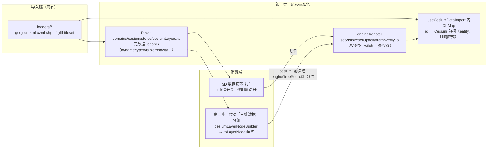

# Cesium 统一图层管理 — 设计文档

> 状态：**已实施（两步走全量落地，版本见[根 README](../../README.md)）**；决策点已拍板：分组内平铺、2D 模式隐藏（随容器清档自动实现）、
> 数据生命周期跟随容器（卸载即清档）；矢量透明度、属性表/样式/编辑/导出均已落地。实施日志：`Docs/LLM_record/26-07/2026-07-26/2026-07-26-cesium-unified-layer-mgmt-impl.md`
> 关联：[2D 图层体系 basemap-source-system.md](basemap-source-system.md) ·
> [多格式数据导入 multi-format-data-import.md](multi-format-data-import.md) ·
> 返回 [根 README](../../README.md)

---

## 1. 问题与背景

Cesium 侧导入的数据（GeoJSON/KML/CZML/SHP/TIF/GLB/3D Tiles）目前只活在
「3D 高级控制台 → 数据」页签的卡片列表里，能力止步于**定位/删除 + 少量类型特化**
（glTF 重定位、TIF 拉伸、tileset 高程/材质）。而 2D（OL）侧已有成熟的 TOC 图层目录
（树形分组、capabilities 驱动的可见/定位/删除/属性表/样式/导出/编辑）。

**割裂点**：3D 模式下侧栏 TOC 显示的仍是 2D 图层树，Cesium 数据不在其中——
用户需要在两个面板间跳转，且 3D 数据没有可见性开关与不透明度控制。

## 2. 现状盘点（代码坐标）

| 能力 | 2D（OL） | Cesium |
|------|----------|--------|
| 记录列表 | Pinia store + `layerTreeBuilder.toLayerNode` 节点契约 | `useCesiumDataImport.loadedDataSources`（组件内 ref） |
| 树形分组 UI | `domains/common/layer-tree/components/TOCPanel.vue`（capabilities 驱动） | 数据页签卡片平铺列表 |
| 可见性开关 | ✅ | ❌（只能删除） |
| 不透明度 | ✅ | ❌（仅 tileset 有材质模式） |
| 定位 / 删除 | ✅ | ✅ `flyToDataSource` / `removeDataSource` |
| 属性表 / 样式 / 编辑 / 导出 | ✅ | ✅（本期已落地，见 §5 / §6） |
| 类型特化 | — | ✅ glTF 重定位、TIF 拉伸高程、tileset 高程/材质 |

关键既有资产：TOC 树节点是**声明式 capabilities 契约**（`visible/locate/remove/attribute/edit/style/export…`
布尔开关决定右键菜单与按钮），意味着接入新引擎节点**几乎不用改 TOCPanel 本体**。

## 3. 目标与非目标

**目标**
1. Cesium 导入数据获得与 2D 同级的基础管理能力：可见性、不透明度、定位、删除、重命名。
2. 统一入口：3D 模式下侧栏 TOC 出现「三维数据」分组，与 2D 图层同一棵树、同一套交互。
3. 保留既有类型特化能力（重定位/拉伸/高程/材质），在卡片或节点菜单中继续可达。

**非目标（本期不做）**
- 2D↔3D 图层互转/同步渲染；URL 状态编码 3D 图层；图层排序拖拽。

> 更正：3D 数据属性表、样式编辑器、几何编辑、导出与矢量透明度均已落地（`cesiumLayers.ts:441-524`、`cesiumLayerNodeBuilder.ts:101-142`），不再属于非目标。

## 4. 总体设计（两步走）



核心原则：**元数据入店、句柄留场**——Pinia 只存可序列化元数据；
Cesium 对象（DataSource/Tileset/Model/ImageryLayer）绝不进响应式系统
（避免 Vue 深代理 Cesium 内部结构导致的性能/崩溃问题，项目内 FluidSimulation 已有同类教训），
仍由 `useCesiumDataImport` 内部以 `Map<id, entity>` 持有，store action 经注册的
adapter 回调触达句柄。

## 5. 数据模型

```ts
/** domains/cesium/stores/cesiumLayers.ts —— 仅元数据，可序列化（源码 :46-80） */
interface CesiumLayerRecord {
    id: string;
    name: string;                 // 可重命名
    type: string;                 // geojson|kml|kmz|czml|shp|tif|gltf|3dtiles|wayline|draw|route|imagery（12 类）
    category?: 'data' | 'draw' | 'route';   // 记录来源：导入 / 绘制 / 路线
    shapeType?: string;           // 绘制/路线成品的具体几何类型（TOC 能力位判据）
    engine: 'cesium';
    visible: boolean;             // 默认 true
    opacity: number;              // 0~1，默认 1
    supportsOpacity: boolean;     // 由 OPACITY_SUPPORTED_TYPES 决定（矢量类已放开）
    createdAt: number;
    // 类型特化元数据（只存数值，句柄不进来）
    heightRange?: { min: number; max: number };   // 3dtiles
    baseHeight?: number;                          // 3dtiles 基座海拔 / glTF 相对地形偏移（TOC 高程滑杆值源）
    materialMode?: string;                        // 3dtiles
    labelVisible?: boolean;                       // 矢量类标注显隐
    style?: CesiumLayerStylePatch;                // 最近一次样式补丁（元数据留痕）
    featureCount?: number;                        // 矢量实体数；tif/3dtiles/gltf 为 undefined
    modelHeightOffset?: number;                   // glTF 相对地形高度偏移
}
```

**类型 × 能力矩阵**（adapter 实现依据）：

| type | visible 实现 | opacity 实现 | 备注 |
|------|--------------|--------------|------|
| geojson/kml/kmz/czml/shp/wayline/draw/route | `DataSource.show` | ✅ per-entity 原色快照 × alpha（已落地） | WeakMap 快照原始色可反复调节；动态颜色属性（isConstant=false）跳过保留 CZML 动画；rAF 合并抗滑杆高频 |
| tif | `ImageryLayer.show` | `ImageryLayer.alpha` ✅ | 另有 heightMesh 需同步 show |
| gltf | `Model.show` | `Model.color = WHITE.withAlpha(a)` ✅ | |
| 3dtiles | `Cesium3DTileset.show` | `Cesium3DTileStyle color alpha` ✅ | 【风险】与现有 `applyTilesetMaterial` 都写 style，需在 adapter 内合成（材质模式 + alpha 单点生成 style），避免互相覆盖 |
| imagery | `ImageryLayer.show` | `ImageryLayer.alpha` ✅ | Ion 等外部影像图层 |

## 6. 第一步详设：记录标准化 + 能力补齐（3D 面板内可用）

改动面：
1. **新增 `domains/cesium/stores/cesiumLayers.ts`**：records state + `syncFromImport` / `setVisible` / `setOpacity` / `rename` / `flyTo` / `remove` / `setStyle` / `editFeature` / `requestAttributeTable` / `exportData` / `fitToTerrain` / `registerDrawing` / `purgeRecord` 等 actions（完整清单见源码 :555-583）；**不存在 `register` / `unregister` / `patchMeta`**。
   `registerAdapter(handlers)` 供容器挂载时注册 `{setVisible, setOpacity, remove, flyTo, …}` 回调；
   卸载时 `unregisterAdapter()`（:550-553）注销 adapter 并清空 records（store action 先改元数据、再调 adapter，无 adapter 时仅元数据——防守时序）。
2. **`composables/layers/useCesiumLayerAdapter.ts:173-176`** watch `loadedDataSources.value`，差量调用 `cesiumLayersStore.syncFromImport(...)`（`cesiumLayers.ts:175`）：新增建档、消失删档、已有记录保留用户改过的元数据；`draw` / `route` 类由管理器句柄表驱动，豁免差量修剪。不再由各 loader 手动 `store.register(record)`；`loadedDataSources` ref 与现有 props 链保留。
3. **数据页签卡片**：标题行左侧加眼睛开关；支持 opacity 的类型加透明度滑杆；双击标题重命名。

DoD-1：任意导入数据可开关显隐与调透明度（按矩阵）、重命名；刷新 3D 模式往返无状态错乱；卡片既有特化功能不回归。

## 7. 第二步详设：挂进统一 TOC

1. **新增 `domains/cesium/stores/cesiumLayerNodeBuilder.ts`**：`records → toLayerNode 契约节点`，
   `sourceType` 按 category 取 `cesium-data` / `cesium-draw` / `cesium-route`；capabilities 实际开启
   `visible` / `opacity` / `zoom(locate)` / `remove` / `solo` / `attribute` / `style` / `label` / `edit` / `copyCoordinates` / `exportLayerData` / `setHeight` / `setMaterial` / `fitTerrain` / `fitTerrainInView` / `resetTerrain` / `reposition` / `stretchHeight`（`cesiumLayerNodeBuilder.ts:101-142`）；
   其中 `edit` 仅对有顶点自由度的 draw 成品开启，`reposition` 仅 glTF、`stretchHeight` 仅 TIF。挂在一级分组「三维数据」下（level 1，平铺已拍板）。
2. **树合并**：由 `layers/toc-adapters/registerCesiumTreePort.ts:24-34` 通过 `registerEngineTreePort` 向 common 图层树注册端口（`listRecords` / `buildGroup` / `isStyleSupported` / `handleAction`），分组构建不再依赖 `getCurrentMapView()` computed 拼接。
3. **动作路由**：common 侧按节点 id 的 `cesium:` 前缀（`domains/common/layer-tree/protocol.ts:10` 的 `CESIUM_NODE_PREFIX`）分流到注册的 `handleAction`，再直调 `cesiumLayers` store action；2D 节点路径完全不受影响。
4. **CesiumContainer**：`onMounted/onUnmounted` 注册/注销 adapter（复用第一步的 setVisible 等函数引用）。

DoD-2：3D 模式导入数据即时出现在 TOC「三维数据」分组；眼睛/定位/删除/重命名/属性表/样式/编辑与 2D 图层操作手感一致；
切 2D 分组消失且清档、切回 3D 不残留幽灵记录（重新导入后由 `syncFromImport` 建档）；TOCPanel 对 2D 图层的全部既有行为零回归。

## 8. 风险与对策

| 风险 | 对策 |
|------|------|
| Cesium 对象进响应式导致深代理灾难 | 元数据入店、句柄留场（§4 原则）；record 中禁止出现 entity 字段，CR 检查 |
| tileset opacity 与材质模式互写 style | adapter 内单点合成 style（mode+alpha 二元函数），`applyTilesetMaterial` 收编进 adapter |
| viewer 销毁时序（切 2D/组件卸载） | `unregisterAdapter()`（`cesiumLayers.ts:550-553`）直接 `records.value = []`；数据生命周期跟随容器已拍板，切 2D / 卸载即清档，不留幽灵记录 |
| TIF 的 imageryLayer + heightMesh 双句柄 | adapter 的 setVisible 对 tif 同步两者（现 remove 已有同款处理可参照） |
| TOCPanel 回归风险（2492 行） | 只在数据源 computed 与动作分流两点做加法；DoD-2 含 2D 全行为回归清单 |

## 9. 工作量评估

| 步骤 | 内容 | 预估 |
|------|------|------|
| 第一步 | store + adapter + import 挂钩 + 卡片 UI | 0.5–1 天 |
| 第二步 | nodeBuilder + 树合并 + 动作分流 + 回归 | 1–1.5 天 |

## 10. 决策点（已拍板）

1. 「三维数据」分组内：**平铺列表**（不再按类型二级分组）。
2. 2D 模式下该分组：**隐藏**——随容器清档自动实现。
3. 切换 2D 时 Cesium 数据：**清空**——数据生命周期跟随容器，`unregisterAdapter()` 直接 `records.value = []`。
4. opacity 覆盖矢量类：**已落地**（per-entity 原色快照 × alpha，见 §5 矩阵）；属性表 / 样式 / 编辑 / 导出亦已落地（`cesiumLayers.ts:441-524`）。

---

*评审通过后按本文实施；实施日志将按 Force_command 规范落盘 `Docs/LLM_record/`。*
