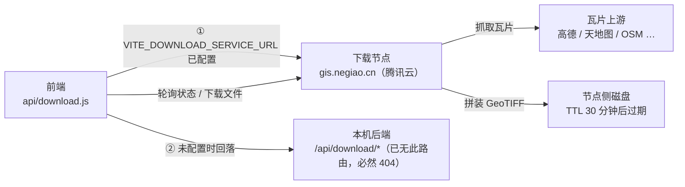
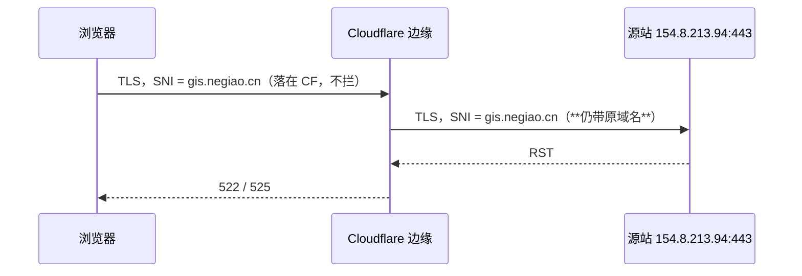

# 瓦片下载服务（独立节点）

> **状态**：✅ 可用。走 **`https://gis.negiao.cn:8443`**（443 被备案拦截，8443 不触发，见 §5）。
> **引入版本**：V3.6.28。
> **相关配置**：`VITE_DOWNLOAD_SERVICE_URL`（见 `deploy/.env.example`）。
> **⚠️ 临时性**：节点为腾讯云活动赠送、**有效期一个月**，仅用于验证与过渡；到期需迁移（§5.4）。

---

## 1. 背景与定位

V3.6.5 起，HF Space 因平台政策删除了 `backend/domains/tiles/download/` 与 `/proxy/*`，
前端下载入口随之失效（调用返回 404）。本仓 `Docs/TODO/plan-download-feature-git-marker.md`
记录了当时的临时处置。

现方案：**下载能力迁到独立节点**，本仓只调接口，不参与抓取、拼装、存储与清理。

**两个节点的职责严格分离**（勿混用）：

| 域名 | 归属 | 职责 |
|---|---|---|
| `vpn.negiao.cn` | 香港 VPS（长期） | 仅**瓦片纠偏 / 直通代理**（`/proxy/*`），可代理任意境外瓦片 |
| `gis.negiao.cn` | 腾讯云大陆（**临时一个月**） | 仅**下载任务接口**（`/api/download/*`），内存大适合 GeoTIFF 拼装 |

> 下载节点是活动赠送的临时资源，**不作为长期基础设施**；迁移路径见 §5.4。



**设计要点**：

- 节点侧承担全部重活，前端只做「建任务 → 轮询 → 取文件」三段式；
- 两条路径（远端节点 / 本机后端）**方法、路径、请求体一致**，调用方无需感知差异；
- 前端不复用主站 `backendAPI`（那套会注入主站 token / 设备头并弹全局 toast），
  而是独立 axios 实例，错误提示交由调用方 `useDownloadStore` 负责。

---

## 2. 接口契约

基址：`VITE_DOWNLOAD_SERVICE_URL`（当前配置 **`https://gis.negiao.cn:8443`**，端口不可省略）。
所有路径均为 `/api/download/*`，与旧后端完全一致。

| 方法 | 路径 | 用途 | 关键返回 |
|---|---|---|---|
| `GET` | `/api/download/estimate-tiles?bbox=&resolution_m=` | 预估瓦片数（只读） | `{"status":"success","tile_count":24}` |
| `POST` | `/api/download/tasks` | 创建下载任务 | 任务对象（见下） |
| `GET` | `/api/download/tasks/{task_id}` | 查询进度 | 任务对象 |
| `GET` | `/api/download/tasks/{task_id}/file` | 下载产物 | `image/tiff` 流 + `Content-Disposition` |
| `POST` | `/api/download/tasks/{task_id}/cancel` | 取消任务 | `200` |
| `GET` | `/api/download/tasks` | 任务列表 | `{"tasks":[...]}` |

### 2.1 创建任务的请求体

```json
{
  "tile_url_template": "https://tile.openstreetmap.org/{z}/{x}/{y}.png",
  "bbox": [116.30, 39.90, 116.32, 39.92],
  "resolution_m": 100,
  "bbox_crs": "EPSG:4326",
  "clip_to_extent": false,
  "basemap_name": "verify-test"
}
```

约束（前端 `buildTaskPayload` 已校验）：模板必须含 `{z}` `{x}` `{y}`；`resolution_m ∈ [0.5, 1000]`。

### 2.2 任务对象

```json
{
  "task_id": "202ba06cc2f14cc6ae1167b6021318f1",
  "status": "pending|downloading|success|failed|cancelled",
  "progress": 5.0,
  "message": "正在下载瓦片",
  "file_ready": false,
  "tile_count": 2,
  "tiles_downloaded": 1,
  "estimated_total_seconds": 30,
  "expires_at": "2026-10-26T11:06:18+08:00",
  "expires_in_seconds": 1799,
  "basemap_name": "verify-test"
}
```

**任务 TTL 约 30 分钟**（实测 `expires_in_seconds = 1799`），过期后文件不可取，需重建任务。

### 2.3 文件下载的响应头

```
HTTP/1.1 200 OK
Content-Type: image/tiff
Content-Length: 951
content-disposition: attachment; filename*=UTF-8''verify-test_100m_10_26_10.tif
Access-Control-Expose-Headers: Content-Disposition, Content-Length
```

`Access-Control-Expose-Headers` 必须包含 `Content-Disposition`，否则跨域下前端读不到文件名
（`download.js` 的 blob 分支依赖它）。节点侧已正确配置。

### 2.4 CORS 契约

节点对请求来源做**反射式放行**（非 `*`），并允许凭据：

```
access-control-allow-origin: https://webgis.negiao.cn
access-control-allow-credentials: true
Access-Control-Expose-Headers: Content-Disposition, Content-Length
```

> 前端 axios 实例**未**开启 `withCredentials`，节点侧当前为无状态接口（实测无 Cookie 也可全流程通过）。
> 若日后节点引入会话，需同步打开 `withCredentials`，否则会出现「接口 200 但业务失败」。

---

## 3. 前端接入

```ts
// src/config/publicRuntime.ts
export const DOWNLOAD_SERVICE_BASE_URL: string = stripTrailingSlash(
    String(import.meta.env.VITE_DOWNLOAD_SERVICE_URL || '').trim() || BACKEND_BASE_URL,
);
```

```js
// src/api/download.js
const USE_REMOTE_SERVICE =
    Boolean(DOWNLOAD_SERVICE_BASE_URL) && DOWNLOAD_SERVICE_BASE_URL !== BACKEND_BASE_URL;
const downloadAPI = USE_REMOTE_SERVICE ? axios.create({ baseURL: DOWNLOAD_SERVICE_BASE_URL, ... }) : backendAPI;
```

| 场景 | `VITE_DOWNLOAD_SERVICE_URL` | 行为 |
|---|---|---|
| 生产 / 联调 | `https://gis.negiao.cn:8443` | 直连节点（**必须带 `:8443`**） |
| 本地开发（节点未就绪） | 留空 | 回落 `VITE_BACKEND_URL` 同源 `/api/download/*`（当前必 404，仅作降级占位） |

---

## 4. 实测结果（2026-10-26）

### 4.1 端口对比（关键）

| 端口 | 带 SNI 的域名访问 | 结论 |
|---|---|---|
| **443** | ❌ `000`（RST，6/6，约 0.3s 快速失败） | 被备案拦截，**不可用** |
| **8443** | ✅ `200`（3/3，约 0.65s） | **当前采用**，未触发拦截 |

证书：`CN = gis.negiao.cn`，有效期 2026-10-26 → 2027-01-24（Let's Encrypt 90 天，需留意续期）。

### 4.2 全链路（`https://gis.negiao.cn:8443`）

| 环节 | 结果 |
|---|---|
| `GET /estimate-tiles`（0.1°×0.05°，10m） | ✅ `{"status":"success","tile_count":24}` |
| `POST /tasks`（0.01°×0.01°，200m） | ✅ 返回 `task_id`，`tile_count=2`，TTL 1799s |
| `GET /tasks/{id}` 轮询 | ✅ `pending → downloading(5%→50%) → success(100%)` |
| `GET /tasks/{id}/file` | ✅ `200 image/tiff`，951 B，魔数 `II*\0` 为合法 GeoTIFF |
| 文件名头 | ✅ `content-disposition: attachment; filename*=UTF-8''v3628-verify_200m_10_26_11.tif` |
| `GET /tasks` / `POST /cancel` | ✅ 均 200 |
| CORS | ✅ 反射 `https://webgis.negiao.cn` + `allow-credentials: true` + `Expose-Headers` 正确 |
| 任务未完成时取文件 | ✅ `400` + JSON 错误体（前端应解析，见 §7 缺陷 2） |

**耗时观察**：2 片瓦片走 `tile.openstreetmap.org` 上游耗时 **约 100 秒**（国内节点访问 OSM 慢）。
任务 TTL 仅 30 分钟，**下载上游必须选国内源**（高德 / 天地图），否则大批量任务会超时。

---

## 5. 端口选择：为什么是 8443

### 5.1 现象

`negiao.cn` **未做 ICP 备案**，DNS 托管在 Cloudflare（**仅 DNS，未开橙云代理**）。子域指向大陆服务器时：

```
https://gis.negiao.cn/          → 000（TLS RST，6/6）
http://gis.negiao.cn/           → 302 → dnspod.qcloud.com/static/webblock.html（<title>备案</title>）
https://gis.negiao.cn:8443/     → 200 ✅
```

### 5.2 根因：拦截在 **SNI / Host 层**，不是 DNS 层

DNS 只有一条 A 记录 `154.8.213.94`，域名与 IP 指向同一台机器；差异出在连接时的判定：

| 访问方式 | SNI / Host | 结果 |
|---|---|---|
| `https://gis.negiao.cn/…`（443） | SNI = `gis.negiao.cn` | ❌ `000`（6/6） |
| `https://154.8.213.94/…` + `Host: gis.negiao.cn` | **无 SNI** | ✅ `200`（3/3） |
| `http://…` + `Host: gis.negiao.cn`（域名或 IP 皆然） | Host 判定 | ❌ `302` webblock |
| **`https://gis.negiao.cn:8443/…`** | SNI = `gis.negiao.cn`，**非标端口** | ✅ `200`（3/3） |

**结论**：拦截按 **SNI（443）/ Host（80）** 判定，且**与来源地域无关**（从香港节点发起同样被拦）。
备案拦截只覆盖标准 Web 端口，**非标端口 8443 不触发**——这就是当前方案成立的原因。

### 5.3 ⚠️ Cloudflare 橙云不能替代 8443



CF 回源必须携带 `SNI = gis.negiao.cn`（免费/Pro 无 SNI Override），`--resolve` 实验已 3/3 复现失败；
`Flexible` 模式走 HTTP 回源，同样被 Host 层拦截。

> 附带事实：`vpn.negiao.cn` 解析到 Cloudflare 边缘 IP（`104.21.5.16` 等），SNI 落在 CF，
> 从未直达腾讯云入口，所以不受该拦截影响——但那是**另一套服务（瓦片纠偏）**，与下载节点无关。

### 5.4 长期方案（8443 是临时解）

| 方案 | 代价 | 说明 |
|---|---|---|
| **A. 完成 ICP 备案** | 1–3 周 | 根治；备案后 443 直连即可，无需非标端口 |
| **B. 下载服务并入香港 VPS** | 中 | 与 `vpn.negiao.cn` 同机或同域反代，SNI 落境外；需评估带宽与 GeoTIFF 拼装的 CPU/磁盘 |
| **C. 维持 8443** | 零 | 当前方案，但节点本身是**一个月免费资源**，到期必须迁移 |

---


## 6. 运维注意

1. **上游选型**：优先国内可达源（高德 `webrd0x.is.autonavi.com`、天地图）。OSM 在国内节点上单片可达数十秒，任务 TTL 只有 30 分钟，大批量下载容易超时。
2. **任务 TTL**：产物 30 分钟后失效。前端若在过期后取文件会得到 4xx，需重新建任务（`useDownloadStore` 已有 `isExpired` 处理）。
3. **磁盘**：存储与清理在节点侧，本仓不感知。节点侧需自带过期清理，否则长期堆积。
4. **配额**：节点可能返回 `429` / `detail.code = DOWNLOAD_QUOTA_INSUFFICIENT`，前端已映射为 `isQuotaExceeded` / `isQuotaInsufficient`。
5. **CORS 白名单**：节点对来源做反射放行，新增前端部署域名时需确认节点侧已加入，否则下载会 403（与瓦片代理的 `TILE_PROXY_ALLOWED_ORIGINS` 是两套独立配置）。
6. **⚠️ 节点到期**：腾讯云机器为活动赠送，**有效期一个月**。到期后 `gis.negiao.cn:8443` 全部接口失效，前端下载功能会整体不可用——需提前按 §5.4 迁移。
7. **证书续期**：`CN=gis.negiao.cn` 为 Let's Encrypt，**2027-01-24 到期**（90 天）。续期由节点侧负责，本仓不感知；过期后浏览器会直接拒绝连接。
8. **端口不可省略**：`VITE_DOWNLOAD_SERVICE_URL` 必须写 `https://gis.negiao.cn:8443`。漏掉 `:8443` 会回到 443，表现为请求全部 `000`（RST），且错误信息不会提示「端口错了」。

---

## 7. 已知缺陷与待办

| # | 问题 | 影响 | 状态 |
|---|---|---|---|
| 1 | ~~域名备案拦截~~ | 已通过 **8443 非标端口**规避（§5） | ✅ 已解决；长期仍需备案或迁香港 |
| 2 | 远端路径的 **blob 错误体未解析**：`download.js` 的 `responseType: 'blob'` 请求失败时，`error.response.data` 是 Blob，`resp?.data?.detail` 取不到，错误信息退化为「Request failed with status code 4xx」 | 配额/过期等错误提示不精确（状态码判定仍正确） | 已记入 TODO，未修（避免扩大本次范围） |
| 3 | 本地回退路径与本机后端返回结构不同：`backendAPI` 会解包 `{code,data}` 信封，远端路径直接取 `response.data` | 当前本机后端已无该路由，无实际影响；若日后恢复需对齐 | 已记入 TODO |
| 4 | 节点 `allow-credentials: true` 但前端未开 `withCredentials` | 当前无状态接口无影响；引入会话后会失效 | 已记入本文档 §2.4 |
| 5 | **节点与证书均为临时资源**（服务器 1 个月、证书 90 天） | 到期即整体不可用，且无自动兜底 | 待迁移（§5.4） |
