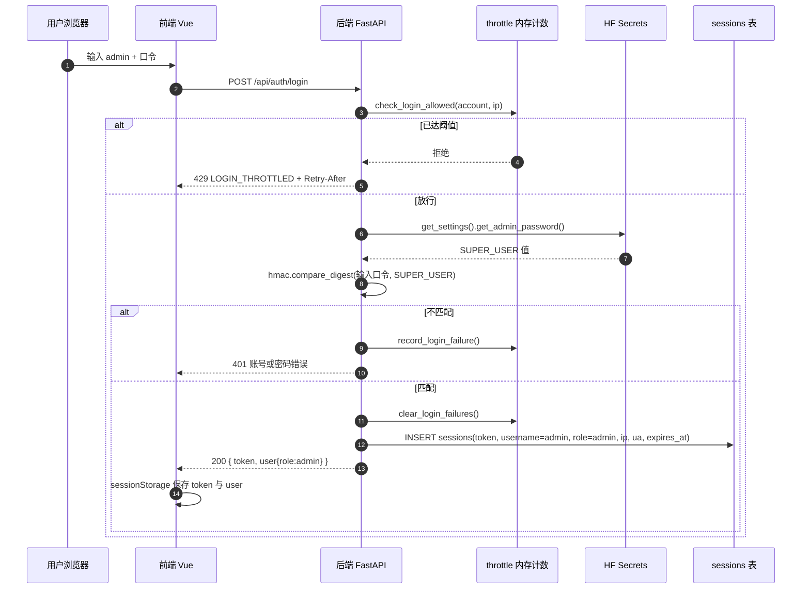
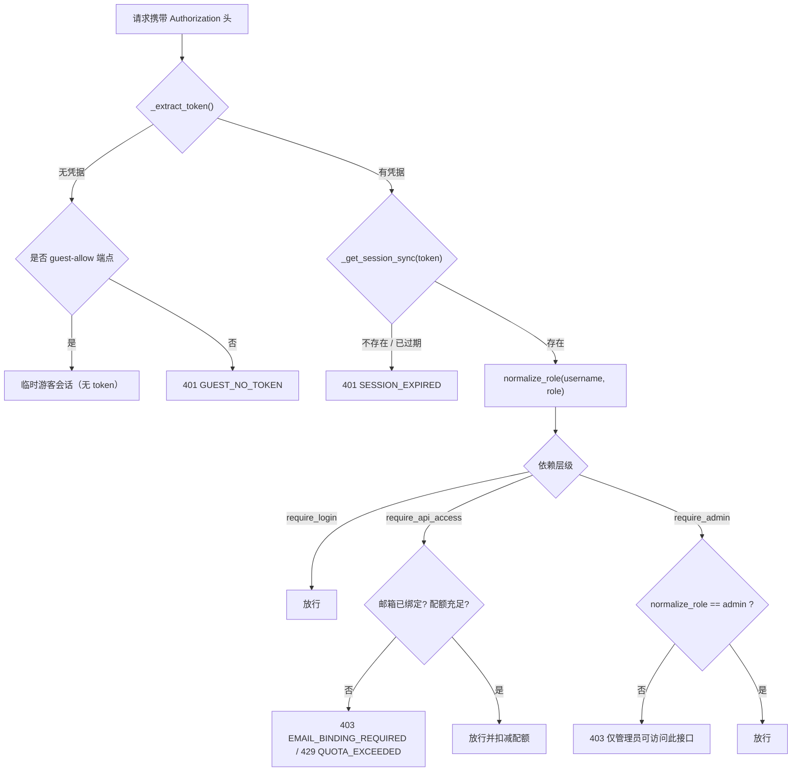

# 身份鉴权链路与安全模型

> **本文范围**：从「前端输入账号密码」到「后端放行管理接口」的完整信任链，以及该链路的强度边界、反爬能力与已知弱点。
>
> **不重复的内容**：角色定义、配额池结构、AI 模型优先级见 [`account-system-ai-quota.md`](account-system-ai-quota.md)；三层配置的取值规则见 [`configuration-three-tier.md`](configuration-three-tier.md)。本文只描述**链路**与**安全属性**。

---

## 1. 一句话概括

前端只负责**采集凭据并保存返回的令牌**；一切身份判定发生在后端，依据是 SQLite `sessions` 表里的一行记录与 `SUPER_USER`（HF Secret）的比对结果。**前端代码、URL 参数、请求头中的身份声明，全部不参与授权判定。**

---

## 2. 端到端链路（登录 → 会话 → 逐请求鉴权）

### 2.1 管理员登录时序



**关键点**：`SUPER_USER` 不落库、不进代码、不下发前端；后端每次登录都从进程环境（HF Secrets）读取并与用户输入做**等时比较**（`hmac.compare_digest`，比较前编码为 bytes，避免非 ASCII 触发异常并消除长度侧信道）。

### 2.2 逐请求鉴权分层



**分层含义**：

| 依赖 | 作用 | 典型使用者 |
|---|---|---|
| `require_login` | 只验会话有效，不做角色与配额判断 | 个人资料、偏好、登出 |
| `require_api_access` | 会话 + 邮箱绑定校验 + 每日配额扣减 | 搜索、AI、代理、导入 |
| `require_admin` | `require_api_access` + `role == admin` | `admin.py` 全部 19 个接口 |

### 2.3 三条身份的分支差异

| 身份 | 凭据来源 | 校验方式 | 会话令牌 |
|---|---|---|---|
| 管理员 | `SUPER_USER`（HF Secret） | 与 Secret 等时比较，**每次登录现算** | 正常签发 |
| 注册用户 | `users.password_hash` | PBKDF2-HMAC-SHA256，16 字节随机盐，120000 次迭代 | 正常签发 |
| 游客 | 共享口令（L1 配置） | 等时比较；身份由 `IP + UA + 设备号` 派生 | 正常签发（游客权限） |
| 临时游客 | 无 | 特定端点自动创建，2 小时内存态 | **无 token** |

---

## 3. 信任边界

> 判定原则：**凡是浏览器能构造的，都不作为授权依据。**

| 输入 | 可信度 | 用途 | 是否参与授权 |
|---|---|---|---|
| 表单中的账号与口令 | 不可信（但必须作为认证输入） | 登录比对 | 仅此一次，比对后即弃 |
| `Authorization` / `X-Auth-Token` | 不可信字符串，但需与服务端记录匹配 | 会话定位 | **是**（唯一依据） |
| URL hash 中的 `ut` | 完全可伪造 | 统计分组、人工排查 | **否** |
| `X-Client-IP` / `X-Forwarded-For` / `X-Real-IP` | 完全可伪造 | 展示、审计、游客身份派生 | **否**（限流以账号维度为主） |
| `Origin`（CORS） | 可伪造（非浏览器客户端不受约束） | 浏览器侧软约束 | **否** |
| `sessions` 表中的 role | 服务端写入，但**每次读取都重算** | 权威判定 | **是（经 `normalize_role`）** |
| `SUPER_USER` | 服务端进程环境（HF Secrets） | 管理员口令比对 | **是** |

### 3.1 为什么 `ut` 不能作为身份证据

`ut` 由 `syncUserRoleToUrl()` 在登录后写入地址栏 hash，任何人手工输入 `#/home?ut=admin` 都能制造同样的字符串；第三方统计采集的是 `location.href`，同样可由客户端任意构造。**它能做统计分组，不能证明访问者身份。**

---

## 4. 管理员身份的硬约束

以下四条共同保证「改前端 / 改 URL / 改请求头都无法获得管理员权限」：

| # | 约束 | 实现位置 | 效果 |
|:--:|---|---|---|
| 1 | 令牌不可伪造 | `session.py::_create_session_sync`：`secrets.token_urlsafe(32)`（256 bit） | 客户端无法构造出存在于 `sessions` 表中的值 |
| 2 | 角色不信任数据库字段 | `constants.py::normalize_role`：仅按 `username == "admin"` 判定 | 即使 DB 中 role 被改写，非 admin 用户名仍不是管理员 |
| 3 | 管理员口令只存在于服务端 | `load.py::get_admin_password`：优先 `SUPER_USER`，仅 `APP_ENV∈dev` 且 `SUPER_USER` 为空时才回退 `123456` | 公开仓库中的 `123456` 在生产不可达 |
| 4 | 环境变量优先级最高 | `load.py::load_project_env`：`system_keys` 中的变量永不被 `.env` 覆盖 | HF Secrets 不会被镜像内的 `.env` 顶掉 |

补充：注册接口以 `RESERVED_USERNAMES` 拦截 `admin` / `guest` 等保留名，阻断「注册同名账号 → 被 `normalize_role` 判为管理员」的路径。

---

## 5. 安全性分析（威胁 → 控制 → 残留）

| 威胁 | 现有控制 | 残留风险 |
|---|---|---|
| 在线口令爆破 | 登录节流：账号 5 次 / 60 秒窗口 → 锁定 60 秒；IP 30 次兜底；超限 429 | 计数在进程内，重启清零；多 worker 会失效 |
| 凭据窃取（XSS） | 令牌存 `sessionStorage`（非 Cookie），不随请求自动携带 | 同源 XSS 可直接读取；页面加载第三方脚本 `min-enhanced.js`（不在本仓库）构成供应链面 |
| CSRF | 不使用 Cookie，令牌需 JS 显式放入请求头 | 无（跨站无法读取 sessionStorage） |
| 越权访问管理接口 | `require_admin` 覆盖 `admin.py` 全部端点；角色服务端归一 | 无已知旁路 |
| 会话固定 | 每次登录新建令牌，登录前不存在会话 | 无 |
| 令牌重放 | 72 小时有效期；登出即删行；改密注销该账号全部会话 | 无设备绑定，令牌泄漏后 72 小时内可用；**令牌在 DB 中以明文存储**，库泄漏等于会话全失 |
| 中间人 | CF 边缘 TLS；80 端口 301 到 https | 未下发 `Strict-Transport-Security`，首次明文请求可被劫持 |
| 统计伪造 | 无（URL 字段天生可伪造） | 记录不可作为入侵证据，只能作参考 |
| 配置误判 | `APP_ENV` 默认 `production`；未配 `SUPER_USER` 时管理员登录直接 503 | 503 会暴露「管理员登录被禁用」这一状态 |

---

## 6. 反爬性评估（如实给出强度）

鉴权体系**不是反爬系统**，两者目标不同：鉴权回答「你是谁」，反爬回答「你请求得太多了」。当前项目的能力分布：

| 维度 | 机制 | 实际强度 |
|---|---|---|
| 身份配额 | `require_api_access` 按 `username / guest_uid` 扣减每日额度 | 中。对注册用户有效；对游客可被绕过（见下） |
| 登录节流 | 账号优先 + IP 兜底 | 中高。账号维度不可伪造 |
| 浏览器跨域 | CORS 白名单（9 个前端来源） | 低。只约束浏览器脚本，`curl` / 服务端直连不受限 |
| 边缘防护 | Cloudflare 仅代理前端域名（80/443/8443 等） | 低。后端 `*.hf.space` **不经过 CF**，WAF/限流规则对 API 无效 |
| 游客身份 | `guest_uid = f(IP, UA, 设备号)` | 低。`X-Client-IP` 可伪造 → 可反复领取新游客额度 |

**已知缺口（按影响排序）**：

1. **游客配额可通过伪造 IP 无限续杯**——改动会重置全部游客身份，故暂未处理；
2. **API 层缺少通用速率限制**——目前只有登录节流与配额扣减，没有「每分钟请求数」维度的约束；
3. **令牌明文入库**——若数据库文件泄漏，攻击者可直接复用未过期会话（建议改为存 `sha256(token)`，登录时比对摘要）。

---

## 7. 部署面必查项

上线或迁移环境时，以下五项决定鉴权是否成立：

| 项 | 期望值 | 检查方式 |
|---|---|---|
| `SUPER_USER` | 已在 HF Space → Settings → Secrets 配置且非空 | 未配置时管理员登录返回 503 |
| `APP_ENV` | `production`（镜像内 `deploy/.env` 已固定） | 若被改成 `development` 且 `SUPER_USER` 为空，`123456` 生效 |
| `CORS_ALLOWED_ORIGINS` | 显式列出前端来源；为空则拒绝全部跨源 | 见 `deploy/.env` |
| `LOGIN_THROTTLE_*` | 5 / 30 / 60 / 60 | 见 `deploy/.env`，改后需重启 |
| **传输层（前端）** | 不允许 HTTP 直连：80 一律 301 到 HTTPS，且启用 HSTS | `curl -sI http://<域名>/` 应 301；`curl -sI https://<域名>/` 应含 `Strict-Transport-Security` |
| **传输层（后端容器）** | 拒绝一切显式声明为 http 的请求（含静态资源），返回 403 | `curl -s -o /dev/null -w "%{http_code}" -H "X-Forwarded-Proto: http" https://negiao-webgis.hf.space/health` 应得 403；不带该头应得 200 |

### 7.1 为什么「只允许 HTTPS」必须配 HSTS 才算完整

只做 301 跳转，挡住的只是**第二次**请求。第一次仍然是明文 HTTP，可被中间人做三件事：

1. **劫持重定向**到仿冒站点（用户看到的是自己的域名，实际是攻击者的页面）；
2. **注入 JS** 后读走 `sessionStorage` 里的会话令牌；
3. **记录路径与查询参数**（例如分享链接里的 `lng/lat`、`p`）。

HSTS 的作用是让浏览器**在发出请求之前**就把该主机改写成 HTTPS，第一次请求也不走明文：

```
Strict-Transport-Security: max-age=31536000
```

**实施位置与注意事项**：

| 项 | 做法 |
|---|---|
| 前端域名 | Cloudflare → SSL/TLS → Edge Certificates → HSTS → 开启，`max-age` 先设 6 个月；**不要**急于勾 preload（清单移除周期以月计） |
| 后端域名 | `*.hf.space` 由 HF 托管，无法自定义响应头；其 HTTPS 强制由平台保证，前端调用恒走 https |
| 子域范围 | `includeSubDomains` 会把 `vpn.negiao.cn`、`gis.negiao.cn` 一并纳入，确认这些子域都已全站 HTTPS 再勾 |

**副作用（本地调试会受影响）**：HSTS 生效后，浏览器对 `webgis.negiao.cn` 的任何端口都会强制 HTTPS。此前用 hosts 把该域名指向 `127.0.0.1` 做 dev 复现的做法会失效——`http://webgis.negiao.cn:5173` 会被升级为 `https://…:5173`，而 Vite 没有 TLS，直接连接失败。这是预期行为，不是故障。

**验证命令**：

```bash
curl -sI http://webgis.negiao.cn/ | head -3          # 期望 301 + Location: https://...
curl -sI https://webgis.negiao.cn/ | grep -i strict  # 期望输出 max-age=...
curl -sI https://negiao-webgis.hf.space/health       # 平台侧 HTTPS，无自定义头
```

**首启参数建议**（Cloudflare → SSL/TLS → Edge Certificates → HSTS）：

| 选项 | 建议 | 理由 |
|---|---|---|
| 启用 HSTS | 开 | 补上首个明文请求的缺口 |
| `max-age` | 先 `86400`（1 天），观察一周后升到 `31536000`（1 年） | 该值被浏览器缓存，调低不会立刻解除已生效的锁定，只能小步放量 |
| `includeSubDomains` | **建议不勾** | 一旦下发，`negiao.cn` 下**所有**子域（含未来新增）被永久约束为 HTTPS，且移除需等 `max-age` 过期。主站单独 HSTS 已足够，子域约束收益有限 |
| `preload` | **不勾** | 入列需另行提交且移除以月计；CF 的开关只是加指令，个人项目无收益 |
| `nosniff` | 勾 | 独立于 HSTS，零风险，阻止 MIME 嗅探 |

> 勾选 `includeSubDomains` 的前置条件：`negiao.cn` 下**所有**子域（含未来新增）均已全站 HTTPS 且无明文端口。当前 `vpn.negiao.cn` 达标（http 301 / https 200）；`gis.negiao.cn` 为腾讯云一个月试用实例，**计划下线**，不再作为阻塞项。
>
> **下线 `gis.negiao.cn` 时必须删除其 DNS 记录**（A/AAAA/CNAME 全部），不要只停实例：试用到期后公网 IP 会被回收再分配，残留解析会让该子域指向陌生人的服务器（悬空 DNS / 子域接管）。该实例的 Let's Encrypt 证书随实例消失即可，无需另行处理。
>
> **`gis.negiao.cn` 443 不通的原因**（2026-11-02 实测，留档备查）：服务 HTTPS 实际在 **8443**（`CN=gis.negiao.cn`，有效期至 2027-01-24），80 端口 301 指向 `https://gis.negiao.cn:8443/`；443 同为 nginx 的 ssl 监听（明文请求返回 `400 The plain HTTP request was sent to HTTPS port`），但带 SNI 的 ClientHello 会被重置，不带 SNI 可正常握手，同 IP 的 8443 带任意 SNI 均正常——特征指向接入商对 80/443 的 SNI 拦截。

**回归红线**：任何新增入口（新 VPS、新静态托管、临时调试服务）都必须先具备 TLS 与 301，**不得以 HTTP 形式对外提供登录或 API**。这条约束对「临时」一视同仁——`5173` 那类裸端口正是从"临时开一下"开始的。

### 7.2 后端容器的 HTTP 拒绝是怎么实现的

**拓扑前提**：HF Space 的边缘代理终止 TLS，容器内的 uvicorn 只监听 `127.0.0.1:8000` 明文，nginx 监听 `7860`。所以容器**无法自己说 HTTPS**，"禁止 HTTP"只能落成「拒绝那些声称自己不是 HTTPS 的请求」。

**两级判断**：

| 层 | 规则 | 说明 |
|---|---|---|
| HF 边缘 | http → 301 到 https | 平台行为，不可配置 |
| nginx（`deploy/nginx.conf`） | `$http_x_forwarded_proto` 显式等于 `http` → 403 | 覆盖全部 location，含静态资源与 `/health` |
| 无该头 | 放行 | 容器内健康检查 `curl 127.0.0.1:7860/health` 与同机调用不经过边缘，不带此头 |

**同时修正了一处隐患**：原配置把 `X-Forwarded-Proto` 覆盖成 `$scheme`（nginx 自身是 http，等于恒为 `http`），真实协议信息被抹掉。现改为透传边缘下发的 `$http_x_forwarded_proto`，后端因此能拿到真实值。

**回滚方式**：该规则写在 nginx 配置里，回滚需改文件并重建镜像。若上线后发现 HF 对 HTTPS 请求也下发 `http`（极端情况），表现为全站 403——此时删掉该 `if` 块重建即可，数据与鉴权逻辑不受影响。

---

## 8. 结论

- 管理员身份的信任根只有两个：**`SUPER_USER`（HF Secrets）** 与 **`sessions` 表中的随机令牌**；其余一切（前端代码、URL、请求头）都只是搬运工。
- 因此「改前端 → 连线上后端 → 冒充管理员」不成立：前端不持有任何可用于签发的秘密。
- 真正的风险集中在三处：**口令爆破（已有节流）**、**同源 XSS / 第三方脚本**、**令牌明文存储**。这三项都不在「前端鉴权分支」这个层面上，改前端写法无法改善，也不会让现状变差。
