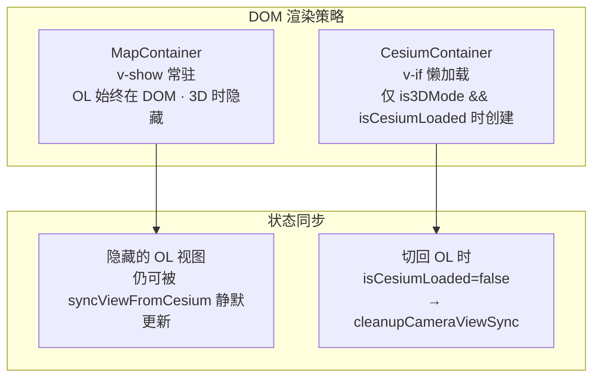
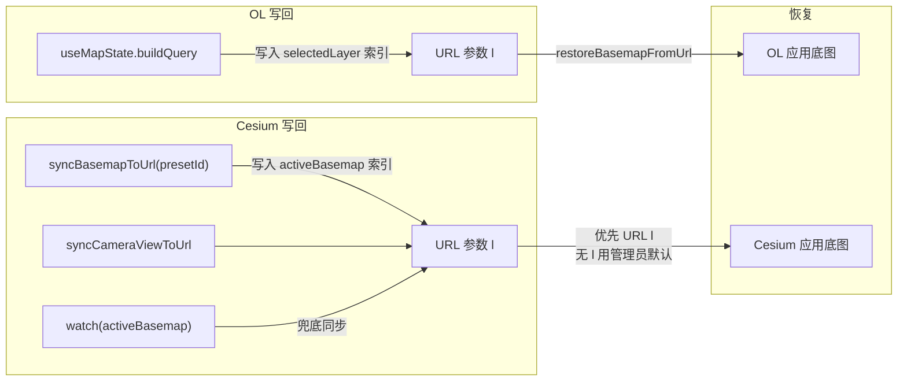

# OpenLayers × Cesium 2D/3D 双引擎架构说明

日期：2026-07-21

适用范围：`frontend/src` 下地图引擎切换与视图状态同步相关模块（`app/HomeView.vue` / `app/HomeView.ts` 仅做模板与 composable 编排、实际逻辑在 `app/composables/useHomeEngineSwitch.ts` 与 `useLazyModules.ts`、`domains/ol/components/MapContainer.vue`、`domains/cesium/components/CesiumContainer.vue`（逻辑在 `CesiumContainer.ts`）、`domains/ol/composables/`、`domains/ol/url-state/`、`domains/ol/startup/`、`domains/common/url-state/`、`domains/common/utils/viewScale/`、`router/index.ts`）。

本文是长期参考文档，说明 WebGIS 3.0 中「OpenLayers 二维地图 + Cesium 三维地球双引擎」的切换机制、视图状态同步算法、URL 参数编码格式、懒加载策略与竞态保护，供后续维护、调试分享链接还原问题与扩展引擎能力时对照。

## 1. 功能定位

本功能在同一页面内同时承载两套地图引擎：

- **OpenLayers（OL）**：二维平面地图，是核心首屏能力，始终挂载。
- **Cesium**：三维数字地球，按需懒加载，重量级资源不参与首屏竞争。

两者通过 URL 参数 `view=ol|cesium` 一键切换，并保证**视图状态双向同步**：

1. **位置与缩放**：地图中心经纬度（`lng`/`lat`）与缩放级别（`z`）在两个引擎间换算对齐。
2. **相机姿态**：Cesium 的 heading / pitch / roll 编码进 `cv` 参数，切回 2D 时保留中心与可视范围。
3. **底图预设**：`l` 参数为底图索引，OL 与 Cesium 共享同一套 `URL_LAYER_OPTIONS` 映射，切换引擎不丢底图。
4. **完整分享还原**：复制地址栏 URL 即可在新会话中精确重现当前引擎、视角、底图与（可选的）定位编码。

**重要边界**：OL 的 `z` 是**缩放级别**（zoom，浮点，常规 0–22），Cesium 的 `z` 是**相机离地高度**（米）。二者数值不可直接复用，切换时必须经 `viewScale` 的 canonical ground resolution 链路换算，否则会出现"切到 3D 后相机穿地或飞到太空"的问题。

> **两套 zoom 阈值并存，用途不同（勿擅自统一）**：`domains/common/utils/viewScale/constants.ts:40` 的 `MIN_OL_ZOOM = 0` / `MAX_OL_ZOOM = 22` 是**尺度换算/钳制**使用的 OL 投影缩放级别边界；`domains/common/url-state/stores/useUrlParamStore.ts:260-281` 的 `validateZoom`（0 ≤ z ≤ 30）是 **URL 参数解析阶段**的宽容校验上限（注释说明兼容天地图 / Cesium 常规层级范围）。两者分属不同链路，故并存。

## 2. 文件结构

| 文件 | 职责 |
|------|------|
| `app/HomeView.vue` / `app/HomeView.ts` | 仅模板编排与 composable 装配：转发 `@view-sync` / `@ready` / `@load-failed` 等事件，向 OL 容器传 `:url-sync-enabled="!is3DMode && !isEngineSwitching"`；切换算法不在本层 |
| `app/composables/useHomeEngineSwitch.ts` | 双引擎切换与同步的**实际实现**：`setMapView`（薄包装）/ `runMapViewSwitch`、`ensureCesiumLoaded`、`buildCesiumQueryPatchFromOl` / `buildOlQueryPatchFromCesium`、`latestCesiumOlEquivalent`、`handleViewSync` / `syncOlFromCesiumPayload`、Precision 比例校正、Agent 地图总线 |
| `app/composables/useLazyModules.ts` | `importCesiumContainerWithRetry()`：Cesium 唯一懒加载入口，静态 specifier + 瞬态错误退避重试 |
| `domains/ol/components/MapContainer.vue` | OL 容器（`v-show` 常驻，逻辑在 `MapContainer.ts`）：暴露 `getCurrentViewState` / `syncViewFromCesium` / `getOlView` / `getMapSize`，接入启动守卫，发出 `view-sync` |
| `domains/cesium/components/CesiumContainer.vue` | Cesium 容器（`v-if` 懒挂载，脚本在 `CesiumContainer.ts`）：构建 Viewer、`restoreCameraFromUrl` 恢复视角、`measureGroundResolution` 射线实测、`bindCameraViewSync` 监听相机 moveEnd、发出 `view-sync` |
| `domains/ol/composables/useMapState.ts` | OL 状态管理：URL 同步（`syncUrlFromMap`）、`getCurrentViewState`、`syncViewFromCesium`（含 `suppressNextUrlSync`）；`formatZParam` 来自 `useMapStateHelpers.ts` |
| `domains/ol/url-state/useMapViewUrlState.ts` | `view` 参数读写：`getCurrentMapView` / `replaceMapView`；切到 Cesium 且 `queryPatch` 未提供 `z` 时无条件写默认相机高度 |
| `domains/cesium/composables/layers/useCesiumUrlTracking.ts` | Cesium 相机 URL 追踪：`parseCameraStateFromUrl` / `restoreCameraFromUrl` / `syncCameraViewToUrl` / 底图 `l` 同步 |
| `domains/common/utils/viewScaleConverter.ts` | 兼容入口，**仅 re-export** 到 `viewScale/`；`olZoomToCesiumHeight` / `cesiumHeightToOlZoom` 的实现在 `viewScale/compat.ts` |
| `domains/common/utils/viewScale/` | 尺度系统 SSOT：`constants.ts` / `webMercator.ts` / `cesiumScale.ts` / `openlayersScale.ts` / `conversion.ts` / `precision.ts`，经 `index.ts` 桶式导出 |
| `domains/common/url-state/urlConstants.ts` | 共享常量：`MAP_VIEW_OL` / `MAP_VIEW_CESIUM` / `CAMERA_VIEW_PARAM_KEY`（`cv`）/ `CAMERA_STATE_QUERY_KEYS` / `normalizeMapView` |
| `domains/common/url-state/urlQueryReader.ts` | URL query 统一读取：hash query 优先级高于 `route.query`，提供完整快照 |
| `domains/common/url-state/crypto.ts` | **仅 re-export**；实现拆到 `codec/positions.ts`（Base62 字符表、位宽常量、`encodePos`）与 `codec/cesiumPose.ts`（`encodeCesiumPoseState` / `decodeCesiumPoseState` / `decodeCesiumCameraState`） |
| `domains/ol/startup/useStartupUrlRestoreGuard.ts` | 启动期 URL 恢复守卫：分享参数应用前暂停 OL 写回，避免默认视图覆盖 URL |
| `domains/ol/startup/useStartupViewResolver.ts` | `applyDeferredUrlParams` / `getInitialViewState`：底图核心就绪后延迟应用 URL 坐标参数 |
| `domains/common/url-state/stores/useUrlParamStore.ts` | URL 参数延迟应用仓库：路由阶段提取、引擎就绪后消费，`z` 按 `view` 双语义校验（`validateZoom` 0–30） |
| `router/index.ts` | 全局路由守卫：`beforeEach` 中提取 URL 参数存入 `useUrlParamStore`，分享模式（`s=1`）注入访客令牌 |

## 3. 双引擎切换机制

### 3.1 挂载策略：v-show 常驻 + v-if 懒加载



`HomeView.vue` 模板对两个容器采用不同的渲染策略（源码注释已固化）：

```html
<!-- 2D 地图是核心，需优先加载且切换 3D 时不销毁（保持状态） -->
<MapContainer v-show="!is3DMode && !isAccountPanelFullscreen" ... />

<!-- 3D 地图很重，只有需要时才渲染 DOM；切回 OL 时卸载，确保相机 URL 监听同步清理 -->
<div v-if="is3DMode && isCesiumLoaded && !isAccountPanelFullscreen" class="cesium-wrapper">
    <component :is="CesiumContainer" ref="cesiumContainerRef" @view-sync="handleViewSync" />
</div>
```

- **MapContainer 用 `v-show`**：OL 始终存在于 DOM，切到 3D 时仅隐藏。这样隐藏的 OL 视图仍可被 `syncViewFromCesium` 静默更新中心与 zoom，作为切回 2D 时的状态来源。
- **CesiumContainer 用 `v-if`**：Cesium 仅在 `is3DMode && isCesiumLoaded` 时才创建 DOM 与 Viewer；切回 OL 时 `isCesiumLoaded` 置 `false`、`CesiumContainer` 置 `null`，组件卸载触发 `cleanupCameraViewSync()`，相机 moveEnd 监听被彻底清理。

### 3.2 懒加载：ensureCesiumLoaded + importCesiumContainerWithRetry

Cesium 组件不在首屏 import。唯一加载入口是 `app/composables/useLazyModules.ts` 的 `importCesiumContainerWithRetry()`：动态 import 使用**静态字面量 specifier** `@cesium-domain/components/CesiumContainer.vue`（SFC 模板；其 `<script lang="ts" src="./CesiumContainer.ts">` 指向逻辑文件 `CesiumContainer.ts`），只对"瞬态模块获取失败"做退避重试，其他错误立即上抛。

```ts
// useLazyModules.ts —— 静态 specifier，禁用运行时拼 query 破缓存
function loadCesiumContainer() {
    return import('@cesium-domain/components/CesiumContainer.vue');
}

export async function importCesiumContainerWithRetry(maxRetries = 2) {
    for (let attempt = 0; attempt <= maxRetries; attempt++) {
        try {
            return await loadCesiumContainer();
        } catch (error) {
            if (attempt >= maxRetries || !isTransientModuleFetchError(error)) throw error;
            await wait(150 * (attempt + 1));   // 退避：150ms、300ms
        }
    }
}
```

`useHomeEngineSwitch.ts:288` 的 `ensureCesiumLoaded()` 在其外包一层并发复用、加载遮罩与 **120s 看门狗**：

```ts
async function ensureCesiumLoaded(): Promise<boolean> {
    if (isCesiumLoaded.value) return true;
    if (_cesiumLoadPromise) return _cesiumLoadPromise;   // 并发调用复用同一 Promise
    isCesiumLoading.value = true;
    showLoading(t('loading.cesiumAssets'), { timeoutMs: 0 });

    cancel(activeWatchdogHandle);
    const watchdogHandle = later(() => {
        if (!isCesiumLoading.value) return;
        message.warning(t('loading.cesiumLoadTimeout'), { closable: true });
        isCesiumLoading.value = false;
        hideLoading();
    }, 120000);                                          // 120s 看门狗
    activeWatchdogHandle = watchdogHandle;

    _cesiumLoadPromise = (async () => {
        try {
            const module = await importCesiumContainerWithRetry();
            CesiumContainer.value = markRaw(module.default);
            isCesiumLoaded.value = true;
            return true;
        } catch (error) {
            message.error(t('loading.cesiumLoadFailed', ...));
            _cesiumLoadPromise = null;
            return false;
        } finally {
            isCesiumLoading.value = false;
            hideLoading();
            clearWatchdog();
        }
    })();
    return _cesiumLoadPromise;
}
```

三重保障：`_cesiumLoadPromise` 缓存防连点重复导入；`useTimerRegistry.later(..., 120000)` 看门狗防"遮罩永不消失"；退避重试仅针对 Vite dev 的瞬态模块获取失败（Chromium / Firefox / Safari / NetworkError 措辞）。

### 3.3 切换调度：setMapView → runMapViewSwitch

`setMapView(view, { writeUrl })` 现为**薄包装**，只负责开关 `isEngineSwitching` 冻结窗口；实际调度在 `runMapViewSwitch`（`useHomeEngineSwitch.ts:511`）。`toggle3D`、浏览器前进/后退的 `watch`、Agent 命令总线以及启动时的初始调用都收敛到 `setMapView`。

**同步冻结窗口**：`setMapView` 进入时置 `isEngineSwitching = true`、`finally` 中复位；`HomeView.vue:80` 把它与 `is3DMode` 一起传给 `<MapContainer :url-sync-enabled="!is3DMode && !isEngineSwitching">`。切换期间 OL 的 moveend 写回被暂停，避免中间态覆盖目标引擎的 URL 参数。

```ts
// useHomeEngineSwitch.ts:597 —— 薄包装
async function setMapView(view, options = {}) {
    isEngineSwitching.value = true;
    try {
        return await runMapViewSwitch(view, options);
    } finally {
        isEngineSwitching.value = false;
    }
}
```

`runMapViewSwitch` 的核心顺序是**先完成 URL 语义转换，再加载/卸载目标引擎，最后做 Precision 比例校正**：

```ts
// useHomeEngineSwitch.ts:511（节选）
const queryPatch = normalizedView === MAP_VIEW_CESIUM
    ? buildCesiumQueryPatchFromOl()      // OL → Cesium：canonical resolution → 相机高度
    : buildOlQueryPatchFromCesium();     // Cesium → OL：等效 zoom

const preSwitchQuery = getCurrentQuerySnapshot(route.query);   // 切换前完整快照
if (writeUrl) await replaceMapView(normalizedView, queryPatch ? { queryPatch } : undefined);

if (normalizedView === MAP_VIEW_CESIUM) {
    isWeatherBoardMode.value = false;              // 天气看板仅支持 2D
    const loaded = await ensureCesiumLoaded();
    if (!loaded) {
        if (writeUrl) await replaceMapView(MAP_VIEW_OL, { queryPatch: preSwitchQuery });
        return false;                              // 失败精确回滚
    }
    is3DMode.value = true;
    setActiveEngineType('cesium');
    // 球面解析高度与射线实测不一致 → 按 targetG / measured 比例校正相机高度（见 §4.4）
} else {
    if (latestCesiumOlEquivalent.value) mapContainerRef.value?.syncViewFromCesium?.(latestCesiumOlEquivalent.value);
    const incomingLayerIndex = getCesiumActiveLayerIndex()
        ?? parseFiniteNumber(queryPatch?.l || readQueryValue('l'));
    // 同步底图 l；targetLayerId === 'custom' 时改调 setCustomBasemapByUrl
    is3DMode.value = false;
    setActiveEngineType('openlayers');
    isCesiumLoading.value = false; hideLoading();
    isCesiumLoaded.value = false;
    CesiumContainer.value = null;
    cesiumContainerRef.value = null;
    _cesiumLoadPromise = null;                     // 允许下次重新导入
}
return true;
```

**失败回滚**：`preSwitchQuery` 是切换前的**完整 URL 快照**（而非仅 `view`）。加载失败时用 `replaceMapView(MAP_VIEW_OL, { queryPatch: preSwitchQuery })` 精确恢复原 `lng/lat/z/l/cv`，避免回滚后视图跳回默认值。

浏览器前进/后退或外部 `router.replace` 改变 `view` 时，由 `useHomeEngineSwitch.ts` 的 `watch(() => getCurrentMapView())` 捕获并以 `writeUrl: false` 调用 `setMapView`，避免重复写 URL；启动时由 `app/composables/useHomeLayerAndMapRouting.ts` 的 `onMounted` 调用 `setMapView(getCurrentMapView(), { writeUrl: false })`，使刷新带 `view=cesium` 的链接直接进入 3D。

## 4. 视图状态同步算法：canonical resolution 链路

尺度系统的 SSOT 是 `domains/common/utils/viewScale/`（桶入口 `index.ts`；旧 `viewScaleConverter.ts` 仅 re-export）。**主链路不再把 OL zoom 与 Cesium 相机高度直接互转**，而是统一经过中间的 canonical ground resolution `G`（米/像素）：

```
OL zoom / resolution ──▶ G（地表分辨率）──▶ Cesium 相机高度
Cesium 相机（射线实测）──▶ G ──▶ OL resolution / zoom
```

### 4.1 三段式管线

1. **OL 侧**（`webMercator.ts` / `openlayersScale.ts`）：
   - `olZoomToResolution(zoom) = 2πR / (tileSize · 2^zoom)`（`R = 6378137`、`tileSize = 256`，zoom=0 时 ≈ 156543.034 米/像素）；`resolveOlScale` 优先消费显式 `resolution`，缺失时才由 zoom 推导。
   - `webMercatorResolutionToGroundResolution(res, lat) = res × cos(lat)`；纬度先钳制到 `WEB_MERCATOR_MAX_LATITUDE = 85.0511287798` 再取 cos（**没有 `MIN_LAT_SCALE` 常量**，钳制已保证 cos 不趋于 0）。逆变换为 `groundResolutionToWebMercatorResolution`。
2. **Cesium 侧**（`cesiumScale.ts`）：
   - 解析模型：正俯视 `G = 2h·tan(fovY/2) / viewportHeight`；任意 pitch 用斜距 `S = h / cos(|pitch+90°|)` 近似（θ 上限 60°）。`groundResolutionToTiltedCameraHeight` 为逆运算，`earthModel` 默认 `'flat'`。
   - 球面模型：`earthModel: 'sphere'` 时用 `measureNadirSphereChord` 计算"中心 + 1px"射线与球面交点的弦长，再以 `h₁ = h_flat·G/c(h_flat)`、`h₂ = h₁·G/c(h₁)` 两次比例迭代把平面模型残差压到 ULP 级。主链路的 `convertOlViewToCesium` 显式传 `earthModel: 'sphere'`。
   - Precision：`measureCesiumGroundResolutionFromRays` 通过注入的 `pickRay` / `globePick` / `distance` 对中心及四邻像素实测地面分辨率（含 Terrain），是斜视 / 地形场景的真值来源。
3. **转换层**（`conversion.ts`）：`olViewToCanonical`（OL→G + 目标相机）、`cesiumViewToCanonical`（相机→G，`measureGroundResolution` 优先，否则退解析模型）、`canonicalScaleToOlView`（G + 纬度→resolution/zoom）、`canonicalScaleToCesiumView`（G→高度）。`convertOlViewToCesium` / `convertCesiumViewToOl` 是两个方向的规范入口。

### 4.2 正向：OL → Cesium（buildCesiumQueryPatchFromOl）

```ts
// useHomeEngineSwitch.ts:379
const converted = convertOlViewToCesium({
    zoom: state.zoom,
    resolution: state.resolution ?? undefined,      // 优先真实投影分辨率
    center: { longitude: state.lng, latitude: state.lat },
    viewport: state.size ? { width: state.size[0], height: state.size[1] } : undefined,
    targetPitch: -90, targetHeading: 0, targetRoll: 0,
    earthModel: 'sphere',
});
lastOlToCesiumTarget = converted
    ? { canonicalResolution: converted.canonicalResolution, analyticHeight: converted.cesium.height }
    : null;
// z = formatZParam(converted?.cesium.height ?? 6000000)
// cv = encodeCesiumPoseState({ heading: 0, pitch: -90, roll: 0 })
```

### 4.3 反向：Cesium → OL（syncOlFromCesiumPayload）

```ts
// useHomeEngineSwitch.ts:432
const conv = convertCesiumViewToOl({
    height: camera.height,
    pitch: camera.pitch,
    viewport: size ? { width: size[0], height: size[1] } : undefined,
    measureGroundResolution: () => cesiumContainerRef.value?.measureGroundResolution?.() ?? null,
});
const olSeg = canonicalScaleToOlView({
    canonicalResolution: conv.canonicalResolution,
    latitude: camera.lat,
});
const equivalent = { lng: camera.lng, lat: camera.lat, zoom: olSeg.zoom };
```

### 4.4 落地时的 Precision 比例校正

解析高度只是初值：Cesium Viewer 起来后，用**射线实测**与目标 `G` 比对，按比例修正相机高度（`useHomeEngineSwitch.ts:537-566`）：

```ts
const measured = cesiumContainerRef.value?.measureGroundResolution?.();
if (Number.isFinite(measured) && measured > 0 &&
    !nearlyEqual(measured, targetG, 1e-9, 1e-6)) {
    const curH = cesiumContainerRef.value?.getCameraHeight?.();
    const correctedH = Number(curH) * (targetG / measured);
    cesiumContainerRef.value?.setCameraHeightKeepOrientation?.(correctedH);
}
```

### 4.5 兼容入口与关键设计点

- `olZoomToCesiumHeight` / `cesiumHeightToOlZoom` 仍由 `viewScale/compat.ts:59-94` 提供（旧签名 `mapSize` / `cesiumFovy` / `clamp` 兼容），内部走同一套 canonical 链路；`cesiumAdapter.ts` 等旧调用方仍在使用，但 **HomeView 主链路已改用 `convert*` + `canonical*`**。
- 纬度钳制只用 `WEB_MERCATOR_MAX_LATITUDE = 85.0511287798` + `Math.cos`（`webMercator.ts:67-83`）；未提供 / 非法纬度按 0°（赤道，不修正）处理。
- 有限数校验：`conversion.ts` 各入口对非有限值返回 `null`，不擅自 clamp；仅旧兼容入口的 `clamp: true` 做有损钳制。
- 两套 zoom 阈值并存（见第 1 章注）：`MAX_OL_ZOOM = 22` 用于尺度钳制，`validateZoom` 的 0–30 用于 URL 参数校验。

## 5. URL 参数编码

### 5.1 参数总览

| 参数 | 语义 | 说明 |
|------|------|------|
| `view` | 引擎选择 | `ol`（默认）/ `cesium`；`normalizeMapView` 还把 `3d` 归一为 `cesium` |
| `lng` / `lat` | 中心经纬度 | OL 下为地图中心，Cesium 下为相机经纬度，6 位小数 |
| `z` | **双语义** | `view=ol` 时为 zoom 级别；`view=cesium` 时为相机离地高度（米），统一两位小数（`formatZParam`） |
| `l` | 底图预设索引 | OL / Cesium 共享 `URL_LAYER_OPTIONS` 映射 |
| `cv` | Cesium 相机姿态码 | `p.<base62>` 姿态短码；兼容旧版完整相机码 |
| `heading`/`pitch`/`roll` | 兼容明文姿态 | 会被编码进 `cv`，URL 独立展示时不保留（`CAMERA_STATE_QUERY_KEYS`） |
| `s` / `loc` / `p` | 分享 / 定位 | 分享标记、定位来源、加密点位编码（见 `useMapState` 与 `crypto.ts` 的 re-export，实现在 `codec/positions.ts`） |

### 5.2 z 双语义的处理

`z` 的语义随 `view` 变化，三处协同保证不出错：

1. **校验**（`useUrlParamStore.validateViewZ`）：`view=cesium` 时按相机高度校验（1 ≤ z ≤ 50000000），否则按 zoom 校验（0 ≤ z ≤ 30）。
2. **切换兜底**（`useMapViewUrlState.ts` 的 `replaceMapView`，第 64–73 行）：`view=cesium` 且 `queryPatch` 未提供 `z` 时，**无条件**写入 `DEFAULT_CESIUM_URL_HEIGHT = '6000000.00'`，避免把 OL 的 zoom 数值（如 17）当成 17 米高度。（旧文档提到的 `shouldUseDefaultCesiumHeight` 条件判断已不存在。）
3. **切换换算**（`useHomeEngineSwitch.ts`）：正常切换路径总是通过 `buildCesiumQueryPatchFromOl` / `buildOlQueryPatchFromCesium` 提供换算后的 `z`，兜底仅在异常路径生效。

### 5.3 cv 姿态编码（Base62）

Base62 编解码的常量（字符表、位宽、`MIN_CODE_LENGTH`）定义在 `domains/common/url-state/codec/positions.ts`，编码函数在同目录 `cesiumPose.ts`；`crypto.ts` 只做 re-export。实现用打乱顺序的自定义 Base62 字符表把整数编码为短字符串：

```ts
const BASE62_ALPHABET = '4CiHUu0oP7ahIA29xNQtgbOMDs6V3nREfw1mGlvWeqSjFT8dJXpBLYKr5kzyZc';
const BASE = 62n;
const MIN_CODE_LENGTH = 8;          // 不足 8 位用字符表首字符左填充
const CESIUM_POSE_PREFIX = 'p.';    // 姿态码前缀
```

**当前姿态码 `encodeCesiumPoseState`**（仅姿态，不含位置/高度，位置由明文 `lng/lat/z` 承载）按固定位宽封包 BigInt：

| 字段 | 位宽 | 缩放 | 偏移 | 取值范围 |
|------|------|------|------|---------|
| heading | 19 bit | ×1000 | 0 | [0, 360) |
| pitch | 18 bit | ×1000 | +90 | [-90, 90] |
| roll | 19 bit | ×1000 | +180 | [-180, 180) |

```ts
let packed = BigInt(headingScaled);
packed = (packed << CESIUM_PITCH_BITS) | BigInt(pitchScaled);
packed = (packed << CESIUM_ROLL_BITS) | BigInt(rollScaled);
return `${CESIUM_POSE_PREFIX}${encodeBase62(packed)}`;   // 形如 p.xxxxx
```

**兼容旧版完整相机码 `decodeCesiumCameraState`**：无 `p.` 前缀，额外封包经纬度（`LAT_BITS=28`，`COORD_SCALE=1e6`）与高度（33 bit，×100），可在没有明文坐标时单独还原完整视角。`parseCameraStateFromUrl` 的解码优先级为：

1. `cv` 姿态码（`decodeCesiumPoseState`）+ 明文 `lng/lat/z`；
2. 旧版完整相机码（`decodeCesiumCameraState`）；
3. 明文 `lng/lat/z` + `heading/pitch/roll`（`cv` 损坏时的退路，避免一个坏编码让分享链接完全失效）。

### 5.4 hash query 优先级

`urlQueryReader.ts` 统一约定 **hash query（`#/home?key=val`）优先级高于 `route.query`**：

- `getCurrentQuerySnapshot(routeQuery)`：先铺 `route.query`，再用 `location.hash` 中的 query 覆盖同名字段。
- `readQueryValue(key, routeQuery)`：先读 hash，命中即返回，否则回退 `route.query`。

所有 OL / Cesium / UI 组件都经此模块读参数，避免多处独立实现导致快照分裂。

## 6. 双向同步链路

### 6.1 OL → Cesium（buildCesiumQueryPatchFromOl）

切到 3D 前，从当前 OL 视图经 canonical resolution 构建 Cesium URL 参数（`useHomeEngineSwitch.ts:355`）。若视图尚未稳定（`isStartupViewSettled() === false`），改用 URL 中的 `lng/lat/z` 解析，避免用默认视图污染切换结果：

```ts
const settled = mapContainerRef.value?.isStartupViewSettled?.() !== false;
const state = settled ? liveState : readOlViewFromUrl(liveState?.size) || liveState;
const converted = convertOlViewToCesium({
    zoom: state.zoom,
    resolution: state.resolution ?? undefined,
    center: { longitude: state.lng, latitude: state.lat },
    viewport: state.size ? { width: state.size[0], height: state.size[1] } : undefined,
    targetPitch: -90, targetHeading: 0, targetRoll: 0,
    earthModel: 'sphere',
});
const height = converted ? converted.cesium.height : null;
lastOlToCesiumTarget = converted
    ? { canonicalResolution: converted.canonicalResolution, analyticHeight: height ?? 0 }
    : null;
const poseCode = encodeCesiumPoseState({ heading: 0, pitch: -90, roll: 0 });  // 默认正俯视
const patch = {
    lng: Number(state.lng).toFixed(6),
    lat: Number(state.lat).toFixed(6),
    z: formatZParam(height ?? 6000000),
    cv: poseCode && poseCode !== '0' ? poseCode : undefined,
    layerId: '', customUrl: '',
};
if (Number.isInteger(state.layerIndex)) patch.l = String(state.layerIndex);  // 显式写 l
```

Cesium 容器挂载后，`initViewer` 调 `restoreCameraFromUrl({ duration: 0 })` 从 URL 精确还原相机；失败则 `flyToHome(0)` 回到默认视角（中国中心，6000km 高度）。Viewer 就绪后 `runMapViewSwitch` 再按 `targetG / measured` 做一次 Precision 比例校正（§4.4）。

### 6.2 Cesium → OL（latestCesiumOlEquivalent）

Cesium 相机每次 moveEnd 触发 `syncCameraViewToUrl`，经 `onCameraViewSync` 发出 `view-sync` 事件，payload 为 `{ view: 'cesium', camera: { lng, lat, height, heading, pitch, roll } }`。`useHomeEngineSwitch.ts:705` 的 `handleViewSync` 转交 `syncOlFromCesiumPayload`：

```ts
function syncOlFromCesiumPayload(payload = {}) {
    let equivalent = payload?.olEquivalent;
    const camera = payload?.camera;
    if (!equivalent && camera) {
        const conv = convertCesiumViewToOl({
            height: camera.height,
            pitch: camera.pitch,
            viewport: size ? { width: size[0], height: size[1] } : undefined,
            measureGroundResolution: () => cesiumContainerRef.value?.measureGroundResolution?.() ?? null,
        });
        if (conv) {
            const olSeg = canonicalScaleToOlView({
                canonicalResolution: conv.canonicalResolution,
                latitude: camera.lat,
            });
            if (olSeg) equivalent = { lng: camera.lng, lat: camera.lat, zoom: olSeg.zoom };
        }
    }
    if (!equivalent) return;
    latestCesiumOlEquivalent.value = equivalent;     // 缓存最近一次等效视图
    mapContainerRef.value?.syncViewFromCesium?.(equivalent);  // 静默更新隐藏的 OL 视图
}
```

切回 2D 时 `buildOlQueryPatchFromCesium`（`useHomeEngineSwitch.ts:489`）读取 `latestCesiumOlEquivalent` 写回 `lng/lat/z`，并从 Cesium 当前 `activeBasemap` 重新计算 `l`（而非透传 URL 旧值，避免熔断降级后底图已变但 URL 未写回的场景）。

### 6.3 底图 l 的双向一致性

OL 与 Cesium 通过 `createBasemapUrlMappingFeature` 复用同一套 `getLayerIdByIndex` / `getLayerIndexById`：



- OL 写回：`useMapState.buildQuery` 写入当前 `selectedLayer` 对应索引。
- Cesium 写回：`syncBasemapToUrl(presetId)` / `syncCameraViewToUrl` 写入 `activeBasemap` 对应索引；`watch(activeBasemap)` 兜底其它入口（如 CesiumToolPanel）触发的同步。
- 恢复：Cesium `restoreBasemapFromUrl` 优先用 URL `l`，无 `l` 时才应用服务器管理员默认底图。

## 7. URL 参数的延迟应用

地图引擎是异步初始化的，而地址栏参数在路由阶段就已可用，因此采用"先提取、后消费"的两段式：

1. **路由阶段提取**：`router.beforeEach` 在跳转 `/home` 时调用 `urlParamStore.extractAndStorePendingParams(routeQueryParams)`，把 `lng/lat/z/l/s/loc/p/view` 规范化后存入仓库，并重置 `isParamApplied`。该调用对纯 query/hash 变化也生效，供刷新恢复与前进/后退同步。
2. **引擎就绪后消费**：`applyDeferredUrlParams` 已独立为 `domains/ol/startup/useStartupViewResolver.ts:21`（由 `domains/ol/composables/useMapBootstrap.ts:613` 在底图核心就绪后调用），它调用 `getValidCoordinateParams()` 取出合法坐标，`flyToView` 定位，再 `markParamsAsApplied`。
3. **Cesium 分流**：`useStartupViewResolver.applyDeferredUrlParams` 显式检查 `urlParamStore.getPendingParams().view === 'cesium'` 后跳过（不再隐式依赖 `getValidCoordinateParams` 返回 `null`）——Cesium 相机恢复不走 OL 坐标路径，而由 `useCesiumUrlTracking.restoreCameraFromUrl()` 独立处理 `cv` 编码，避免 OL 坐标恢复逻辑与 Cesium 相机恢复逻辑冲突。

## 8. 竞态保护

双引擎共享一条 URL，多个写回源（OL moveend、Cesium moveEnd、切换调度、定位回写）可能互相覆盖，故设两道守卫。

### 8.1 启动守卫 startupUrlRestoreGuard

`createStartupUrlRestoreGuard` 在分享链接参数尚未应用前暂停 OL 主动写回，避免地图默认视图覆盖 URL：

```ts
hasPendingRestore()           // 是否仍存在启动期待恢复参数
markInitialRestoreApplied()   // 标记启动期参数已处理，后续可正常写回
canSyncNow()                  // isUrlSyncEnabled && !initialRestorePending 才允许写回
```

`MapContainer` 的 `syncUrlFromActiveMap` 仅在 `canSyncNow()` 为真时写回；`bindActiveMapViewSync` 在 `hasPendingRestore()` 期间不绑定 moveend；`useStartupViewResolver.ts` 的 `applyDeferredUrlParams` 在 `flyToView` 之后才 `markInitialRestoreApplied` 并绑定 moveend——避免飞行动画产生的首次 moveend 覆盖分享链接。

### 8.2 抑制下一次同步 suppressNextUrlSync

`useMapState.syncViewFromCesium` 在静默更新隐藏 OL 视图（中心 + zoom）前置 `suppressNextUrlSync = true` 并取消挂起的防抖同步：

```ts
suppressNextUrlSync = true;
debouncedSyncUrlFromMap.cancel();
view.setCenter?.(fromLonLat([lng, lat]));
view.setZoom?.(zoom);
```

`syncUrlFromMap` 开头检测到该标志即消费它（置回 `false`）并直接返回，从而避免"隐藏的 2D 面板被 Cesium 等效视图更新后，下一次 moveend 又把 OL 状态写回 URL、覆盖 Cesium 相机编码"的循环覆盖。

### 8.3 写回前的快照比对

OL（`useMapState.replaceUrlQuery`）、Cesium（`useCesiumUrlTracking.replaceUrlQuery`）与 `useMapViewUrlState.replaceMapView` 在 `router.replace` 前都用 `isSameQuerySnapshot` 比对当前快照与目标快照，完全一致则跳过，避免无意义的路由替换。OL 侧还仅在 `view === 'ol'` 时才清除 `cv/heading/pitch/roll`，避免在 Cesium 模式下 OL 残留调用抹掉相机编码状态。

## 9. 局限与升级方向

**现有局限：**

1. **换算依赖视口高度**：`viewScale` 的解析模型以视口垂直方向为基准，OL 与 Cesium 容器尺寸不一致（如分屏、面板拖拽后未 `updateSize`）时，往返换算会有可视范围偏差；Precision 射线实测可缓解但不能完全消除此偏差。
2. **姿态码精度有损**：`cv` 姿态码 heading/roll 精度 0.001°、pitch 精度 0.001°，位置/高度依赖明文 `lng/lat/z`（6 位小数 / 两位小数），极端高精度需求下分享还原存在量化误差。
3. **默认正俯视**：OL→Cesium 切换固定写入 `heading:0, pitch:-90, roll:0`，不携带 OL 的旋转角（OL 二维视图本身无相机姿态概念）。
4. **隐藏 OL 常驻内存**：`v-show` 策略使 OL 地图在 3D 模式下仍占用内存与瓦片缓存，长时间停留 3D 时存在资源冗余。
5. **Cesium 卸载即失态**：切回 OL 会销毁 Viewer，3D 场景内的临时数据源、模型、相机历史不保留，再次进入需重新初始化与加载。

**升级方向：**

1. 引入容器尺寸联动（ResizeObserver + `map.updateSize`），在面板拖拽 / 分屏时实时校正换算基准。
2. 评估将姿态码升级为含位置的完整相机码或二进制 Base64，提升精度并缩短 URL。
3. 对 Cesium 采用 `keep-alive` 或 Viewer 复用池，保留 3D 场景状态、减少重复初始化开销。
4. 抽象统一的 ViewState 中间表示（中心 + 高度 + 姿态），让两个引擎都向中间态同步，简化双向链路并便于接入第三引擎。

## 10. 关键常量速查

| 常量 | 值 | 含义 | 所在文件 |
|------|-----|------|---------|
| `WEB_MERCATOR_INITIAL_RESOLUTION` | `(2π×6378137)/256 ≈ 156543.034` | Web Mercator zoom=0 投影分辨率（米/像素） | `viewScale/constants.ts` |
| `DEFAULT_FOVY`（别名 `DEFAULT_FOVY_RAD`） | `π/3`（60°） | Cesium 垂直视场角默认值 | `viewScale/constants.ts` |
| `DEFAULT_VIEWPORT_HEIGHT` | 768 | 未传视口尺寸时的高度兜底 | `viewScale/constants.ts` |
| `MIN_CESIUM_HEIGHT` / `MAX_CESIUM_HEIGHT` | 1 / 50,000,000 | Cesium 相机高度上下限（米；别名自 `MIN_CAMERA_HEIGHT` / `MAX_CAMERA_HEIGHT`） | `viewScale/constants.ts` |
| `MIN_OL_ZOOM` / `MAX_OL_ZOOM` | 0 / 22 | 尺度换算/钳制使用的 OL 缩放级别边界（URL 校验上限 30 见 `useUrlParamStore.ts:260-281`，两者用途不同） | `viewScale/constants.ts` |
| `WEB_MERCATOR_MAX_LATITUDE` | `85.0511287798` | 纬度钳制上限（取代旧 `MIN_LAT_SCALE`；钳制后直接乘 `cos`） | `viewScale/constants.ts` |
| `DEFAULT_PIXEL_DELTA` | 1 | 射线实测的像素采样步长 | `viewScale/constants.ts` |
| `MAP_VIEW_OL` / `MAP_VIEW_CESIUM` | `'ol'` / `'cesium'` | 引擎常量 | `urlConstants.ts` |
| `CAMERA_VIEW_PARAM_KEY` | `'cv'` | Cesium 相机视角 URL 参数键 | `urlConstants.ts` |
| `CAMERA_STATE_QUERY_KEYS` | `['heading','pitch','roll']` | 会被编码进 cv 的独立姿态键 | `urlConstants.ts` |
| `BASE62_ALPHABET` | 打乱顺序的 62 字符表 | 自定义 Base62 字符表 | `codec/positions.ts` |
| `CESIUM_POSE_PREFIX` | `'p.'` | 姿态码前缀 | `codec/positions.ts` |
| `MIN_CODE_LENGTH` | 8 | 编码最小长度（左填充） | `codec/positions.ts` |
| heading / pitch / roll 位宽 | 19 / 18 / 19 bit | 姿态封包位宽（缩放 ×1000，pitch +90、roll +180 偏移） | `codec/positions.ts` |
| `DEFAULT_CESIUM_URL_HEIGHT` | `'6000000.00'` | OL→Cesium 切换且 `queryPatch` 缺 `z` 时的兜底相机高度（无条件写入） | `useMapViewUrlState.ts` |
| `DEFAULT_CESIUM_HEIGHT` / `LNG` / `LAT` | 6000000 / 104.1954 / 35.8617 | Cesium 默认相机状态（中国中心，6000km） | `useCesiumUrlTracking.ts` |
| `DEFAULT_CESIUM_PITCH_DEGREES` | -90 | Cesium 默认俯仰角（正俯视） | `useCesiumUrlTracking.ts` |

> 上表 `viewScale/*` 均指 `domains/common/utils/viewScale/`，`codec/*` 指 `domains/common/url-state/codec/`；`crypto.ts` 只是这两处实现的 re-export 入口。
