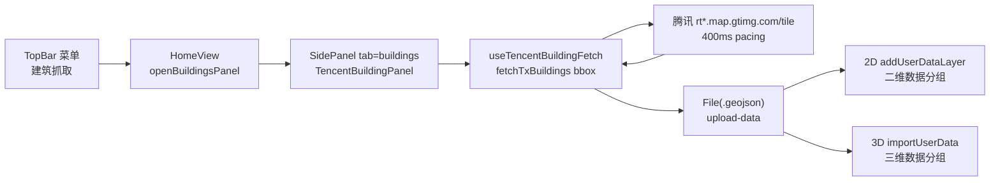

# 腾讯建筑白模抓取入库方案（L3，需批准后施工）

> 状态：**待用户批准**。批准前不碰任何代码（Force_command §1 L3）。
> 版本计划：批准并实施后记 **V3.6.11**（L2/L3 每次 +1 修订号，同日不合并）。

## 1. 目标

- `TopBar` 功能菜单新增「建筑抓取」入口，点击打开 `SidePanel` 新页签。
- 新页签内框选范围（2D 用 ExtentPicker，3D 用镜像 CesiumExtentPicker；手动输入保留）→ 调已有的 `parsers/tencentBuildingFetcher.js` 抓取 → 输出 WGS-84 GeoJSON → **自动经既有 `upload-data` 管线入库**（用户指令：取消手动入库按钮，抓取成功按当前引擎自动加载；2D 进二维数据分组、3D 进三维数据分组），自动获得显隐/透明度/定位/移除等 TOC 能力。
- 新 Vue 组件匹配全站主题（品牌渐变顶栏 + 白卡片浅绿边框 + Lucide 图标，见 `TopBar.vue:871-1010` 注释约定的 DrawPanel 语言）。

## 2. 现状分析（已读代码确认，非臆造）

| 事实 | 位置 |
|---|---|
| 抓取器纯前端 ESM：`fetchTxBuildings({bbox\|center},{zoom,batchDelay,retries,proxyBase,signal,onProgress})` → `FeatureCollection`（`height_m` + `tile`，WGS-84），400ms 批 pacing，可 abort | `data-import/parsers/tencentBuildingFetcher.js:201-294` |
| 直接命中腾讯 `rt*.map.gtimg.com/tile`（CORS `*` 实测可直连），`proxyBase` 可切同源中转 | 同上 `:161-171` |
| 入库缝：`HomeView.handleUploadData({resources:File[]})` 按引擎分流（3D→`importUserData`，2D→`addUserDataLayer`），两边入库后自动进 TOC 对应分组 | `HomeView.vue:1298-1312` |
| OL 侧接受内存内容：`addUserDataLayer({content,type:'geojson',name})` → `parseUploadedFeatures` → `createManagedVectorLayer` + `buildStandardLayerItem` | `ol/data-import/composables/useLayerDataImport.js:1398-1507` |
| Cesium 侧只接受 File：`importUserData({resources})` → `handleDataImport` | `CesiumContainer.vue:977-982` |
| TopBar 菜单为 2×2 网格 + `open-*`/`activate-feature` 双 emit | `TopBar.vue:42-85,357-367,407-451` |
| HomeView 开面板范式：`openX()` 置 `activeSidePanelTab` + 展开（`344-388`）；SidePanel 懒加载页签（`loadedTabs` + `defineAsyncComponent`，`no-padding` 名单制） | `HomeView.vue:148,344-388`、`SidePanel.vue:302-324,439-446,44-52` |
| 文案走 `t('topbar.*')` / `t('shell.*')`，中英双文件 | `locales/zh-CN.js:329-377`、`en-US.js` 对应区 |

**关键选型结论**：组件内把 GeoJSON 包成 `new File([json], 'name.geojson')` 调既有 `upload-data` 通道即可入库两引擎，**零新协议、零新 `type`（`geojson` 已在 TOC 已知集合）、零配置 key**，天然满足 §3 数据源注册前置（显隐/透明度/flyTo/remove 全继承）。

## 3. 实施方案

### 3.1 新增文件（2 个，均在 `data-import` 域内）

| 文件 | 职责（遵分层边界） |
|---|---|
| `frontend/src/domains/common/data-import/useTencentBuildingFetch.js` | 编排：范围归一化（bbox/中心+半径/当前视图三选一）、`fetchTxBuildings` 进度+取消、包 File、调 `upload-data`（经 props 回调由 HomeView 路由）、失败转 `message.error` |
| `frontend/src/domains/common/data-import/components/TencentBuildingPanel.vue` | 纯 UI + 事件：双引擎框选 + 范围表单、进度条、结果统计（栋数/耗时）、下载 GeoJSON 按钮（复用 `downloadGeoJSON`）；抓取成功自动入库（无手动按钮）；Lucide 图标 + 主题 token |
| `frontend/src/domains/common/components/CesiumExtentPicker.vue` | 三维框选（左键拖拽 + 椭球拾取，ExtentPicker 镜像；2D 侧直接复用 ExtentPicker） |

### 3.2 接线改动（5 处，只读确认过的缝）

1. `TopBar.vue`：菜单网格加「建筑抓取」项（`Building2` 图标，`size 16` 与邻项一致）→ `handleOpenBuildings()` 双 emit（`activate-feature {key:'buildings'}` + 新 `open-buildings`）。
2. `locales/zh-CN.js` + `en-US.js`：`topbar.buildings`（菜单）与 `shell` 命名空间面板文案。
3. `HomeView.vue`：`openBuildingsPanel()`（仿 `openBusPlanner`）+ 顶栏监听 `@open-buildings`；面板经 `upload-data` 已有通道入库，无需新 handler（composable 经 prop 回调拿 `getCurrentViewExtent` 与 `emit('upload-data')`，由 SidePanel 透传）。
4. `SidePanel.vue`：新 `v-show="activeTab==='buildings'"` 懒加载块 + `no-padding` 名单 + `defineAsyncComponent` + 所需 props（视图范围回调、引擎、upload 透传）。
5. `frontend-structure.md`（或 data-import 对应 structure 文件）：新增两文件条目（含功能注释）。

### 3.3 数据流（Mermaid）

## 4. 合规与风险

- **平台红线**：本功能=前端瓦片接口 fetch（同底图瓦片性质）+ 用户手动单次触发，无代理/VPN/隧道、无浏览器自动化、无验证码对抗、无运行时下载执行、无防休眠；`proxyBase` 留空默认直连，不动 `deploy/.env` 与工作流。结论：不触 §11。
- **第三方 ToS 灰区**：腾讯矢量接口为逆向调用（见 `Pages/Note/md/tencent-building-reverse.md`），默认 zoom 18 + 单次小范围 + 400ms pacing（**禁止调小**）；面板内注来源与“仅供学习研究”提示；是否上线公网由用户决策。
- **大范围风险**：zoom 18 下每 2×2 瓦片一批，城区别拉全城（面板限最大边长并估算批数，超限先告警）。

## 5. 验收（待用户实机）

1. TopBar 菜单出现建筑抓取项，中英文案正常；点击 SidePanel 切到新页签（懒加载一次）。
2. 默认范围=当前视图；抓取有进度（已完成批数/栋数）、可取消；失败转中文错。
3. 入库后 TOC 对应引擎分组出现新条目，显隐/透明度/flyTo/移除可用；2D/3D 各验一次。
4. 下载的 `.geojson` 可被本工具箱二次导入（回环）。

## 6. 门禁与版本（实施后执行）

- `CheckStructureTree.py` / `CheckConfigRegistry.py`（本次零配置 key，预期全绿）。
- README 三处 + CHANGELOG → **V3.6.11**；日志 `Docs/LLM_record/26-10/2026-10-10/2026-10-10-tencent-building-import.md`。
- 不执行任何 Git 写操作。
