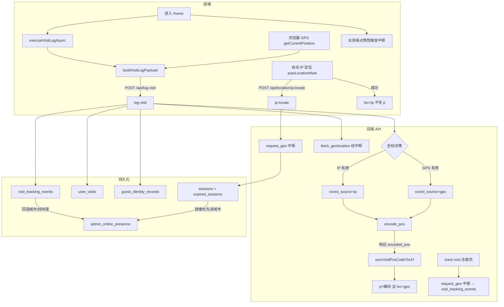

# 用户位置统计架构

> 本文梳理"用户位置"从**采集 → 编解码 → 前后端交互 → 持久化**的完整链路。
> 重点区分两套容易混淆的机制：
> 1. **URL `p` 参数**：位置短码（前端 `encodePos` / 后端 `encode_pos` **同算法**，双向互通）；
> 2. **后端 IP/GPS 解析统计**：IP 定位 + GPS 上报 → 多张统计表。
>
> 代码依据（2026-11-26 核查）：`frontend/src/domains/common/{map-view,url-state,user}`、
> `frontend/src/app/composables/useHomeTocAndAttributeActions.ts`、
> `backend/api/{statistics,location}.py`、`backend/services/{ip_geo,request_geo}.py`、
> `backend/api/auth/schema.py`。

---

## 一、术语与口径定义（先分清，避免混淆）

| 术语 | 含义 | 产生方 | 形态 |
|---|---|---|---|
| **`p` 参数** | URL hash query 中的**位置短码**，编码经纬度（6 位小数精度） | 后端 `/api/log-visit` 返回（访问链路）；前端 `encodePos`（其它写 URL 场景） | Base62 短串，如 `2Kx9…`；无效为 `'0'` |
| **`loc` 参数** | 定位**来源标记**，只表来源不表坐标 | 前端 | `gps` / `ip` / `0`（旧链接 `1` 兼容映射为 `gps`） |
| **`lng`/`lat`** | URL hash query 中的明文经纬度（WGS-84） | 前端地图状态 | 浮点数 |
| **`encoded_pos`** | 数据库中存储的**同一位置短码**，与 URL `p` 同算法 | 后端 `statistics.encode_pos` | 与 `p` 可互换 |
| **`coord_source`** | 后端统计表中记录的坐标来源 | 后端 | `gps` / `ip` / `unknown` |
| **IP 定位** | 由请求 IP 反查城市+经纬度（非用户授权） | 后端 `ip_geo_service` | 城市级 + 粗略经纬度 |
| **GPS 定位** | 浏览器 `navigator.geolocation`（需用户授权） | 前端 | 精确 WGS-84 坐标 |

**关键边界**：`p` 是**坐标的编码表示**，`loc` 是**来源标记**，`s/loc/p/cs` 中的 `loc` 与地图定位的 `loc` 是同一个参数。
IP 定位只写 `loc=ip`、**不写 `p`**（`userLocationMath.ts:130-151` 仅 `params.set('loc', source)`）；GPS 授权的坐标短码 `p` + `loc=gps` 由 `syncVisitPosCodeToUrl` 在收到后端 `encoded_pos` 后写入（`useHomeTocAndAttributeActions.ts:551-553`）。

---

## 二、位置短码 `p` 的编解码（前后端同算法）

### 2.1 编码规则（完全一致）

| 步骤 | 前端 `encodePos`（`url-state/codec/positions.ts`） | 后端 `encode_pos`（`statistics.py:227`） |
|---|---|---|
| 精度 | `COORD_SCALE = 1e6`（6 位小数） | 同 |
| 平移 | `lng + 180`、`lat + 90` | 同 |
| 位宽 | `LAT_BITS = 28n` | 同 |
| 封包 | `(lngScaled << 28) | latScaled`（BigInt） | `(int << 28) | int` |
| 编码 | 自定义 Base62 | 同（`_encode_base62`） |
| 校验 | 范围外/非法返回 `'0'` | 同 |
| 补位 | — | `len < MIN_CODE_LENGTH` 时左侧补 base62 零，保证与前端等长 |

后端函数注释明确："按前端 urlCrypto 规则编码，保持互通"。
解码端：**仅前端有 `decodePos`**（`positions.ts`），用于把 `p` 还原成点位并画点；
**后端只有编码、没有解码函数**——管理端若要按坐标展示，直接使用库中 `latitude/longitude` 字段，
不解码 `encoded_pos`。
另有一组**罗盘状态短码**（`r.`/`t.` 前缀，封装半径与主题）与 `p` 共用封包基础但**语义不同**，勿混。

### 2.2 `p` 的完整流转（访问链路，最重要）

```
前端 GPS 授权 (navigator.geolocation)
  → buildVisitLogPayload() 组装 {gps_lng,gps_lat,gps_accuracy,gps_timestamp,geo_permission}
  → POST /api/log-visit
  → 后端选坐标源（GPS 优先 > IP 回退）
  → 后端 encode_pos(选中经纬度) → encoded_pos
  → 响应体返回 encoded_pos
  → 前端 syncVisitPosCodeToUrl(encodedPos, geo_permission)
      · granted 且 code≠'0' → 写 p=<code> 且 loc=gps
      · 否则 → 删 p / loc（不写占位值）
  → URL hash query 更新（replaceState，不进历史）
```

**注意**：访问链路中 URL 的 `p` 来自**后端返回值**，不是前端本地编码。前端 `encodePos` 用于其它写 URL 场景（如地图状态同步）。

### 2.3 `p` 的其它生命周期

- **读取**：`useUrlParamStore.normalizePositionCode` 规范化 → pendingParams；`useCesiumUrlTracking` / `useMapState` 读取并恢复视图。
- **持久化跨越登录**：登录/注册/OAuth 回调前 `persistPositionCode` 写入 sessionStorage，
  成功后 `injectPositionCodeToPath` 回填到 `/home?p=...`，再 `consumePersistedPositionCode` 清除。
- **解码展示**：用户可粘贴 `p` 到 TOC 面板 → `usePositionCodeTool.decodePositionCodeToPointPayload`
  → `decodePos` → 逆地理编码补全属性 → 画点。
- **清洗**：`urlParamSanitizer` 仅保留非空非 `'0'` 的 `p`，写入端不产生 `p=0`。

---

## 三、GPS 定位链路（前端主导）

### 3.1 采集与候选

| 文件 | 职责 |
|---|---|
| `useUserLocation.ts` | `navigator.geolocation.getCurrentPosition`（highAccuracy, 3.5s 超时, 60s 缓存）；`buildIpCandidate` 构造 IP 回退候选 |
| `userLocationMath.ts` | 坐标换算、中国范围判定、`markLocationSuccessFlagInUrl` 写 `loc` |
| `services/autoLocationMark.ts` | 进入 `/home` 时非阻塞 IP 定位 → 成功写 `loc=ip`（整页一次），`fetchIpLocationCandidate` 与 `useUserLocation` 共用 |
| `usePositionCodeTool.ts` | `p` 解码 + 逆地理编码补全 |

**优先级**：GPS（用户授权）> IP（自动回退）。已写 `loc=gps` 后 IP 回退不得降级覆盖。

### 3.2 前端 IP 定位 API 交互

- `apiLocationIpLocate(ip?)` → `POST /api/location/ip-locate`
  - 后端经 `request_geo` 中枢取 IP 并惰性解析（显式 ip 用 `resolve_ip_geo`，无显式 ip 用 `get_request_geo`）；私网/失败返回 `ok=false`；
  - 返回 `{ok, source, ip, city, province, country, latitude, longitude, extent:null}`；
  - `autoLocationMark` 成功即 `markLocationSuccessFlagInUrl('ip')`，**不写 `p`**。

---

## 四、后端 IP 解析服务与统一中枢

### 4.1 `ip_geo_service`（`services/ip_geo.py`）

四级降级（自带 TTL 缓存 1h、自动跳过私网 IP）：

| 优先级 | 服务 | 说明 |
|---|---|---|
| 1 | 高德 AMAP | 需 api_keys.amap_key，仅中国 IP，精度最高 |
| 2 | ipwho.is | 免费 HTTPS，覆盖数据中心 IP |
| 3 | ip-api.com | 免费，仅 HTTP，不稳定 |
| 4 | ipapi.co | 30 次/分钟限流，最后兜底 |

### 4.2 `request_geo` 中枢（`services/request_geo.py`，V3.7.14）

- `get_request_geo(request)`：结果挂 `request.state._unified_geo_result`，**请求内只解析一次**；
- `resolve_ip_geo(ip)`：供无 request 上下文（如 proxy）或显式 IP 调用；
- 进程级缓存复用 `ip_geo_service`，实现**同一 IP 跨请求只解析一次**；
- 私网 IP 在中枢层直接跳过（零外部请求），失败静默返回 `resolved=False`（保留 `ip` 供审计）。
- **触发方式（2026-11-26 代码审查后定稿）**：业务端点惰性调用，**不挂全局中间件**——
  `app.py` 的 `check_startup_state` 不再 `await` 地理解析，避免任意请求被第三方延迟拖慢；
  `resolve_request_geo_middleware()` 仅作可选预热入口保留，默认未挂载。

> **现状（2026-11-26 已收敛）**：`location.py` 的 `/location/ip-locate`（显式 ip 用 `resolve_ip_geo`，
> 无显式 ip 用 `get_request_geo`）与 `/location/track-visit`（`get_request_geo`）、账号/游客签发
> 均已改走中枢，全仓 IP 解析只有中枢一个入口；请求级缓存保证同一请求只解析一次。

---

## 五、后端统计写入与存储分工

### 5.1 两个访问追踪端点（口径已统一，2026-11-26）

| 端点 | 所在文件 | 写入表 | 触发方 | 内容 |
|---|---|---|---|---|
| `POST /api/log-visit` | `statistics.py:1362`（装饰器） | `visit_tracking_events` + `user_visits` + `guest_identity_records` | 进入 /home 后的 `executeVisitLogAsync` | 完整：IP + 城市 + GPS + `coord_source` + `encoded_pos` |
| `POST /api/v1/location/track-visit` | `location.py:327` | **`visit_tracking_events`**（V3.7.14 统一） | 注册页 `RegisterView.ts:298` | IP 城市级（`coord_source=ip`），经中枢解析 |

> **V3.7.14 变更**：`track-visit` 原写只写不读的 `visit_tracking` 死表，现统一写入
> `visit_tracking_events`（管理端统计源）。旧 `visit_tracking` 表为无读取方的死表，**已于 2026-11-26 删除**（删前备份）。
> 两个端点的 IP 解析均经 `request_geo` 中枢，`gps_timestamp` 统一服务端 UTC+8。

> ⚠️ **代码注释待修（本次不改代码）**：`backend/api/location.py:354-355` 的注释仍写「旧表保留不删（历史数据），但停止写入」，与已删除的实际状态（`schema.py` 无建表、`auth/db.py:281-282` 记「该表 V3.7.14 已删除」）不一致。本文按代码事实统一为「已删除」，该代码注释留待后续修订。

### 5.2 `/api/log-visit` 的坐标决策（后端 `statistics.py:1407-1434`）

```
geo_data = fetch_geolocation(client_ip)        # IP 定位（经中枢）
gps = 前端上报的 gps_lng/gps_lat
if GPS 有效:
    selected = GPS; coord_source='gps'
elif IP 经纬度有效:
    selected = IP; coord_source='ip'
else:
    selected = None; coord_source='unknown'
encoded_pos = encode_pos(selected) 或 '0'
```

写入三张表（各司其职）：

| 表 | 写入函数 | 作用 |
|---|---|---|
| `visit_tracking_events` | `_insert_visit_tracking_event_sync` | 访问事件明细（含完整地理与同步状态），供管理端列表与在线表反查 |
| `user_visits` | `_record_visit_sync`（`ON CONFLICT DO UPDATE`） | 用户维度的访问聚合（ip/city/lat/lng） |
| `guest_identity_records` | `_upsert_guest_identity_record_sync` | 游客身份记录（ip/coord_source/encoded_pos/last_latlng） |

### 5.3 全部含地理字段的表

| 表 | IP | 城市 | 坐标 | 短码 | 写入方 |
|---|---|---|---|---|---|
| `visit_tracking_events` | ip | ip_city/region/country | latitude/longitude + coord_source | encoded_pos | `/log-visit` |
| ~~`visit_tracking`~~ | — | — | — | — | **已删除**（V3.7.14；死表无读取方，删前已备份） |
| `user_visits` | ip | city | latitude/longitude | — | `_record_visit_sync` |
| `guest_identity_records` | ip | — | last_latitude/longitude + coord_source | encoded_pos | `_upsert_guest_identity_record_sync` |
| `sessions` | ip | ip_city/region/country（V3.7.14） | — | — | 签发时经中枢 |
| `expired_sessions` | ip | 同上（归档副本） | — | — | 归档搬运 |
| `admin_online_presence` | ip | ip_city/region/country | latitude/longitude + coord_source | — | 镜像刷新（sessions 优先，回退事件表） |

### 5.4 在线表的城市来源（V3.7.14）

`_mirror_identity_from_db_sync` 刷新在线表时：
1. **优先**查 `sessions.ip_city`（签发时由中枢解析落库）；
2. **回退**查 `visit_tracking_events`（按 guest_uid/username 最新一条）；
3. 经纬度始终取访问事件表（sessions 只存城市级，不扩大隐私面）。

---

## 六、端到端数据流（总图）



---

## 七、关键约束与不变量

1. **GPS 优先**：`coord_source=gps` 一旦成立，IP 回退不可覆盖；URL `loc=gps` 同理。
2. **IP 不写 `p`**：IP 定位只标 `loc=ip`，`p` 仅由 GPS 授权链路写入（`userLocationMath.ts` + `syncVisitPosCodeToUrl`）。
3. **`p` 与 `encoded_pos` 同算法**：后端编码结果可直接作为前端 URL `p` 使用（后端补位保证等长）。
4. **不写占位值**：`p`/`loc`/`s`/`cs` 的空值由 `urlParamSanitizer` 统一剔除；读取端仍兼容旧链接。
5. **仅 `/home` 可写定位标记**：`markLocationSuccessFlagInUrl` 与入口自动定位均限定 `/home`，落地页不写。
6. **私网 IP 不解析**：中枢层与 `ip_geo_service` 双重跳过；HF 容器网关 IP 的城市留空属预期。
7. **城市级隐私边界**：`sessions` 只存城市；精确经纬度仅在访问事件/游客记录中。

---

## 八、原 3 处不一致（2026-11-26 已全部修复）

| # | 原不一致 | 修复结果 |
|---|---|---|
| 1 | `/location/ip-locate`、`/location/track-visit` 直调 `ip_geo_service` | **已改走 `request_geo` 中枢**：显式 ip 用 `resolve_ip_geo`，无显式 ip / track-visit 用 `get_request_geo` 惰性解析并复用 `request.state` |
| 2 | 两套访问追踪端点写入两张不同统计表 | **已统一写 `visit_tracking_events`**；旧 `visit_tracking` 已删除（V3.7.14；删前备份，见 §5.1 / §5.3） |
| 3 | `gps_timestamp` 前端上报，时钟可能漂移 | **已改服务端 UTC+8**：`log-visit` 与 `track-visit` 均用 `datetime.now(...).isoformat()`，前端上报值忽略 |

回归测试：`backend/tests/test_location_inconsistency_fix.py`（5/5）。修复日志：[location-inconsistencies-fix](../LLM_record/26-11/2026-11-26/2026-11-26-location-inconsistencies-fix.md)

**剩余说明**：`gps_error` 仍由前端上报并原样入库——这是错误描述文本而非时间戳，无时钟漂移问题，保留。

---

## 九、文件速查

| 主题 | 前端 | 后端 |
|---|---|---|
| 短码编解码 | `domains/common/url-state/codec/positions.ts` / `crypto.ts`（编+解） | `api/statistics.py:encode_pos`（仅编码） |
| URL 参数 | `urlParamSanitizer.ts`、`stores/useUrlParamStore.ts`、`auth.ts`(p 持久化) | — |
| GPS 采集 | `map-view/useUserLocation.ts`、`userLocationMath.ts`、`app/composables/useHomeTocAndAttributeActions.ts` | — |
| IP 定位 | `api/backend/location.ts:apiLocationIpLocate` | `api/location.py:ip_locate`、`services/ip_geo.py`、`services/request_geo.py` |
| 访问统计 | `api/backend/statistics.ts:apiLogVisit` | `api/statistics.py:log_visit`、`api/location.py:track_visit` |
| 存储 | — | `api/auth/schema.py`（各表结构）、`api/auth/session_archive.py` |
