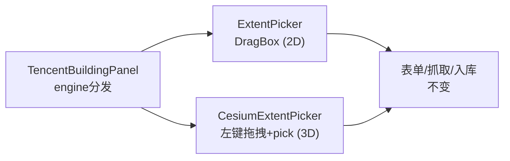

# 2026-10-10 建筑抓取改框选 → V3.6.14

## 日期与时间

2026-10-10（会话内执行）

## 任务等级

**L2 常规**（交互变更：新文件 1 + 面板/SidePanel/HomeView/locale/结构树；无配置 key、无签名变更）

> 依据 Force_command §0：用户指令「换成框选，区分 ol/cesium」（P1）要求遵循本规范（P2），是对已批 L3 方案交互方式的变更，用户当场改判生效。

## 问题分析

### 核心症状

- 用户认为「使用当前视图」不好用，要求换成框选，且 OL/Cesium 各自实现。

### 根本原因

- 当前视图=整屏 bbox，不可控；框选才是抓取类功能的标准交互。

### 受影响模块

| 模块 | 文件（†=新增） |
|---|---|
| 三维框选 † | `common/components/CesiumExtentPicker.vue` |
| 抓取面板 | `data-import/components/TencentBuildingPanel.vue`（框选嵌入 + 删视图链） |
| 透传 | `shell/SidePanel.vue`（viewer/命名空间 props）、`app/HomeView.vue`（2 取数器，删旧范围函数） |
| 文案 | `locales/zh-CN.js`、`en-US.js`（`extent.hintIdleCesium` 各 1 键） |
| 文档 SSOT | 结构树、`README.md`、`CHANGELOG.md`、方案局部更新、本日志 |

### 候选方案对比

| 方案 | 说明 | 结论 |
|---|---|---|
| A. 两引擎各写一套 | OL 重复 ExtentPicker 的 DragBox/覆盖层逻辑 | 否决 |
| B. OL 复用 ExtentPicker，Cesium 新建镜像组件（同事件形状） | OL 零新交互代码；Cesium 左键拖拽 + pickEllipsoid，拾取失败不落点 | **选定** |

## 修改内容

1. **† `CesiumExtentPicker.vue`**：镜像 `ExtentPicker` 的 props（-currentView）/事件（`extent-change {extent[4],crs}`/`extent-clear`）/按钮文案（复用 `extent.*`）/红预览蓝覆盖视觉；拾取期禁用旋转、退出恢复；天空/无效落点不发射；卸载清理。
2. **面板**：`activeEngine!=='cesium'` 用 `ExtentPicker`（自带当前视图/清除），否则用 `CesiumExtentPicker`；`onExtentPicked` 同形填充；删 `getViewExtent` prop + `fillFromView` + Crosshair。
3. **链路**：HomeView 删 `getBuildingsViewExtent`（L1 兜底一并退役，无死代码），加 `getCesiumViewerForPicker/getCesiumNamespaceForPicker`；SidePanel props 同步替换并透传。
4. **文案**：`extent.hintIdleCesium` 中英；`useView`/`viewEmpty`（面板）暂留无害（前者已无引用，后者三维拾取失败复用）。
5. **文档**：结构树 +1 条目；方案 §1/§3 交互改为框选（小幅同步）；README×3 + CHANGELOG → V3.6.14。

## 修改原因

用户明确要求；旧链删除干净，无残留（已 grep 核对 `getBuildingsViewExtent/fillFromView` 零命中）。

## 影响范围

- 建筑抓取面板范围输入方式；其余抓取/入库逻辑不动
- `ExtentPicker` 被多面板共用，本次只消费未改动它
- SidePanel 新增 2 透传 props（仅 buildings 页签使用）

## 解决方案

见「修改内容」。三维拾取用椭球（与瓦片编号体系一致，框选用途足够）；地形起伏导致的边缘偏差在可接受范围（抓取按瓦片取整，本就外扩）。

## 性能指标

未实测。

## 测试方案

### Agent 已执行

- 通读 `ExtentPicker` 400 行（事件形状/注入链/样式）与 `MapDownloader` 消费范例，镜像 API 对齐
- 全链 grep 核对（新链 17 命中，旧链 0 残留；面板无 Crosshair/getViewExtent 残留）
- 无 `.ts` 新增；门禁见下；未执行 Git 写操作

### 待用户实机验证

1. 2D：点开始框选 → 地图拉框（红预览）→ 松手蓝框保留 + 4 输入框填值 + 量估算出现；清除按钮清框。
2. 3D：同上在三维里拉框；旋转在拾取期禁用、结束后恢复；往天上拉不落点。
3. 框选后直接抓取→自动入库；手动输入回归。
4. 中英切换：三维 idle 提示为新文案。

## 变更文件清单

| 路径 | 说明 |
|---|---|
| `frontend/src/domains/common/components/CesiumExtentPicker.vue` † | 三维框选镜像组件 |
| `.../data-import/components/TencentBuildingPanel.vue` | 框选嵌入 + 删视图链 |
| `frontend/src/domains/common/shell/SidePanel.vue` | 2 透传 props 替换 |
| `frontend/src/app/HomeView.vue` | 2 取数器，加 1 删 1 函数 |
| `frontend/src/locales/zh-CN.js`、`en-US.js` | `hintIdleCesium` |
| `Docs/Guide/frontend-structure.md` | +1 条目 |
| `Docs/Architecture/tencent-building-import-plan.md` | 交互改为框选（局部同步） |
| `README.md` | 三处 → V3.6.14 |
| `Docs/Guide/CHANGELOG.md` | V3.6.14 条目 |
| `Docs/LLM_record/26-10/2026-10-10/2026-10-10-building-boxselect.md` | 本日志 |

## 模块关系

## 遗留与风险

- `shell.buildings.useView/viewEmpty/import` 三键残留（`viewEmpty` 三维拾取失败复用中，另两键无引用），无害。
- 三维框选是椭球拾取，高山区分辨率边缘与地形有差，抓取按瓦片外扩可覆盖。
- 超长列表/触摸手势在三维框选未专项验证（Cesium 触摸映射左键，理论可用）。
- 未实机运行。

## 门禁

- `python Scripts/CheckStructureTree.py`：通过（486 项/0 漂移；含本次 +1 文件）
- `python Scripts/CheckConfigRegistry.py`：全部通过 ✅（零配置 key）
- 平台红线自查：仅前端交互，未碰后端/部署面 → CLEAN
- 未执行任何 Git 写操作
