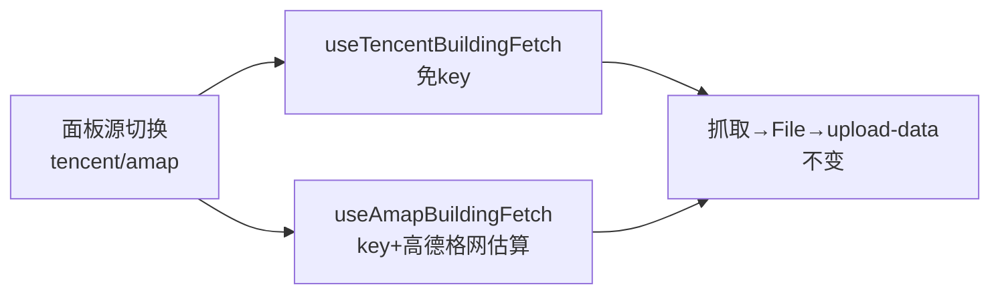

# 2026-10-10 建筑抓取双源（腾讯/高德）→ V3.6.12

## 日期与时间

2026-10-10（会话内执行）

## 任务等级

**L2 常规**（功能扩展：新文件 1 + 面板/文案/结构树；无配置 key、无签名变更）

> 依据 Force_command §0：用户三问（P1）要求遵循本规范（P2），无冲突。

## 问题分析

### 核心症状

1. 演示 key（`AMAP_DEMO_KEY`）能否用？
2. 已验证的自备 key 如何在前端用？
3. 面板只支持腾讯源，要加高德源二选一。

### 根本原因

1. 演示 key 实测：`web/init` 通过（key 活着），`get_tile` oversea=0 报 `11000 OVERSEA_FORBIDDEN`，oversea=1 报 `10006 INVALID_USER_DOMAIN`（域名白名单）——**认证活、无数据，浏览器端同样撞墙，故不可用**。
2. 面板无 key 输入位；抓取器 `key` 参数空置。
3. 功能缺失：单源写死。

### 受影响模块

| 模块 | 文件（†=新增） |
|---|---|
| 高德编排 † | `common/data-import/useAmapBuildingFetch.js`（与腾讯版同 API 形状） |
| 面板 | `data-import/components/TencentBuildingPanel.vue`（源切换 + key 输入 + 桥接分发） |
| 文案 | `locales/zh-CN.js`、`en-US.js`（source/key 系 7 键 + 标题去腾讯化） |
| 文档 SSOT | 结构树、`README.md`、`CHANGELOG.md`、本日志 |

### 候选方案对比

| 方案 | 说明 | 结论 |
|---|---|---|
| A. 默认填演示 key | 实测 0 栋，误导用户 | 否决 |
| B. key 面板输入 + localStorage 持久 + 缺 key 报 `key_required`，不设演示兜底 | 诚实可用；key 不进仓库 | **选定** |
| C. key 进 `.env`/catalog | 后续如需多端同步再做，本次面板级即够 | 否决（暂不） |

## 修改内容

1. **† `useAmapBuildingFetch.js`**：同形状状态机；`estimateAmapTiles`（高德格网 y 为等距纬度行）；`startFetch(bbox, zoom, key)` 缺 key 报 `key_required`；`buildImportFile/downloadResult` 复用 `toSpecGeoJSON`（高德输出同有裸 `crs`）。
2. **面板**：顶部源切换（腾讯/高德，抓取中禁用）；高德源显示 key 密码框 + 提示（演示 key 无数据、只存本地）；级别选项按源切换（腾讯 16-18/高德 13-15，切换源重置）；估算/抓取经 `cur` 桥接分发（computed 包 ref 自动拍平，模板零改）；标题去腾讯化。
3. **文案**：`sourceTencent/sourceAmap/key/keyPh/keyTip/err_key_required` + 标题中英。
4. **文档**：结构树 +1；README×3 + CHANGELOG → V3.6.12。

## 修改原因

用户三问；演示 key 不可用必须明示（面板 keyTip 写死）。

## 影响范围

- 建筑抓取面板（默认腾讯源，老行为不变；切高德需填 key）
- 其余链路（框选/入库/拔高）不动

## 解决方案

见「修改内容」。入库/拔高/crs 兼容对高德输出同样生效（同 `height_m` + 同裸 `crs`）。

## 性能指标

未实测；高德 z14 估算公式已按其 batchSize=8/300ms 校准。

## 测试方案

### Agent 已执行

- Node 实测：自备 key 东方明珠 4611 栋（高 4–520m）；演示 key init 活、get_tile 双路死（11000/10006），0 栋
- eslint 4 文件零告警；无 `.ts` 新增；门禁见下；未执行 Git 写操作

### 待用户实机验证

1. 面板顶部出现腾讯/高德切换；默认腾讯，老流程不变。
2. 切高德：出现 key 框（空），点抓取报“请先填写高德 key”；粘贴实测 key → 抓取→自动入库；刷新页面 key 还在（localStorage）。
3. 高德结果 3D 拔高正常（同 `height_m`）。
4. 中英切换新文案正常。

## 变更文件清单

| 路径 | 说明 |
|---|---|
| `frontend/src/domains/common/data-import/useAmapBuildingFetch.js` † | 高德编排 |
| `.../data-import/components/TencentBuildingPanel.vue` | 双源切换 + key + 桥接 |
| `frontend/src/locales/zh-CN.js`、`en-US.js` | 7 键 + 标题 |
| `Docs/Guide/frontend-structure.md` | +1 条目 |
| `README.md` | 三处 → V3.6.12 |
| `Docs/Guide/CHANGELOG.md` | V3.6.12 条目 |
| `Docs/LLM_record/26-10/2026-10-10/2026-10-10-building-dualsource.md` | 本日志 |

## 模块关系

## 遗留与风险

- key 只存浏览器本地；多端同步/团队共用需走配置中心（另立项，进 `.env` + catalog + 门禁）。
- `shell.buildings.useView/import` 残留键无害（历史原因）。
- 演示 key 结论基于 Node 直测；浏览器端只会更严（叠加 Referer 白名单），结论不变。
- 未实机运行（面板改动需真机点一遍）。

## 零散修补（L1，不单 bump 版本，并入未提交的 V3.6.12）

- 进度 undefined＋`[object Object]`：实证 `computed(() => ref)` 不拍平内层 ref（Node 实测 bridged.value 为 RefImpl），桥接层改在 getter 内取 `.value`。教训：跨实例桥接必须取值后暴露，不得透传 ref。单文件，eslint 全绿。
- 高德 key 改走管理端 L2（用户纠正）：`useAmapBuildingFetch.startFetch` 内 `await loadRuntimeMapTokens()` + `getRuntimeMapTokensSync().amapKey`（与天气/下载等模块同通道）；面板 key 输入框、localStorage 逻辑、`key/keyPh/keyTip` 文案键全部删除（grep 零残留）；缺 key 报“管理端未配置…”；`err_key_required` 中英改写。key 不进仓库。eslint 全绿。
- amap 框选偏差大：实测请求框 0.02×0.02° 输出 0.044×0.033°、3954/4611 栋中心落框外——整瓦片外扩无裁剪（z14 瓦片大；腾讯 z18 肉眼不明显）。`useAmapBuildingFetch` 加 `clipFeaturesToBbox`（环上任一顶点落框即整栋保留，跨边楼完整），入库/下载均为裁剪后；Node 实测 4611→680，剩余外扩均为跨边楼合法保留。UI 区分双源：tab 加图标＋高德激活态绿色系＋源说明行（逻辑/速度/配额差异写进文案）。并入 V3.6.12，eslint＋双门禁全绿。
- 高德级别真相：同框实测 z13/z14/z15 → 0/4608/0 栋；再探 pbf 体积 z13/z15 仅 80 余字节空包、z14 39KB——**服务端仅 z14 发楼栋层**，非解码 bug。两种切片策略：腾讯 z18 小瓦片 vs 高德 z14 大瓦片整包。修：删 `AMAP_ZOOM_OPTIONS`，高德锁死 z14（下拉变固定文本＋`zoomFixed` 文案），说明行同步。并入 V3.6.12。
- 删演示 key（用户要求，防 GitHub 风险提醒）：`AMAP_DEMO_KEY` 常量＋默认参数＋相关注释全部删除，`fetchAmapBuildings` 无 key 直接抛错；`AMAP_TILE_SIZE` 保留（误删后已恢复）。全仓 grep 确认代码零残留（仅本日志叙事提及常量名，无明文值；明文从未进过仓库）。eslint 全绿。并入 V3.6.12。
- 范围上限分源放宽（用户批准）：速算腾讯 z18 的 0.05°=2701 瓦片/676 批（10 分钟＋必卡死，保持）；高德 z14 的 0.05°=15 块/2 批（过严）→ 放宽到 0.2°（约 190 块/24 批，2–3 分钟可接受）；`err_oversize` 文案去具体数值（两源不一致了）。彻底取消不可取（腾讯侧必炸＋key 配额风险）。并入 V3.6.12。
- 高德 16/17/18 追测：同框 → 0/0/0（z18 跑 147s 仍 0），确认仅 z14 有数，锁死正确。
- 腾讯级别影响（同框 0.008° 实测）：z16 2.3s/270 栋/8.4 点均，z17 4.4s/251 栋/10.3 点，z18 11.6s/191 栋/12.8 点——级别越高越慢、轮廓越精细（均顶点多），栋数略降（高级别泛化不同）；默认 z18 求质量，赶时间降级。用户确认 height 恢复，面板下载链本身不丢属性，闭环。

## 门禁

- `python Scripts/CheckStructureTree.py`：通过（488 项/0 漂移；首跑抓到 `amapBuildingFetcher.js` 旧漂移，已补条目复绿）
- `python Scripts/CheckConfigRegistry.py`：全部通过 ✅（零配置 key）
- 平台红线自查：仅前端，未碰后端/部署面；key 不进仓库 → CLEAN
- 未执行任何 Git 写操作
