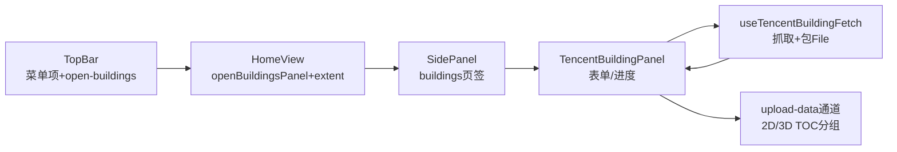

# 2026-10-10 腾讯建筑白模抓取入库 → V3.6.11

## 日期与时间

2026-10-10（会话内执行）

## 任务等级

**L3 方案 + L2 实施**：跨 4 模块（TopBar/SidePanel/data-import/图层管理）+ 2 新文件。按 Force_command §1 先定 L3 出方案（`Docs/Architecture/tencent-building-import-plan.md`，含 Mermaid），经用户明确批准（菜单网格 + 双引擎）后施工；施工部分按 L2 全流程收尾，记 **V3.6.11**。

> 依据 Force_command §0：用户原指令（P1）+ 会中批准（P1）要求遵循本规范（P2），无冲突。

## 问题分析

### 核心症状

- 用户要：TopBar 接入“建筑数据爬取” → 点开 SidePanel → 用 `parsers/tencentBuildingFetcher.js` 抓腾讯建筑 → GeoJSON 注册到图层管理；新组件贴合主题/UI。

### 根本原因

- 功能缺失：抓取器只有纯函数（无 UI、无入库接线、无入口），需补“编排 + 面板 + 三处接线”。

### 受影响模块

| 模块 | 文件（†=新增） |
|---|---|
| 抓取编排 † | `common/data-import/useTencentBuildingFetch.js` |
| 抓取面板 † | `common/data-import/components/TencentBuildingPanel.vue` |
| 顶栏入口 | `common/shell/TopBar.vue`、`locales/zh-CN.js`、`locales/en-US.js` |
| 面板宿主 | `common/shell/SidePanel.vue`、`app/HomeView.vue` |
| 文档 SSOT | `README.md`、`CHANGELOG.md`、`frontend-structure.md`、方案、本日志 |

### 候选方案对比

见方案文档 §2-3。核心选型：结果包 `.geojson` File 走既有 `upload-data` 通道（`HomeView:1298` 按引擎分流），OL 侧 `addUserDataLayer({content,type:'geojson'})`（`useLayerDataImport:1398`）与 Cesium `importUserData({resources})`（`CesiumContainer:977`）各自自动建档进 TOC——**零新协议/零新 type/零配置 key**，§3 注册前置以复用方式满足。

### 选定方案与理由

方案 C（用户已批准）：composable（编排）+ Panel（纯 UI）分层；TopBar 菜单网格项；SidePanel 新懒加载页签；中英文案。

## 修改内容

1. **† `useTencentBuildingFetch.js`**：`idle|fetching|done|error` 状态机；`validateTxbBbox`（边长 ≤0.05° 等 5 档短码）；`estimateTxbTiles`（与抓取器同算法）；`startFetch`（AbortController + 进度回调，取消回 idle 不报红）；`buildImportFile`/`downloadResult`。
2. **† `TencentBuildingPanel.vue`**：范围 4 输入 + 级别 16/17/18 + 当前视图填充 + 量估算 + 进度条 + 结果统计 + 入库/下载 + 来源声明；`upload-data {resources:[File]}` / `close` 双事件；主题 token + Lucide（Building2/Crosshair/Upload/Download/X/TriangleAlert，均为仓内已用名或同系新图标）。
3. **`TopBar.vue`**：`Building2` import + `open-buildings` emit + 菜单网格第 5 项 + `handleOpenBuildings`（双 emit 关菜单范式）。
4. **locales**：`topbar.buildings` + `shell.buildings`（23 键）中英。
5. **`HomeView.vue`**：`openBuildingsPanel` + `@open-buildings` + `getBuildingsViewExtent`（2D 直读 `getMapExtent`，3D 按相机中心+高度折算）+ SidePanel prop 透传 + tab 注释。
6. **`SidePanel.vue`**：`TencentBuildingPanel` 懒加载 + `buildings` 页签块（罗盘后）+ `no-padding` + `getBuildingsViewExtent` prop + `upload-data` 透传；模式注释顺延 6→7→8。
7. **文档**：`frontend-structure.md` 加 2 新条目并补此前漂移的 `tencentBuildingFetcher.js`；README 三处 + CHANGELOG → V3.6.11。

## 修改原因

用户功能需求 + L3 批准（菜单网格/双引擎）。

## 影响范围

- TopBar 功能菜单（+1 项，2×2 网格变为 5 项自适应换行）
- SidePanel（+1 懒加载页签；其余页签不动）
- data-import（+2 文件；既有解析/入库逻辑零改）
- 入库数据经既有通道，双引擎 TOC 行为与文件导入一致

## 解决方案

见方案文档与「修改内容」；数据流 Mermaid 见方案文档 §3.3。

## 性能指标

未实测（需真机抓取；估算：默认视图 z18 约数十批 ×0.4s pacing）。

## 测试方案

### Agent 已执行

- 通读 Force_command 全文；核对抓取器 311 行、`upload-data` 双引擎路由、OL/Cesium 入库签名、TopBar/SidePanel/HomeView 接线范式、locale 格式、Lucide 名仓内有据（Building2 除外，为 lucide 常驻图标，TriangeAlert 同系已用）
- 新增/改动 7 文件 + 结构树 + README×3 + CHANGELOG + 方案 + 本日志
- 门禁见下；未执行 Git 写操作

### 待用户实机验证

1. TopBar 菜单出现「建筑抓取」（中英），点击 SidePanel 切新页签（首开懒加载）。
2. 点“使用当前视图”自动填 bbox；估算显示；抓取有进度、可取消；超大范围被拦截。
3. 抓取完成显示栋数；点入库 → TOC 对应引擎分组出现条目，显隐/透明度/flyTo/移除可用；2D/3D 各验。
4. 下载的 `.geojson` 可被工具箱二次导入（回环）。
5. 回归：其余顶栏菜单与页签无异常；F12 移动宽下面板按钮 ≥36px。

## 变更文件清单

| 路径 | 说明 |
|---|---|
| `frontend/src/domains/common/data-import/useTencentBuildingFetch.js` † | 抓取编排 composable |
| `frontend/src/domains/common/data-import/components/TencentBuildingPanel.vue` † | 抓取面板 |
| `frontend/src/domains/common/shell/TopBar.vue` | 入口项 + emit + handler |
| `frontend/src/locales/zh-CN.js`、`en-US.js` | `topbar.buildings` + `shell.buildings` |
| `frontend/src/app/HomeView.vue` | 开面板 + 视图范围 + 监听 + 透传 |
| `frontend/src/domains/common/shell/SidePanel.vue` | 新页签 + 懒加载 + 透传 |
| `Docs/Guide/frontend-structure.md` | 2 新条目 + 补 `tencentBuildingFetcher.js` 漂移 |
| `README.md` | 三处 → V3.6.11 |
| `Docs/Guide/CHANGELOG.md` | V3.6.11 条目 |
| `Docs/Architecture/tencent-building-import-plan.md` | L3 方案（已批准） |
| `Docs/LLM_record/26-10/2026-10-10/2026-10-10-tencent-building-import.md` | 本日志 |

## 模块关系（L2 ≥3 文件）

## 遗留与风险

- `useTencentBuildingFetch` 未被 `CheckConfigRegistry` 覆盖外的新增 `components/` 目录由结构树覆盖；`tsc --noEmit`：新增 `.js`/`.vue`（无 `.ts`），未引入类型检查项——如仓内对 `.vue` 跑 `vue-tsc`，需用户在实机联调时顺带确认（Agent 未跑全量前端构建，禁止谎报）。
- `tencentBuildingFetcher.js` 结构树条目为本次顺手补的**此前漂移**（非本次新增），特此说明。
- 第三方逆向接口 ToS 灰区：面板已注来源与 pacing 不可调小；是否公网开放由用户决策。
- 超大范围仅边长拦截；z16 下单瓦片覆盖大、栋数少属接口特性，非 bug。
- `<building2-icon>` 命名遵循仓内 `LayersIcon→layers-icon` 同规则；构建若报未知组件，改 Pascal 直用即可（一行）。

## 门禁

- `python Scripts/CheckStructureTree.py`：通过（485 项/0 漂移；含本次 2 新文件 + 补 `tencentBuildingFetcher.js` 条目）
- `python Scripts/CheckConfigRegistry.py`：全部通过 ✅（本次零配置 key；catalog 130 key / 前端 VITE_ 14 个）
- 平台红线自查：本次未碰后端/部署面；新增域等效 Grep（自动化/代理/远控/反爬表述）无命中 → CLEAN；`deploy/.env` 未动；抓取为前端瓦片接口直 fetch + 用户手动单次触发，不触 §11
- 未执行任何 Git 写操作

## 零散修补（L1，不单 bump 版本）

- 2026-10-10「使用当前视图」报无法获取范围：`getMapExtent` 系死代码转正、静默 null（`?.` 吞错且无报错）；`HomeView.getBuildingsViewExtent` 2D 改走 `getCurrentViewState`（中心+分辨率+尺寸）兜底，`getMapExtent` 保留首选。单文件约 +20 行，无版本号变更。
- 2026-10-10 取消手动入库按钮（用户指令，P1 豁免方案）：`TencentBuildingPanel` 去入库按钮，抓取成功（栋数>0）自动 `emit upload-data` 由上层按当前引擎路由入库；0 栋仅提示不入库。单文件改动；`shell.buildings.import` 文案键暂留（未删 locale，避免扩散改动）。
