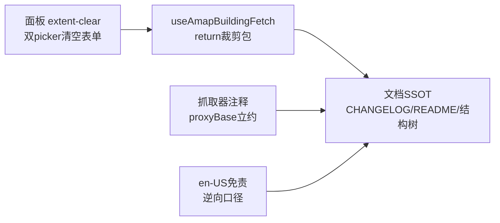

# 2026-10-12 建筑抓取观察项修复 → 并入 V3.6.12

## 日期与时间

2026-10-12（会话内执行）

## 任务等级

**L2 常规**（功能修复：5 文件代码 + 4 文档；多文件协同，含 Mermaid；无配置 key、无架构变更）

> 依据 Force_command §0：用户指令“观察项全部修复，符合实际代码”（P1）与本规范（P2）无冲突。暂存区既有 V3.6.12 未提交，本任务修复直接并入 **V3.6.12**（用户明确要求版本号改回 3.6.12，不顺延）。

## 问题分析

### 核心症状

上一轮 Review 留 6 项“只记不改”观察：CHANGELOG/结构树/README 版本行仍写旧设计（面板 key 输入框、级别 13-15、localStorage），与实现（管理端 L2 key、锁死 z14）漂移；另有返回口径、中英免责、`proxyBase` 约定、`extent-clear` 未接、`zoomOptions` 冗余 `computed`。

### 根本原因

双源任务在 V3.6.12 开发中途经历 6 轮零散修补（key 通道改 L2、z14 锁死、删演示 key、分源上限），但版本摘要行写于修补前、未同步更新；边缘代码问题（return 未裁剪包）是修补引入的新口径差。

### 受影响模块

| 模块 | 文件 |
|---|---|
| 高德编排 | `common/data-import/useAmapBuildingFetch.js`（return 裁剪包） |
| 抓取器 | `parsers/amapBuildingFetcher.js`、`parsers/tencentBuildingFetcher.js`（proxyBase 约定注释） |
| 面板 | `data-import/components/TencentBuildingPanel.vue`（extent-clear + zoomOptions 去 computed） |
| 文案 | `locales/en-US.js`（disclaimerAmap 逆向口径） |
| 文档 SSOT | `README.md`×3 处、`Docs/README_EN.md` 能力行、CHANGELOG、本日志、结构树 3 行 |

### 候选方案对比

| 方案 | 说明 | 结论 |
|---|---|---|
| A. 只改文档不动代码 | 留下 return 空判边缘 bug | 否决 |
| B. 文档校准 + 最小代码修复（本方案） | 6 项全修；proxyBase 只补约定注释不改拼接（默认直连 + 全仓唯一用法透传 ''，行为无害） | **选定** |
| C. 重构 proxyBase 拼接 helper | 超出观察范围，另立项 | 否决 |

## 修改内容

1. **`useAmapBuildingFetch.js`**：`startFetch` 返回裁剪后 `{...fc, features: clipped}`（入库/统计/判空三方一致；跨边楼保留逻辑不变）。
2. **面板**：双 picker 补 `@extent-clear="clearFormBbox"`（2D/3D 同形清空）；`zoomOptions` 去 `computed` 包裹（静态数组直接用；另删已无用的 `computed` 导入——经核对 `engineLabel/progressPercent/errorText` 等仍在用，仅删 `zoomOptions` 那一处）。
3. **抓取器注释**：腾讯/高德两处 `proxyBase` JSDoc 补“默认 '' 直连；非空须以 `/` 结尾”约定（行为零改）。
4. **英文免责**：`disclaimerAmap` official → reverse-engineered，与中文/抓取器注释统一。
5. **文档**：CHANGELOG V3.6.12 摘要按实现重写；README 版本表 V3.6.12 行同步；结构树 3 行注释校准；中英能力行保留（上一轮 L1 已加）。

## 修改原因

用户要求观察项全部修复、符合实际代码。

## 影响范围

- 建筑抓取面板（清框行为、高德空框判空更准）
- 其余链路（框选/入库/拔高/估算）不动；抓取器网络行为零改

## 解决方案

见「修改内容」。proxyBase 采用“注释立约 + 行为不动”：当前全仓调用均透传默认 ''（面板→composable→抓取器均无 proxyBase 参数），直连语义不受影响；将来若经 `/proxy` 中转，调用方按约定传以 `/` 结尾基址即可。

## 性能指标

未实测（纯口径/边缘修复，无热路径改动）。

## 测试方案

### Agent 已执行

- 全仓 grep：`AMAP_DEMO_KEY` 代码零残留；`proxyBase` 全仓仅两抓取器透传默认；`zoomOptions` 单文件两处引用
- `node --check` 4 个 JS 文件通过（高德编排/两抓取器/英文文案）；面板 `.vue` 拆 script 落盘因临时目录失败，改由 ESLint 覆盖
- eslint 5 文件零告警；无新增 `.ts`；双门禁全绿（见门禁节）
- 未执行任何 Git 写操作

### 待用户实机验证

1. 切高德、框小范围使裁剪为 0：应报“该范围内无建筑数据”，不入库空文件
2. 2D/3D 各点一次框选器“清除”：表单四框清空
3. 中英切换：高德免责行均为“逆向接口 / reverse-engineered”
4. 硬刷新确认页脚 V3.6.12

## 变更文件清单

| 路径 | 说明 |
|---|---|
| `frontend/src/domains/common/data-import/useAmapBuildingFetch.js` | return 裁剪包 |
| `.../data-import/components/TencentBuildingPanel.vue` | extent-clear + zoomOptions 去 computed |
| `.../data-import/parsers/amapBuildingFetcher.js` | proxyBase 约定注释 |
| `.../data-import/parsers/tencentBuildingFetcher.js` | proxyBase 约定注释 |
| `frontend/src/locales/en-US.js` | disclaimerAmap 逆向口径 |
| `Docs/Guide/frontend-structure.md` | 3 行注释校准 |
| `README.md` | 三处 → V3.6.12（合并） + V3.6.12 行重写 |
| `Docs/README_EN.md` | 能力行 +1（英文版此前缺失） |
| `Docs/Guide/CHANGELOG.md` | V3.6.12 摘要重写 + 观察项修复链本日志 |
| 本日志 | `Docs/LLM_record/26-10/2026-10-12/2026-10-12-building-review-fixes.md` |

## 模块关系

## 遗留与风险

- 本任务修复直接并入 V3.6.12（用户明确要求改回 3.6.12，不顺延）；提交前需用户一次性 `git add -A`。
- 未实机运行（面板改动需真机点一遍，清单见上）。
- 英文版版本号行（V3.5.22）为历史漂移，本次不动（SSOT：版本号权威在根 README，英文版另立项修）。
- 2026-10-12 补记：用户要求版本号改回 3.6.12（选项 A 合并）：已删 V3.6.13 独立条目，修复并入 V3.6.12（日期收敛 2026-10-12，摘要追加观察项修复句，日志双链）；README 三处回 V3.6.12。§5 同日不合并条款由用户指令（P1）一次性豁免，仅本次生效。

## 门禁

- `python Scripts/CheckStructureTree.py`：通过（文档 488 · 磁盘 488 · 0 漂移）
- `python Scripts/CheckConfigRegistry.py`：全部通过 ✅（catalog 130 key · 前端 VITE_ 14 个）
- `node --check`：高德编排/两抓取器/英文文案 4 文件通过；面板 `.vue` 因临时目录落盘失败未跑 `node --check`，改用 ESLint 覆盖（含模板解析）
- ESLint 5 文件零告警 ✅（含面板 `.vue`）
- 平台红线自查：REDLINE-1 CLEAN；REDLINE-2 无命中；REDLINE-3 仅命中后端 `.venv` 内 fastapi 依赖注释（SSE keepalive 内部实现，非本仓代码）→ CLEAN；生产基线三项未动（本次仅前端）
- 未执行任何 Git 写操作
