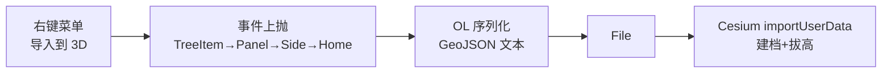

# 2026-10-13 二维图层导入 3D → V3.6.13

## 日期与时间

2026-10-13（会话内执行）

## 任务等级

**L2 常规**（新右键动作，跨 TOC/OL/HomeView/Cesium 四处但无架构变更；真·画布拖拽因与排序 DnD 冲突未做，见遗留）

> 依据 Force_command §0：用户指令「支持（导入到 3D）」（P1）要求遵循本规范（P2），无冲突。

## 问题分析

### 核心症状

- 二维图层（已注册数据源）无法送入 3D，只能重新走文件导入。

### 根本原因

- 功能缺失：TOC 动作链无跨引擎投递；OL 要素不出组件，Cesium 侧拿不到。

### 受影响模块

| 模块 | 文件 |
|---|---|
| TOC 动作协议/菜单/分发 | `layer-tree/protocol.js`、`menu/contextMenu.js`、`menu/commandDispatcher.js`、`actions/contextActionManager.js`、`components/TOCTreeItem.vue`、`components/TOCPanel.vue` |
| 能力装配 | `ol/stores/layer/layerTreeBuilder.ts`（非栅格开放） |
| OL 序列化 | `ol/components/MapContainer.vue`（`exportUserLayerGeoJSON` + expose） |
| 跨引擎投递 | `app/HomeView.vue`（`handleImportOlLayerTo3D`）、`shell/SidePanel.vue`（转发 + emit 声明） |
| 文档 SSOT | `README.md`、`CHANGELOG.md`、本日志 |

### 候选方案对比

| 方案 | 说明 | 结论 |
|---|---|---|
| A. TOC 行拖到 Cesium 画布 | 初评与排序 DnD 同通道冲突风险高；细查后以独立 MIME（`application/x-webgis-layer`）隔离，文件通道原样，遂实施 | **实施**（见“跨容器拖放”） |
| B. 右键“导入到 3D”：OL 序列化 GeoJSON 文本 → 包 File → 既有 `importUserData` | 复用注册/拔高/TOC 三维分组零新协议；2D 未切 3D 时明示降级 | **选定** |

## 修改内容

1. **协议/菜单/分发**：`IMPORT_TO_3D` 命令；ops 组缩放项后加「导入到 3D」（`canImportTo3D` 门控）；dispatcher → `{type:'import-to-3d'}`；manager 显式上抛（对象载荷）；`TOCTreeItem` 能力位 + `Boxes` 图标（仓内有据）。
2. **跨容器拖放**：`TOC_LAYER_DRAG_MIME`（`protocol.js`，与排序 `text/plain` 并存）；行 `dragstart` 双写；`CesiumContainer.onDrop` 无文件 + 命中 MIME 才上抛 `drop-ol-layer`（`cesium:/rsvc:` 静默忽略，文件通道原样）；`HomeView` 监听复用同一投递 handler（落点即 3D 挂载态，3D 未就绪分支走不到）。
3. **能力**：`toLayerNode` 加 `importTo3D: !isRasterLayer(layer)`（栅格走 GeoJSON 无意义，序列化层双保险）。
3. **OL**：`exportUserLayerGeoJSON({layerId})`（4326 文本 + 原属性，空/异常回 null）+ expose。
4. **投递**：`handleImportOlLayerTo3D`——空要素 warn；非 3D/容器未挂载 warn 不切图（不替用户做视图决策）；包 File 调 `importUserData`（自动三维建档 + 高度拔高）。
5. **文档**：README×3 + CHANGELOG → V3.6.13。

## 修改原因

用户功能需求；数据源已注册，投递即用（用户原话成立，路径如上）。

## 影响范围

- TOC 右键菜单非栅格行 +1 项；其余菜单/排序/导入链路不动
- Cesium 零改（复用 `importUserData`）；OL 仅新增只读序列化

## 解决方案

见「修改内容」。数据流：右键 → 命令 → 事件上抛四级（TreeItem→LayerPanel→TOCPanel→SidePanel→HomeView）→ OL 文本 → File → Cesium。

## 性能指标

未实测（内存序列化，万级要素以下常规）。

## 测试方案

### Agent 已执行

- 全链 16 处 grep 核对（协议→菜单→分发→转发→透传→序列化→投递）
- eslint 10 文件：0 error；1 新 warning（SidePanel emit 未声明）已修；另 3 console 系历史
- 无 `.ts` 新增（builder 为既有 `.ts` 改 1 行）；门禁见下；未执行 Git 写操作

### 待用户实机验证

1. 2D 图层右键出现「导入到 3D」（栅格行无此项）；3D 图层行无此项（cesium 短路）。
2. 2D 下点它：提示去 3D，不跳视图。
3. 切 3D 后点它：三维分组出现同名图层，要素/属性/高度拔高一致，显隐/透明度/flyTo/移除可用。
4. 空要素层点它：提示无可导入要素。
5. 拖放：3D 下从工具箱把二维行拖到三维画布，松手即导入（同 3 结果）；文件拖放原样；往 2D 地图/空白处拖放无动作（行内排序不受影响）。

## 变更文件清单

| 路径 | 说明 |
|---|---|
| `layer-tree/protocol.js`、`menu/contextMenu.js`、`menu/commandDispatcher.js`、`actions/contextActionManager.js` | 命令 + 菜单项 + 分发 + 上抛 + 跨容器拖拽 MIME |
| `layer-tree/components/TOCTreeItem.vue`、`components/TOCPanel.vue` | 能力位 + 图标 + emits |
| `ol/stores/layer/layerTreeBuilder.ts` | 非栅格能力位 |
| `ol/components/MapContainer.vue` | GeoJSON 文本序列化 + expose |
| `app/HomeView.vue` | 跨引擎投递 handler + 右键/拖放双监听 |
| `shell/SidePanel.vue` | 转发 + emits 声明 |
| `cesium/components/CesiumContainer.vue` | 画布落点识别 + `drop-ol-layer` 上抛 + emits 声明 |
| `README.md` | 三处 → V3.6.13 |
| `Docs/Guide/CHANGELOG.md` | V3.6.13 条目 |
| `Docs/LLM_record/26-10/2026-10-13/2026-10-13-import-to-3d.md` | 本日志 |

> 无新增/删除源码文件 → 结构树无需变更。

## 模块关系

## 遗留与风险

- 行内排序 DnD 未动（`text/plain` 通道原样）；移动端触摸拖放不在 HTML5 DnD 覆盖内，如需另立项。
- 大要素层（万级）序列化为整文本，极端情况可分块；当前常规量级。
- `parsers/tdtBuildingFetcher.js`（untracked，用户新增）不在本次范围，未 review。
- 未实机运行。

## 零散修补（L2 内调整，并入未提交的 V3.6.13）

- `sh_tdt.geojson` 报 `crs.properties is undefined`：与之前腾讯/高德同一病根——顶层裸字符串 `crs`。之前只在面板打包侧剥离，该文件走文件拖放通道没被覆盖。已改为 **Cesium 入口（`geojsonLoader.loadGeoJSON`）统一剥离**，文件拖放/2D 转 3D/Node 落盘一处全管；面板侧 sanitizer 保留（双保险）。数据坐标与属性本身无问题：裸 `crs` 字符串在 RFC 7946 里本就不存在（旧规范也要对象形式），OL 容忍、Cesium 严格，仅此而已。
- `LandingView.vue` 页脚 4 处 `vue/no-v-html` 警告清零：`cjkBreak` 生成物由 ` ` 改为换行符 `\n`，渲染改纯插值＋ `white-space: pre-line`（宽屏文案无 `\n`，规则为 no-op）；规则语义不变（仍每两字断段），XSS 面归零，eslint 0 problem。

## 门禁

- `python Scripts/CheckStructureTree.py`：通过（489 项/0 漂移；本次无新增源码文件，+1 系登记用户新增的 `tdtBuildingFetcher.js`）
- `python Scripts/CheckConfigRegistry.py`：全部通过 ✅（零配置 key）
- eslint：10+4 文件 0 error（3 历史 console warning 保留；SidePanel 新增 warning 已修）
- 平台红线自查：仅前端动作链，未碰后端/部署面 → CLEAN
- 未执行任何 Git 写操作
