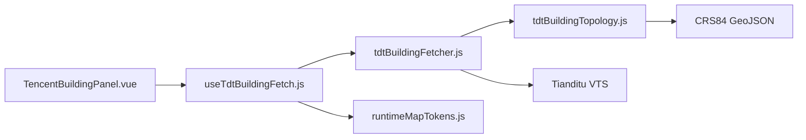

# 2026-10-13 天地图建筑抓取权限与拓扑移植

## 任务级别

L2 常规功能修复：天地图抓取权限处理、浏览器端拓扑 Union 移植、文档和暂存区审查。

## 分析结论

- **核心症状**：管理端现有 `tianditu_tk` 返回 `301010`，表示没有矢量瓦片服务权限；浏览器端此前只显示通用 HTTP 错误，无法指导用户更换密钥。
- **根本原因**：天地图 tk 是服务权限凭证，不是所有地图 tk 都拥有 VTS 权限；同时浏览器解析器只做了按 `elemid` 聚合，没有调用 Node 逆向脚本中的边界拆分、内外侧判断和闭环追踪算法。
- **受影响模块**：天地图抓取器、抓取 composable、建筑抓取面板、中文/英文文案、前端目录结构和版本日志。
- **方案对比**：
  1. 硬编码 demo tk：能快速验证，但会暴露凭证并且不适合部署。
  2. 仅依赖管理端 tk：适合统一管理，但当前 tk 无 VTS 权限时无法验证。
  3. 用户临时输入 tk，管理端 `tianditu_tk` 作为兜底：既能用用户自己的 VTS 权限 tk，也保留管理员统一配置能力，不保存用户输入。
- **选定方案**：采用方案 3；不把 demo 或真实 tk 写入前端。`301010` 映射为明确的权限提示。
- **拓扑方案**：从 Node 逆向实现抽取纯浏览器模块；先将局部 ring 转为全局整数瓦片坐标，再进行边相交拆分、外侧边界筛选、反向边抵消和闭环追踪。只有同一 `elemid` 的多瓦片且触及接缝窄带时才 Union，失败时保留原始片段，避免丢楼。

## 模块关系

## 实施记录

- 新增 `tdtBuildingTopology.js`，封装无第三方依赖的完整边界 Union。
- 解析器改为调用 `mergeTdtBuildings`，保留 `elemid`、名称、高度和楼层属性。
- 面板新增临时 tk 密码输入框，输入只存在当前页面状态，不写入 localStorage 或源码。
- VTS 非 2xx 响应解析 JSON；`code=301010` 转为 `tdt_permission`。
- `tianditu_tk` 仍作为管理端默认配置项；如需要专用 L2 密钥，管理员直接替换该配置值即可。

## 验证方案

### 已执行

- `node --check`：天地图抓取器和拓扑模块语法检查。
- `npx eslint`：相关 parser、topology、composable、面板和 locale。
- `npm run build`：前端生产构建。
- 使用脱敏的权限错误响应验证 `301010` 错误分支。

### 用户需要执行

- 在面板输入一个确认拥有“矢量瓦片”权限的 tk，使用 `114.3006,34.8168,114.3068,34.8207`、z18 验证。
- 对比同一 `elemid` 是否从多个 Polygon 片段变为一个无公共中缝的独立几何。

## 暂存区 Code Review

### 发现与处理

| 严重度 | 文件 | 结论 |
|---|---|---|
| 高 | `tdtBuildingFetcher.js` | 原先错误地吞掉所有非 2xx 响应，已改为抛出明确错误并识别 `301010`。 |
| 高 | `tdtBuildingFetcher.js` | 原先浏览器端没有真正 Union，已改为调用共享拓扑模块。 |
| 中 | `TencentBuildingPanel.vue` | 原先无法使用用户自有 VTS tk，已增加临时输入，且管理端 token 仍可兜底。 |
| 低 | `frontend-structure.md` | 原条目标记为“未 review”，需要同步为已拆分拓扑模块。 |

## 未纳入本次范围

- 不修改部署密钥文件，不提交任何真实 tk。
- 不改变后端运行时 token API；现有 `tianditu_tk` 已足以承载专用 L2 配置。
