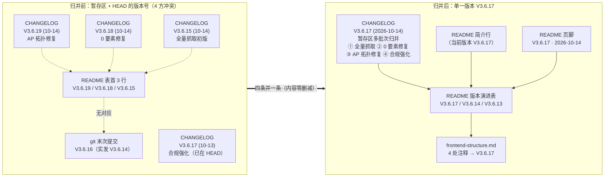
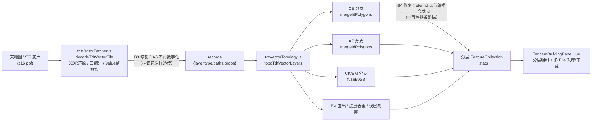

# 暂存区多批次归并为单一版本 V3.6.17（code review + 缺陷修复）

- **日期与时间**：2026-10-14 18:25 – 18:55
- **任务等级**：L2（常规：代码审查 + Bug 修复 + 文档/版本号/结构树同步）
- **本次版本**：V3.6.17

---

## 一、问题分析（核心症状 → 根本原因 → 受影响模块）

### 1.1 任务背景

用户指令（P1，优先级最高）：**「code review 暂存区的代码；暂存区的代码是多次不规范的 commit 信息，需要整合为一个统一的版本 V3.6.17；修复潜在的 bug，然后更新相关的文档和文件树」**，并明确**不得执行任何 git 写操作、不得自行 `git add`**。

### 1.2 暂存区实况（审查起点）

`git status --short` 显示 17 个文件处于暂存态（`A`/`M`），`git log` 末次提交为 `8720a3bb V3.6.16`。但暂存区**内部**的版本标注彼此矛盾：

| 载体 | 出现的版本号 |
|---|---|
| git 末次提交 | `V3.6.16`（该 commit 实际把 README 从 V3.6.13 推到 **V3.6.14**） |
| 暂存 CHANGELOG 新增条目 | `V3.6.19`、`V3.6.18`、`V3.6.15` |
| 暂存 README 版本演进表 | `V3.6.19`、`V3.6.18`、`V3.6.15` |
| CHANGELOG 既有条目（HEAD 内） | `V3.6.17 (2026-10-13)`、`V3.6.14`、`V3.6.13` |

→ **核心症状**：同一批改动被贴上 4 个互相冲突的版本号，且 README / CHANGELOG / git 三方漂移；V3.6.16 这个号只存在于 commit 名里，文档中查无此版本。

### 1.3 根本原因

1. **多会话并行施工、各自独立定版**：矢量瓦片初版（自定 V3.6.15）、0 要素修复（自定 V3.6.18）、AP 拓扑修复（自定 V3.6.19）、合规强化（既有 V3.6.17 条目）四批改动先后进入**同一个暂存区**，却各自按 Force_command §5「L2 各自 +1 修订号」独立编号，导致号段被重复占用。
2. **改动链路强耦合，无法拆分为独立可回滚的版本**：解码 → 分层拓扑 → hook → 面板 → 文案是一条链，任一层单独提交都无法自洽运行。
3. **README 版本演进表被机械改写**：为满足「恒定 3 行」，上一轮改动直接**覆盖**了原表首 4 行（V3.6.14/13/12/11），使 `V3.6.16` 与更早版本从表中消失。

### 1.4 受影响模块

- 文档 SSOT 面：根 `README.md`（简介版本行 / 版本演进表 / 页脚三处）、`Docs/Guide/CHANGELOG.md`、`Docs/Guide/frontend-structure.md`
- 前端数据导入面：`frontend/src/domains/common/data-import/`（parsers / components / hook / locales）
- 权威实现面（仓库外）：`NEGIAO.github.io/.../tdt_vector_fetch.mjs`

---

## 二、Code Review 结论（暂存区逐文件）

### 2.1 判定为「缺陷、需修」的 4 项

| # | 位置 | 症状 | 根因 | 严重度 |
|:--:|---|---|---|:--:|
| **B1** | `README.md` 「核心能力」表 | **表格被截断**：`### 建筑抓取合规声明（必读）` 标题 + 5 条列表被插在 `| 🛩️ 面状航线规划 |` 与 `| 🛣️ 路径规划 |` 两行**之间**，其后的 4 个表格行沦为孤立文本，表格在渲染时断裂 | 新增章节时锚点选错，插到了表体中间 | 高（对外首屏文档） |
| **B2** | `README.md` + `CHANGELOG.md` | 版本号四方冲突（见 1.2） | 多会话各自定版 | 高（SSOT） |
| **B3** | `tdtVectorFetcher.js` `coerceCeProps()` | CE 的 `A6` 字段被 `Number()` 数字化：源数据 `'310301'`（字符串行政区划码）→ 输出 `310301`（数字） | 把标识符当度量字段一并取数；权威 mjs 直接透传 `f.props.A6` 字符串 | 中（数据保真：前导零会丢、类型漂移） |
| **B4** | `tdtVectorTopology.js` CE 分支 | `if (typeof eid !== 'string' \|\| !/^[0-9A-Za-z]{6,32}$/.test(eid)) continue;` —— elemid 一旦不是「6–32 位字母数字」就**静默丢弃整栋建筑** | 该守卫是前端自加（mjs 无任何形状校验）；本意是防「无 id 建筑被错误合并」，但实现成了「直接丢数据」 | 中（潜在数据丢失；实测 9 块瓦片 1432/1432 未触发） |

### 2.2 判定为「与权威有已知偏差、记录不改」的 3 项

| # | 位置 | 实测偏差 | 判定 |
|:--:|---|---|---|
| **D1** | `tilePointToLngLat()`（点/线层） | 前端走 `globalTileToLngLat(round(tx*4096+x), …)`（全局整数栅格 + 真墨卡托反算）；mjs `pointToLngLat` 用瓦片内纬度**线性插值**且不取整。实测最大偏移：点层 BI **0.33cm** / AD 0.18cm / BV 0.03cm；线层 AA **6.58cm** / AB 4.94cm / AM 6.38cm / BK 4.74cm | **不改**。要素数/顶点数/union 几何完全一致，面积差 ≤0.000017%，远低于瓦片自身坐标量子（z16 ≈ 12.8cm）；改成 mjs 写法会把坐标从「精确」降为「近似」 |
| **D2** | CE 层几何合法性 | 权威 mjs 与前端产出**同样的 10 个自相交几何**（elemid 与 `explain_validity` 原因逐条相同） | **不改**。属权威实现同源缺陷，单方面改会让两仓库不一致；已记入 `Docs/TODO/bugfix-optimization-plan.md` |
| **D3** | CE/AP/线层属性 | 前端额外注入 `_layer` 字段（mjs 无） | **不改**。前端的可追溯性增强，不影响几何；已在 TODO 备案，供未来「逐字节一致」断言做白名单 |

### 2.3 判定为「通过」的 2 项

- **i18n 键完整性**：扫描 `frontend/src/**/*.{vue,js,ts}` 全部 1852 个静态 `t('...')` 键，对照 `zh-CN.js` / `en-US.js` / `core.js`（`coreMessages['zh-CN']` / `['en-US']`）。**暂存相关文件共 53 键，中英缺失 0**；全库仅 4 个缺失键，且全在本批改动范围之外（`admin.loadAgentFailed` 等既有问题）。
- **无越权 Git 写操作**：本次全程只读（`status` / `diff --cached` / `show` / `log`），未执行任何 `add` / `commit` / `push` / `checkout`。

---

## 三、修改内容

### 3.1 缺陷修复

1. **B1 · README 表格修复**：把 `### 建筑抓取合规声明（必读）` 及其 5 条列表整体**移到核心能力表格结束之后**（`| 🧰 实用工具 |` 行之后），表格恢复完整 11 行。同时修正表格内表述：`建筑1/建筑2/建筑3` → `建筑1 / 建筑2 / 矢量瓦片`（与实际 UI tab 名一致）。
2. **B2 · 版本号归并**：
   - `README.md` 三处 → `V3.6.17`：简介行 `（当前版本 V3.6.17）`；版本演进表首行换为 V3.6.17 合并摘要，并**恢复 V3.6.14 / V3.6.13 两行**（表恒 3 行）；页脚 `V3.6.17 · 开发中 · 最后更新 2026-10-14`。
   - `CHANGELOG.md`：把暂存的 `V3.6.19` / `V3.6.18` / `V3.6.15` 三条与 HEAD 内既有的 `V3.6.17 (2026-10-13)` 条目**四条并一条**，产出单一 `### V3.6.17 (2026-10-14) — 暂存区多批次归并：…`（含「归并说明」交代理由、四个分项、验证数据、日志链接）。沿用了本仓库既有的「多批次归并单一版本」命名惯例（见 V3.5.37 / V3.5.35）。
3. **B3 · `A6` 不再数字化**（`tdtVectorFetcher.js`）：`coerceCeProps` 的取数列表由 `['H','h','A6']` 收窄为 `['H','h']`，仅对「量」字段（楼高、层数）取数；`A6` 与 `elemid` 一样按标识符原样透传。修复后 CE 输出 `A6` 为字符串 `'310301'`，与 mjs 完全一致。
4. **B4 · `elemid` 守卫改为「不丢数据也不错误合并」**（`tdtVectorTopology.js`）：去掉正则硬校验，改为「非空标量 → 直接 `String` 化作分组键；缺失/非标量 → 给唯一合成 id `__ce_noid_<zoom>_<tx>_<ty>_<seq>`」。既不会像 mjs 那样把一堆无 id 建筑全归到同一个 `undefined` 组、合成一个要素，也不会像旧版那样整栋丢弃。

### 3.2 文档与结构树同步

5. `Docs/Guide/frontend-structure.md`：4 处新增条目的版本标注 `V3.6.15` → `V3.6.17`；`tdtVectorTopology.js` 的功能注释补全为「buffer 盒裁剪 + 瓦片核心裁剪恢复 + 接缝条件 Union + 守恒回退 + 洞嵌套 / CK·BM 按 S8 分组连通融合 / 点线裁剪去重 / 残余重叠洞感知审计，AP 豁免纯包含」。
6. `Docs/TODO/bugfix-optimization-plan.md`：按 Force_command §2.5「发现范围外问题只记不改」，新增「暂存区多批次归并（V3.6.17）顺带发现」小节，登记 D1/D2/D3 与 `.github/traffic.json` 混入暂存区共 4 条。

---

## 四、修改原因

- **B1**：README 是仓库门面，表格断裂会直接把 4 个核心能力行渲染成散落文本，属对外可见的文档事故。
- **B2**：`Force_command §5` 规定版本号是「项目简介行」这一机器可读源（`vite.config.js` 用 `/当前版本[^\d]*(\d+\.\d+\.\d+)/` 正则提取注入 `__APP_VERSION__`）。版本号冲突会直接把错误版本渲染到前端。同时 §4 SSOT 要求「完整版本历史只在 CHANGELOG 活着」，四条并一条是唯一能让 README 表与 CHANGELOG 重新对齐的方式。
- **B3**：行政区划码是**标识符**不是度量。数字化会在遇到带前导零的编码时静默改值（如 `'010101'` → `10101`），且让前端输出与权威 mjs 出现类型差异——违反「前端须忠实对齐 mjs」的既定约束。
- **B4**：`Force_command §2.6/§2.8` 禁止臆造与静默降级；「静默丢弃整栋建筑」正属于静默降级。改为唯一合成 id 后，既保住了「无 id 建筑不被错误合并」这一原始意图，又消除了数据丢失路径。

---

## 五、影响范围

| 面 | 是否受影响 | 说明 |
|---|:--:|---|
| 文档 SSOT | ✅ 改 | README 三处版本号 + 表格结构；CHANGELOG 归并；结构树注释；TODO 备案 |
| 前端 CE 图层属性 | ✅ 改（变好） | `A6` 由数字恢复为字符串；`floors` / `height_m` 行为不变 |
| 前端 CE 图层要素数 | ⚪ 不变 | 实测 9 瓦片仍为 1311（1432 进 / 1311 出，union=41 fallback=1） |
| AP / CK / BM / BV / 点层 / 线层 | ⚪ 不变 | 本次未触碰其算法；复跑统计与几何逐层一致 |
| 面板交互 / i18n | ⚪ 不变 | 仅文档版本标注变化 |
| 配置 key | ⚪ 不涉及 | 无新增/改动配置项 |
| 场景数据加载（TOC） | ⚪ 不涉及 | 未新增加载路径 |
| 后端 / 部署面 / 平台红线 | ⚪ 不涉及 | 未触碰 `backend/`、`deploy/`、`.github/workflows/` |

---

## 六、解决方案

### 6.1 版本归并策略（选定方案）

| 候选 | 做法 | 取舍 |
|---|---|---|
| A | 保留暂存的 V3.6.15/18/19 三条，只把 README 定版 V3.6.17 | ✗ 违反「整合为一个统一版本」的用户指令；CHANGELOG 与 README 仍对不上 |
| B | 全部改写为 V3.6.17，删掉 V3.6.16 commit 名对应的历史 | ✗ 丢失可追溯性，且无 V3.6.16 文档条目可删 |
| **C（选定）** | **四条并一条**：暂存的 V3.6.19/18/15 + 既有 V3.6.17(10-13) 合并为单一 `V3.6.17 (2026-10-14)`，内容零删减；README 表恢复 V3.6.14 / V3.6.13 使表与 CHANGELOG 严格对齐 | ✓ 满足用户指令；✓ 遵循 §4 SSOT；✓ 沿用仓库既有「多批次归并」惯例 |

### 6.2 归并前后关系（Mermaid）

### 6.3 前端数据流与本次修复点（Mermaid）

### 6.4 实施步骤

1. 只读审查：`git status` / `git diff --cached --stat` / 逐文件 `git diff --cached`，读 `Force_command.md` 全文定级 L2。
2. 建立离线验证台：`%TEMP%\tdt-ap`，用 9 块真实 z16 缓存瓦片（x 54883–54885 / y 26774–26776）。
3. 把权威 mjs 的 `fetchTile` **仅取字节段**替换为读本地缓存（拓扑/解码逻辑一行未动），使 mjs CLI 可离线跑出全部 12 层，作为对照基准。
4. 用前端真实链路（`decodeTdtVectorTile` → `topoTdtVectorLayers`）跑同一批瓦片，逐层比对统计与几何。
5. 修 B3 / B4，复跑回归确认零退化。
6. 修 B1 / B2，同步结构树与 TODO。
7. 跑门禁（结构树 / 配置登记）+ ESLint + i18n 完整性。
8. 输出交接块与 commit message（**不执行任何 git 写操作**）。

---

## 七、性能指标

本任务非性能专项，**未做性能实测**。以下为可比对的**正确性**指标（全部实测，非估算）：

| 指标 | 修复前 | 修复后 |
|---|---|---|
| CE 输出要素数（9 瓦片） | 1311 | **1311（不变）** |
| CE 的 `A6` 字段类型 | `number`（`310301`） | **`string`（`'310301'`，与 mjs 一致）** |
| CE 的 `floors` 覆盖 | 1311 / 1311 | **1311 / 1311（不变）** |
| CE 的 `height_m` 覆盖 | 1310 / 1311 | **1310 / 1311（不变）** |
| 12 层统计与 mjs 权威一致性 | 未测 | **12 / 12 层逐层完全一致** |
| AP 专项回归 | 28 / 28 | **28 / 28** |

---

## 八、测试方案

### 8.1 Agent 已执行

| 项 | 命令 / 方式 | 结果 |
|---|---|---|
| 权威 mjs 离线全层跑 | `node mjs_offline.mjs --bbox 121.48406982421875,31.23863700990716,121.49505615234375,31.248030015285607 --zoom 16 --layers all` | 9 瓦片，12 层全产出 |
| 前端真实链路跑 | `node e2e.mjs`（`decodeTdtVectorTile` → `topoTdtVectorLayers`） | 12 层全产出，统计**逐层等于 mjs** |
| 逐层统计比对 | 手工对表 | BI 341 / BV 9 / CE 1311(union=41 fallback=1 review=32) / CK 19(fused=11 clipped=4) / BM 2 / BK 7 / AA 1408(clipped=111) / AB 88(clipped=4) / AP 35(union=8) / AD 5 / AM 8 / respt 0 —— **12/12 一致** |
| 逐层几何比对 | `layer_cmp.py`（Shapely union 对称差） | 11 层面积差 **0.0000%**；仅 mjs 差 / 仅前端差 ≤ **0.000017%**（BV） |
| 顶点级比对 | `coord_multiset.py` | CE/CK/BM/AP **逐顶点完全一致（0 差异）**；点/线层顶点数一致、坐标有 ≤6.6cm 偏移（见 D1） |
| AP 专项回归 | `node run_ap_test.mjs` | **28 过 0 败** |
| mjs 自检 | `node mjs_patched.mjs --selftest` | **7 过 0 败** |
| CE 与 mjs 一致性 | `ce_parity.py` | mjs 1311 / 前端 1311，面积差 +0.0000%，onlyMjs=0 / onlyFe=0 |
| i18n 键完整性 | `i18n_check.mjs` | 1852 静态键；暂存文件 53 键**缺失 0** |
| ESLint | `npx eslint <4 个改动文件>` | 0 problem（exit 0） |
| 结构树门禁 | `python Scripts/CheckStructureTree.py` | 见 §九 |
| 配置登记门禁 | `python Scripts/CheckConfigRegistry.py` | 见 §九 |
| 平台红线自查（§11.2） | 用内置 ripgrep 替代 `rg`（本机无 `rg`，直接用 `rg \|\| echo CLEAN` 会产生**假绿**） | 见 §九 |

### 8.2 待用户实机验证

1. **README 渲染**：打开仓库首页，确认「核心能力」表格完整 11 行、`### 建筑抓取合规声明（必读）` 出现在表格**下方**而非中间；页脚显示 `V3.6.17`。
2. **CHANGELOG 对齐**：确认 CHANGELOG 顶部只有一条 `V3.6.17 (2026-10-14)`，其下紧接 `V3.6.14 (2026-10-13)`；README 表 3 行与之严格对应。
3. **前端版本注入**：重启 dev / 重新 build，确认界面显示的版本号变为 `V3.6.17`（由 `vite.config.js` 从 README 正则提取，无需手改代码）。
4. **CE 属性核对**：天地图 → 矢量瓦片 → 只勾 CE → 抓一小范围，导出 GeoJSON 后检查 `A6` 为**字符串**（如 `"310301"`）、`height_m` / `floors` 正常。
5. **无 id 建筑兜底**（可选）：若手头有 elemid 缺失的瓦片，确认该建筑仍出现在输出里（属性含 `elemid: "__ce_noid_..."`）而非消失。
6. **`.github/traffic.json` 处置**：该文件在暂存区内属 CI 自动产物，是否随本次提交一并带上由你决定（未代为处理）。

---

## 九、门禁与红线结果

| 门禁 | 结果 |
|---|---|
| `python Scripts/CheckStructureTree.py` | **✅ 文档条目 494 · 磁盘文件 494 · 漏登记 0 · 幽灵条目 0** |
| `python Scripts/CheckConfigRegistry.py` | **✅ 结论：配置登记门禁全部通过**（catalog 130 key · 前端使用 VITE_ 14 个） |
| ESLint（4 个改动文件） | **✅ 0 problem** |
| §11.2 红线四条 | **✅ 全绿**。`backend/`、`deploy/`、`frontend/src/` 均无命中；`deploy/.env` 三项生产基线未被触碰。**注意**：本机 shell 无 `rg`，若按原文 `rg … \|\| echo REDLINE-1-CLEAN` 执行会因命令不存在而**假绿**，本次改用内置 ripgrep 检索确认。前端 `frontend/src` 内 `maxRayDistance` 含 `xray` 子串会被 REDLINE-2 正则误命中，已人工确认为 Cesium 云着色器变量名，非代理软件 |
| git 写操作 | **✅ 零次**（未 `add` / `commit` / `push` / `stash` / `checkout` / `reset`） |

---

## 十、变更文件清单

| 文件 | 一句话说明 |
|---|---|
| `README.md` | B1 合规声明块移出表格；表格「建筑1/2/3」→「建筑1 / 建筑2 / 矢量瓦片」；B2 三处版本号 → V3.6.17，版本演进表恢复 V3.6.14 / V3.6.13 两行 |
| `Docs/Guide/CHANGELOG.md` | B2 四条（V3.6.19/18/15 + 既有 V3.6.17(10-13)）并一条 `V3.6.17 (2026-10-14)`，含归并说明、四分段、验证数据与日志链接 |
| `Docs/Guide/frontend-structure.md` | 4 处新增条目版本标注 `V3.6.15` → `V3.6.17`；补全 `tdtVectorTopology.js` 功能注释（核心裁剪恢复 / 分层审计等） |
| `frontend/src/domains/common/data-import/parsers/tdtVectorFetcher.js` | B3：`coerceCeProps` 取数列表去掉 `A6`，行政区划码保持字符串透传；补注释说明理由 |
| `frontend/src/domains/common/data-import/parsers/tdtVectorTopology.js` | B4：CE 分支去掉 `elemid` 正则硬校验，改为「非空标量即用 / 否则唯一合成 id」，消除静默丢要素 |
| `Docs/TODO/bugfix-optimization-plan.md` | §2.5 备案：D1 点/线层 ≤6.6cm 坐标偏差、D2 CE 10 个自相交（权威同源）、D3 前端额外 `_layer` 字段、`.github/traffic.json` 混入暂存区 |
| `Docs/LLM_record/26-10/2026-10-14/2026-10-14-staged-review-v3.6.17.md` | 本日志（新建） |

> 说明：`git status` 中的 `.github/traffic.json`、`Docs/Guide/CHANGELOG.md` 中本批之外的历史内容、以及三条分项日志（`2026-10-14-tdt-full-vector-fetch.md` / `-tdt-vector-decode-fix.md` / `-tdt-ap-topology-fix.md`）均为**本批改动原有内容**，本次仅做归并与必要修复，未删改其正文。

---

## 十一、遗留与风险

1. **D2 · CE 层 10 个自相交几何**（优先级中）：权威 mjs 与前端**同源同数**，属 `unionRings` 合并产物缺陷。若要修必须**两仓库同步改 + 同步验证**，否则会打破现有的逐层一致性。已记入 TODO。
2. **D1 · 点/线层 ≤6.6cm 坐标偏差**（已知、判定不改）：前端用精确墨卡托 + 全局整数栅格，mjs 用瓦片内线性插值。要素数/顶点数/union 几何完全一致，面积差 ≤0.000017%。改法已写入 TODO，但**建议维持现状**（改过去反而降精度）。
3. **README 版本演进表的口径选择**：本次按 §4 SSOT「表只保留 CHANGELOG 最新 3 条」取 **V3.6.17 / V3.6.14 / V3.6.13**。若你更希望表里体现 `V3.6.16` / `V3.6.15` 这两个「只出现在 commit 名或暂存条目里、没有独立 CHANGELOG 条目」的号，请告知——那需要额外为它们补 CHANGELOG 条目，否则表与 CHANGELOG 会再次漂移。
4. **CHANGELOG 历史条目被合并**：既有 `### V3.6.17 (2026-10-13) — 建筑抓取合规强化与匿名展示` 条目已按用户 P1 指令并入新条目（内容零删减）。这属于「改写版本历史」，**仅因用户明确指令才执行**；若希望保留 10-13 那条独立条目，需要重新拆分。
5. **`.github/traffic.json`**：CI 自动产物混在暂存区，是否随本次提交由用户决定（Agent 未动 git）。
6. **验证台位置**：`%TEMP%\tdt-ap`（仓库外）。含 `cache/*.pbf` 真实瓦片、`mjs_offline.mjs`（离线化权威）、`e2e.mjs`（前端真实链路）、`layer_cmp.py` / `coord_multiset.py` / `offset_m.py`（逐层几何与坐标比对）、`run_ap_test.mjs`、`i18n_check.mjs`。**属临时目录，清理前请先确认无需复跑。**
