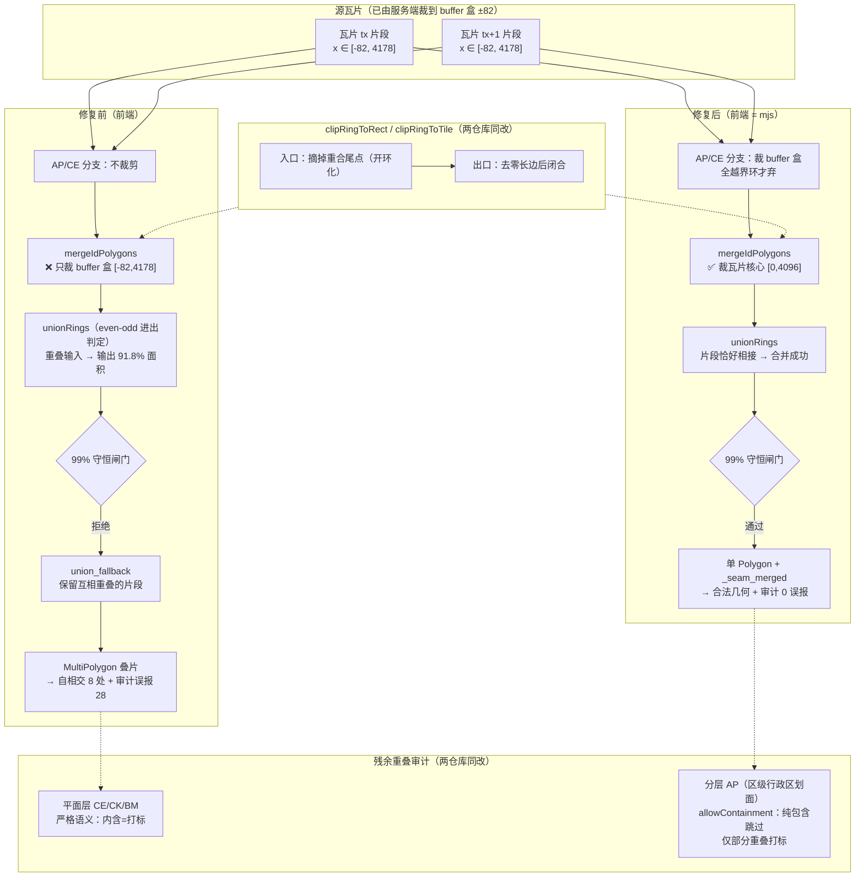

# 天地图 AP（区级行政区划面）拓扑缺陷修复 —— 核心裁剪丢失 / 裁剪环零长边 / 分层审计误报

- **日期与时间**：2026-10-14 18:18
- **任务等级**：L2（常规：Bug 修复，跨 2 个仓库 3 个文件，含分析文档 + 日志 + 版本号 + 门禁）
- **关联上一任务**：V3.6.18 [`2026-10-14-tdt-vector-decode-fix.md`](2026-10-14-tdt-vector-decode-fix.md)（0 要素解码修复）

---

## 一、问题分析

### 1.1 核心症状

用户导出实机抓取的 AP 层 GeoJSON：`E:\Google\天地图矢量_AP_z16_121.4899_31.2437_wgs84.geojson`（35 要素 / 9 瓦片 3×3）。用 GEOS/Shapely 逐项体检，客观缺陷四项：

| 症状 | 实测值 | 性质 |
|---|---|---|
| **几何非法（自相交）** | **8 / 35 要素** `Self-intersection`，交点全部落在瓦片裁剪线坐标上 | 硬缺陷，下游引擎无法处理 |
| **要素内多面片互相重叠** | 7 个 MultiPolygon，其中 oid 310283 有 5 片、314998 有 4 片、193664 有 2 片… | 硬缺陷（MultiPolygon 定义禁止叠片） |
| **环内重复相邻点（零长边）** | 52 处（51 个环几乎每环 1 处） | 退化几何 |
| **`_topo_review=1` 残余重叠标记** | **28 / 35 要素** | 见 §1.3，绝大多数为误报 |

> 注：8 个非法要素恰好 = 8 个跨瓦同 id 要素；52 处重复点 = 51 个输出环 + 1，即**每个输出环都被插入 1 个重复点**。

### 1.2 根本原因（三处，均已实测复现）

先确立事实基线：**源瓦片数据是干净的**。抓取同一 9 块真实瓦片（z16 x54883-54885 / y26774-26776）解码后：51 个 AP 原始要素、35 个不同 objectid、其中 8 个 objectid 跨 2~5 块瓦片；原始环全部闭合、全数据集仅 1 处重复点、无重复环。缺陷**全部由处理链引入**。

#### 原因① 前端移植丢失「瓦片核心裁剪」（致命，仅 WebGIS-Dev）

mjs 权威实现是**两段裁剪**：

```
AP 分支        clipRingToRect(ring, -82, -82, 4178, 4178)   // buffer 盒：全越界环才弃
mergeIdPolygons clipRingToTile(closed)                      // 瓦片核心 [0,4096]：真正决定输出
```

前端移植时把 `mergeIdPolygons` 里的核心裁剪换成了 buffer 盒裁剪，只留一段：

```js
// 旧（错误）：clipRingToRect(ring, CLIP_LO, CLIP_LO, CLIP_HI, CLIP_HI)   // CLIP_LO=-82, CLIP_HI=4178
```

后果是**跨瓦同 id 片段在接缝带内互相重叠**（每块瓦的片段向邻瓦伸出 82 单位，重叠带宽 164 单位），而 `unionRings` 的进出判定用 even-odd 奇偶规则——**重叠输入会让重叠区被判成"外部"**，于是合并失败。以 oid 314998（2 片段）实测：

| 输入形态 | 输入环面积和 | unionRings 输出 | 面积比 | 99% 守恒闸门 |
|---|---|---|---|---|
| 前端：buffer 盒裁剪 | 8,422,444 | 2 环 / 7,734,176 | **91.8%** | ❌ 拒绝 → `union_fallback`，**保留互相重叠的原始片段** |
| mjs：核心裁剪 | 7,781,826 | **1 环** / 7,781,836 | 100.0% | ✅ 通过 → 合并为单 Polygon |

核心裁剪后同 id 跨瓦片段**恰好相接（0 面积重叠）**，union 正常；buffer 盒裁剪则重叠，union 必然被守恒闸门拦下。8 个跨瓦要素全部落入 `union_fallback`，重叠片段被原样输出成 MultiPolygon 的多个 part —— 这就是 8 处自相交 + 7 个叠片 MultiPolygon 的来源。

> 旁证：`touchesTileSeam` 只在核心裁剪下才可靠（裁剪会在 x=0/4096 生成接缝顶点）；buffer 盒裁剪下顶点落在 ±82，判据退化。

#### 原因② Sutherland–Hodgman 裁剪插入重复顶点（两仓库共有）

`clipRingToRect` / `clipRingToTile` 用 `(i+1) % output.length` 环形遍历，而入参是**已闭合环（首==尾）**：当 `i = len-1` 时 `a = 尾点 = 首点`、`b = output[0] = 首点`，两点同在内侧 → 首点被**再 push 一次**。最小复现：

```
输入 (闭合 5 点): [[10,10],[10,20],[20,20],[20,10],[10,10]]
旧输出 (6 点)   : [[10,10],[10,10],[10,20],[20,20],[20,10],[10,10]]   ← 首点重复，零长边
```

**每个输出环必多 1 点**（实测：51 环 → 52 处重复；mjs 侧 35 环 → 45 处重复）。凹环沿裁剪边还会留下退化桥，是自相交的次要贡献者。

#### 原因③ 分层数据被"平面铺满"语义的审计误报（两仓库共有）

`auditResidualOverlap` 把「一个要素的顶点严格落在另一要素内」一律判为残余重叠。实测该 9 瓦片 AP 的 24 组重叠**全部为纯包含（containment）**：23 组是"大区含小区"（`fracOfB = 1.000`，即完全内含），仅 1 组是 9.75e-13 deg² 的数值噪声；33 个小要素之间**两两互不相交**。

而 AP 的语义在项目自研文档中已定性：

> `Docs`/`Pages/Note/md/tianditu-vector-full-reverse.md` §4.9：**AP = 区级行政区划面（高置信）**，且已注明"乡级/功能区低概率残留"。

行政区划面是**分层**数据：区（大面）含乡/功能区（小面）是正常层级，不是残余重叠。平面铺满语义（CE 建筑、CK/BM 覆盖面）下"内含=合并失败"才成立。审计对该 9 瓦片误报 28/35。

### 1.3 受影响模块

| 模块 | 文件 | 影响 |
|---|---|---|
| 前端分层拓扑 | `frontend/src/domains/common/data-import/parsers/tdtVectorTopology.js` | 原因①②③全部命中；AP/CE 输出几何非法 |
| 前端建筑拓扑 | `frontend/src/domains/common/data-import/parsers/tdtBuildingTopology.js` | 原因②（`clipRingToTile` 自带一份实现） |
| 权威 Node 实现 | `NEGIAO.github.io/Pages/Note/resources/tdt-full-reverse/tdt_vector_fetch.mjs` | 原因②③ |

---

## 二、修改内容

### 2.1 `tdtVectorTopology.js`（WebGIS-Dev，前端）

1. **恢复瓦片核心裁剪**（原因①，致命）：`mergeIdPolygons` 内改用 `clipRingToTile(closed)`（对齐 mjs `mergeIdPolygons`），并新增 `bufferClippedRingsOf()` 承担 CE/AP 分支的 buffer 盒预裁剪（对齐 mjs 分支，保留"全越界环才弃"语义）。CE/AP 两个分支由 `closedRingsOf(r)` 改为 `bufferClippedRingsOf(r)`。
2. **裁剪环去零长边**（原因②）：`clipRingToRect` 入口先摘掉重合尾点（开环化，回到标准 S-H），出口去零长边后闭合。
3. **AP 审计分层化**（原因③）：`auditResidualOverlap(features, opt)` 新增 `opt.allowContainment`；新增 `distToRings` / `insideOrOnRings` / `allInsideOrOnRings` 判定纯包含并跳过。调用点改为 `{ allowContainment: name === 'AP' }`——**CE/CK/BM 保持原严格语义不变**。
4. 头部规则注释同步（规则 2 / 6 / 7）。

### 2.2 `tdtBuildingTopology.js`（WebGIS-Dev，前端）

`clipRingToTile` 同一处零长边缺陷（原因②）：入口开环化 + 出口去零长边。

### 2.3 `tdt_vector_fetch.mjs`（NEGIAO.github.io，权威实现）

1. `clipRingToRect` 同一处零长边缺陷（原因②）修复。
2. `auditResidualOverlap(features, opt)` 支持 `opt.allowContainment`（原因③），AP 调用点传入；新增同名前三个辅助函数。
3. 头部规则注释补第 9 条（裁剪环洁净）并细化第 8 条（AP 分层豁免）。

---

## 三、修改原因

- 前端是从成熟 mjs 迁移来的，迁移时**丢了一步核心裁剪**，导致跨瓦合并整链失效。用户明确要求"以 negiao.github.io 的 mjs 为准"、"两个项目都要修"，故以 mjs 为权威基线恢复对齐。
- 零长边与审计误报在 mjs 中同样存在（mjs 输出 45 处重复点、误报 25/35），属**共享缺陷**，两个仓库同步修复。
- AP 是行政区划面而非平面铺满层，继续用平面语义审计会把正常层级报成缺陷，污染导出结果的可读性与下游判断。

---

## 四、影响范围

- **天地图矢量抓取链路**（前端）：AP 输出几何合法化；**CE 同步受益**（同一 `mergeIdPolygons` 路径）。
- **CE 行为变化（预期内）**：核心裁剪使"完全落在 buffer 带内"的建筑归位到邻瓦核心（不再重复输出）。实测同一 9 瓦片：CE out 1353 → **1311**，与 mjs 权威输出 **out=1311 完全一致**；覆盖率比对 `onlyMjs=0 / onlyFe=0`（面积差 0.0000%）。CK / BM / BV 覆盖率变化 **0.0000%**（完全中性）。
- **不涉及**：解码链（`tdtVectorFetcher.js`）、UI/文案、腾讯/高德链路、后端与部署面、配置 key、TOC 数据源注册（本改动只影响解析产物几何，未新增加载路径）。

---

## 五、解决方案

### 5.1 方案对比

| 方案 | 说明 | 取舍 |
|---|---|---|
| A. 恢复核心裁剪（选定） | `mergeIdPolygons` 裁到 [0,4096]，与 mjs 逐行对齐 | 修因不修表；跨瓦 union 恢复；与权威实现可逐点比对 |
| B. 放宽 99% 守恒闸门 | 让 buffer 盒重叠输入也能通过 | ❌ 治表：union 结果本身错误（91.8% 覆盖率），放宽后丢面 |
| C. 前端自行去重/裁掉重叠带 | 在 union 前手工剔除 82 单位重叠 | ❌ 等于重新发明核心裁剪，与 mjs 分叉 |
| D. AP 完全不审计（照 BV 处理） | 省掉误报 | ❌ 会漏掉真·部分重叠；分层豁免更精确 |

### 5.2 实施步骤

1. 抓取真实瓦片建立可复现基线（9 瓦片 / 51 AP 原始要素），并确认源数据干净。
2. 在临时验证台（`%TEMP%\tdt-ap`，仓库外）建立四路对照：mjs 原版 / mjs 修补版 / 前端原版 / 前端修补版，逐项量化。
3. 按 §5.1 方案 A 实施三处修复（前端 2 文件、mjs 1 文件）。
4. 用同一批瓦片复测四路指标，并对 **真实仓库文件**（非原型副本）做逐点比对与覆盖率比对。
5. 补 AP 专项回归测试 28 条；重跑既有解码/拓扑测试；ESLint + 双门禁 + 红线自查。

### 5.3 修复前后对照（同一 9 块真实瓦片，AP 层）

| 指标 | mjs 原版 | mjs 修补版 | 前端原版 | **前端修补版** |
|---|---|---|---|---|
| 要素数 | 35 | 35 | 35 | 35 |
| union / fallback | 8 / 0 | 8 / 0 | **0 / 8** | **8 / 0** |
| 非法几何 | 0 | 0 | **8** | **0** |
| 环内重复点 | 45 | **0** | 52 | **0** |
| MultiPolygon 叠片 | 0 | 0 | **7** | **0** |
| `_topo_review` 误报 | 25 | **0** | 28 | **0** |
| 输出环数 | 35 | 35 | 51 | 35 |
| 与 mjs 修补版逐点一致 | — | 基线 | ✗ | ✅ **35/35 几何完全相同** |

### 5.4 变更前后数据流（Mermaid）



---

## 六、性能指标

未实测（本次为几何正确性修复，未做吞吐基准）。可定性说明：新增一次 `clipRingToTile` 与入口 `pop()` 均为 O(n)；`allowContainment` 的包含判定仅在**已判定为"有顶点严格内含"**的候选对上触发（先用 bbox 预筛），不改变整体 O(n²) 复杂度量级。

---

## 七、测试方案

### 7.1 Agent 已执行（全部通过）

| 检查 | 命令 / 方式 | 结果 |
|---|---|---|
| AP 专项回归 | `run_ap_test.mjs`（仓库外验证台） | ✅ **28 过 0 败** |
| 解码一致性（回归） | `run_test.mjs`（真实 mjs vs 前端解码器） | ✅ 20 过 0 败 |
| 拓扑行为（回归） | `run_topo_test.mjs` | ✅ 14 过 0 败 |
| mjs 自检（回归） | `node tdt_vector_fetch.mjs --selftest` | ✅ 7 过 0 败 |
| mjs CLI 端到端 | `--bbox ... --zoom 16 --layers AP`（9 瓦片） | ✅ `in=51 out=35 union=8`，无 `topo_review`；0 非法 / 0 重复点 / 0 叠片 |
| mjs CLI 端到端（CE） | `--layers CE`（同 9 瓦片） | ✅ `out=1311`，与前端修补版覆盖率完全一致 |
| 前端 ↔ mjs 逐点一致性 | 真实仓库文件 vs mjs 修补版 | ✅ AP 35/35 要素几何完全相同（`shapely.equals=True`，对称差 0） |
| 分层回归（11 层） | 修复前/后全层对照 | ✅ CK/BM/BV 覆盖率差 0.0000%；CE 与 mjs 权威一致 |
| ESLint | `npx eslint src/domains/common/data-import/` | ✅ 0 报错 |
| 语法 | `node --check tdt_vector_fetch.mjs` | ✅ 通过 |
| 门禁 | `CheckStructureTree.py` / `CheckConfigRegistry.py` | ✅ 通过（见交接块） |
| 红线自查（§11.2 四条） | 内置 ripgrep 全仓扫描 + `deploy/.env` 基线核对 | ✅ 全绿（见下） |

红线自查明细（**注意**：本机 shell 无 `rg` 命令，直接用 `rg` 会走 `|| echo CLEAN` 分支产生假绿，故改用内置 ripgrep 检索，结果如实记录）：

- REDLINE-1/2/3：`backend/`、`deploy/`、`frontend/src/`、`.github/` 无真实命中；唯一命中是 `frontend/src` 中 `maxRayDistance` / `rayDistance`（体积云 raymarch 参数）**包含 `xray` 子串导致的假阳性**，以及 `Docs/` 下引用禁项清单本身的规范与历史日志。本次改动的两个文件（`tdtVectorTopology.js` / `tdtBuildingTopology.js`）零命中。
- REDLINE-4：`deploy/.env` 为 `PROXY_ALLOW_PRIVATE_HOSTS=false`、`DOWNLOAD_ALLOW_PRIVATE_HOSTS=false`、`PROXY_RATE_LIMIT=600`，生产基线未被破坏。

关键回归断言（`run_ap_test.mjs` 摘录）：`clipRingToRect` 输出无重复点且面积守恒、前端与 mjs 逐点一致；跨瓦同 id → 1 要素 / 单 Polygon / `_seam_merged=1` / `union=1 fallback=0`；纯包含在严格语义下打标、`allowContainment` 下不打标、部分重叠仍打标；真实瓦片 AP `out=35 union=8 review=0` 且环全闭合、零重复点。

### 7.2 待用户实机验证

1. **重抓同一区域 AP**（z16 121.4899/31.2437 附近），导出 GeoJSON。
   - 预期：35 个要素全部为合法单 Polygon；无 `_topo_review` 标记；跨瓦要素带 `_seam_merged: 1`；**不再出现自相交与叠片 MultiPolygon**。
2. **交叉验证几何**：把导出文件丢进 QGIS / mapshaper / geojson.io。
   - 预期：无拓扑告警；`mapshaper -clean` 前后面积不变。
3. **CE（建筑）回归**：同区域抓建筑，确认楼层/高度/名称仍在，跨瓦高楼合并为单栋、无重复栋。
   - 预期：要素数略降（buffer 带内重复栋归位到邻瓦核心），实机显示无缺栋。
4. **其他层回归**：CK / BM / BV / 点层 / 线层各抓一次，确认与修复前视觉一致（覆盖率实测中性）。
5. 提交与推送由用户自行执行（本次未做任何 Git 写操作）。

---

## 八、变更文件清单

| 文件 | 说明 |
|---|---|
| `frontend/src/domains/common/data-import/parsers/tdtVectorTopology.js` | ① 恢复 `mergeIdPolygons` 瓦片核心裁剪 + 新增 `bufferClippedRingsOf`；② `clipRingToRect` 去零长边；③ 审计支持 `allowContainment` 并用于 AP；④ 头部注释同步 |
| `frontend/src/domains/common/data-import/parsers/tdtBuildingTopology.js` | `clipRingToTile` 去零长边（同一缺陷的独立实现） |
| `README.md` | 三处版本号 → V3.6.19（简介行 / 版本演进表 / 页脚） |
| `Docs/Guide/CHANGELOG.md` | 顶部追加 V3.6.19 条目 |
| `Docs/LLM_record/26-10/2026-10-14/2026-10-14-tdt-ap-topology-fix.md` | 本日志 |
| **仓库外** `D:\Dev\GitHub\NEGIAO.github.io\Pages\Note\resources\tdt-full-reverse\tdt_vector_fetch.mjs` | ① `clipRingToRect` 去零长边；② 审计支持 `allowContainment` 并用于 AP；③ 头部注释补第 9 条 |

---

## 九、遗留与风险

1. **CE 残余重叠审计仍报 32/35**（`_topo_review`）：与 mjs 权威行为完全一致（mjs 同批 CE 也是 32），属既有语义，本次未改。若后续确认 CE 也存在合法"裙楼含塔楼"层级，可考虑对 CE 复用 `allowContainment`（已记入 TODO 建议，未实施）。
2. **AP 层仍保留 23 组纯包含关系**（大区含小区）：这是源数据的分层事实，本次只**不再误报**，未做几何裁剪/压制。若业务要求 AP 输出为平面铺满（区=最大面、小区挖洞），需另立任务（涉及"父面挖子面"逻辑，超出本次 bug 修复范围）。
3. **数值噪声级部分重叠**：`310283 × 314998` 存在 9.75e-13 deg²（≈0.01 m²）的部分重叠，属整数坐标取整噪声，两个实现一致，未处理。
4. **源数据内在重叠**：源瓦片在接缝带内存在不同 objectid 的相邻片段重叠（如 314998 与 312506），核心裁剪后消失；此结论已在验证台量化（核心裁剪后同 id 跨瓦重叠 = 0 对）。
5. **权威实现同步**：`tdt_vector_fetch.mjs` 的修改属仓库外文件（NEGIAO.github.io），已同步修改并通过 selftest 与 CLI 端到端验证，但**不在本仓库版本号管辖范围**，其版本控制由用户决定。
