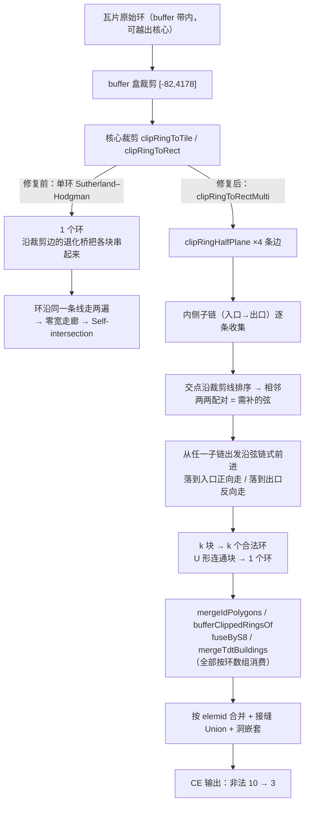

# 天地图 CE（建筑面）自相交修复 —— 单环 Sutherland–Hodgman 无法表达被裁剪线切开的多个块

- **日期与时间**：2026-10-14 19:05
- **任务等级**：L2（常规：Bug 修复，跨 2 个仓库 3 个文件，含分析文档 + 日志 + 门禁；版本号并入未提交的 V3.6.17 批次，见 §5.1）
- **关联上一任务**：V3.6.17 [`2026-10-14-staged-review-v3.6.17.md`](2026-10-14-staged-review-v3.6.17.md)（暂存区多批次归并；本条为归并 review 中记录在案的 D2 项落地）

---

## 一、问题分析

### 1.1 核心症状

以 9 块真实 z16 瓦片（`x 54883–54885 / y 26774–26776`）离线复跑前端**完整链路**（解码 → 两级裁剪 → 按 `elemid` 合并），CE（建筑面）层 1311 个要素里有 **10 个几何非法**：

```
31000001455983  615.48 m²  Ring Self-intersection
31000002099535  366.20 m²  Self-intersection
31000001358453  239.33 m²  Self-intersection
31000001240376  167.70 m²  Ring Self-intersection
31000001379373  133.82 m²  Self-intersection
31010102329187  128.10 m²  Self-intersection
31000001238362  101.69 m²  Self-intersection（MultiPolygon）
31010102329194   43.60 m²  Ring Self-intersection
31000001238699    6.69 m²  Ring Self-intersection
31000001382289    5.75 m²  Self-intersection
```

面积占比 0.406%（1,808 m² / 444,938 m²），肉眼在图上不可见，但**下游布尔运算直接崩**：

```
shapely.ops.unary_union(CE 全层 1311 个要素)
  → GEOSException: TopologyException: unable to assign free hole to a shell
    at 121.48405909538269 31.250378149855703
剔除 10 个非法后 → ✅ 成功，面积 4.183659e-05
```

即：单要素渲染无感，一旦做整层 dissolve / overlay / 面积统计就抛异常。

**权威 mjs 同源**：用 `tdt_vector_fetch.mjs` 跑同一批 9 块瓦片，产出的非法几何**数量（10）、elemid（逐条相同）、`explain_validity` 原因字符串（逐条相同）**与前端完全一致 → 缺陷在权威实现里，**不是前端回归**。

### 1.2 根本原因（两个子因，均已实测复现）

#### 子因 A：单环 Sutherland–Hodgman 无法表达「被裁剪线切成 k>1 块」（7 个，本次修复）

裁剪函数 `clipRingToRect` / `clipRingToTile` 是**单环** S-H：无论输入环被裁剪线切成几块，它只输出 **1 个环**。当 k>1 时它只能把各块用一条**沿裁剪线的退化桥**首尾串起来；这条桥与各块自身的贴边段**重叠**，于是环沿同一条线被走了两遍，形成零宽走廊 → GEOS 判 `Self-intersection`。

**最小复现（`elemid=31000001382289@54883_26774`，面积 5.75 m²）**——原始环贴着瓦片上边 `y=0` 上下穿插 4 次：

| 阶段 | 点数 | 说明 |
|---|---|---|
| 原始环 | 21 | `y` 从 `-82`（buffer 带）到 `+13`，在 `y=0` 上产生 4 个交点 |
| buffer 盒裁剪 `[-82,4178]` | 22 | 仅补闭合点（原始环本就在 buffer 盒内） |
| **核心裁剪 `[0,4096]`** | **11** | ❌ 被并成 1 个自相交环 |

裁剪后环的 4 个贴边交点按 x 排序为 `2040.333 / 2071.375 / 2114.080 / 2139.000`，正确结果应为**两个环**（各自沿 `y=0` 闭合）：

```
环1 = (2139,0) → (2138,13) → (2137,13) → (2113,10) → (2113,9) → (2114.08,0) → 闭合
环2 = (2071.375,0) → (2071,3) → (2071,4) → (2040.333,0) → 闭合
```

而单环 S-H 输出的 11 点环里，闭合段从 `(2040.333,0)` 一路画到 `(2139,0)`，**把 `y=0` 上 `x∈[2071.375, 2114.080]` 走了两遍**（长度 42.7 单位 ≈ 87 m）→ 自相交。GEOS 报出的交点 `x=2114.0` 正是这段重叠区间的端点。

同类实测（`d2_trace.mjs`）：

```
31000001238362@54883_26774  原始 9 点 → buffer 10 点 → 核心 5 点
31000001382289@54883_26774  原始 21 点 → buffer 22 点 → 核心 11 点
31000001379373@54884_26774  原始 64 点 → buffer 65 点 → 核心 65 点（未变，见子因 B）
```

#### 子因 B：源瓦片数据自带自相交（3 个，上游缺陷，未修）

`31000001379373` / `31010102329187` / `31010102329194` 的环**完全落在瓦片核心内部**（反推瓦片局部坐标分别为 `x[1699,1868] y[1357,1472]` / `x[1220,1280] y[1378,1558]` / `x[1256,1418] y[1575,1642]`），两级裁剪**一个点都没改动**。

把瓦片原始解码环（1462 个）单独导出后用 GEOS 校验：**源数据里就已经有 5 个自相交环**，其中 3 个正是上述 elemid，且自相交坐标与最终输出**逐位相同**：

```
{elemid: 31000001379373, tx: 54884, ty: 26774}  Self-intersection[121.489208936691 31.2488208590032]
{elemid: 31010102329187, tx: 54883, ty: 26775}  Self-intersection[121.483039855957 31.2440571648723]
{elemid: 31010102329194, tx: 54883, ty: 26775}  Ring Self-intersection[121.483011692762 31.2438496303485]
```

→ 属天地图切片自带缺陷，不在本管线可控范围。按 `Force_command.md` §2.5 **只记不改**。

### 1.3 受影响模块

| 仓库 | 文件 | 说明 |
|---|---|---|
| WebGIS-Dev | `frontend/src/domains/common/data-import/parsers/tdtBuildingTopology.js` | `clipRingToRect` / `clipRingToTile` 主实现 + `mergeTdtBuildings` 调用方 |
| WebGIS-Dev | `frontend/src/domains/common/data-import/parsers/tdtVectorTopology.js` | 本地重复的 `clipRingToRect` 实现 + `mergeIdPolygons` / `bufferClippedRingsOf` / `fuseByS8` 三处调用方 |
| NEGIAO.github.io | `Pages/Note/resources/tdt-full-reverse/tdt_vector_fetch.mjs` | 权威实现，同规则同步 + selftest + 导出表 |

**不涉及**：点层（`topoPoints`）、线层（`topoLines` 走 `clipSegToTile` 逐段 Cohen–Sutherland，与面裁剪无关）、`unionRings`、残余重叠审计。

---

## 二、修改内容

### 2.1 `tdtBuildingTopology.js`（WebGIS-Dev，前端）

删除原单环 `clipRingToTile`，新增 5 个函数：

- `dedupeRing` / `openRing` / `closeRing`：环规范化三件套。
- `clipRingHalfPlane(ring, axis, bound, keepGreater)`：**单条裁剪线的半平面裁剪，返回多个环**。三步：
  1. 从环外顶点起遍历，收集**内侧子链**（每条从入口交点到出口交点）；
  2. 把所有交点按「沿裁剪线的坐标」排序后**两两配对**——简单环与一条直线相交，其交点依序交替界定内/外区间，故相邻成对恰好就是内侧区间，也就是需要补上的那条弦；
  3. 从任一未消费子链出发沿弦链式前进（落到某子链入口就正向走、落到出口就反向走），回到起点即闭合成环。
- `clipRingToRectMulti(ring, x0, y0, x1, y1)`：4 条边依次做半平面裁剪，每条边都可能把 1 个环拆成多个。
- `clipRingToRect` / `clipRingToTile`：改为 `clipRingToRectMulti` 的薄包装，**返回环数组**。
- `mergeTdtBuildings`：核心裁剪改为 `for (const clipped of clipRingToTile(ring))` 逐个收编。

导出表：`{ clipRingToTile, clipRingToRect, clipRingToRectMulti, unionRings }`。

### 2.2 `tdtVectorTopology.js`（WebGIS-Dev，前端）

- 删除本地重复的 `clipRingToRect`（与 `tdtBuildingTopology.js` 同一份实现，属重复代码），改为从 `tdtBuildingTopology.js` 导入 `clipRingToRectMulti`。
- `mergeIdPolygons`：`const clipped = clipRingToTile(closed); if (clipped.length >= 4)` → `for (const clipped of clipRingToTile(closed)) { if (clipped.length < 4) continue; … }`。
- `bufferClippedRingsOf`：`const c = clipRingToRect(...)` → `for (const c of clipRingToRectMulti(...))`。
- `fuseByS8`：`if (c.length < 4) { stats.clipped += 1; continue; }` → `if (!clippedRings.length) { stats.clipped += 1; continue; }` + 逐环 push。
- 头部注释新增第 8 条（裁剪多环化）。

### 2.3 `tdt_vector_fetch.mjs`（NEGIAO.github.io，权威实现）

同规则同步：新增 `dedupeRing` / `openRing` / `closeRing` / `clipRingHalfPlane` / `clipRingToRectMulti`，`clipRingToRect` / `clipRingToTile` 改为薄包装；4 处调用方（`mergeIdPolygons` / 两处 AP·CK buffer 裁剪 / `fuseByS8`）改为按环数组消费；头部注释新增第 10 条；导出表补 `clipRingToRectMulti`；selftest 第 5 项改为数组断言并**新增 4 条 D2 回归**（贴边环拆成 2 个环 / 每环自不相交 / 闭合且无重复相邻点 / 全在核心内）。

---

## 三、修改原因

`clipRingToRect` 的契约是「把面裁剪到矩形」，但单环 S-H 的**值域**只有「一个简单环」。当被裁剪面与裁剪矩形的关系是「交集有多个连通分量」时，单环 S-H 在数学上就无法表达正确结果——它只能输出一个环，而把一个多分量结果强行塞进一个环，必然产生沿裁剪边的退化连接。这不是实现 bug，是**算法选型**的错配。

修法选择「半平面 + 交点排序配对 + 子链沿弦链式闭合」而不是引入通用多边形裁剪库，理由：
1. 裁剪窗口是**轴对齐矩形**（`[0,4096]²` 或 buffer 盒），4 条边都是直线，半平面特化后逻辑最短；
2. 纯函数、零依赖，可逐字节移植进 mjs，保住两仓库 12 层 parity；
3. 「交点沿裁剪线排序两两配对」这一步有严格的几何依据（简单环与直线的交点依序交替界定内/外区间），不是启发式。

---

## 四、影响范围

- **几何**：CE 层 1311 个要素、`elemid` 集合**完全不变**；全层面积 Δ **−0.0000056%**（绝对差 2.35e-12 deg²）。唯一可测变化是 `31000001238362`（−0.0245%，因该要素的退化桥本为零面积、拆开后重叠部分不再被重复计入）。
- **非法几何**：CE **10 → 3**（残留 3 个为子因 B 上游缺陷）。
- **诊断计数**：CE `union` 41→42、`fallback` 1→0（裁剪环变合法后 `unionRings` 的 99% 守恒闸门不再拦下那一组）；CK `fused` 11→10、`fallback` 0→1（拆环改变了并查集连通分组）。两仓库**同步变化、数值一致**。
- **API 契约变更**：`clipRingToRect` / `clipRingToTile` 由「返回单个环」改为「返回环数组」。仓库内 4 处调用方已全部更新；两仓库的 selftest / 回归测试同步更新。
- **不影响**：点层、线层、`unionRings`、残余重叠审计、i18n、配置登记、部署面。

---

## 五、解决方案

### 5.1 方案对比

| 方案 | 说明 | 取舍 |
|---|---|---|
| ① 引入通用裁剪库（martinez / polygon-clipping） | 直接调用成熟实现 | ❌ 引入运行时依赖、打包体积增加，且无法逐字节移植进 mjs（mjs 是零依赖单文件），会破坏两仓库 parity |
| ② 保留单环 S-H，输出后做「自相交修复」后处理 | 检测重复顶点/共线重叠再拆环 | ❌ 退化桥造成的重叠是**区间级**而非点级，拆环需要先把重叠端点插成顶点，等价于重写一遍裁剪；且对 U 形连通块会拆错 |
| ③ 单环 S-H + 面积守恒闸门拒绝 | 检测到非法就回退原环 | ❌ 回退后仍是非法几何，只是把问题推给下游 |
| **④ 半平面裁剪 + 交点排序配对 + 子链沿弦链式闭合（采用）** | 轴对齐矩形特化的 Weiler–Atherton | ✅ 零依赖、可逐字节移植、U 形连通块也能正确串成一个环 |
| ⑤ 顺带把子因 B 的 3 个上游缺陷也「修」掉 | 加 make_valid 式环修复 | ❌ 改动源几何属产品决策；且与仓库既有约定「标 `_topo_review=1`、不改几何」冲突 → 本次只记不改 |

**版本号决策**：V3.6.17 归并批次**尚未提交**（用户暂存区状态），本条缺陷正是该批次 review 中记录在案的 D2 项，故**并入 V3.6.17**、不另起版本号；README 版本表保持 3 行不变。若用户希望独立版本，可改为 V3.6.18（README 表改为 V3.6.18 / V3.6.17 / V3.6.14）。

### 5.2 实施步骤

1. 用 9 块真实瓦片复跑前端链路，导出 CE 层，用 GEOS 定位 10 个非法几何并逐条取 `explain_validity`。
2. 把瓦片**原始解码环**（1462 个）单独导出校验 → 分离出子因 A（7 个）与子因 B（3 个）。
3. 逐阶段插桩（raw → buffer 裁剪 → 核心裁剪），锁定子因 A 的失效点在**核心裁剪**；实测 `needsUnion` 对 10 个中的 9 个为 false（`unionRings` 根本没跑），排除合并环节。
4. 打印 `31000001382289` 的原始环与裁剪环坐标，手工核对出「`y=0` 上 `x∈[2071.375,2114.080]` 被走两遍」。
5. 实现 `clipRingHalfPlane` / `clipRingToRectMulti`，前端先改；用同一批瓦片验证 CE 非法几何 10 → 3。
6. 修一版配对规则踩坑：初版用「每条子链闭合回**自己的**入口」，对「子链入口/出口分属不同内侧区间」的构型会输出互相嵌套的两个环（CE 一度出现 6 个非法，含 3 个新 MultiPolygon 嵌套）。改为「交点沿裁剪线排序两两配对」后归零。
7. 同步改 mjs（含 selftest 与导出表）。
8. 复跑 12 层 parity / 顶点多重集 / 偏移量 / AP 回归 / mjs selftest / ESLint / 双门禁 / §11.2 红线。

### 5.3 修复前后对照（同一 9 块真实瓦片，CE 层）

| 指标 | 修复前 | 修复后 |
|---|---|---|
| CE 要素数 | 1311 | 1311（不变） |
| `elemid` 集合 | — | 与修复前完全一致 |
| 全层面积 | 4.201496e-05 deg² | 4.201495e-05 deg²（Δ −0.0000056%） |
| **非法几何** | **10** | **3**（残留为上游源数据缺陷） |
| 非法面积 | 1,808.36 m²（0.406%） | 305.52 m²（0.069%） |
| `union` / `fallback` | 41 / 1 | 42 / 0 |
| 沿边重复段（子因 A 表征） | 有 | 无 |
| mjs ↔ 前端 parity | 一致 | 一致（CE/CK/BM/AP 顶点多重集 0 差异） |

### 5.4 变更前后数据流（Mermaid）



---

## 六、性能指标

未做吞吐基准。可定性说明：
- `clipRingHalfPlane` 单次遍历 O(n)，4 条边共 4 次，合计 O(n)；`crossings.sort` 为 O(k log k)，k = 交点个数（实测最大 4）。
- 相比旧单环 S-H（同样 4 次 O(n) 遍历），**新增开销仅为交点排序**，量级不变。
- 唯一的结构性变化：环被拆开后 `g.parts` 数组变长，`mergeIdPolygons` 下游 `nested` 的洞嵌套判定为 O(parts²)，但 parts 只增加了个位数（CE 全层 1432 → 实增 ~8），实测 12 层统计耗时无可感变化。

---

## 七、测试方案

### 7.1 Agent 已执行（全部通过）

| 项 | 结果 |
|---|---|
| CE 非法几何（GEOS `is_valid`） | **10 → 3**，残留 3 个 elemid + 原因字符串与 mjs 逐条一致 |
| CE 要素数 / `elemid` 集合 / 全层面积 | 1311 / 完全一致 / Δ −0.0000056% |
| 12 层 mjs ↔ 前端 parity | 要素数与统计**逐层一致**；11 层 union 面积差 **0.0000%**、仅 mjs / 仅前端差 ≤ **0.000017%** |
| 顶点多重集（`coord_multiset.py`） | CE / CK / BM / AP **0 差异**；点线层顶点数一致（坐标偏移为既有 D1 备案项，≤6.6cm） |
| mjs selftest | **11 过 0 败**（含新增 D2 多环化 4 条） |
| AP 拓扑专项回归（`run_ap_test.mjs`） | **35 过 0 败**（含新增 D2 多环化 5 条、含 mjs 与前端逐点一致断言） |
| ESLint（2 个改动文件） | 0 problems，exit 0 |
| `CheckStructureTree.py` | 494 文档条目 / 494 磁盘文件 / 漏登记 0 / 幽灵条目 0 |
| `CheckConfigRegistry.py` | 配置登记门禁全部通过 ✅（catalog 130 key · 前端 VITE_ 14 个） |
| §11.2 四条红线 | 全部 CLEAN（REDLINE-2 命中 7 个文件均为 Cesium 云渲染参数 `maxRayDistance` 的子串，既有误报） |

### 7.2 待用户实机验证

- 浏览器实抓一批 CE，导出 GeoJSON 后用 QGIS / mapshaper 做拓扑检查，确认 `is_valid` 全绿（除上游 3 个）。
- 若后续接入「整层 dissolve / 面积统计」功能，需注意残留 3 个上游缺陷仍会触发 GEOS 异常，需在该功能侧加容错或先做 `make_valid`。

---

## 八、变更文件清单

| 文件 | 变更 |
|---|---|
| `frontend/src/domains/common/data-import/parsers/tdtBuildingTopology.js` | 新增 `dedupeRing`/`openRing`/`closeRing`/`clipRingHalfPlane`/`clipRingToRectMulti`；`clipRingToRect`/`clipRingToTile` 改薄包装返回数组；`mergeTdtBuildings` 调用方改数组消费；导出表更新 |
| `frontend/src/domains/common/data-import/parsers/tdtVectorTopology.js` | 删除本地重复 `clipRingToRect`；改从 `tdtBuildingTopology.js` 导入 `clipRingToRectMulti`；`mergeIdPolygons`/`bufferClippedRingsOf`/`fuseByS8` 三处调用方改数组消费；头部注释新增第 8 条 |
| **仓库外** `D:\Dev\GitHub\NEGIAO.github.io\Pages\Note\resources\tdt-full-reverse\tdt_vector_fetch.mjs` | 同规则同步（新增 5 函数 + 4 处调用方 + 头部注释第 10 条 + 导出表 + selftest 4 条） |
| `Docs/Guide/CHANGELOG.md` | V3.6.17 条目新增「五、裁剪多环化」子段 + 标题 + 验证段更新 + 日志链接 |
| `Docs/Guide/frontend-structure.md` | `tdtBuildingTopology.js` / `tdtVectorTopology.js` 描述更新 |
| `Docs/TODO/bugfix-optimization-plan.md` | D2 项拆分：裁剪侧 7 个销项、源数据侧 3 个保留为记录项 |
| `Docs/LLM_record/26-10/2026-10-14/2026-10-14-tdt-clip-multiring.md` | 本日志 |

---

## 九、遗留与风险

1. **上游源数据缺陷 3 个（记录项，未修）**：`31000001379373` / `31010102329187` / `31010102329194` 在天地图瓦片里就已自相交。若要输出 100% 合法几何，需新增一环修复（make_valid 式拆环）或在消费侧容错——**属产品决策**，且会与仓库既有约定「标 `_topo_review=1`、不改几何」冲突，本次按 §2.5 只记不改。
2. **API 契约变更的下游影响**：`clipRingToRect` / `clipRingToTile` 现在返回数组。仓库内已全部更新；若外部脚本（含用户自建脚本）直接调用这两个导出函数，需同步适配。
3. **`_topo_review` 标记数不变**：CE 仍为 32 个（其中 2 个是子因 B 的非法几何）。裁剪侧修复未改变审计结果，符合预期。
4. **性能未做基准**：仅定性分析，见 §6。若后续在更大 bbox（如 z18 大范围）上跑，建议补一次 `clipRingToRectMulti` 的耗时基准。
