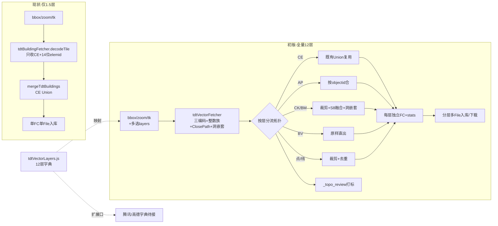

# 2026-10-14 天地图全量矢量抓取初版（多选分层 + 拓扑对齐 mjs）→ V3.6.15

## 日期与时间

2026-10-14 12:00（UTC+8，用户会话开始；实施中追加精确时间）

## 任务等级

L2 常规（功能扩展 + 新增文件 + 多文件协同；非 L3：不动目录/依赖/配置架构/DB）

## 问题分析（核心症状 → 根本原因 → 受影响模块）

- **核心症状**：WebGIS-Dev 建筑抓取（建筑3/天地图）只用了全量 12 层中的 1.5 层——`parsers/tdtBuildingFetcher.js:decodeTile` 仅收 `layer==CE && type==2 && /^\d{14}$/elemid`，`respt` 只做挂名；其余 BI/BV/CK/BM/BK/AA/AB/AP/AD/AM 全部丢弃。
- **根本原因**：
  1. 前端解码器是建筑子集实现，缺少 mjs 已验证的三编码（标准 0x1a / 前导 / 裸层）、Value 整数族（f4/f5/f6/f7）、ClosePath count 恒 1 修复、洞嵌套逻辑；
  2. `elemid` 仍用 `/^\d{14}$/` 过滤，而 mjs §11 已证伪（郑州 z18 含字母 `zzrespl` 案丢 4 栋百米高楼），只能校验非空；
  3. 拓扑只有 CE 跨瓦 Union（`tdtBuildingTopology.js`），无 CK/BM 按 S8 融合、AP 按 objectid 合、点线裁剪去重、残余打标。
- **受影响模块**：天地图抓取链路（parsers/useTdtBuildingFetch/面板/locales），腾讯/高德链路零触碰（只留扩展口）。

## 版本漂移修复（用户 P1 指令：本次定 V3.6.15）

> 依据 §0：P1 用户明确指令优先，P2 规范其余条款继续遵守。

| 位置 | 现状 | 判定 |
|---|---|---|
| README 简介行 | V3.6.14 | 落后 |
| README 版本表 | V3.6.14/13/12/11（4 行，违反恒定 3 行） | 漂移 |
| README 页脚 | V3.6.14 · 2026-10-13 | 落后 |
| CHANGELOG 顶部 | V3.6.17（合规匿名）→ V3.6.14…（缺 3.6.15/16 条目） | 漂移 |
| git commit 8720a3bb | 标题 V3.6.16，但其 CHANGELOG diff 实际写入 `### V3.6.14` | 错配 |
| HEAD 5b92be33「补丁」 | 只写 CHANGELOG V3.6.17，未同步 README 三处 | 未完成 |
| 暂存区 | `tdtBuildingFetcher.js` 5 行优雅降级 fix 未提交 | 用户侧待提交，本任务不碰 |

修复动作（不改写历史条目，禁 Git 写操作）：README 三处 → V3.6.15（表首新增并删最旧、恒定 3 行）；
CHANGELOG 顶部追加 V3.6.15（含本条漂移说明）；旧条目原样保留。

## 候选方案对比 → 选定方案与理由

1. **改旧 fetcher 为全量**：动 staged 文件（用户未提交改动），回归风险高。否决。
2. **新建全量解析器 + 老文件冻结**（选定）：`parsers/tdtVectorLayers.js`（12 层字典，多选 UI 与腾讯/高德复用同形状）+ `parsers/tdtVectorFetcher.js`（mjs 全量解码浏览器版）+ 拓扑文件**只增新导出、零改旧路径** + `useTdtBuildingFetch` 新增 `startVectorFetch`（老 `startFetch` 零回归）。与 mjs §7「复用 useTdtBuildingFetch 形状」一致，且为腾讯/高德留扩展口。
3. 拓扑策略（用户拍板③：效果与 mjs 一致）：CE 沿用既有 Union；AP 按 objectid 合；CK/BM 核心裁剪→S8 分组→连通 Union→洞嵌套；BV 原样直出；点（BI/AD/respt）裁剪+去重；线（AA/AB/AM/BK）逐段裁剪+完全一致去重；残余重叠标 `_topo_review=1` 不改几何；Union 前后守恒、失败回退。全部由 mjs §7 逐条移植（零第三方依赖）。

## 影响范围

天地图抓取面板（多选 UI/分层结果/分层入库下载）、新增 2 解析器文件、拓扑文件增导出、useTdt hook 增量 API、中英 locale 新增键、结构树、README×3、CHANGELOG。
腾讯/高德 tab、后端、管理端、配置 key：零触碰（无新增 key，不跑 catalog 相关变更，但门禁双脚本照跑）。

## Mermaid（§2.9：≥3 文件协同，附变更前后关系）

## 修改内容

- 新增 `frontend/src/domains/common/data-import/parsers/tdtVectorLayers.js`：12 层字典（码→中文含义→关键属性→拓扑策略）+ 多选归一化 + 下拉选项。
- 新增 `parsers/tdtVectorFetcher.js`（525 行）：XOR 还原 + 标准/前导/裸层三编码 + Value 整数族 + ClosePath 修复 + 洞嵌套 + `fetchTdtVectorLayers` 分层抓取（400ms 间隔禁调小，失败记 failures 不伪造）。
- 新增 `parsers/tdtVectorTopology.js`（390 行）：复用既有 `clipRingToTile/unionRings`；CE 按 elemid 非空合、AP 按 objectid 合、CK/BM 按 S8 融、BV 直出、点线裁剪去重、残余打标、守恒回退。
- 扩展 `useTdtBuildingFetch.js`：新增 `startVectorFetch` + `buildVectorImportFiles` + `downloadVectorResult` + `selectedLayers/vectorResult`；老 `startFetch` 零改动。
- 面板 `TencentBuildingPanel.vue`：天地图 tab 下多选勾选（含全选）+ 分层结果明细 + 天地图分流全量抓取/分层入库 + 估算切全量口径 + 新增样式（Lucide 图标规范不变）。
- 中英 locale 各 +4 键：`vectorLayers/vectorLayersAll/vectorResult/vectorImported`。
- 结构树同步 3 处；README 三处 → V3.6.15；CHANGELOG 顶部追加 V3.6.15（含漂移说明，历史条目不动）。

## 修改原因

用户已完成天地图 12 层全量逆向并验证（mjs 成熟），要求 WebGIS-Dev 建筑抓取升级为全量初版：前端多选 + 分层入库，拓扑效果与 mjs 一致，腾讯/高德解析完成后直接套用同形状。

## 解决方案（实施步骤）

1. 先写本日志前半（分析链 + Mermaid），再动代码。
2. 新建字典 → 新建拓扑（复用既有 Union 引擎）→ 新建抓取（mjs 解码逐行移植）→ hook 增量 API → 面板多选分流 → locale → 结构树 → 版本 → 门禁。
3. 老文件 `tdtBuildingFetcher.js`（含用户暂存区 5 行 fix）全程零触碰。

## 性能指标

未实测（沙盒无 tk 实机抓取；解码拓扑均为既有引擎复用 + mjs 同算法）。

## 测试方案

### Agent 已执行

- `node --check`：`tdtVectorTopology.js` ✅、`tdtVectorFetcher.js` ✅、`tdtVectorLayers.js` ✅、`useTdtBuildingFetch.js` ✅。
- 待跑：`python Scripts/CheckStructureTree.py`、`python Scripts/CheckConfigRegistry.py`（见门禁结果节）。

### 待用户实机验证

1. 天地图 tab 勾选 `CE + respt` 小范围 z18 抓取：与老建筑结果栋数一致（elemid 含字母楼不丢失）。
2. 全选 12 层小范围 z16：分层明细 12 行 + TOC 出现 `天地图矢量_<码>` 多条目，显隐/透明度/定位/移除可用；CE 拔高、其余贴地。
3. 取消按钮中断抓取回到 idle；301010 无权限提示不变；缺 tk 报 `tdt_key_required` 不变。
4. 腾讯/高德 tab 行为零变化。

## 变更文件清单

- `frontend/src/domains/common/data-import/parsers/tdtVectorLayers.js`（新增）
- `frontend/src/domains/common/data-import/parsers/tdtVectorFetcher.js`（新增）
- `frontend/src/domains/common/data-import/parsers/tdtVectorTopology.js`（新增）
- `frontend/src/domains/common/data-import/useTdtBuildingFetch.js`（增量 API）
- `frontend/src/domains/common/data-import/components/TencentBuildingPanel.vue`（多选分层 UI + 分流）
- `frontend/src/locales/zh-CN.js`、`frontend/src/locales/en-US.js`（各 +4 键）
- `Docs/Guide/frontend-structure.md`（树同步）
- `README.md`（三处 → V3.6.15）、`Docs/Guide/CHANGELOG.md`（追加 V3.6.15）
- 本日志。

## 遗留与风险

- `tdtBuildingFetcher.js` 暂存区 5 行 fix（`closedAny` 尾渣保留）由用户提交，本任务未合入；全量解码器已自带同规则，不依赖该 fix。
- 前导/裸层在浏览器侧为弱/强证据组合实现，未经线上 tk 实测，失败只记 failures 不抛错；待用户小范围实测后微调。
- Cesium 按高度拔高依赖既有 `upload-data` 通道对 `height_m` 的识别，非 CE 层无高度保持贴地（符合预期）。
- 版本号：历史 `V3.6.16` commit 名与 `V3.6.17` CHANGELOG 条目保留未改（禁改历史），本次按用户 P1 指令定版 V3.6.15；并行会话若再推进需顺延。

## 门禁结果

- `CheckStructureTree` ✅（494 文件双向零漂移）。
- `CheckConfigRegistry` ✅（catalog 130 key / 前端 VITE_ 14 个，全绿；本次无新增配置 key）。
- `node --check` ✅（3 新解析器 + hook 全过）。
- 未执行任何 Git 写操作；未在 Docs 外新建说明；未硬编码 tk；平台红线：本次纯前端改动，未触后端/部署面，无红线项。

