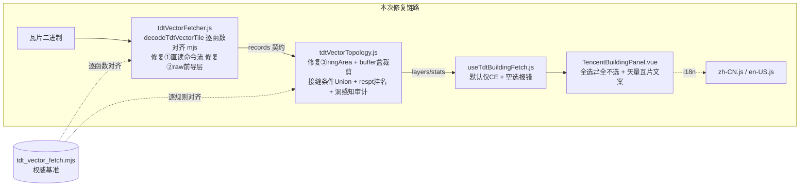

# 2026-10-14 天地图矢量瓦片 0 要素修复（解码链重写 + 拓扑对齐 mjs + 默认仅建筑 + 矢量瓦片文案）→ V3.6.18

## 日期与时间

2026-10-14 17:35（UTC+8）

## 任务等级

L2 常规（Bug 修复 + 多文件协同重写；非 L3：不动目录/依赖/配置架构/DB）

## 问题分析（核心症状 → 根本原因 → 受影响模块）

- **核心症状**：用户实机测试 V3.6.15 全量矢量抓取，所有图层 0 要素（进度正常、无报错、结果为空）。
- **根本原因**（对照权威实现 `tdt_vector_fetch.mjs` 逐函数比对锁定，共 3 处致命 bug）：
  1. **几何链只降不读（致命）**：旧 `tdtVectorFetcher.js` 的 `pfeature→pfind` 只做 f1 深嵌套下降（且 `pfind` 逻辑自相矛盾：无 f1 兄弟字段时无限递归，有则把兄弟字段当几何），**从不直读命令流**。而真实瓦片 f1 几何即命令流（MoveTo2/LineTo3/ClosePath7 + zigzag 差分）——所有标准层要素几何解析必然失败 → 全层 0 要素。mjs `findCommands` 是"先直读命令流，失败再按 f1 递归（depth≤8）"。
  2. **前导层入口错位（致命）**：旧 `ppreamble(body)` 从 `body`（=raw.slice(5)）解析前导层，但前导层结构位于 `raw[0..]`（0x1a + XOR 长度 + XOR 感知内容），mjs `parsePreambleLayer(raw)` 传的是整个 raw → 前导层永远解析不到。
  3. **ringArea 公式尾项写错（潜伏）**：旧 `tdtVectorTopology.js` 的 `ringArea` 尾项误写 `ring[i][0]`（x_i），应为 `ring[i][1]`（y_i）——所有面积守恒校验（Union 前后 99% 回退线）全部失真，跨瓦 Union 会随机误回退/误通过。
- **次要偏差**（拓扑行为与 mjs 不一致，用户点名"没有进行拓扑的处理"核查后确认）：
  - CE/AP 用核心盒 [0,4096] 裁剪（mjs 用 buffer 盒 [-82,4178]，bbox 边缘不断楼）；Union 不分条件见多环就合（mjs 仅"跨瓦 + 接缝带"才合）；
  - CE 无 respt 挂名；点层把 buffer 点丢掉且去重键不含坐标兜底；线去重键不含属性；残余重叠审计只看 bbox 相交（mjs 是洞感知严格内含）；
  - 旧版把裸层/前导层同名去重做成 `!(bare && bare.name === lead.name)` 的弱判断，且检测/解析函数与 mjs 逐行不等价（`pfields` 无 guard、`ptop` 无完整消费校验、`pdetect` 单遍扫描易漏层）。
- **受影响模块**：`parsers/tdtVectorFetcher.js`（重写）、`parsers/tdtVectorTopology.js`（重写）、`useTdtBuildingFetch.js`（默认层 + 空选校验）、`components/TencentBuildingPanel.vue`（全选切换 + 文案分流）、`locales/zh-CN.js`/`en-US.js`（矢量瓦片文案）。腾讯/高德链路、后端、配置 key：零触碰。

## 修改内容

1. **重写 `parsers/tdtVectorFetcher.js`**（解码链逐函数对齐 mjs）：
   - `splitFields/parseTop/detectLayers`（全字节扫描 + parseTop 完整消费 + f5/f15 双证）、`parseCommands`（首命令必须 MoveTo2、ClosePath count 恒 1、坐标界 [-1000,5100]、尾渣 partial 优雅降级）、`findCommands`（**修复①**：直读命令流优先，失败 f1 深嵌套递归 ≤8）、`parseValue`（f1 严格 UTF-8 失败记 `__raw_hex` / f3 浮点 / f4-f7 整数族 BigInt）、`parseFeature/parseLayer/featureProperties`；
   - `parsePreambleLayer(raw)`（**修复②**：入参改为整个 raw）+ `readTagXor/readLenXor/parseFeatureContainerXor`；`parseBareBlock`（严格 parseTop + 特性字段前置 + keys 必须非空）；
   - `decodeTdtVectorTile`（对齐 `decodeTileFull`：raw[99] XOR 还原 + slice(5) + 前导/裸层同名取裸 + 标准层；输出 records 契约 `{layer,type,paths,props,partial,tx,ty,zoom,geomKind}` 供拓扑消费）；
   - `fetchTileBuffer`（3 次重试、tdt_* 服务错误不重试直接抛、301010 权限识别保持）。
2. **重写 `parsers/tdtVectorTopology.js`**（分层规则逐条对齐 mjs）：
   - **修复③**：`ringArea` 尾项 `ring[i][1]`；
   - `clipRingToRect`（mjs 逐边 Sutherland 忠实移植）；CE/AP 走 buffer 盒 [-82,4178] + `mergeIdPolygons`（同 id 跨瓦**且**接缝带才 Union，面积守恒 99% 回退，洞按包含嵌套，`_seam_merged/_geom_partial` 标记，`fillExtra` 跨瓦互补）；
   - CE elemid 只判 `/^[0-9A-Za-z]{6,32}$/`（两套编码并存，不按位数预设）+ **respt 挂名**（lzh/name/label/title/Z5 优先级）；
   - CK/BM `fuseByS8`：核心裁剪 → S8 分组 → 完全一致去重 → 连通（共享顶点/互含）并查集 → 连通 Union（≤20000 边）→ `nestRings` 洞嵌套；
   - 点层（respt/BI/AD）：**buffer 点亦保留**，同 id 去重（respt 按 elemid、BI 按 F5、AD 按 Z5+H7+L1+A6，无 id 按 1e-7 度坐标兜底），MultiPoint 输出；
   - 线层（AA/AB/AM/BK）：逐段 Cohen–Sutherland 裁剪串链 + 去重键 = 坐标(round7) + `stableProps`（mjs 同款）；
   - BV 直出补 `_tile/_geom_partial`；审计换 `auditResidualOverlap`（洞感知 + 边界接触排除 + 同要素多面片参与 + 严格内含判定）。
3. **`useTdtBuildingFetch.js`**：`selectedLayers` 默认 `['CE']`（用户要求①）；`startVectorFetch` 空选集显式报 `layers_required`（不再静默回退全量）。
4. **`TencentBuildingPanel.vue`**：全选按钮改为**全选 ⇄ 全不选**切换（用户要求①）；勾选可清空到 0 层 + 空选红字提示 + 抓取按钮禁用；标题/副标题/按钮按源分流（矢量瓦片 tab 用新文案，腾讯/高德不变，用户要求②）。
5. **中英 locale**：`vectorTitle/vectorSubtitle/vectorFetch/vectorLayersEmpty/err_layers_required` 新增；tab 名"建筑3"→"矢量瓦片"；说明/免责/tk/权限/合规标题/progress/result/empty 全部由"建筑"措辞改为"矢量瓦片/要素"措辞（用户要求②）。

## 修改原因

V3.615 全量抓取实机 0 要素；用户要求以 `NEGIAO.github.io` 的 `tdt_vector_fetch.mjs` 为权威基准重新对齐解析与拓扑，同时按需求调整默认勾选与前端文案。

## 影响范围

天地图矢量瓦片抓取链路（解码/拓扑/hook/面板/locale）。老建筑单源链路 `tdtBuildingFetcher.js` 零触碰；腾讯/高德 tab 零触碰；后端/配置 key 零触碰（无新增 key）。

## 解决方案（方案对比 → 选定理由）

- 候选①：在旧实现上打补丁（改 `pfind` 加直读、改 `ppreamble` 入参）。否决：旧解码器是从 mjs"逐行对齐"时走样的（pfind 语义自反、pdetect 单遍、ptop 无完整消费校验），补丁修不完全且难验证。
- 候选②（选定）：解码链与拓扑按 mjs **逐函数重写**，保留前端契约（records 形状、分层输出、stats），并用**合成瓦片双解码器一致性测试**（同一批瓦片分别送真实 mjs 与新前端解码器，断言层级/要素/几何/属性逐字段一致）+ **拓扑行为测试**（跨瓦 Union/respt 挂名/点去重/BV 直出/线裁剪/重叠审计）双保险验证。测试期间额外捕获并修复了 `ringArea` 公式 bug（面积守恒全链路失真）。

## Mermaid（§2.9：≥3 文件协同）

## 性能指标

未实测（无线上 tk 实机抓取；解码/拓扑为 mjs 同算法，Union 引擎复用 `tdtBuildingTopology.js`）。

## 测试方案

### Agent 已执行

- **解码一致性测试 20/20 过**：合成瓦片 6 组（标准层三几何/含洞多环/浮点与字符串 Value、前导层+标准层、裸层+标准层、>99 字节 XOR 补丁、AP sint64 整数族、CE 字符串高度数字化 + 空瓦片）分别送**真实 mjs**（临时导出副本）与新前端解码器，`deepStrictEqual` 断言层名集合/要素数/几何/类型/属性逐字段一致；另跑 mjs `--selftest` 7/7 过。
- **拓扑行为测试 14/14 过**：跨瓦同 elemid 接缝 Union（单要素 + `_seam_merged` + union=1 + 跨瓦跨度 0.54 瓦宽 + height_m 入属性）、respt 挂名（CE properties.name='2号楼'）、点层跨瓦同 F5 去重（dedup=1 + buffer 点保留）、BV 直出（越界坐标保留）、线核心裁剪 + 外部线丢弃、同瓦重叠双 id `_topo_review` 打标（review=2）。
- `node --check`：tdtVectorFetcher.js / tdtVectorTopology.js / useTdtBuildingFetch.js / zh-CN.js / en-US.js 全过。
- `eslint`：6 个改动文件全绿（含 TencentBuildingPanel.vue）。
- 门禁：`python Scripts/CheckStructureTree.py`、`python Scripts/CheckConfigRegistry.py`（结果见「门禁结果」节）。

### 待用户实机验证

1. 天地图 tab 默认仅勾选 CE（建筑）：小范围 z16 抓取应出建筑要素（0 要素问题修复验证）。
2. 点「全选 / 全不选」：第一次全选 12 层，再点全不选（出现红字提示且抓取按钮禁用）；手动只勾 CE 后按钮恢复。
3. 全选后小范围抓取：分层明细 12 行、TOC 出现 `天地图矢量_<码>` 多条目；CE 有 height_m 拔高、respt 楼名挂接、CK/BM 融合面。
4. 面板文案：标题「矢量瓦片抓取」、按钮「开始矢量瓦片抓取」、tab「矢量瓦片」；腾讯/高德 tab 文案与行为零变化。
5. 取消/301010/缺 tk 行为不变；瓦片失败记 failures 不中断整批。

## 变更文件清单

- `frontend/src/domains/common/data-import/parsers/tdtVectorFetcher.js`（重写：解码链逐函数对齐 mjs，修复①②）
- `frontend/src/domains/common/data-import/parsers/tdtVectorTopology.js`（重写：分层拓扑逐规则对齐 mjs，修复③）
- `frontend/src/domains/common/data-import/useTdtBuildingFetch.js`（默认 ['CE'] + layers_required）
- `frontend/src/domains/common/data-import/components/TencentBuildingPanel.vue`（全选切换 + 空选提示 + 文案分流 + canFetch）
- `frontend/src/locales/zh-CN.js`、`frontend/src/locales/en-US.js`（矢量瓦片文案 +5 键）
- `README.md`（三处 → V3.6.18）、`Docs/Guide/CHANGELOG.md`（顶部追加 V3.6.18）
- 本日志。

## 遗留与风险

- 前导层/裸层解析按 mjs 弱/强证据组合实现，已通过合成瓦片与 mjs 双解码一致性验证；线上极端样本仍待实机确认（失败只记 failures 不抛错）。
- CE 高度兼容逻辑 `coerceCeProps`（H/h/A6 数字化、floor→floors）为前端入库契约所需，mjs 无此步（差异在一致性测试中已在基准侧做同映射）。
- 版本号：本次顺延定 V3.6.18（历史 V3.6.16/17 条目保留不改写）。
- 本次未新增/删除文件，`frontend-structure.md` 树无需同步（三解析器条目注释仍准确）。

## 门禁结果

- `CheckStructureTree`：✅（494 文件双向零漂移）
- `CheckConfigRegistry`：✅（本次无新增配置 key）
- `node --check` ✅ / `eslint` ✅ / 双解码一致性 20/20 ✅ / 拓扑行为 14/14 ✅ / mjs selftest 7/7 ✅
- 未执行任何 Git 写操作；未在 Docs 外新建说明文档；未硬编码 tk；平台红线：纯前端改动，未触后端/部署面。
