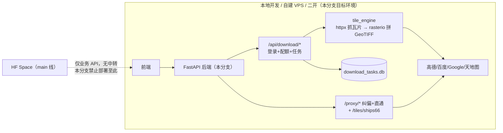

# 瓦片域整域恢复：纠偏 + 直通代理 + 底图下载（V3.6.18 · tiles-full 分支版）

> ⚠️ **本版本仅限本地开发 / 自建 VPS / 二开使用。禁止部署到 Hugging Face Spaces**——HF Content Policy
> 明令禁止 Space 代理模式（2026-09-14 HF 对本账号的书面禁令，详见本目录事故记录与
> `Docs/Force_command.md` §11）。Space 部署基线恒为 `main`（V3.6.17）。

## 日期与时间

2026-10-16 09:24 – 10:20（功能恢复）· 10:27 后（定版为 `tiles-full/v3.6.18` 分支）

## 任务等级

L2

## 问题分析

- **核心症状**：前端底图下载面板（`MapDownloader` / `MyDownloadTasks` / `useDownloadStore`）自 V3.6.5 起调用 `/api/download/*` 全部 404，功能搁置（V3.6.6 加了注释标记）。
- **根本原因**：V3.6.5（`1b731917`）删除整个 `backend/domains/**`，瓦片纠偏迁往 VPS `vpn.negiao.cn/proxy/*`；下载功能随之被删，仅留本地 tag `tile-download-last`（= V3.6.4 `4a701dad`）。
- **受影响模块**：后端瓦片域、`app.py`、下载任务 DB、配额链路（`api/auth/quota.py`、`/api/auth/download-quota/estimate`、`/api/admin/config/download-ttl`）、前端下载链路（完好，仅注释标注）、门禁脚本、6 份文档。

## 修改内容

1. **恢复 `backend/domains/tiles/` 全部 28 文件**（源自 `tile-download-last`）：纠偏 4 路由 + 直通代理 + `proxy_shared` + `cache_cleanup` + `infra/` + `rectify/` + `download/`。
2. **`app.py` 接线**：挂载 `tiles_router` 与 `download_router`；lifespan 增加 `init_download_task_db()`、`start_task_cleanup_scheduler()`、`cache_cleanup_loop()`；shutdown 增加对应取消/关闭。
3. **SSRF 护栏单点化**：`infra/net_guard.py` 改为转接 `core/net_guard.py` 的 shim。
4. **配额链路恢复可用**：`/api/auth/download-quota/estimate`、`quota.py` 扣减/退还、`/api/admin/config/download-ttl`。
5. **前端**：仅清理 4 处搁置注释；TOC 入口本就完好；`VITE_TILE_PROXY_BASE_URL` 指向 VPS 的默认语义保留（本地/VPS 部署时可指向自建代理）。
6. **门禁脚本**：`check_app_import.py` 禁止路径断言清空，改为部署侧决策注释。
7. **配置**：`DOWNLOAD_*`、`PROXY_*`、`GCJRE_*` 键核查完好；`ALLOW_PRIVATE_HOSTS=false` 生产基线保留。

## 修改原因

用户决策：V3.6.4 的瓦片纠偏 + 下载能力对 clone 者/二开者有完整价值；HF 合规边界内的正确形态是"main 保持 HF 安全版、全功能版走分支 + tag"。

## 影响范围

- 路由 131 条（较 V3.6.17 +13）：`/api/download/*`（6）、`/proxy/{gcj2wgs,wgs2gcj,bd2wgs,wgs2bd}/*`（4）、`/proxy/{target_url:path}`（1）、`/tiles/ships66/*`（1）、`/api/admin/config/download-ttl|proxy-rate-limit`（既有）。
- 前端 4 文件仅注释变化。
- 文档：README / CHANGELOG（V3.6.18）/ 结构树 ×2 / 架构文档 ×2 / marker / 分支指南。

## 解决方案（架构）

## 性能指标

未实测（功能恢复版本；下载拼图耗时与 V3.6.4 实现一致，任务 TTL 默认 30 分钟）。

## 测试方案

### Agent 已执行（2026-10-16 上午，本地 Windows + backend/.venv）

| 项 | 结果 |
|---|---|
| import 门禁 `scripts/check_app_import.py` | ✅ 131 条路由，无三方桩 |
| 冒烟（未登录） | ✅ 6 个下载端点均 401（require_login 生效）；纠偏/直通可达 200 |
| E2E（TestClient + 高德瓦片源，bbox≈2km²、100m/px） | ✅ 两轮全过：estimate(2 瓦片) → 配额估算(cost=1/limit=1000) → 建任务 → progress 100%（已裁剪到精确范围）→ 文件下载（TIFF 魔数 `II*\0`，3183B）→ cancel 200 |
| 前端 ESLint（4 文件） | ✅ |
| 结构树 / 配置登记门禁 | ✅ 494/494；catalog 130 key |
| §11.2 红线自查（backend/ deploy/ frontend/src/ 全范围） | ✅ 无命中（`maxRayDistance` 系 "xray" 子串误报） |
| E2E 残留清理 | ✅ smoke 用户与 /tmp 任务库已删 |

### 待用户实机验证

1. 本地或 VPS 起后端后，登录状态在 TOC 打开下载面板：小范围 + 低分辨率提交任务，观察进度到 100% 并成功下载 GeoTIFF。
2. 模板填 `https://vpn.negiao.cn/proxy/gcj2wgs/<瓦片源>` 验证"下载时纠偏"链路。
3. 管理后台确认配额扣减/退还与 TTL 可调。

## 变更文件清单

| 路径 | 说明 |
|---|---|
| `backend/domains/**`（28 文件） | 瓦片域整域恢复 |
| `backend/domains/tiles/infra/net_guard.py` | 转接 `core/net_guard.py` 的 shim |
| `backend/domains/tiles/__init__.py` | 包文档（V3.6.18 分工与目录） |
| `backend/app.py` | 路由挂载 + 下载任务库/调度器/缓存清理启停 |
| `backend/scripts/check_app_import.py` | 禁止路径断言清空 + 注释 |
| `frontend/src/api/download.js` 等 4 文件 | 清理搁置注释 |
| `README.md` / `Docs/Guide/CHANGELOG.md` | V3.6.18 版本号三处 + 完整条目 |
| `Docs/Guide/frontend-structure.md` / `backend-structure.md` | 结构树同步 |
| `Docs/Architecture/tile-rectify-system.md` / `system-architecture.md` | 迁出结论与分工 |
| `Docs/TODO/plan-download-feature-git-marker.md` | 搁置 → 已恢复 |
| `Docs/Guide/tiles-full-branch.md` | 分支用途与合规警示（本次新增） |

## 遗留与风险

1. **HF 合规**：本分支含第三方瓦片抓取与回传层，**禁止部署到 HF Spaces**（红线详见 Force_command §11 与 2026-09-14 HF 邮件）。Space 构建基线恒为 main。
2. **`/proxy/*` 免登录**：面向本地/VPS 自用可接受；公网部署时务必自行加访问控制。
3. **配额依赖 auth DB**：迁移到 VPS 时需自备鉴权/配额等价机制（marker 文档迁移注意事项已列明）。
