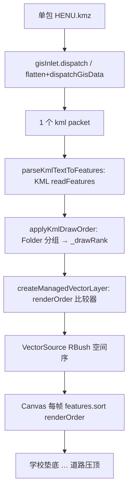

# 2026-10-16 · URL l 参数底图延迟修复 + KMZ 多面图层叠放定序（V3.6.19）

> 归属版本：**V3.6.19**（2026-10-16 17:32 补充定版；任务等级 **L2**）。
> 版本说明：原稿写 V3.6.18，但 V3.6.18 已保留给瓦片下载分支（不在 main），main 线本次递增为 **V3.6.19**，下文凡 V3.6.18 均指同一内容。
> 本文件合并记录当日多项修复：① 分享链接 `l` 参数底图近 10s 才生效；② KMZ/KML 多面数据图层叠放颠倒（3D Cesium zIndex 定序）；③ 2D OL 链路同文件叠放颠倒（RBush 乱序根因 + renderOrder 定序）；④ 图层移除“假删除”脱节。
> 注：早前 2026-10-16 的 KMZ 叠放修复（未提交的工作区改动）在本日会话开始时已丢失（工作区重置），本文件按已验证方案重新落地并复验。

## 一、分享链接 l 参数底图 ~10s 延迟

### 现象
URL 形如 `#/home?l=4&lng=…&lat=…&z=…`（指定底图 + 视角）。进页后先用默认底图渲染，近 10s 后才自动切换到 l 指定的底图。用户怀疑「相关 JS 逻辑还没载入 / 资源加载导致」。

### 排除的猜测
- **JS 未载入**：不成立。`selectedLayer` 在组件 setup 阶段（`parseUrlToState()`）即按 URL 设定；watcher 也在 `initMap()` 内同步绑定。
- **资源加载慢**：不是直接原因；它是被放大的放大器（见下）。

### 根因（双因素叠加）
1. 路由为 **hash 模式**（`router/index.js`：`createWebHashHistory()`），地址栏参数位于 `#` 之后。
2. `MapContainer.vue` onMounted 判断「URL 是否显式指定底图」用 `new URLSearchParams(window.location.search)`——hash 模式下 `location.search` **恒为空串** → `hasExplicitLayerParam` 恒为 false。

后果链：
- setup：`selectedLayer = URL 的 l 对应底图`（正确）；
- onMounted：判断失败 → `selectedLayer` 被「用户偏好默认底图（localStorage）→ 管理员全局默认底图（apiGetRuntimeDefaults）」**覆盖**；
- `initMap()`：图层按 layerList 静态可见性创建（默认预设），结尾 `bindBasemapSelectionWatcher()` 的 immediate 回调应用的是**被覆盖后的默认底图**；
- `await waitForCriticalTileReady()`：等待默认底图首屏瓦片（tileloadend → rendercomplete → 双 rAF），默认底图慢/被限流时逼近 **15s 兜底**；
- Phase 5 `applyDeferredUrlParams()`：`flyToView({ lng, lat, z, l })` → `onLayerIndexChange(l)` → `selectedLayer = URL 底图` → watcher 才真正切换。

即：URL 底图只在「等关键瓦片」之后才被应用，延迟 ≈ 关键瓦片等待时长（用户实测 ~10s）。

### 修复
`MapContainer.vue`：显式底图参数检测改走统一读取器：

```js
import { getCurrentQuerySnapshot } from '@common/url-state/urlQueryReader';
// onMounted 内：
const startupQuery = getCurrentQuerySnapshot();                 // hash query 优先、route.query 兜底
const startupSearchParams = new URLSearchParams(window.location.search || '');
const hasExplicitLayerParam = ['l', 'layer', 'layerId'].some(
    (key) => startupQuery[key] !== undefined || startupSearchParams.has(key),
);
```

修复后：URL 显式带 l 时跳过默认底图覆盖，`initMap` 内 immediate watcher 在 `switchLayerById` 中同步完成切换，URL 底图首帧前生效；`waitForCriticalTileReady` 随之等待正确底图瓦片。URL 无效 l（如越界号）时由 `parseUrlToState()` 原逻辑回落偏好/默认，行为不变。

### 涉及文件
- `frontend/src/domains/ol/components/MapContainer.vue`（检测逻辑 + import）

## 二、KMZ/KML 多面数据图层叠放颠倒

### 现象
一个 KMZ 内多个面图层，加载后叠放顺序颠倒：后解析的「地块」大范围面覆盖建筑等顶部图层。正确语义：基底先画、顶部图层后画。

### HENU.kmz 真实结构（XML 真解析，勿信正则）
`doc.kml`（3.1MB）：`Document > Folder line_Clip（613 线）+ Folder LandParcel（容器，无直接要素）> [建筑 148 面 / 体育绿 57 / 体育红 36 / 水体 6 / 绿地 144 / 居住区 3 / 学校 9]`。Folder 为**嵌套结构**；按 `</Folder>` 非贪婪正则会误判为 8 个并列文件夹（复现脚本曾因此得出错误结论）。

### 机制（Cesium 1.132 bundle 实证 + 类型声明复核）
- `GroundPrimitiveBatcher`：把（材质, zIndex）相同的几何合并进**同一个** `GroundPrimitive`；桶内等高三角形 depth-test，**先写入者胜出**；
- `OrderedGroundPrimitiveCollection`：按 zIndex 分桶、桶间升序渲染，**zIndex 越大越靠上**；
- `PolygonGraphics.zIndex` / `PolylineGraphics.zIndex`（后者需 `clampToGround`，`forceDataSourceClampToGround` 已保证）均为地面定序手段。

### 修复（V3.6.19 修正方向：与 2D 统一，对标 QGIS 图例在上者 z 高）
`loaders/utils.js` 新增：
- `parseKmlPolygonStackingRanks(kmlText)`：DOMParser 文档序遍历；统计含 `<Polygon>` **或** `<LineString>` 的 Placemark（MultiGeometry 内亦可，纯点不参；混合 Placemark 计一次）；按「最内层 Folder 名」划分 run，Folder 变化即开新 run，rank 沿文档单调不减；
- `applyGroundStackingZIndex(dataSource, buckets = 64, ranks = null)`：
  - 策略 A（ranks 与地面实体数对齐，线/面同体系）：`zIndex = (buckets-1) - floor((rank+1)/(maxRank+2)*buckets)`，文档首 run 最高；
  - 策略 B（回退，无 ranks）：按面实体序号 `floor(index/total*buckets)` 文档升序（扁平层不反转）；
  - 单一 run / 单面时不改写 zIndex（避免跨数据源定序副作用）。

调用点（均在 `forceDataSourceClampToGround` 之后、`flyToEntity` 之前）：
- `kmlLoader.js`：`loadKML` / `loadKMZ` 均传 `parseKmlPolygonStackingRanks(preparedText)`；
- `geojsonLoader.js` / `shpLoader.js`：无 Folder 结构，走策略 B 回退（不变）。

### 复验（真实 HENU.kmz）
1016 个地面 Placemark（613 线 + 403 面）→ 8 个 run → zIndex 带 **56/49/42/35/28/21/14/7**；文档首 `line_Clip` 道路 56 最顶，文档末「学校」7 垫底——与 2D 渲染顺序一致。

### 涉及文件
- `frontend/src/domains/cesium/composables/dataImport/loaders/utils.js`（新增两函数）
- `frontend/src/domains/cesium/composables/dataImport/loaders/kmlLoader.js`（loadKML / loadKMZ）
- `frontend/src/domains/cesium/composables/dataImport/loaders/geojsonLoader.js`
- `frontend/src/domains/cesium/composables/dataImport/loaders/shpLoader.js`

## 二-补、2D OL 链路同文件叠放颠倒（RBush 乱序根因 + renderOrder 定序，17:32 追加）

### 现象
同一 `HENU.kmz` 在 2D 同样被大面覆盖；且此前多轮“数组重排”（包倒序 / 面按面积降序 / Folder 分组倒序）日志显示已执行，但视觉无任何变化。

### 根本原因（OL 源码实锤，非推测）
`node_modules/ol/source/Vector.js:711` 中 `getFeatures()` 文档原话：“Get a snapshot of the features currently on the source **in random order**”（RBush 空间索引序）；
`node_modules/ol/renderer/canvas/VectorLayer.js:761-764` 每帧 `getFeaturesInExtent()` 后**仅当图层设了 `renderOrder` 才排序**，否则按 RBush 序绘制。
结论：**数组顺序到不了渲染器**——此前一切数组级重排注定无效。另证伪两条弯路：① 按面积排是拍脑袋启发式（QGIS 根本不这么干）；② 日志曾显示“最大面 0㎡”仅是取样 bug（取了第 0 个道路线要素），面积计算本身正常（3857 下最大块约 110万㎡，文档第 397/403 位）。

### QGIS/GDAL 真实行为（已拉源码对照，非臆测）
- `GDAL ogr/ogrsf_frmts/kml/kmlvector.cpp :: findLayers`：深度优先后序遍历容器，按文档顺序把 Folder 编号成 OGR 图层（空容器剔除；HENU 得 8 层：line_Clip(0) / 建筑(1) / … / 学校(7)）；
- QGIS 图例索引小的在上、后画压先画 → 视觉自上而下 = line_Clip … 学校，自底向上 = 学校 … line_Clip。
- 用户亲口确认该顺序为正确渲染。

### 修复（2 文件）
- `useLayerDataImport.js` 新增 `applyKmlDrawOrder(kmlText, features)`：栈匹配 Folder/Placemark 嵌套（规避 `</Folder>` 非贪婪正则误判嵌套），按最内层 Folder 起始位置倒序分组（文档末组序号 0 先画垫底），组内保持文档顺序；序号写要素**对象自有属性 `_drawRank`**（不在 `getProperties` 内，不污染属性表与导出）；Placemark 数量对不上 / 不足 2 组时返回 -1 不动。
- `useCreateManagedVectorLayer.js`：建 `VectorLayer`（几何层 + 标注层）时**仅当要素带序号才传 `renderOrder`** 比较器（序号小先画；缺序号回落极大值，稳定排序等于现状）；WebGL 大数据路径不动；其余类型（SHP/GeoJSON/绘制）无序号、行为零变化。
- HENU 实测：8 组，自底向上 = 学校 → 居住区 → 绿地 → 水体 → 体育红 → 体育绿 → 建筑 → line_Clip（道路最顶），与 QGIS 图例语义一致。

### 数据流（Mermaid，§2.9）


## 二-补二、图层移除“假删除”脱节（HomeView）
`handleRemoveLayer` 原先丢弃 `dispatchLayerAction` 返回值、无条件 `layerStore.removeLayerById`：分发失败时 TOC 条目消失而地图图层残留。改为以分发结果为准，失败则 warning 并直接返回（`HomeView.vue:1408`，+10 行）。

## 三、遗留事项（2026-10-16 17:32 修订）
- **[HIGH，已修]** 2D 与 3D 定序曾方向矛盾（3D 文档在前者 zIndex 最小 + 道路线无 zIndex 会被面压住），V3.6.19 已按用户指令统一为 QGIS 语义：策略 A 反转为文档首 run 最高 zIndex，线要素纳入同体系（`entity.polyline.zIndex`，依赖先行的 clampToGround）；策略 B（扁平层）保持文档升序不反转。HENU 带 56/49/42/35/28/21/14/7，3D/2D 一致。待用户 3D 实机验证。
- [MEDIUM，已确认无碍] `MapContainer` 用 `startupQuery[key] !== undefined` 判断显式 l 参数：`getCurrentQuerySnapshot` 缺省键即为 `undefined`（仅非空值入快照），判定成立，无需改动。
- [LOW，已修] `useLayerDataImport` 注释曾引用已删除的 `reorderKmlFeaturesByFolder` 旧名，已改为 `applyKmlDrawOrder`。
- 启动链中 `hydrateRuntimeMapTokens()` + `apiGetRuntimeDefaults()` 仍先于 `initMap()` await；若后端接口慢会推迟首屏（表现为白屏而非底图切换延迟），不在本次范围。
- `view=cesium` 模式下底图参数由 Cesium 侧链路处理，本次未改。
- 暂存区新增共享测试数据 `frontend/public/ShareData/河南大学金明校区/HENU_高德效果.kmz`（190KB）+ `manifest.json` 登记；仓库已有 KMZ 资产先例，接受，但注意二进制体积。

## 四、验证
- ESLint：`MapContainer.vue` / `utils.js` / `kmlLoader.js` / `geojsonLoader.js` / `shpLoader.js` / `HomeView.vue` / `useLayerDataImport.js` / `useCreateManagedVectorLayer.js` 全绿（0 errors；`HomeView.vue` 3 条 console warning 为历史遗留）。
- HENU.kmz rank 复算（真实文件）：403 面 / 8 组，自底向上 = 学校 → 居住区 → 绿地 → 水体 → 体育红 → 体育绿 → 建筑 → line_Clip；最大面约 110万㎡ 原文档第 397/403 位。
- 性能指标：未实测（纯排序逻辑，1016 要素可忽略）。
- Agent 已执行：ESLint（上）+ `node --check`（两 OL 文件）+ 真实 HENU 坐标 3857 面积/分组/RBush+renderOrder 全链路 Node 仿真。
- 待用户实机验证：① 硬刷新 → 删干净旧 HENU → 重导一次，确认学校垫底、道路压顶，控制台应出现 `已按 Folder 分组设定绘制顺序…8 组` + `已启用绘制顺序`；② 3D 侧按遗留 HIGH 项确认方向后再验。

## 五、变更文件清单
- `frontend/src/domains/ol/components/MapContainer.vue`：URL 显式 l 参数改走 `getCurrentQuerySnapshot`（hash 优先）
- `frontend/src/domains/cesium/composables/dataImport/loaders/utils.js`：新增 `parseKmlPolygonStackingRanks` / `applyGroundStackingZIndex`
- `frontend/src/domains/cesium/composables/dataImport/loaders/kmlLoader.js`：loadKML/loadKMZ 调用定序
- `frontend/src/domains/cesium/composables/dataImport/loaders/geojsonLoader.js`、`shpLoader.js`：回退定序调用
- `frontend/src/domains/ol/data-import/composables/useLayerDataImport.js`：新增 `applyKmlDrawOrder` + 调用
- `frontend/src/domains/ol/layer/composables/useCreateManagedVectorLayer.js`：条件 `renderOrder`
- `frontend/src/app/HomeView.vue`：移除以分发结果为准（防假删除）
- `frontend/public/ShareData/manifest.json` + 新增 `HENU_高德效果.kmz`：共享测试数据
- `Docs/Guide/CHANGELOG.md`、`README.md`：V3.6.19 版本登记
