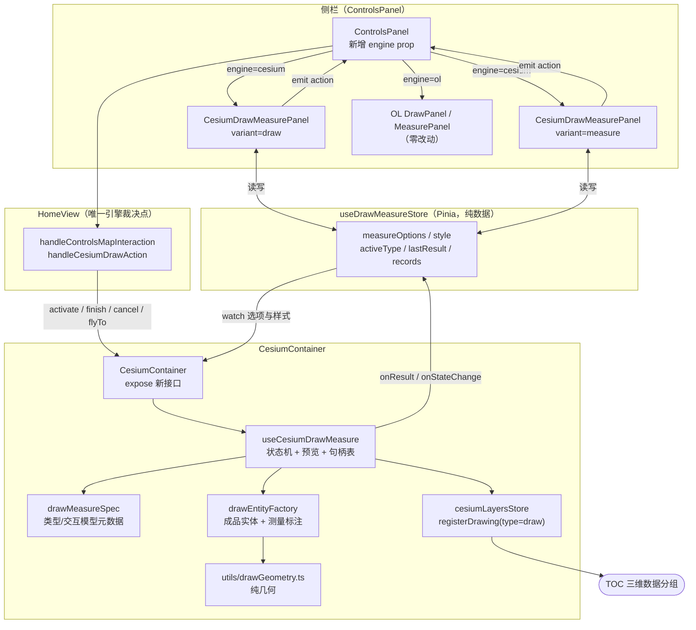
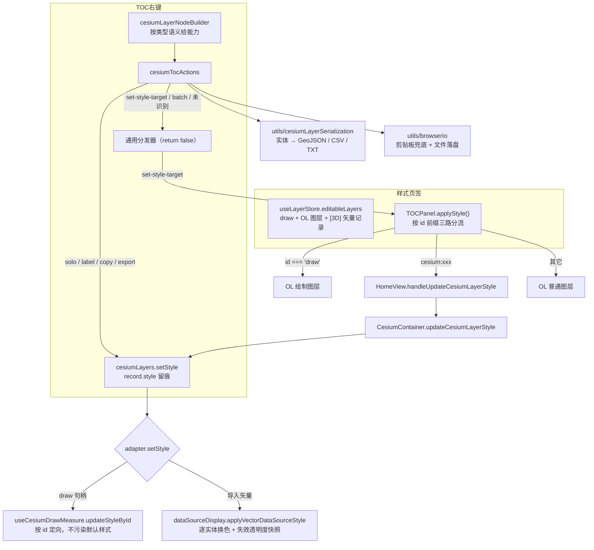
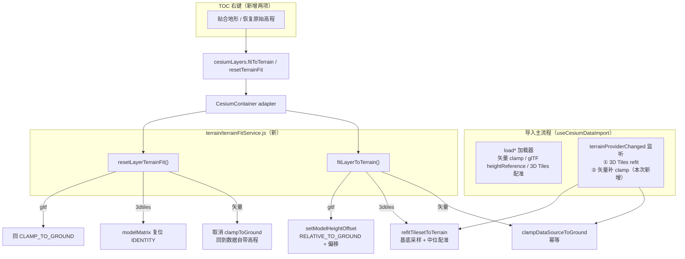
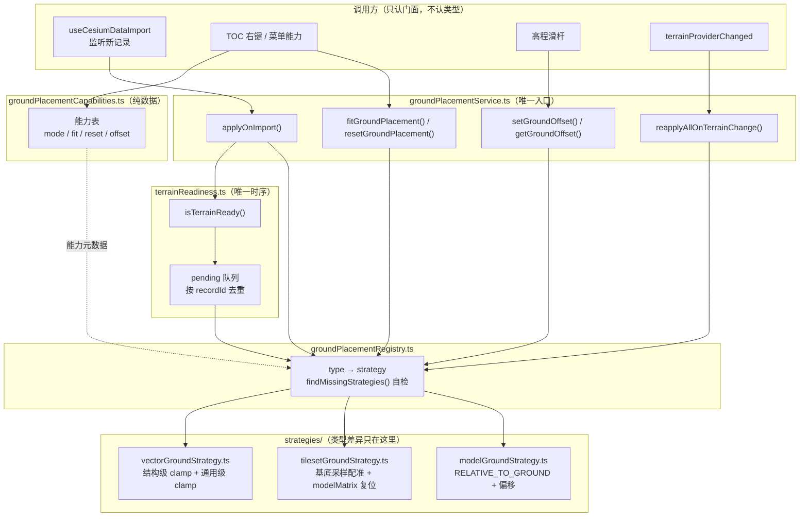

# Cesium 绘制与测量完整迁移（Demo → 引擎感知面板）

- **日期与时间**：2026-10-25 09:40
- **任务等级**：L2（功能开发 · 新增文件 · 跨模块协同，涉及 ≥3 文件故附 Mermaid）
- **需求来源**：用户指定参照 `Docs/Demo/draw_manager.html` + `Docs/Demo/DrawManager.js`，将绘制与测量能力完整迁入 `domains/cesium`，并要求「同一面板按当前引擎切换 UI 与功能」

---

## 一、问题分析（阶段一产出）

### 1.1 核心症状

| # | 现象 | 触发路径 |
|---|---|---|
| 1 | 3D 模式下只能画点 / 折线 / 面，矩形、圆不可用 | `ControlsPanel` 绘制面板 → `map-interaction: Rectangle / CircleOutline` → `useCesiumDrawMeasure.activateInteraction` 返回 `false` → HomeView toast「3D 不支持」 |
| 2 | 无测高距、无方位角 | 上述同一路径，类型根本不在 `SUPPORTED_INTERACTIONS` 集合内 |
| 3 | 测量开关（只绘制 / 面积 / 周长）在 3D 完全缺失 | 管理器 `finishInteraction` 无条件生成测量标签，无开关概念 |
| 4 | 3D 无测量结果读数、无记录、无导出 | 结果只以场景 Label 呈现，无面板承载 |
| 5 | 3D 无样式控制 | `updateStyle` 存在但只作用于「后续绘制」，且 UI 只在 OL `DrawPanel` 里 |

### 1.2 根本原因

`useCesiumDrawMeasure.js` 是引擎感知迁移 **P0 批次的最小可用实现**（见 `Docs/TODO/engine-aware-map-operations-migration-plan.md` §3-P0），当时刻意收窄范围：

- 交互模型只有「多次点击 + 双击/右击结束」一种，缺少 **锚点两点式**（矩形/圆）与 **两点即完成式**（测高距/方位角）两种状态机；
- 测量语义写死为「画完就标」，未抽象 `measure / showArea / showPerimeter` 三档开关；
- 面板层未做引擎分支：`ControlsPanel` 无条件渲染 OL 的 `DrawPanel` / `MeasurePanel`，3D 下这些面板里的高级图形一律降级 toast。

即：**缺的不是一处代码，而是「类型 → 交互模型 → 测量语义 → 结果呈现」四段链路的完整化**。

### 1.3 受影响模块

| 模块 | 影响 |
|---|---|
| `domains/cesium/composables/draw/useCesiumDrawMeasure.js` | 交互状态机、预览、成品、测量标签全部需扩展 |
| `domains/cesium/components/CesiumContainer.vue` | 需暴露新能力接口、把结果回写到共享状态 |
| `domains/ol/components/ControlsPanel.vue` | 侧栏子面板需按引擎切换（当前硬编码 OL 面板） |
| `app/HomeView.vue` | 引擎裁决点需新增动作路由（完成/取消/飞到/测量项） |
| `locales/zh-CN.js` / `en-US.js` | 新增面板文案 |
| `cesiumLayersStore` | 沿用 `registerDrawing`，无需改结构（`type:'draw'` 已支持） |

---

## 二、方案对比与选型

### 2.1 面板承载位置

| 方案 | 做法 | 优点 | 缺点 | 结论 |
|---|---|---|---|---|
| A | 扩写 OL 的 `MeasurePanel.vue`，加 `engine` 分支 | 文件少 | OL 域承载 Cesium 专属 UI（工具数、样式、结果区），职责混杂 | 否决 |
| B | 新建 `CesiumDrawMeasurePanel.vue`，`ControlsPanel` 按 `engine` prop 二选一 | 域内自治；面板可独立演进；符合「组件只渲染」分层 | `ControlsPanel` 需引入一次 `@cesium-domain` 异步 import | **采用** |
| C | 结果读数做成 Cesium 视口内浮层 | 无跨组件状态 | 与侧栏交互割裂；移动端遮挡画面 | 否决 |

> B 的跨域 import 有既有先例：`domains/common/shell/SidePanel.vue` 已异步 import `@ol/routing/components/RoutePlannerPanel.vue`，`domains/ol/stores/useLayerStore.ts` 已 import `@cesium-domain/stores/cesiumLayers`。域边界实际约束是「不得复制对方逻辑」，而非禁止引用。

### 2.2 状态协调方式

| 方案 | 做法 | 结论 |
|---|---|---|
| 三层 props 透传（Container emit → HomeView ref → ControlsPanel prop → Panel prop） | 与现有 HomeView 单点裁决一致，但测量选项/样式/结果/记录四类状态会撑爆 props | 否决 |
| 新建 `useDrawMeasureStore`（Pinia，仅存可序列化数据） | 面板与引擎解耦；面板关闭重开不丢状态；符合 `stores` 层「只存状态不依赖引擎类」 | **采用** |
| 管理器直接持有并驱动 UI | 违反分层 | 否决 |

**关键约束**：store 内**禁止**存 `Cartesian3` / `Entity`（Cesium 对象进 Pinia 代理会导致 `entities.remove` 句柄失配，Demo 中 `markRaw` 注释即为此坑）。故 store 只存 `lonLats` 与数值，`flyTo` 走 `id` 回查管理器句柄表。

### 2.3 测量口径

沿用项目既有约定而非 Demo 自带的近似公式：

- 距离：`EllipsoidGeodesic.surfaceDistance`（P0 已确立，对齐 OL `getLength`）；
- 面积：ENU 等距投影 + shoelace（P0 已确立）；
- 单位格式化：复用 `@common/map-view/units` 的 `formatDistanceMeasure` / `formatAreaMeasure`（尊重用户 metric/imperial 偏好），**不复制** Demo 的 `formatArea/formatLength`；
- 新增纯几何（矩形跨度、圆环、方位角、重心）落在 `utils/drawGeometry.ts`，**不引入 Cesium 依赖**，便于 `tsc --noEmit` 与单测。

---

## 三、目标架构



**数据流要点**

1. 面板只读写 store + emit 动作，不持有引擎对象；
2. `HomeView` 仍是唯一引擎裁决点（沿用迁移方案 §2.1）；
3. 管理器完成一次绘制后 `onResult(payload)` → store，面板随之渲染；
4. store 的 `measureOptions` / `style` 变化由 `CesiumContainer` watch 后下推给管理器（单向，避免双向回环）；
5. 每条成品都走 `cesiumLayersStore.registerDrawing`，TOC 显隐/透明度/flyTo/移除由既有 adapter 分流到管理器句柄表。

---

## 四、实施步骤

1. `utils/drawGeometry.ts`：纯几何（面积/周长/矩形跨度/圆环/方位角/重心/地面距离）；
2. `composables/draw/drawMeasureSpec.js`：类型清单、交互模型分类（多点/锚点/两点）、最小点数、别名；
3. `composables/draw/drawEntityFactory.js`：按类型建成品实体 + 按测量开关建标注；
4. `composables/draw/useCesiumDrawMeasure.js`：三态交互状态机、预览、句柄表、标注刷新、样式回放；
5. `stores/useDrawMeasureStore.ts`：面板↔引擎共享状态；
6. `components/CesiumDrawMeasurePanel.vue`：双 variant 面板（工具/测量项/结果/记录/样式/动作）；
7. `CesiumContainer.vue`：接线 + expose（finish / cancel / flyTo / setOptions / setStyle）；
8. `ControlsPanel.vue` + `HomeView.vue`：engine prop 与动作路由；
9. i18n 双语、结构树、CHANGELOG、README 三处版本号、门禁。

---

## 五、修改内容

### 5.1 新增能力（功能开发）

1. **类型从 5 → 9**：`Point / LineString / Polygon / Rectangle / Circle / MeasureDistance / MeasureArea / MeasureHeight / MeasureAzimuth`；`CircleOutline` 经别名归一为 `Circle`，HomeView 引擎路由对两套命名无感。
2. **三态交互状态机**（`drawMeasureSpec.interactionModelOf`）：
   - `multi`：逐点取点，双击 / 右击 / 面板「完成」结束，最小点数 2（线）或 3（面）；
   - `anchor`：首点定锚（矩形角点 / 圆心）→ 移动实时预览 → 次点确认；
   - `two-point`：两点即完成（测高距 / 方位角），第二点落下自动出结果。
3. **测量项开关**：`measure / showArea / showPerimeter`；总开关关闭 = 纯绘制；改开关对**全部既有成品**即时重算标注（Demo 只重算最后一条，此处按「所有成品」实现）。
4. **结果读数面板**：面积 / 周长 / 长度 / 半径 / 东西·南北跨度 / 垂直·水平·斜距 / 方位角 / 起终点高程 / 顶点数 / 首点·起点·终点·西南·东北角坐标。
5. **测量记录**：上限 20 条，最新在前；清图不清记录（独立「清空记录」）。
6. **导出**：GeoJSON（点→Point、线/高距/方位角→LineString、面类→闭合 Polygon 环）；坐标复制（非安全上下文退回 `execCommand`）。
7. **样式即时回放**：填充色 / 填充透明度 / 边线色 / 边线宽度 / 显示顶点 / 顶点大小；测高距与方位角跳过色彩覆盖（语义色不可丢）。
8. **引擎感知面板**：`ControlsPanel` 新增 `engine` prop，3D 下绘制 / 测量子面板切换为 `CesiumDrawMeasurePanel`（`variant=draw|measure`）。

### 5.2 关键修复（开发过程中自查发现）

1. **预览矩形坐标系混用**：`previewRect` 初版一处按弧度 `toDeg`、一处按度直用。统一为**度制**（与成品载荷同构），渲染时再 `Cesium.Rectangle.fromDegrees`。
2. **预览 Label 泄漏**：`previewLabel` 为独立实体未入 `sketch` 表，`teardown` 若不显式摘除会每次交互泄漏一个 Label（P0 注释已警示同类问题），已补摘除。
3. **多边形预览层级 `< 3` 点崩溃风险**：`PolygonHierarchy` 少于 3 点时返回 `undefined` 而非空层级。
4. **矩形 / 圆顶点沉入地形**：二者顶点由 `fromDegrees` 构造（高程 0），已按类型加 `heightReference: CLAMP_TO_GROUND`（测高距保持真实高程，不贴地）。
5. **圆的 64 个顶点标记成噪点**：`buildVertices` 跳过 `Circle`。
6. **手势结束静默失败**：右击 / 双击取点不足时原先无任何反馈，新增 `onReject(code)` 回调 → 容器 toast（面板「完成」按钮仍走返回值，避免双重提示）。
7. **撤销 / TOC 删除后读数残留**：新增 `onRemoved(id)` 回调，命中当前读数则置空。

## 六、测试方案

### Agent 已执行

| 检查 | 命令 | 结果 |
|---|---|---|
| 类型检查 | `npx tsc --noEmit`（frontend/） | ✅ 0 error（含新增 `drawGeometry.ts`、`useDrawMeasureStore.ts`） |
| 生产构建 | `npx vite build`（输出到临时目录，见下「说明」） | ✅ `4266 modules transformed` / `built in 17.08s` |
| 结构树门禁 | `python Scripts/CheckStructureTree.py` | ✅ 文档 502 · 磁盘 502 · 漏登记 0 · 幽灵 0 |
| 配置登记门禁 | `python Scripts/CheckConfigRegistry.py` | ✅ B1–B4 / F1–F3 全通过 |

> **说明**：`npm run build` 的默认输出目录 `frontend/dist` 由沙箱批量删除保护拦截（`SAFE_DELETE_BULK_CONFIRM_REQUIRED`，清空 189 个旧产物时触发），**与代码无关**；改用 `--outDir <临时目录>` 复跑，编译与打包全绿。

### 待用户实机验证

| # | 步骤 | 预期结果 |
|---|---|---|
| 1 | 进入 3D，点侧栏「测量」 | 弹出「测量工具」面板：测距 / 测面 / 测高距 / 方位角 四按钮 |
| 2 | 选「多边形」，在地形上点 3 点后双击 | 面贴地形起伏、边线贴地、顶点圆点可见；右侧读数出现顶点数 / 投影面积 / 周长 / 首点 |
| 3 | 取消勾选「启用测量」后重画一个面 | 场景无标注、读数区显示「仅绘制模式」 |
| 4 | 重新勾选「启用测量」 | **已画好的面立即出现面积 / 周长标注**（无需重画） |
| 5 | 选「矩形」，点第一角点后移动鼠标 | 实时青色矩形预览 + 面积浮标；点第二下成型 |
| 6 | 选「圆」，点圆心后移动 | 实时圆环预览 + 半径浮标；点第二下成型；TOC「三维数据」出现「绘制_圆_n」 |
| 7 | 选「测高距」，在山顶与山谷各点一下 | 出现黄（斜边）/ 红（垂线）/ 青（水平线）三线直角三角；读数出垂直 / 水平 / 斜距与两端高程；标注在半空（未被压到地面） |
| 8 | 选「方位角」，两点落下 | 出现贴地箭头线 + 正北虚线；读数出方位角（0° 正北顺时针）与水平距离 |
| 9 | 面板「撤销」/「清除」 | 场景图形与 TOC 条目同步消失；「清除」后读数清空、记录保留 |
| 10 | 面板「定位」 | 相机飞到最近一条图形（含 pitch -45° 偏移） |
| 11 | 改样式（边线色 / 宽度 / 填充透明度） | 已画图形即时变色变宽；测高距 / 方位角的三色语义线**不受影响** |
| 12 | 「导出 GeoJSON」后拖回地图导入 | 图形位置与形状一致（圆为 64 边形） |
| 13 | 切回 2D 再切回 3D | 2D 面板恢复为 OL 的「测距 / 测面」两项；3D 侧图形与 TOC 条目随容器卸载清空（既有语义） |
| 14 | 移动端（真机，触屏） | 工具按钮 ≥40px；面板不超出视口；无整页缩小 |

## 七、变更文件清单

### 新增

| 文件 | 说明 |
|---|---|
| `frontend/src/domains/cesium/utils/drawGeometry.ts` | 纯几何算法（面积 / 周长 / 矩形跨度 / 圆环 / 方位角 / 重心 / 地面距离），零 Cesium 依赖 |
| `frontend/src/domains/cesium/composables/draw/drawMeasureSpec.js` | 类型清单、交互模型分类、最小点数、别名归一 |
| `frontend/src/domains/cesium/composables/draw/drawEntityFactory.js` | 成品实体与测量标注构建、样式回放 |
| `frontend/src/domains/cesium/stores/useDrawMeasureStore.ts` | 面板↔引擎共享状态（仅可序列化数据） |
| `frontend/src/domains/cesium/components/CesiumDrawMeasurePanel.vue` | 3D 绘制 / 测量面板（双 variant） |

### 修改

| 文件 | 说明 |
|---|---|
| `frontend/src/domains/cesium/composables/draw/useCesiumDrawMeasure.js` | 三态状态机、6 类型成品、测量开关、样式回放、结果/状态/拒绝/移除回调 |
| `frontend/src/domains/cesium/components/CesiumContainer.vue` | 接线 store（含双向约束下的单向下推）、expose `finishCesiumDraw`/`cancelCesiumDraw`/`flyToCesiumDrawing`/`getCesiumDrawState`、卸载与重建时复位 store |
| `frontend/src/domains/ol/components/ControlsPanel.vue` | 新增 `engine` prop、3D 面板切换、`cesium-draw-action` 上抛、子面板定位样式 |
| `frontend/src/app/HomeView.vue` | 传 `:engine`、`handleCesiumDrawAction` 动作路由（结果码 → 文案） |
| `frontend/src/locales/zh-CN.js` / `en-US.js` | `cesium.drawMeasure.*` 全量双语键（工具 / 提示 / 测量项 / 读数 / 记录 / 样式 / 动作 / 标注 / toast） |
| `Docs/Guide/frontend-structure.md` | 4 个新文件条目 + `useCesiumDrawMeasure` / `ControlsPanel` / `MeasurePanel` 描述同步 |
| `Docs/Guide/CHANGELOG.md` | V3.6.24 条目 |
| `README.md` | 版本号三处（项目简介行 / 版本演进首行 / 页脚） |
| `Docs/TODO/bugfix-optimization-plan.md` | 顺带发现 4 条（§2.5 只记不改） |

## 八、遗留与风险

### 8.1 已知限制（非本次范围）

1. **3D 仍不支持** `Ellipse` / 军标箭头族（`Arrow`/`WindArrow`/`BattleArrow`）/ `SelectEdit`——与迁移方案 §5「非目标：不做 3D 高级图形」一致，HomeView 仍 toast 降级。
2. **圆为 64 边形环近似**（与 Demo 一致），非真椭球圆；GeoJSON 亦按 64 点环导出。
3. **3D 无框选删除**：删除单条走 TOC 右键移除或面板「撤销」。
4. **测量记录清图不清记录**（Demo 行为）；如需同步清空，见 TODO 记录项。

### 8.2 风险

1. **`classificationType: TERRAIN` 的贴地面图元**在极端自相交多边形下可能生成失败（Cesium 侧无回执），表现为该面不显示但边线仍在。已用 try/catch 包住成品创建并回滚半成品，但几何自相交属输入问题，未做拦截。
2. **`PolylineArrowMaterialProperty` + `clampToGround`** 依赖 `GroundPolylinePrimitive` 的材质支持（Demo 已实测可行）；若未来 Cesium 版本收紧，方位角箭头线会退化为普通贴地线。
3. **性能未实测**：单个面最多 64 段环 + 顶点 + 2 个标注，量级远低于既有 3D Tiles 场景；未做 100+ 图形的压力测试。
4. **`ControlsPanel` 域归属**：侧栏 shell 寄居 `@ol/components` 却服务双引擎，本次新增 `engine` prop 与 `@cesium-domain` 异步引入进一步加深该债；已登记 TODO，待 L3 批准后迁至 `@common/shell/`。

### 8.3 性能指标

未实测（本次为功能开发，非性能任务；无前后可比对数据）。


---

## 九、零散修补（L1，同日追加）

### 2026-10-25 09:46 · ESLint `no-console` 三处（`frontend/src/app/HomeView.vue`）

- **定级**：L1（单文件，仅新增 3 行注释，无逻辑改动、无版本号）。
- **来源**：用户提供的 IDE 诊断（`no-console`，行 1059 / 1122 / 1226）。
- **定性**：三处均为**既有代码**，不在 V3.6.24 改动 diff 内（`git diff` 已核）。其中前两处受 `localStorage.__zdebug === '1'` 门控，属刻意保留的排查开关；第三处 `[ViewScale][Report]` 为 2D→3D 尺度校正误差报告，刻意常驻。
- **处置**：按仓库既有先例（`cesiumRuntime.js` / `useCesiumNavigation.js` / `cesiumWarmup.js` / `cesium-shim.js` 共 5 处同款抑制）逐处加 `// eslint-disable-next-line no-console` 并附理由注释，**不改输出行为、不改日志级别**。
- **顺带修复**：`drawEntityFactory.applyStyleToHandle` 中两处 `expr && (assignment)` 简写触发 `@typescript-eslint/no-unused-expressions`（error 级），改写为 `if` 语句，语义不变。
- **验证**：`npx eslint` 对本次全部改动文件 0 problems；`tsc --noEmit` 0 error；`vite build` 4266 modules 通过（16.55s）。

---

## 十、追加：绘制图层「未注册数据源 / TOC 不可控」排查（L2 修补，并入 V3.6.24）

> 版本号判断：V3.6.24 尚未提交，本次修补的是同版本自身的健壮性回归，**不另起 V3.6.25**，避免产生一个从未可发布过的中间版本号。

### 10.1 结论：建档链路本身是通的（已用可执行方式证明）

用户反馈「绘制/测量的 Cesium 图层没有注册数据源，图层管理里无法控制」。为排除主观判断，写了两个临时桩件脚本（`esbuild` 打包真实源码 + `pinia` 真 store + 最小 Cesium 桩件），跑通后即删除，仓库无残留。

**证据 1 — 元数据店建档**（直接调 store）：

```
records = [{ id:'cesium-draw-1', type:'draw', category:'draw', engine:'cesium',
             visible:true, opacity:1, supportsOpacity:true }]
groupName = 三维数据 (2)
children  = [{ id:'cesium:cesium-draw-1', format:'绘制', supportsOpacity:true, sourceType:'cesium-draw' }]
after syncFromImport ids = [ 'cesium-draw-1', 'cesium-draw-2', 'import-1' ]   // draw 记录未被误剪
```

**证据 2 — 完整绘制流程**（真管理器 + 桩件模拟 3 次左键 + `finish()`）：

```
1) activate(Polygon) = true
2) state after 3 clicks = {"drawing":true,"mode":"Polygon","clickCount":3}
3) finish() = ok
4) records = [{ id:'cesium-draw-…-1', name:'绘制_面_1', type:'draw', supportsOpacity:true }]
5) TOC group = [{ id:'cesium:cesium-draw-…-1', format:'绘制' }]
6) onResult count = 1 type=Polygon
7) setVisible/setOpacity → { visible:false, opacity:0.4 }
8) 场景实体数 = 7
```

**旁证**：TOC 动作链路 `TOCPanel → useTreeActionDispatcher → handleCesiumLayerTreeAction → cesiumLayers.setVisible/setOpacity/flyTo/remove → CesiumContainer adapter → 绘制管理器` 逐段可读且无过滤分支；右键菜单的「透明度」项对 layer 节点**无条件**渲染（`contextMenu.js:127`）。

### 10.2 三个「图层管理」入口的差异（易误判点）

| 入口 | 打开方式 | 是否含绘制/测量成品 |
|---|---|---|
| **TOC「图层」页签**（侧栏工具箱） | 左侧栏 → 图层 | **含**，位于顶部「三维数据 (N)」分组，format 标签「绘制」 |
| 3D 高级控制台「图层」页签 | 顶栏 → 3D 高级控制台 | 否（只列底图 / 地形 / 叠加层） |
| 3D 高级控制台「数据」页签 | 同上 | 否（只列 `loadedDataSources` 导入数据） |

绘制成品按 Force_command §3「（或等价 TOC 元数据店）」进入 `cesiumLayersStore`，**不进 `loadedDataSources`**，因此后两个页签看不到。

### 10.3 本次修补（真实缺陷）

1. **恢复半成品回滚保护**（重写时丢失的 P0 保障）：`createHandle` 改为先建空句柄再逐段填充，`buildShape` / `buildVertices` / `buildLabels` 任一段抛错时按已落盘部分整体移除并 `console.warn`。原实现一旦中途抛错，实体留在场景却不在句柄表 → **TOC 无档、清空清不掉**，症状与用户描述完全一致。
2. **新增建档回执校验**：`registerDrawing` 后立即 `getRecord(id)` 复核，未落档时显式告警，避免「静默不可控」（§2-8）。

### 10.4 验证

`npx eslint` 0 problems / `npx tsc --noEmit` 0 error / `npx vite build` 4266 modules 通过；桩件回归在修补前后均输出 `finish() = ok` 且 records 有档。

### 10.5 待用户确认

若在 **TOC「图层」页签** 仍看不到「三维数据 (N)」分组，请提供：① 浏览器 Console 是否有 `[CesiumDraw]` 开头的 warn；② 是否已硬刷新/重启 dev server（大文件 HMR 可能未生效）。

---

## 十一、追加：Cesium 图层样式编辑 + TOC 右键能力对齐（V3.6.25 · L2）

### 11.1 问题分析

| # | 症状 | 根本原因 |
|---|---|---|
| 1 | 侧栏「样式」页签的下拉只有 OL 图层，三维图层根本不出现 | `useLayerStore.editableLayers` 只聚合 `draw / searchLayers / userLayers`，从未纳入 `cesiumLayersStore.records` |
| 2 | 三维节点右键只有 9 项，OL 有 15+ 项 | `cesiumLayerNodeBuilder` 把 `style / label / copyCoordinates / exportLayerData` 全部写死为 `false`，`soloEvent` 为空串 |
| 3 | 即便把上述能力打开，点了也没反应 | `cesiumTocActions` 的 `default: true` 会把 `cesium:` 节点的**一切**未列举动作静默吞掉（含 `set-style-target`、批量操作），根本到不了通用分发器 |
| 4 | （自查发现）绘制面板改颜色无效，只有线宽生效 | `drawEntityFactory.applyStyleToHandle` 回放时用的是建档快照 `hexColor`，而不是当前 `style.fillColor/outlineColor` |

**受影响模块**：`cesiumLayerNodeBuilder` / `cesiumLayers` / `cesiumTocActions` / `drawEntityFactory` / `useCesiumDrawMeasure` / `dataSourceDisplay` / `CesiumContainer` / `useLayerStore` / `TOCPanel` / `SidePanel` / `HomeView` / locales。

### 11.2 方案对比

| 方案 | 做法 | 结论 |
|---|---|---|
| A. 新建独立的「3D 样式」页签 | 与 OL 样式页签并列 | 否决：两套 UI 重复，用户要在两个页签间切换 |
| B. 样式页签下拉按引擎过滤 | 3D 时只列三维图层 | 否决：双引擎同屏场景（2D 容器 v-show 常驻）会看不到对方图层 |
| C. **同一页签合并列表 + id 前缀分流** | `cesium:<recordId>` 作为唯一寻址，`applyStyle` 按前缀三路分流 | **采用**：零新增 UI，与 TOC 节点 id 形式一致，避免两套寻址 |

### 11.3 架构



### 11.4 能力矩阵（按类型语义，不按引擎）

| 动作 | draw / route | geojson / kml / kmz / czml / shp / wayline | 3dtiles | gltf | tif / imagery |
|---|:---:|:---:|:---:|:---:|:---:|
| 查看 / 缩放 / 移除 / 重命名 / 透明度 | ✅ | ✅ | ✅ | ✅ | ✅ |
| 仅显示此图层（solo） | ✅ | ✅ | ✅ | ✅ | ✅ |
| 样式设置 | ✅ | ✅ | — | — | — |
| 开启 / 关闭标注 | ✅ | ✅ | — | — | — |
| 复制坐标 | ✅ | ✅ | — | — | — |
| 导出坐标（GeoJSON / CSV / TXT） | ✅ | ✅ | — | — | — |
| 调整高程 / 材质模式 | — | — | ✅ | — | — |
| 调整位置 | — | — | — | ✅ | — |
| 拉伸至高程 | — | — | — | — | ✅ |
| 属性表 / 编辑要素 / 坐标转换 / AOI / KML 导出 | ❌ 3D 无实现，菜单不出现 |

### 11.5 实施清单

1. `cesiumLayers.ts`：record 增加 `labelVisible / style`；新增 `setStyle / setLabelVisible / solo / copyCoordinates / exportData`；导出 `isCesiumStyleSupportedType / isCesiumVectorType` 单一判据；adapter 接口补 4 个可选方法。
2. `cesiumLayerNodeBuilder.ts`：按上表派生能力，`soloEvent` 置 `solo-layer`，`labelVisible` 取自 record。
3. `cesiumTocActions.js`：补 `solo-layer / toggle-layer-label-visibility / copy-layer-coordinates / export-layer-data` 分支；`default` 由 `true` 改 `false`（关键修复）；载荷读取兼容「平铺」与「payload 包裹」两种形态。
4. `drawEntityFactory.js`：`applyStyleToHandle` 改为写入**当前**样式并回写描述表基色。
5. `useCesiumDrawMeasure.js`：抽出 `mergeStylePatch`；新增 `updateStyleById / setLabelVisible / getShapesById`。
6. `dataSourceDisplay.js`：新增 `applyVectorDataSourceStyle`（只换纯色材质）与 `setVectorLabelVisible`。
7. `utils/cesiumLayerSerialization.js`（新）：实体 → point/line/polygon 反解 + GeoJSON/CSV/TXT。
8. `utils/browserIo.js`（新）：剪贴板兜底与文件落盘。
9. `CesiumContainer.vue`：adapter 补 `setStyle / setLabelVisible / copyCoordinates / exportData`；expose `updateCesiumLayerStyle`；新增 `collectLayerShapes`。
10. `useLayerStore.ts` / `TOCPanel.vue` / `SidePanel.vue` / `HomeView.vue`：样式目标合并与事件链。
11. i18n：6 条提示键（不支持样式 / 无标注 / 无坐标 / 复制成功 / 复制失败 / 已导出）。

### 11.6 验证（桩件实测，跑完即删）

```
draw node    = {style:true, label:true, copy:true, exportData:true, csv:true, kml:false, attribute:false, solo:'solo-layer'}
vector node  = {style:true, label:true, copy:true, exportData:true, ...}
3dtiles node = {style:false, label:false, copy:false, exportData:false, setHeight:true}
after solo   = [["d1",true],["v1",false],["t1",false]]
action solo-layer                    consumed=true
action toggle-layer-label-visibility consumed=true
action copy-layer-coordinates        consumed=true
action export-layer-data             consumed=true
action set-style-target              consumed=false   ← 交回通用分发器（打开样式页签）
action batch-layer-operation         consumed=false   ← 交回通用分发器
shapes = [["polygon",3],["line",2],["point",1]]
geojson ext=geojson bytes=1513 / csv ext=csv bytes=207 / txt ext=txt bytes=191
```

工程验证：`tsc --noEmit` 0 error；`eslint`（13 个改动文件）0 problems；`vite build` 4268 modules 通过。

### 11.7 遗留

- 属性表、要素编辑、坐标系转换、AOI 面板、KML 导出在 3D 侧无实现，**刻意不开放菜单项**（避免「点了没反应」），已记入 `Docs/TODO/bugfix-optimization-plan.md`。
- 绘制成品的「标注开关」为单条临时语义，测量开关变化触发的重算会覆盖它（全局优先），属预期行为。
- 样式补丁只覆盖纯色材质；KML 自带的虚线 / 图标样式不会被改色（改色会丢语义）。

---

## 十二、追加：三维地形贴合 + 属性表 / 要素编辑 / KML 导出（V3.6.26 · L2）

### 12.1 地形问题的根因（不是「没做贴地」，而是两个时序/语义缺口）

现状核查结论：**各类型的贴地机制其实都已具备**——

| 类型 | 既有机制 | 结论 |
|---|---|---|
| geojson / kml / kmz / shp | `DataSource.load({ clampToGround: true })` + 加载后实体级强制钳制 | 已有 |
| czml | `clampDataSourceToGround` | 已有 |
| glTF | `Entity ModelGraphics.heightReference = CLAMP_TO_GROUND / RELATIVE_TO_GROUND` | 已有 |
| 3D Tiles | 叶子包围盒基底采样 × 地形逐点配对 → 中位配准（`fitTilesetToTerrain`） | 已有 |

真正的两个缺口：

1. **地形异步就绪窗口**（主因）。`clampDataSourceToGround` 内部先判 `isTerrainEnabled`，地形 provider 仍是 `EllipsoidTerrainProvider` 时**直接返回 0 个已钳制实体、不报错**。而 `terrainProviderChanged` 监听原先只对 3D Tiles 做 `refitTilesetToTerrain`，**不补做矢量** → 在地形加载完成前导入的整批矢量永远停在椭球 0 高程，`depthTestAgainstTerrain = true` 下被地形完全遮住。
2. **glTF 原点语义**。`CLAMP_TO_GROUND` 把**模型原点**钉在地表；若 GLB 原点在几何中心（不少建模工具默认导出），模型必然半截入土，且用户无法调整（高程滑杆当时只对 3D Tiles 开放）。

### 12.2 方案对比

| 方案 | 做法 | 结论 |
|---|---|---|
| A. 关闭 `depthTestAgainstTerrain` | 埋地也能看见 | 否决：埋地物体会穿透地形显示，视觉错误且掩盖真实问题 |
| B. 导入时统一把高度采样后写死绝对高程 | 一次性采样 | 否决：地形切换后不再跟随，且对 3D Tiles 会污染 `modelMatrix` |
| C. **补齐时序 + 按类型统一「贴合地形」动作** | 地形就绪后补做 + 每图层可手动重贴/恢复 | **采用**：不改变既有机制，只补缺口，且失败有明确提示 |

### 12.3 架构



### 12.4 实施清单

**地形**
1. `terrain/terrainFitService.js`（新）：`fitLayerToTerrain` / `resetLayerTerrainFit` / `canFitToTerrain`，按类型分派；地形未就绪返回 `terrain-off` 而非假装成功。
2. `cesiumLayers.ts`：`TERRAIN_FIT_TYPES` + `isCesiumTerrainFitType`（与 nodeBuilder 共用单一判据）；adapter 增 `fitToTerrain` / `resetTerrainFit`；新增同名 store 动作。
3. `cesiumLayerNodeBuilder.ts`：`fitTerrain` / `resetTerrain` 能力；glTF 开放 `setHeight` 并给 `heightRange = -20~200`、`baseHeight = modelHeightOffset`。
4. `protocol.js` / `commandDispatcher.js` / `contextMenu.js` / `TOCTreeItem.vue`：新增 `FIT_TERRAIN` / `RESET_TERRAIN` 命令与菜单项。
5. `cesiumTocActions.js`：`terrain-fit` / `terrain-reset` 分支。
6. `CesiumContainer.vue`：adapter 实现 + 结果分档提示（成功 / 地形未开 / 类型不支持 / 失败）；`setBaseHeight` 对 glTF 分流。
7. `gltfLoader.js`：`setModelHeightOffset`（RELATIVE_TO_GROUND + 偏移，`null` 复位）。
8. `useCesiumDataImport.js`：`terrainProviderChanged` 监听扩展为「3D Tiles 重配准 + 矢量补 clamp」，消息分别计数。

**属性表 / 要素编辑 / KML**
9. `CesiumAttributeTableDialog.vue`（新）：只读表格 + 搜索 + 分页 + 行点击定位。
10. `cesiumLayerSerialization.js`：`collectEntityProperties`、`buildKML`、`serializeShapes` 增 kml 分支。
11. `useCesiumDrawMeasure.js`：`startVertexEdit` / `stopVertexEdit` / `isEditing`（顶点拖拽、锁相机、提交重算测量值并刷新标注）；`removeHandle` / `reset` 与编辑态互斥。
12. `CesiumContainer.vue`：属性表状态与 `showAttributeTable` / `locateAttributeEntity`；adapter `openAttributeTable` / `editFeature`。
13. `cesiumLayers.ts`：`requestAttributeTable` / `editFeature`；nodeBuilder 开放 `attribute`（矢量）与 `edit`（仅 draw）。
14. i18n：地形 6 条 + 属性表 8 条 + 编辑 4 条，中英双语。

### 12.5 验证

**桩件实测（跑完即删，仓库无残留）**

```
d1  style=1 label=1 attr=1 edit=1 kml=1 fit=0 reset=0 setHeight=0
v1  style=1 label=1 attr=1 edit=0 kml=1 fit=1 reset=1 setHeight=0
t1  style=0 label=0 attr=0 edit=0 kml=0 fit=1 reset=1 setHeight=1
g1  style=0 label=0 attr=0 edit=0 kml=0 fit=1 reset=1 setHeight=1 heightRange=-20~200
r1  style=0 label=0 attr=0 edit=0 kml=0 fit=0 reset=0 setHeight=0
KML ext=kml bytes=859 placemarks=2 polygonTag=true
props columns = ["name","kind","level"] / rows = [["poly A","park"],["line B","road"]]
```

说明：`draw` 的 `fit=0` 是**设计如此**——绘制成品自身用 `classificationType: TERRAIN` / `clampToGround` 贴地，不参与导入数据的地形贴合链路。

**工程验证**：`tsc --noEmit` 0 error；`eslint`（16 个改动文件）0 problems；`vite build` 4271 modules 通过。

### 12.6 遗留

- **地形贴合与顶点拖拽未真机验证**：前者依赖真实地形 provider 的采样时序，后者依赖鼠标拾取与相机控制器，二者都无法在 Node 侧桩件中覆盖。需实机按 12.7 步骤复验。
- **顶点编辑不覆盖测高距 / 方位角**：二者载荷含派生几何（三角形顶点、正北参考点），改顶点需重算整条派生链。
- **属性表只读**：3D 侧无属性写回通道，提供编辑态会造成「改了但没保存」的静默丢失。
- **导入矢量仍不可编辑**：需先把导入数据「转为绘制成品」或建立写回源文件的通道，属独立立项。

### 12.7 待用户实机复验

| # | 步骤 | 预期 |
|---|---|---|
| 1 | 保持默认地形，导入一个含高程的 GeoJSON | 图形贴合起伏地形，不埋地 |
| 2 | 切到椭球地形 → 导入 GeoJSON → 再切回真实地形 | 提示「N 个矢量图层已贴合地形」，图形从地下冒出 |
| 3 | 导入 3D Tiles（倾斜摄影/白膜） | 基底与地形配准；不贴合时右键「贴合地形」可重试 |
| 4 | 右键任一 3D Tiles → 「恢复原始高程」 | 回到数据原始位姿（可能再次埋地，属预期） |
| 5 | 导入 GLB，若半截入土 → 高程滑杆上抬 | 模型整体抬升且随地形起伏 |
| 6 | 右键矢量图层 → 「打开属性表」 | 表格出现，搜索可过滤，点行飞到该要素 |
| 7 | 右键矢量 → 「导出坐标(KML)」→ 拖回地图 | 图形位置一致 |
| 8 | 3D 画一个面 → 右键「编辑要素」→ 拖橙色顶点 | 形状实时变化，松手后面积/周长标注更新 |

---

## 十三、追加：贴地逻辑统一化（V3.6.27 · L3 架构重构，用户批准方案 A）

### 13.1 重构前审计（量化）

```
clampToGround     63 处 / 12 文件
heightReference   40 处 / 10 文件
合计 103 处直写、14 个文件
```

**8 个语义重叠的贴地入口**：`isTerrainEnabled`、`clampEntityToGround`、`clampDataSourceToGround`、`forceDataSourceClampToGround`、`fitTilesetToTerrain`、`refitTilesetToTerrain`、`fitLayerToTerrain`、`setModelHeightOffset`。

**5 套不同做法**（同一件事，每种类型一套）：矢量靠 `clampToGround` 加载选项、KML 额外一道实体兜底、CZML 后置 clamp、3D Tiles 基底采样配准、glTF `heightReference`。

### 13.2 根因

1. 贴地是「加载的副作用」，不是一等公民 → 新增格式只能复制粘贴；
2. 能力判据散落 4 处（`isTerrainEnabled` / `canFitToTerrain` / nodeBuilder 的 `fitTerrain` / `setHeight`）→ 新增类型必漏；
3. 时序无人统管（`clampDataSourceToGround` 地形未就绪时静默返回 0）→「导入成功但看不见」；
4. 自动入口与手动入口是两套代码（`fit` / `refit`、`clampDataSourceToGround` / `forceDataSourceClampToGround`）；
5. 无能力自描述 → TOC 菜单靠手写 `if (is3DTiles)`。

### 13.3 目标架构



**分层职责（一句话）**：能力表说「能做什么」，注册表说「谁来做」，门面说「怎么调」，readiness 说「什么时候做」，策略说「具体怎么做」。

### 13.4 实施（P0 + P1 + P2）

**P0 契约与策略搬家**
- 新增 `groundPlacementCapabilities.ts`（纯数据零依赖：`GROUND_MODE` / `GROUND_REASON` / 能力表 / `getGroundCapability` / `VECTOR_GROUND_LOAD_OPTIONS`）；
- 新增 `groundPlacementRegistry.ts`（策略只提供行为，能力从能力表取；`findMissingStrategies()` 供启动自检）；
- 新增 `strategies/{vector,tileset,model}GroundStrategy.ts`：3D Tiles 只编排、不重写内部配准（搬家而非重写）；
- 新增 `terrainReadiness.ts`（唯一 `isTerrainEnabled` 外部调用点 + 按 recordId 去重的补做队列）；
- 新增 `groundPlacementService.ts`（门面，模块加载即完成策略注册）。

**P1 统一导入入口与时序**
- `useCesiumDataImport`：改为 `watch(loadedDataSources)` 对新增记录统一 `applyOnImport`（一处替代 10+ 处 loader 内贴地副作用）；`terrainProviderChanged` 改为 `reapplyAllOnTerrainChange` + 清队列；
- 4 个 loader：`clampToGround: true` 改为消费 `VECTOR_GROUND_LOAD_OPTIONS`；删除 KML / CZML 的后置 clamp 与 geojson / shp 的 `forceDataSourceClampToGround` 调用（两道 clamp 合并进 vector 策略，幂等）；
- glTF 记录补 `modelHeightOffset`，保证 `applyOnImport` 不把语义高度抹成 0。

**P2 能力自描述与调用方收敛**
- `cesiumLayerNodeBuilder`：`fitTerrain / resetTerrain / setHeight / heightRange / baseHeight` 全部改读 `getGroundCapability`；
- `CesiumContainer`：adapter 的 `setBaseHeight` 由「按类型 if/else」改为门面调用；`fitToTerrain` / `resetTerrainFit` 改走门面；`initViewer` 增加 `assertGroundPlacementRegistry()` 启动自检；
- 删除 `terrainFitService.js` 与 `cesiumLayers.isCesiumTerrainFitType`（第二份类型白名单）。

### 13.5 验收对照

| 验收标准 | 结果 |
|---|---|
| 全局 `isTerrainEnabled` 外部调用点 = 1 | ✅ 仅 `terrainReadiness.ts`（另有 1 处是 `clampDataSourceToGround` 的内部自检） |
| 导入链路的贴地决策收敛到策略 | ✅ 3 个策略 + 1 个原语（`terrainClampService` 仅被 vector 策略调用） |
| 新增类型成本 = 1 条能力 + 1 个策略 + 1 行注册 | ✅ 结构保证，且 `findMissingStrategies()` 会把漏注册暴露成 warn |
| TOC 菜单与能力 100% 一致 | ✅ 桩件实测五类节点能力矩阵与能力表逐项对齐 |
| 5 类数据导入 + 地形切换回归 | ⚠️ 未实机（Node 桩件覆盖门面分支，浏览器行为待复验） |

> 说明：`clampToGround` / `heightReference` 的**原始出现次数**反而从 63/40 上升到 68/50——因为新增的策略文件本身就带这些关键字，且 `draw` / `route` / `planar-route` / `route-fly` 属于「引擎内生成物」，它们设置自身图元贴地是构造属性，不参与导入贴地链路。真正被消除的是**同一件事的多份实现**，而非关键字数量。

### 13.6 验证（桩件实测，跑完即删）

```
registered = geojson,kml,kmz,czml,shp,wayline,3dtiles,gltf
missing    = []
off → deferred | pending = 1
on  → ok | line clamped = true | polygon height cleared = true | perPositionHeight = false
reset → ok | line clamped = false
tif   → unsupported
```

工程验证：`tsc --noEmit` 0 error；`eslint`（terrain + dataImport + loaders + stores + toc-adapters + locales）0 problems；`vite build` 4277 modules 通过；结构树门禁 512:512。

### 13.7 顺带修复

V3.6.26 在 `setBaseHeight` 的 glTF 分支里回调 `cesiumLayersStore.setBaseHeight`，而 store 的动作本身会调用 adapter —— **形成无限递归**（栈溢出）。本次随「adapter 只走门面」一并消除，并在代码里留下注释防止复发。

### 13.8 遗留（P3，未批准实施）

- 删除 `forceDataSourceClampToGround` 的导出（现已只被 vector 策略调用，可内联）；
- `terrainClampService` 收敛为 vector 策略私有实现（不再 export `isTerrainEnabled`）；
- 注册自检从 `console.warn` 升级为开发期断言 + 结构树门禁提示。
