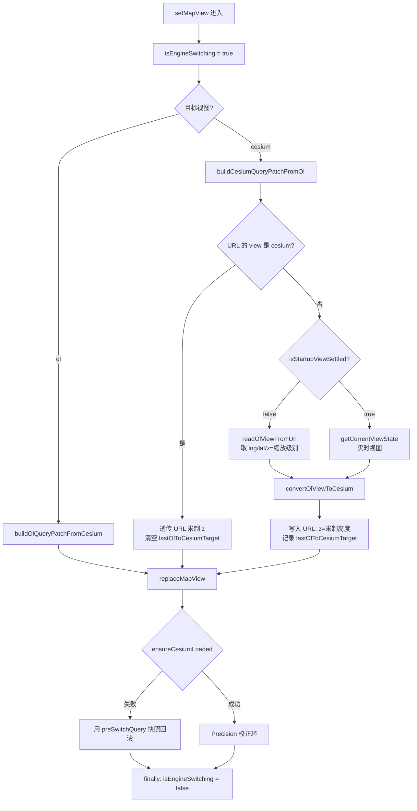

# V3.6.25 暂存区归并 + 代码审查加固

## 元信息

- **日期与时间**：2026-10-25 12:20
- **任务等级**：**L2**（跨 3 个源文件 + 4 份文档的协同改动；未触及架构级重构）
- **版本**：**V3.6.25**（V3.6.24 已独立提交，本批次为其后续未提交工作，按用户指示归并为单一版本）
- **前置**：暂存区存在两批未提交改动，曾被逐次记为 `V3.6.25 / V3.6.26 / V3.6.27`，本次整合为单一版本

---

## 一、问题分析

### 1.1 核心症状

暂存区代码对应两次独立修复（各有一份过程日志），但版本记录混乱：`Docs/Guide/CHANGELOG.md` 把这两次修复塞进了**已发布**的 V3.6.24 条目（第 ⑤ ⑥ 项），而 README 仍标注 `当前版本 V3.6.24`——等于「已发布版本被追溯修改 + 新工作无版本归属」。

### 1.2 根本原因

1. **版本归并口径不一致**：上一轮归并把「尚未提交」当作「可以继续并入上一版本」，但 V3.6.24 实际已提交发布（commit `06c6f6c1`），此后新增的修复必须单独占一个修订号（§5）。
2. **审查欠账**：两份修复日志的「遗留与风险」已自陈多处未闭环，其中 `isEngineSwitching` 异常路径未复位被上一轮审计列为 P1，但一直未施工。

### 1.3 受影响模块

| 模块 | 影响 |
|---|---|
| `Docs/Guide/CHANGELOG.md` | V3.6.24 条目被追溯改写；新批次无条目 |
| `README.md` | 版本号三处（简介行 / 演进表 / 页脚）停留在 V3.6.24 |
| `app/HomeView.vue` | 视图切换标志生命周期、OL→Cesium 换算输入选取 |
| `ol/components/MapContainer.vue` | 稳定性判据在实例缺失时给出错误答案 |

---

## 二、解决方案

### 2.1 版本归并策略

| 方案 | 做法 | 结论 |
|---|---|---|
| A. 保持 V3.6.24，把新修复继续塞进该条目 | 零改动 | ❌ 追溯修改已发布版本，违反 §5「同批次不得拆版本」的反向约束——已发布版本同样不应被追加 |
| B. 新开 V3.6.25，从 V3.6.24 条目中摘出 ⑤⑥ | 内容上移，历史条目恢复原状 | ✅ **采纳** |
| C. 保留 ⑤⑥ 在 V3.6.24，另开 V3.6.25 只写本轮审查修复 | 改动最小 | ❌ 同一份改动横跨两个版本，与用户「整合为统一版本」的指示冲突 |

### 2.2 代码审查发现（本轮新增）

对暂存代码做逐文件审查，除上一轮审计已列项外，新发现两处**会导致实际视野错误**的缺陷，均在本次修复：

| # | 位置 | 缺陷 | 后果 |
|---|---|---|---|
| ① | `buildCesiumQueryPatchFromOl` | URL 兜底无条件把 `z` 当作 OL 缩放级别 | URL 已是 `view=cesium` 时（启动直达 3D）米制 `z` 被当缩放：`z=20` → 换算成数百米写入 `lastOlToCesiumTarget`，Precision 校正环按错误目标推走相机 |
| ② | `MapContainer.isStartupViewSettled` | 地图实例未创建时 `getView()` 为 `undefined`，函数返回 `true` | 调用方误判「已稳定」，放弃 URL 兜底、退到默认高度——正是「首次进入过远」成因之一 |
| ③ | `setMapView` | `isEngineSwitching` 手工置位/复位，无异常保护 | 切换流程多次 `await`，任一抛错即永久冻结 OL 的 URL 写回（上一轮审计 P1） |

### 2.3 换算输入决策链（变更后）

> 关键点：`F` 是本次新增的语义守卫，`H` 的 `false` 分支是上一轮修复的时序守卫，`Q` 是本次新增的异常保护。三者缺一都会让相机落到错误高度。

---

## 三、修改内容

### 3.1 代码

| 文件 | 改动 |
|---|---|
| `frontend/src/app/HomeView.vue` | ① `buildCesiumQueryPatchFromOl` 增加语义守卫：`getCurrentMapView() === cesium` 时透传米制 z 并清空 `lastOlToCesiumTarget`；② `setMapView` 拆为 `runMapViewSwitch`（纯流程）+ `setMapView`（`try/finally` 管理 `isEngineSwitching`） |
| `frontend/src/domains/ol/components/MapContainer.vue` | `isStartupViewSettled()` 增加 `if (!mapInstance?.value) return false` |

### 3.2 文档

| 文件 | 改动 |
|---|---|
| `Docs/Guide/CHANGELOG.md` | 新增 V3.6.25 条目（含版本归并说明、三次修复、本轮审查三项）；从 V3.6.24 条目摘出 ⑤⑥ 及其日志链接，恢复已发布条目原状 |
| `README.md` | 版本号三处：简介行 `V3.6.24 → V3.6.25`、演进表新增 V3.6.25 行并删最旧行（恒定 3 行）、页脚 `` |
| `Docs/Guide/frontend-structure.md` | `MapContainer.vue` 条目补「跨引擎契约」：`urlSyncEnabled` prop 与 `isStartupViewSettled()` 的用途与前提 |
| `Docs/TODO/bugfix-optimization-plan.md` | 销项 3 项（`isEngineSwitching` P1、URL 语义误读、实例未就绪误判）；新增 1 项（ESLint `no-useless-assignment`）；本批次引用版本号统一为 V3.6.25 |
| `Docs/LLM_record/26-10/2026-10-25/2026-10-25-v3.6.25-staged-consolidation.md` | 本日志（新增） |

---

## 四、修改原因

1. **版本可追溯**：已发布版本不应被追加内容，否则「V3.6.24 到底含哪些改动」永久失真。
2. **视野正确性优先**：本轮两处新发现都会直接把相机送到错误高度，且都在「首次进入 3D」这条用户感知最强的路径上，优先级高于任何文档整理。
3. **异常安全**：手工管理跨 `await` 的标志位是典型易漏点，`try/finally` 是唯一不依赖「记得每处都复位」的写法。

---

## 五、影响范围

| 维度 | 是否受影响 | 说明 |
|---|---|---|
| OL→Cesium 换算 | 是 | 新增语义守卫；正常 OL 切换路径行为不变 |
| Cesium→OL 切换 | 是 | 仅受 `try/finally` 影响，流程未变 |
| 启动直达 3D（`view=cesium` 链接） | 是 | 不再触发错误的 Precision 校正 |
| 懒加载重试 | 否 | 本次未改动 `useLazyModules.ts` |
| 后端 / 配置面 / 部署面 | 否 | 零改动 |
| 版本号机器读取源 | 是 | README 简介行格式保持不变，`__APP_VERSION__` 正则可正常提取 |

---

## 六、性能指标

不适用（无热路径改动）。`try/finally` 与一次 `getCurrentMapView()` 判断均为常数开销。

---

## 七、测试方案

### 7.1 Agent 已执行

| 项目 | 命令 | 结果 |
|---|---|---|
| 类型检查 | `npx tsc --noEmit` | ✅ 0 error |
| ESLint（改动文件） | `npx eslint src/app/HomeView.vue src/domains/ol/components/MapContainer.vue src/app/composables/useLazyModules.ts` | ⚠️ 1 error：`MapContainer.vue:1716 no-useless-assignment`（既有问题，非本次引入，已记 TODO） |
| 构建 | `npx vite build --outDir .dist-v2` | ✅ 4401 modules / 17.88s |
| 结构树门禁 | `python Scripts/CheckStructureTree.py` | 见交接块 |
| 配置登记门禁 | `python Scripts/CheckConfigRegistry.py` | 见交接块 |
| §11.2 红线自查 | 四条 `rg` | 见交接块 |

> **未执行**：浏览器级运行时验证。项目无前端测试，本机 `npx playwright` 受权限限制不可用。本次结论基于**代码路径推导 + 类型检查 + 构建验证**，不得视为已验收。

### 7.2 待用户实机验证

| 步骤 | 预期结果 |
|---|---|
| 1. 清 `node_modules/.vite` 后 `npm run dev -- --force`，首次打开（OL 全国视野）→ 切 3D | Cesium 视野与 OL 接近（全国范围），无「贴地街区级」 |
| 2. 用 `?view=cesium&z=20` 直接打开 | 相机停在约 20 米高度，不被推远到数百米 |
| 3. 切 3D 后连续 OL↔3D 五次 | 每次视野一致；URL 中 `z` 在 OL 下为缩放级别、在 3D 下为米制高度，不出现混合态 |
| 4. Network 面板拦截 CesiumContainer 分块制造加载失败 | 回滚后 URL 恢复为 `view=ol&z=<缩放级别>`，`z` 不为七位数 |
| 5. 切回 OL 后拖动地图 | URL 正常随 moveend 更新（验证 `isEngineSwitching` 已复位） |

---

## 八、变更文件清单

| 文件 | 说明 |
|---|---|
| `frontend/src/app/HomeView.vue` | 语义守卫 + 切换标志 try/finally |
| `frontend/src/domains/ol/components/MapContainer.vue` | 实例未就绪返回 false |
| `Docs/Guide/CHANGELOG.md` | 新增 V3.6.25 条目，V3.6.24 条目摘出 ⑤⑥ |
| `README.md` | 版本号三处 |
| `Docs/Guide/frontend-structure.md` | MapContainer 跨引擎契约说明 |
| `Docs/TODO/bugfix-optimization-plan.md` | 销项 3 项 / 新增 1 项 / 版本号同步 |
| `Docs/LLM_record/26-10/2026-10-25/2026-10-25-v3.6.25-staged-consolidation.md` | 本日志 |

---

## 九、遗留与风险

1. **未做浏览器级验证**（见 §7.1）。视野相关改动只在「代码路径 + 构建」层面验证过。
2. **`z: 17` 硬编码兜底仍在**：z 被判非法时静默回落到街道级，属行为设计问题，需产品确认后改为「不注入 z」。
3. **`MIN_CAMERA_HEIGHT = 1` 偏宽松**：历史污染链接（`view=cesium&z=4.00`）不会自愈，需手动缩放或删 `z` 重进。
4. **ESLint 既有 error 未修**（`MapContainer.vue:1716`）：按 §2.5 只记不改，已入 TODO。
5. **懒加载重试的覆盖边界**：退避总时长仅 450ms，对 Vite 预构建 full-reload（秒级）与发版后旧 chunk 失效无效，已在 TODO 说明。
6. **未执行任何 Git 写操作**：按用户明确要求，本次只改文件，版本控制交由用户。

---

## 零散修补（2026-10-25 12:18，L1）

### 消息弹窗同屏上限 3 → 2

- **位置**：`frontend/src/domains/common/shell/useMessage.js:10`
- **改动**：`const MAX_VISIBLE = 3;` → `const MAX_VISIBLE = 2;`，并补注释说明该常量的语义（同时可见条数）与下调原因（3 条同屏会压住右侧工具栏与比例尺）。
- **单一事实来源核查**：`MAX_VISIBLE` 全仓仅 1 处定义，消费点 2 处——`flushQueue()`（:187 补位条件）与 `createMessage()`（:268 溢出转队列），均自动跟随，无第二处硬编码；`Message.vue` 只读取 `queued.length` 渲染「还有 N 条提示」徽标，不含数量上限。
- **未改动**：`QUEUE_DRAIN_THRESHOLD = 3`（队列加速阈值，与可见条数是不同语义）、`MAX_QUEUE = 8`（积压硬上限）。
- **行为影响**：第 3 条起进入等待队列，岛底徽标显示积压数量；消息总吞吐不变。
- **验证**：`eslint` 0 problems；纯常量改动，无函数签名与分支变化，未跑构建。
- **未做**：真机/浏览器复验（需实际触发多条 toast 观察同屏条数）。
