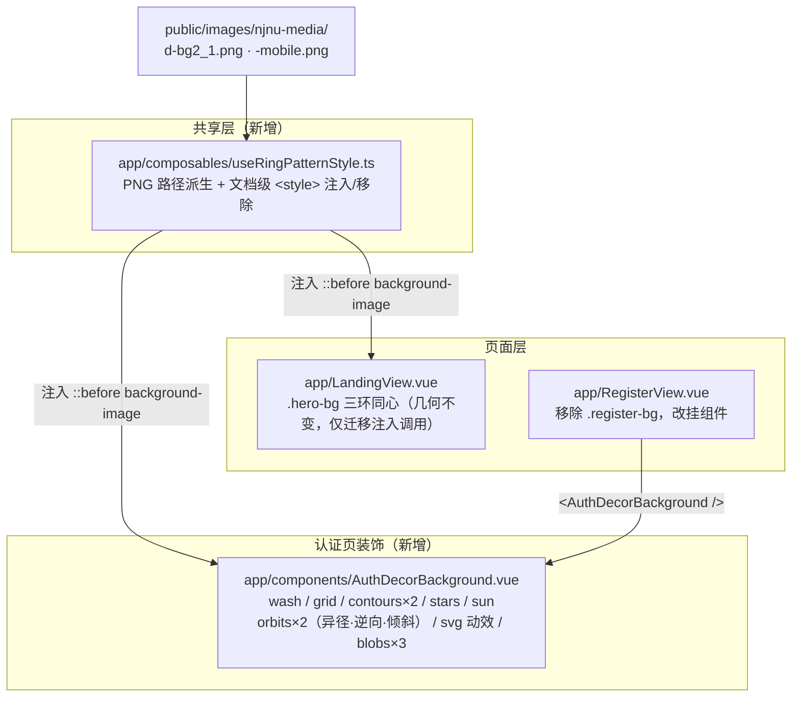

# V3.6.29 认证页背景重构（双轨交会 + 动态 SVG，与 Landing 同心圆明确区分）

## 元信息

- **日期与时间**：2026-10-26 14:45–15:10
- **任务等级**：**L2**（新增 2 个文件 + 2 个视图改动 + 文档/版本号；无架构级目录调整）
- **用户指令**：① Landing 首页背景（圆环 + PNG 旋转纹样 + 太阳）观感不错，Register 缺这套背景，需补上；② **不要和 Landing 一模一样**，Register 要换布局/方式，用两个圆相对逆向旋转；③ 背景太单薄，需增加更多元素；④ 加动态 SVG 效果或动画
- **版本**：V3.6.28 → **V3.6.29**

---

## 一、问题分析

### 1.1 核心症状

`LandingView` 首屏（`.hero-bg`）有 6 层装饰：经纬网、天光（暖金 radial + conic 光芒，96s 自转）、三环**同心**轨道（环上叠 PNG 旋转纹样与公转点）、两枚品牌色光斑。
`RegisterView`（注册/登录共用页）只有 2 层：28px 经纬网 + 两枚模糊光斑（原 `.register-bg`，1636–1681 行）。从 Landing 点「立即体验」跳转后，页面质感骤降。

### 1.2 根本原因

1. **装饰层从未沉淀为可复用资产**。`hero-bg` 的 250 行调参 CSS 与 40 行纹样注入脚本全部内联在 5204 行的 `LandingView.vue` 内，第二处使用只能复制。
2. **纹样 PNG 的 URL 不能写在 SFC scoped 样式里**。相对 `url()` 的解析基准是「写下它的样式表」，打包后落在 `/assets/index-*.css`，`./images/...` 会被拼成 `/assets/images/...` 而 404；`var()` 传 URL 在计算值阶段非法。唯一可行通道是「运行时注入文档级 `<style>`」（V3.6.20 线上实测结论）。该通道此前是页面私有的。
3. **Register 当初按「克制版」设计**，加卡片表单后没有回头补品牌装饰。

### 1.3 受影响模块

- 认证页视觉层（`src/app/RegisterView.vue`）
- 轨道环纹样注入通道（原 `LandingView.vue` 私有函数 → 抽为公共 composable）
- 前端结构树文档、README 版本号、CHANGELOG

---

## 二、方案对比与选型

| 方案 | 做法 | 优点 | 缺点 | 结论 |
|---|---|---|---|---|
| A | 把 Landing 的 CSS/JS 复制进 `RegisterView.vue` | 改动最小、零回归风险 | 两个巨型文件继续膨胀（违反 §3「巨型文件只出不进」）；纹样 URL 与 iOS mask 缺陷的成因注释出现两份；**且用户明确要求两页不能雷同** | **否决** |
| B | 把 `.hero-bg` 整体抽成通用组件，两页共用 | 真正单一实现 | 需重写 Landing 250 行按首屏几何调参的 CSS，并与 `.hero-section` 的 flex 布局耦合；Landing 是门面页，视觉回归风险高；共用一套几何必然导致两页同构，与需求 ② 冲突 | **否决** |
| C | ① 抽出纹样注入 composable（两页共用）；② 新建 `AuthDecorBackground.vue` 承载认证页**独立几何 + 独立动效** | 注入通道与 PNG 路径单点维护；两页视觉语言同源但构图、动效完全不同；互不牵连 | 新增 2 个文件，需同步结构树 | **采纳** |

**选型理由**：真正需要共享的是「PNG 路径 + 文档级注入」这段有副作用的逻辑（含 iOS 合成缺陷的成因），而非几何与动效。几何必须分开——Landing 是三环同心、以首屏文案为中心；认证页是双轨错位、以 440px 居中卡片为交点。

---

## 三、视觉方案：双轨交会

与 Landing 的差异（逐项对照）：

| 维度 | Landing（同心圆靶心） | 认证页（双轨交会） |
|---|---|---|
| 环心 | 三环共心，落在首屏文案中心 | **两环错位**：33%/52% 与 67%/46%，卡片落在交会处 |
| 环数/环径 | 3 环 960 / 680 / 420（单一中心） | **2 轨 × 3 环**：每轨外/中/核 = 100% / 70.8% / 43.75%，轨径 780 / 700（不等径，避免"镜像副本"读感） |
| 形态 | 正圆 | **椭圆**：外壳 `rotate(-13°/+11°) scaleY(0.88)`，读作倾斜轨道面 |
| 方向 | 外顺 / 中逆 / 内顺 | **A 顺 90s / B 逆 120s**，严格相对逆向 |
| 线型 | 外虚线 + 中/内实线 | A 轨外虚→中实→核实（绿渐弱）；B 轨外实→中虚→核点（转金） |
| 公转点 | 空心 + 实心两枚 | 同（一空一实），净周期 36s / 35s、方向相反 |
| 附加 | 无 | 每轨两枚**卫星小环**随环自转；**动态 SVG** 层（流动虚线轨迹 + 定位脉冲） |
| 纹样缩放 | 124% / 96% / 90%（对应 3 环） | **同一套 124% / 96% / 90%**，但作用于每轨的 3 个内环 —— 花边落在三个不同半径，叠成"外圈贴边、中圈内收、核心收紧"的综合圆环 |

背景层次（由后至前，共 8 层）：

| # | 层 | 实现 | 作用 |
|---|---|---|---|
| 1 | 底纹渐变 | 顶部品牌绿 + 右下暖金两段 radial | 让页面不再是"一张纯白纸" |
| 2 | 经纬网 | 28px 网格 + 顶部浓、向下渐隐的 mask | 技术底纹（沿用认证页原有密度） |
| 3 | 等高线 ×2 | `repeating-radial-gradient` 1px 线 + 径向 mask | GIS 最直白的视觉母题；左下绿、右上金 |
| 4 | 散点/点位 | 16 层 `radial-gradient`（13 实心点 + 3 空心环） | 填中上部留白，读作"地图点位" |
| 5 | 天光 | 暖金 radial + 品牌色 conic 光芒，96s 自转 | 右上角纵深 |
| 6 | 双轨 × 三环 | 每轨外/中/核三环同心，同一 PNG 按 124%/96%/90% 缩放 | 主角；"综合圆环"的来源 |
| 7 | 动态 SVG | 2 条流动虚线轨迹 + 3 处定位脉冲 | 让页面"活起来" |
| 8 | 光斑 ×3 | 左上 / 右下 / 底部中央暖金 | 收边、托住卡片下沿 |

### 3.1 动态元素清单

| 元素 | 动画属性 | 周期 | 方向 | 合成友好 |
|---|---|---|---|---|
| A 轨外环 | `transform: rotate` | 90s | 顺时针 | 是 |
| A 轨中环 / 核心环 | `transform: rotate` | 130s / 180s | 逆 / 顺（交替） | 是 |
| B 轨外环 | `transform: rotate` | 120s | 逆时针 | 是 |
| B 轨中环 / 核心环 | `transform: rotate` | 150s / 210s | 顺 / 逆（交替） | 是 |
| 公转点 A/B | `transform: rotate` | 60s / 50s | 顺 / 逆（净 36s / 35s） | 是 |
| 天光 | `transform: rotate` | 96s | 顺 | 是 |
| 轨迹 A/B | `stroke-dashoffset` | 2.6s / 3.4s | 正向 / 反向 | 否（重绘路径，仅 2 条细线） |
| 定位脉冲 ×3 | `transform: scale` + `opacity` | 4.4s（错峰 1.6s） | 扩散 | 是 |
| 星座连线 ×3 | `stroke-dashoffset`（`pathLength="1"` 归一化） | 2.2s 一次性 | 起笔自绘，错峰 0.6/1.5/1.9s | 否（仅首屏一次） |
| 星座节点 ×6 | `opacity` | 5.4s | 呼吸，错峰 1.4~3.0s | 是 |
| 宇航员躯干 | CSS `transform: translate + rotate` | 10s | 三段式漂浮 12/-20px，-3°~+5° | 是 |
| 宇航员双臂 | SMIL `animateTransform rotate` | 5.2s / 5.8s | 绕肩点 ±10°，左右反相位 | 否（SMIL） |
| 宇航员双腿 | SMIL `animateTransform rotate` | 6.4s / 7.1s | 绕髋点 ±8°，左右反相位 | 否（SMIL） |
| 散点层 | `opacity` | 7.5s alternate | 整体呼吸 | 是 |

全部动画包在 `@media (prefers-reduced-motion: no-preference)` 内，用户开启「减少动态效果」时整层静态。

### 3.2 关键实现约束

- **倾角与自转必须分两层**：动画的 `transform` 会整体覆盖静态 `transform`，若把 `rotate/scaleY` 与 `@keyframes rotate` 写在同一元素上，倾角会被吃掉。故 `orbit`（外壳，静态倾角）→ `ring`（内环，自转）。
- **纹样只能用 `background-image`，不能用 `mask`**：iOS Safari 在持续 transform 旋转的父元素内会把遮罩层栅格化成黑环（Landing 的线上实测结论）。注入规则与 Landing 共用同一实现。
- **SVG 扩散环必须 `transform-box: fill-box`**：否则 `transform-origin: center` 按视口原点计算，脉冲会被甩出画面。
- **移动端整层关闭**：≤768px 时 `RegisterView` 把卡片改成全屏，不透明卡片会 100% 覆盖装饰层，保留只剩合成开销。

### 3.3 文件关系

数据流向：`ASSET_BASE_URL`（`config/publicRuntime.ts`，唯一 env 入口）→ composable 拼 URL → 文档级 `<style>` → 伪元素 `background-image`。绕开 scoped 样式的相对路径解析基准问题。

---

## 四、修改内容

1. **新增 `app/composables/useRingPatternStyle.ts`**：纹样注入提升为参数化 composable（`styleId` / `scope` / `ringClass` / `breakpoint`），提供 `injectRingPatternStyle` / `removeRingPatternStyle` / `useRingPatternStyle` 三个导出；PNG 路径由 `ASSET_BASE_URL` 派生，单一来源。
2. **新增 `app/components/AuthDecorBackground.vue`**：认证页装饰层，8 层结构 + 12 组动画 + 动态 SVG（流动轨迹 / 定位脉冲 / 自绘星座 / 漂浮宇航员）；每轨内套「外/中/核」三环（同一 PNG 按 124%/96%/90% 缩放）；`≤768px` 整层 `display:none`。
3. **`RegisterView.vue`**：模板中 `.register-bg` 三个 div 替换为 `<AuthDecorBackground />`；删除 `.register-bg*` 共 6 条样式规则与移动端 2 条降级规则（约 60 行），补导入。
4. **`LandingView.vue`**：删除私有的 `injectRingPatternStyle` / `removeRingPatternStyle` / `RING_PATTERN_STYLE_ID` / 两个 PNG 常量（约 45 行），改为 `useRingPatternStyle({ styleId: 'landing-ring-pattern-style', scope: '.hero-bg__rings', ringClass: 'hero-bg__ring' })`；`styleId` 与选择器保持原值，注入结果与改造前逐字符一致。
5. **文档**：`frontend-structure.md` 登记 2 个新文件；README 三处版本号；CHANGELOG 追加条目；本日志。

## 五、修改原因

Landing 与认证页是用户进入产品的第一、第二个界面，装饰语言必须连续，否则从宣传页跳到注册页会出现"质感断崖"。同时按用户要求让两页**同源不同构**：共享纹样资产与注入通道，构图与动效各自独立。借这次机会把注入通道从页面私有提升为公共资产，消除第二份复制。

## 六、影响范围

- 认证页（注册 + 登录双模式）视觉层
- Landing 首屏纹样注入路径（迁移到 composable，行为等价，已截图回归）
- 前端结构树文档、README 版本三处、CHANGELOG

## 七、解决方案

见第三节。

## 八、性能指标

未实测帧率。定性评估：

- 装饰层动画以 `transform` / `opacity` 为主，可走合成层；唯一非合成项是 2 条 1.3px 虚线的 `stroke-dashoffset`。
- 相对 Landing 首屏：环数 3→2、无 Ken Burns、无网格漂移；新增等高线（静态）与散点（静态，16 层渐变一次绘制）。
- 移动端整层关闭，移动 GPU 零成本。

## 九、测试方案

### Agent 已执行

| 项 | 命令/方式 | 结果 |
|---|---|---|
| ESLint | `npx eslint src/app/{RegisterView,LandingView}.vue src/app/components/AuthDecorBackground.vue src/app/composables/useRingPatternStyle.ts` | 0 problems |
| 类型检查 | `npx tsc --noEmit` | 0 error（全仓） |
| 生产构建 | `npx vite build --outDir <临时目录>`（`dist/` 被沙箱批量删除保护拦截，改用独立输出目录） | `✓ built`，无新增告警 |
| 桌面渲染 | 无头 Chrome 1440×900 截图 `#/register`，迭代 7 轮（初版 → 补元素 → 加 SVG 动效 → 调平衡 → 三环综合圆环 → 加星座/宇航员 → 宇航员面罩重绘） | 双轨、三环纹样（三个半径上的花边）、等高线、散点、天光、轨迹、脉冲、星座连线、宇航员（含深色面罩与系绳）均正常渲染 |
| Landing 回归 | 同尺寸截图 `#/`，与改造前对照 | 三环纹样、天光、数字卡完全一致，注入迁移无回归 |
| 静态样式核查 | 逐条核对选择器优先级与 `transform` 覆盖关系 | 倾角外壳 / 自转内环分层正确；注入规则选择器与历史实现逐字符一致 |
| 结构树门禁 | `python Scripts/CheckStructureTree.py` | 文档 514 · 磁盘 514 · 漏登记 0 · 幽灵 0，exit 0 |
| 配置登记门禁 | `python Scripts/CheckConfigRegistry.py` | 七项全通过（B1-B4 / F1-F3），exit 0 |
| 平台红线自查 | §11.2 四条（`rg` 不可用，改用 `grep -riE` 等价执行，排除 `.venv`/`node_modules`） | 1/3/4 全清；第 2 条唯一命中为 `cloudModule.js` 的 `maxRayDistance`（Cesium 参数名含 `xray` 子串），属**已知误报**，非代理工具 |

### 待用户实机验证

1. `npm run dev` 后打开 `/#/register`，确认：两环**相对逆向**旋转（左顺右逆）、公转点一空一实反向掠过、虚线轨迹朝相反方向流动、三处脉冲错峰扩散。
2. 注册 / 登录两个 Tab 切换，确认卡片高度变化时双轨始终与卡片交会、不被裁成断弧。
3. 窗口从 1440px 缩到 900px，确认两环按 `vw/vh` 收放、不出现半圈被裁。
4. ≤768px（或手机）确认装饰层整层消失、卡片全屏无异常。
5. iOS Safari 真机确认旋转环**不是黑环**（mask 合成缺陷的回归项）。
7. 首屏进入后 0~3s 观察星座连线是否"从起点画到终点"（`pathLength` 归一化在不同浏览器下应一致）。
6. 系统开启「减少动态效果」后确认整层静态。

## 十、变更文件清单

| 文件 | 说明 |
|---|---|
| `frontend/src/app/components/AuthDecorBackground.vue` | **新增**：认证页装饰层（8 层 + 6 组动画 + 动态 SVG） |
| `frontend/src/app/composables/useRingPatternStyle.ts` | **新增**：纹样 PNG 注入 composable（Landing / 认证页共用） |
| `frontend/src/app/RegisterView.vue` | 装饰层改为挂载组件，删除旧 `.register-bg*` 样式 |
| `frontend/src/app/LandingView.vue` | 纹样注入迁移到 composable（行为等价） |
| `Docs/Guide/frontend-structure.md` | 登记 2 个新文件 + 更新 RegisterView 说明 |
| `README.md` | 版本号三处（简介行 / 版本表首行 / 页脚） |
| `Docs/Guide/CHANGELOG.md` | 追加 V3.6.29 条目 |
| `Docs/LLM_record/26-10/2026-10-26/2026-10-26-register-auth-decor-background.md` | 本日志 |

## 十一、遗留与风险

1. **纹样可见度与环径正相关**：PNG 花边在缩放时按面积平均 alpha，环越小越淡。每轨的核心环只有外环的 43.75%，稀释最重，已用 `opacity: 0.7` 压到"能看出纹样、读不出图案"的临界值；若后续再缩小轨径，需同步提 `opacity` 或改用 alpha 加强版 PNG。
2. **三环叠加的纹理密度**：外/中/核三层的花边分别落在约 0.966 / 0.75 / 0.70 倍半径处，中环与核心环的花边半径接近（0.75 vs 0.70），在部分旋转相位下会短暂重叠成更密的一圈。属可接受的"呼吸"效果；若后续觉得糊，可把核心环的 `background-size` 从 90% 调到 84% 拉开距离。
3. **`stroke-dashoffset` 不可合成**：2 条细线 + 3 条星座线在大面积 SVG 上流动/自绘会触发路径重绘。桌面端截图无异常，但低端设备 / 高分屏下的帧率**未实测**，属待观察项。
4. **脐带已删除（两次返工记录）**：第一版 6.8s 单摆被判定「与人物同频」；第二版改 4.2s 主摆 + 13s 慢漂的复合节奏后，仍被判定「好奇怪」。结论是**语义问题而非节奏问题**——90px 尺度下，一条从腰甩到脚下、末端悬空的虚线无法表达「系留在某物上」，只会读成一条多余虚线。最终整条移除，人物改为纯漂浮；若后续想恢复，必须同时画出被系留的物体（飞船/舱段），否则不成立。
5. **SMIL 不响应 `prefers-reduced-motion`**：四肢/系绳的关节摆动用的是 `animateTransform`（CSS `rotate()` 的 `transform-origin` 对嵌套 SVG 组不可靠，`fill-box` 以 bbox 左上角、`view-box` 以视口原点为基准，都不是"肩点"）。为守住"减少动态效果即静态"的承诺，组件在 setup 期读一次 `matchMedia('(prefers-reduced-motion: reduce)')`，命中时不渲染任何 `<animateTransform>`。若后续要彻底去 SMIL，需改用 CSS + 手算 bbox 偏移的 `transform-origin`。
6. **SVG 采用固定 viewBox 1440×900 + `slice`**：极端宽高比（如 21:9）下轨迹与星座会被裁切，属装饰性裁切，不影响信息；宇航员位于左下角，超宽屏下可能被裁到只剩半个，需实机确认。
7. **未做移动端动效**：≤768px 整层关闭是刻意取舍（卡片全屏、装饰不可见），若后续移动端改回留白卡片，需补一套轻量装饰。
8. **Landing 的三环几何未改动**：本次只迁移注入通道，视觉零变化；若后续要统一两页，建议以 `AuthDecorBackground` 的参数化方式重做，而非直接复用。
9. **红线自查的已知误报**：§11.2 第 2 条的 `xray` 会命中 `cloudModule.js` 的 `maxRayDistance`（体积云模块合法参数）。当前环境无 `rg`，以 `grep -riE` 等价执行；后续若装 `rg`，建议把该模式收紧为 `\bxray\b` 或排除该文件。
10. **暂存区状态由 IDE 侧产生**：`git status` 显示部分文件已处于 staged 状态（`M ` / `A `），Agent 本次**未执行任何 Git 写操作**，暂存与提交由用户决定。
