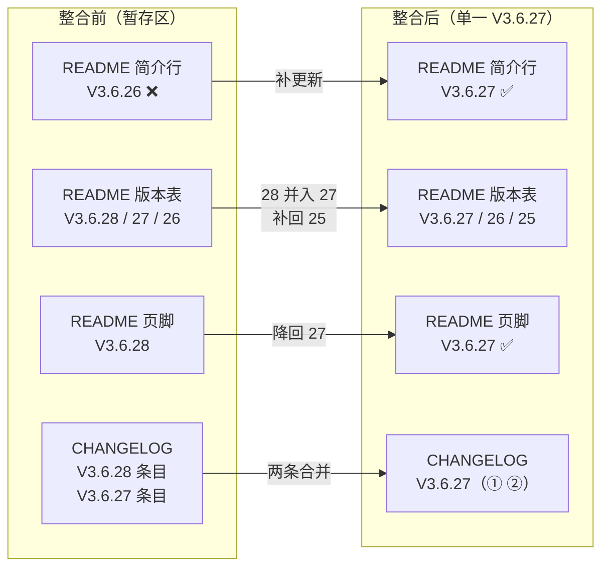

# V3.6.27 暂存区代码审查与版本整合

## 元信息

- **日期与时间**：2026-10-26 10:25–10:50
- **任务等级**：**L2**（多文件文档整合 + 一处事实性注释修正；无业务逻辑新增）
- **用户指令**：按 `Docs/Force_command.md` 规范 code review 暂存区；把多次不规范 commit 整合为**单一 V3.6.27**；修复潜在 bug；更新文档与文件树；**禁止任何 Git 写操作**（§2.1）
- **版本**：V3.6.26 → **V3.6.27**（V3.6.28 并入，不单独成版）

---

## 一、问题分析

### 1.1 核心症状

暂存区共 **11 个文件 / +371 −48**，来自**至少两个并行会话**，且被拆成两个版本号：

| 来源批次 | 内容 | 原记版本 |
|---|---|---|
| A | 船舶网海图改走通用代理（前端 2 文件 + 文档） | V3.6.27 |
| B | Dependabot 策略注释 + 日志 | V3.6.28 |
| C | 依赖锁同步（`uv.lock`、`package-lock.json`）、`traffic.json` 统计 | 无版本 |
| D | README 截图 URL 替换、TOC 锚点补全 | 无版本 |

### 1.2 根本原因

同一天内多个会话各自「+1 修订号」，违反 §5「同一批次不得拆成多个版本号」；且 B 批次**漏更新 README 项目简介行**（§5 要求三处同步，该项目简介行还是版本号的**机器读取源**）。

### 1.3 受影响模块

- 版本号 SSOT 三处（README 简介行 / 版本演进表 / 页脚）
- `Docs/Guide/CHANGELOG.md` 条目结构
- `.github/dependabot.yml` 注释的**事实准确性**
- `Docs/Architecture/basemap-source-system.md` 路由契约表

### 1.4 审查发现（逐项）

| # | 文件 | 发现 | 严重度 | 处置 |
|---|---|---|---|---|
| 1 | `README.md` | 项目简介行仍是 V3.6.26，而版本表/页脚已到 V3.6.28 → **三处不一致**，且简介行是 `vite.config.js` 提取版本号的正则源 | **高** | 已修 |
| 2 | `README.md` | 版本表被拆成 V3.6.28 / V3.6.27 / V3.6.26 三行，且**挤掉了 V3.6.25 行** | 中 | 已合并并补回 3 行 |
| 3 | `CHANGELOG.md` | 27 / 28 两条独立条目 | 中 | 已合并为单条（① ②） |
| 4 | `.github/dependabot.yml` | 注释称「当前仓库有『Copilot cloud agent』workflow」——**实测 `.github/workflows/` 只有 codeql / deploy / pre-check / traffic-counter 四个，无 Copilot workflow**（违反 §2.6 禁止臆造） | **高** | 已改正 |
| 5 | `Docs/Architecture/basemap-source-system.md` | 路由契约表仍列 `/tiles/ships66/{z}/{x}/{y}.png` 为现存端点 | 中 | 已更新 |
| 6 | `frontend/.../basemapConfig.ts` | `tileProxyUrl('http://g3.ships66.com/...{z}/{x}/{y}.png')` 的**坐标顺序**是否正确（同日另一个瓦片源就是顺序错的） | 待验证 | **已实测通过**（见 §7.1） |
| 7 | `frontend/src/config/publicRuntime.ts` | 删除 `backendTilesUrl()` 后是否有残留引用 | 待验证 | **已实测无残留** |
| 8 | `frontend/.../tileLifecycle.ts:135` | 仍保留 `/tiles/` 前缀判断，端点下线后成死分支 | 低 | **保留**（防御性分支，无副作用；记入遗留） |
| 9 | `backend/uv.lock` | `starlette 1.0.0→1.10.0`、`anyio 4.13.0→4.14.2` 属 **minor** 升级，与「只收 major」策略看似矛盾 | 中 | 保留（属既有约束内补丁，非本批引入）；**建议用户实机验证后端启动** |
| 10 | `.github/traffic.json` | 每日统计自动更新 | 无 | 保留 |

### 1.5 整合前后关系

---

## 二、解决方案

### 2.1 候选方案对比

| 方案 | 做法 | 结论 |
|---|---|---|
| A. 保留 V3.6.28 独立成版 | 只修 README 简介行 | ❌ 违背用户「整合为单一 V3.6.27」的明确指令 |
| **B. 28 并入 27，CHANGELOG 双条合一** | 版本号统一 27，内容按 ①② 并列 | ✅ **采纳** |
| C. 全部退回 V3.6.26 | 忽略两批改动 | ❌ 丢失已完成的 ships66 下线与 dependabot 注释 |

### 2.2 实施步骤

1. 只读审查 11 个暂存文件（`git diff --cached`），未做任何 `add` / `commit`；
2. README 三处统一 V3.6.27，版本表合并并补回 V3.6.25；
3. CHANGELOG 两条合并为 `### V3.6.27`，正文分 `#### ① 船舶网海图` / `#### ② Dependabot 策略`，去掉重复的「过程见」行；
4. 修正 `dependabot.yml` 中关于 Copilot workflow 的错误表述；
5. 更新 `basemap-source-system.md` 路由契约表，补 V3.6.27 变更说明；
6. 给 `2026-10-25-dependabot-pr-policy.md` 加**更正批注**（不回溯改写原文）；
7. 跑两道门禁。

---

## 三、修改内容

| 文件 | 改动 |
|---|---|
| `README.md` | 简介行 V3.6.26→**V3.6.27**；版本表 28/27/26 → **27（合并）/26/25**；页脚 28→**27** |
| `Docs/Guide/CHANGELOG.md` | V3.6.28 + V3.6.27 两条合并为单条 `### V3.6.27`，分 ①②；删除小节内重复的过程链接 |
| `.github/dependabot.yml` | 改正 Copilot 表述：不存在 Copilot workflow，属账号级能力；列出实际 4 个 workflow 名 |
| `Docs/Architecture/basemap-source-system.md` | 路由表删除 `/tiles/ships66` 行，补 V3.6.27 变更说明（只剩 `/proxy/*` 命名空间） |
| `Docs/LLM_record/.../2026-10-25-dependabot-pr-policy.md` | 对「workflow 处于 active」加更正批注 |

---

## 四、修改原因

1. **版本号 SSOT 三处必须一致**：`vite.config.js` 用正则 `/当前版本[^\d]*(\d+\.\d+\.\d+)/` 从 README 简介行提取并注入 `__APP_VERSION__`，简介行漏改会导致前端显示的版本号与实际发版不符。
2. **同一批次不得拆版本号**（§5）：28 与 27 同为 2026-10-25 未提交工作，拆开会造成「同日两个版本」的历史噪音。
3. **事实准确性**（§2.6）：注释里断言一个不存在的 workflow，会把后续排查引向错误方向——已用 `ls .github/workflows/` 实测证伪。
4. **架构文档是当前态 SSOT**：端点已下线却仍列在路由契约表中，会让接手者按图索骥找到 404。

---

## 五、影响范围

| 维度 | 是否受影响 | 说明 |
|---|---|---|
| 前端运行逻辑 | 否 | 仅删除无引用的 helper 与替换底图 URL |
| 版本号显示 | 是（修正） | `__APP_VERSION__` 将由 V3.6.27 注入 |
| 依赖 | 是 | `uv.lock`（starlette/anyio 补丁）、`package-lock.json`（brace-expansion 5.0.8→5.0.12） |
| CI | 是（仅注释） | `dependabot.yml` 无策略变更，只改注释 |
| 文档 | 是 | README / CHANGELOG / 架构文档 / TODO |
| 配置面 | 否 | 无新增配置 key |

---

## 六、性能指标

不适用（文档整合 + 无逻辑变更）。

---

## 七、测试方案

### 7.1 Agent 已执行

| 项目 | 方式 | 结果 |
|---|---|---|
| 删除 helper 的残留引用 | `grep -rn backendTilesUrl frontend/src/` | ✅ 无残留 |
| ships66 坐标顺序正确性 | 取 `z=5 x=26 y=13` 与 Google 同坐标**看图比对** | ✅ 返回华东沿海+台湾，与标准网格吻合 |
| `/tiles/` 死分支确认 | 读 `tileLifecycle.ts:135` 上下文 | ✅ 仅用于「已代理 URL 不再二次代理」，无害 |
| Copilot workflow 是否存在 | `ls .github/workflows/` + `grep -rl copilot .github/` | ✅ 不存在，注释已改正 |
| 版本号三处一致性 | `grep` 当前版本 / 版本表行数 / 页脚 | ✅ 均 V3.6.27，表 3 行 |
| 结构树门禁 | `python Scripts/CheckStructureTree.py` | ✅ 512/512，漏登记 0 |
| 配置登记门禁 | `python Scripts/CheckConfigRegistry.py` | ✅ 通过 |
| Git 写操作 | 全程仅 `status` / `diff --cached` / `log` | ✅ 未执行任何写操作 |

### 7.2 待用户实机验证

| 步骤 | 预期结果 |
|---|---|
| 1. 启动后端（`uv sync` 后运行） | starlette 1.10.0 下 FastAPI 正常启动，`/docs` 可访问 |
| 2. 前端 `npm ci && npm run build` | 构建通过，`__APP_VERSION__` 显示 V3.6.27 |
| 3. 打开底图列表选「船舶网」 | 瓦片正常显示（走 `/proxy/http://g3.ships66.com/...`） |
| 4. 确认 V3.6.28 不再出现在任何文档 | `grep -rn "V3.6.28" README.md Docs/Guide/CHANGELOG.md` 应只剩「合并说明」中的历史提及 |

---

## 八、变更文件清单

| 文件 | 说明 |
|---|---|
| `README.md` | 三处版本号统一 V3.6.27 + 版本表合并补行 |
| `Docs/Guide/CHANGELOG.md` | 两条目合并为单条 V3.6.27（①②） |
| `.github/dependabot.yml` | 修正 Copilot workflow 的事实性错误 |
| `Docs/Architecture/basemap-source-system.md` | 路由契约表移除已下线端点 |
| `Docs/LLM_record/26-10/2026-10-25/2026-10-25-dependabot-pr-policy.md` | 加更正批注 |
| `Docs/LLM_record/26-10/2026-10-26/2026-10-26-v3.6.27-staged-consolidation.md` | 本日志（新增） |

> 前端源码（`publicRuntime.ts` / `basemapConfig.ts`）在本次审查中**未改动**——已验证无 bug，仅保留原暂存内容。

---

## 九、遗留与风险

1. **`tileLifecycle.ts` 的 `/tiles/` 分支**：端点下线后成为死分支，保留作为防御（若日后重新引入 `/tiles/*` 端点仍正确）；未清理，符合 §2.5「不越权扩大范围」。
2. **`uv.lock` 的 minor 升级与本批主题无关**：`starlette 1.0.0→1.10.0`、`anyio 4.13→4.14` 属既有约束内补丁，非本次引入；但**未在本地实机启动过后端**，存在 FastAPI 兼容性风险，已列入 §7.2 待验证。
3. **`Docs/Architecture/2026-08-02-basemap-ssot-refactor.md` 仍提及 `/tiles/ships66`**：该文件是**带日期的历史设计快照**，按 §2.4 不回溯改写；当前态以 `basemap-source-system.md` 为准。
4. **V3.6.28 的字符串仍存在于 CHANGELOG 合并说明与本次日志中**：作为「曾用版本号」的历史记录保留，不影响 SSOT。
5. **未执行 Git 写操作**：暂存区保持用户原样（本次修改的文件处于「已修改未暂存」状态），需用户自行 `git add`。
