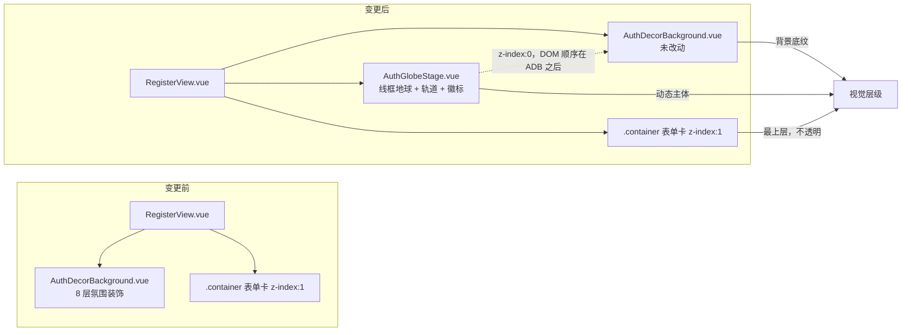
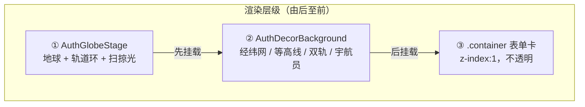

# 注册页新增动态线框地球（外部站点动效移植 + 浅色底适配）

- **日期与时间**：2026-10-27 09:30
- **任务等级**：L2（新增文件 + 功能开发）
- **版本**：并入 **V3.6.29**（与认证页装饰层、构建告警同批次合并发布）

---

## 一、问题分析

### 1.1 核心症状

注册页背景装饰（V3.6.29 落地的 `AuthDecorBackground`）虽有 8 层结构，但视觉上偏"静态底纹"：双轨椭圆、等高线、散点都是恒定或慢速运动，缺少一个**能被眼睛立刻抓住的动态主体**。对比外部二次开发站点（`http://39.105.147.13:8080`）的认证页，其左栏有一颗持续自转的线框地球，动态感明显更强。

### 1.2 根本原因

V3.6.29 的装饰语言是"氛围型"——所有元素都在同一视觉层级上平铺，没有主次。外部站点的做法相反：**只有一颗球**，其余元素（轨道、坐标徽标）都服务于它，视觉焦点唯一。

### 1.3 受影响模块

| 模块 | 影响 |
|---|---|
| `app/RegisterView.vue` | 挂载新装饰组件（1 行模板 + 1 行 import + 注释同步） |
| `app/components/AuthGlobeStage.vue` | 新建 |
| `Docs/Guide/frontend-structure.md` | 结构树登记 |
| `README.md` / `Docs/Guide/CHANGELOG.md` | 版本号与变更记录 |

**未受影响**：`AuthDecorBackground.vue` 一字未改（避免删除 V3.6.29 成果）；主题令牌、i18n、路由、后端均无改动。

---

## 二、方案对比与选型

### 2.1 待决问题

外部站点的效果挂在**深色左栏舞台**上（`.login-shell` 双栏 `1.1fr : minmax(400px,.9fr)`），而本页是**单列 440px 居中卡片 + 浅色底**。直接照搬不可行，需先定形态。

| 方案 | 内容 | 结论 |
|---|---|---|
| **A. 装饰层增强** | 保持单列布局，把地球作为新装饰层挂进现有背景 | **选定** |
| B. 分栏改版 | 引入 `.login-shell` 双栏 + 左品牌舞台，移动端折叠 | 否决：属页面结构变更（L3），且会推翻 V3.6.29 的双轨构图 |
| C. 整页替换 | 用外部站点的 `gis-stage` 整体替换 `AuthDecorBackground` | 否决：等于删除 V3.6.29 成果，违反 §2.4 |

### 2.2 A 方案内部的位置选型

| 位置 | 问题 |
|---|---|
| 卡片正后方居中 | 卡片不透明（`--bg-primary` + `box-shadow`），440×600 的卡片会吃掉球的中心；**扫掠光半径 62%~66% 恰好落在被遮挡区**，最漂亮的元素完全不可见 → 否决 |
| 左下角 | 与现有等高线（`--a` 组在左下）叠加，线稿互相干扰 → 否决 |
| **右下空场** | 球心 `76%/62%`，直径 `min(560px,40vw,70vh)`。球心在卡片右缘之外，扫掠光完整可见；与左下等高线、右上暖金光斑形成对角平衡 → **选定** |

### 2.3 移植成本的核心：配色

外部站点线稿为 `rgba(255,255,255,.13~.35)`，建立在 `#05304f → #0a5fa3` 深蓝渐变上。本页底色 `--bg-secondary`（`#f9f9f9`），白线**等于不可见**。故全部改走品牌色 alpha：

| 元素 | 外部站点 | 本项目（浅底） |
|---|---|---|
| 球面填充 | `#ffffff0a` | `rgba(--brand-primary-rgb, .04)` |
| 球体描边 | `#ffffff57` | `rgba(--brand-primary-rgb, .26)` |
| 经线 | `#fff3` | `rgba(--brand-primary-rgb, .18)` |
| 纬线 | `#ffffff24` | `rgba(--brand-primary-rgb, .12)` |
| 轨道虚线 | `#ffffff38` | `rgba(--brand-primary-rgb, .20)` |
| 卫星 | `#ffd166` | `var(--brand-gold)`（`#c9a227`） |

绿 / 蓝双主题通过 `--brand-primary-rgb` 自动联动，无需第二套样式。

---

## 三、模块关系（变更前后）



层级说明：`AuthGlobeStage` 与 `AuthDecorBackground` 同为 `position:absolute; inset:0; z-index:0`，靠 DOM 顺序决定前后（地球在后挂载 → 压在其上）；表单卡 `z-index:1`，永远在最前。

---

## 四、实施要点

### 4.1 三个关键实现

1. **椭圆伪造球体自转**
   经线本质是 `rx = R·cos(经度)` 的椭圆。只画 3 条（`rx` 94/62/30，`ry` 恒 94），整组绕中心旋转即产生"经线在转"的错觉——成本 3 个 `<ellipse>`，无需 WebGL / 纹理 / 球面投影。

2. **纬线只摆不转（成败关键）**
   若经纬同速旋转，画面是一块旋转的网格布。纬线保持 30s `alternate` 的 ±5° 慢摆，与经线 24s 自转形成"一静一动"，平面才被读作球体。

3. **conic-gradient 扫掠光**
   `conic-gradient` 画扇形 + `radial-gradient` 环形 mask 只留 62%~66% 半径。6s 一圈，比经线快 4 倍——**快慢差就是体积感**。比再画一条椭圆便宜得多。

### 4.2 三个必须做对的细节

| 细节 | 后果（做错时） |
|---|---|
| `<g>` 配 `transform-box: fill-box; transform-origin: center` | 默认绕 SVG 视口原点 (0,0) 旋转，整颗球被甩出画面 |
| 倾角与自转分属「外壳 / 内环」两层 | `@keyframes` 的 `transform` 覆盖静态 `rotate(-16deg)`，倾角丢失 |
| 脉冲环静态态 `opacity: 0` | 动效关闭时残留三个死环 |

### 4.3 移动端基线（§3 核对）

- 本层 `pointer-events: none` + `aria-hidden="true"`，非交互元素，不涉及 40px 触控目标
- 无 `min-width` 基准值，不存在窄屏溢出
- `≤1100px` 收径右移；`≤768px` 整层 `display:none`，判据与 `AuthDecorBackground` 一致（"卡片是否全屏"的布局问题，与输入设备无关）
- 动效全部包在 `@media (prefers-reduced-motion: no-preference)` 内

---

## 五、性能指标

未实测。该层为纯 CSS 合成动画（`transform` / `opacity` / `stroke-dashoffset` 以外的属性均不参与逐帧重排），无 JS 参与，无网络请求；`≤768px` 整层关闭。预期开销与现有 `AuthDecorBackground` 同级，**待实机用 DevTools Performance 面板核对**。

---

## 六、测试方案

### 6.1 Agent 已执行

| 项 | 命令 | 结果 |
|---|---|---|
| ESLint | `node node_modules/eslint/bin/eslint.js src/app/components/AuthGlobeStage.vue src/app/RegisterView.vue` | 0 problems |
| 结构树门禁 | `python Scripts/CheckStructureTree.py` | 文档条目 515 · 磁盘文件 515 · 漏登记 0 · 幽灵条目 0 |
| 配置登记门禁 | `python Scripts/CheckConfigRegistry.py` | B1~B4 / F1~F3 全通过，catalog 130 key |

**未执行**：`vite build`、`tsc --noEmit`（本次无 `.ts` 新增，SFC 无 `<script>` 块）、浏览器实机渲染。

### 6.2 待用户实机验证

1. `npm run dev` → 打开 `#/register`
2. **预期**：页面左下、宇航员脚下出现一颗持续自转的线框地球（大半沉在视口下沿，只露上半球）；经线在转、纬线在缓慢摆动；有一道品牌色扇形光沿球面顺时针扫过（6s 一圈）；球外有虚线轨道 + 金色卫星绕行
3. 切到蓝色主题（`[data-theme="blue"]`）→ 球体线稿应变蓝，金色卫星不变
4. 窗口拉到 `≤1100px` → 球应缩小并右移，仍不被卡片遮挡
5. 窗口拉到 `≤768px` → 整层消失（卡片已全屏）
6. 系统开启"减少动态效果" → 球体静止，无脉冲环、无扫掠光
7. DevTools Performance 录制 10s，确认无持续 layout / paint 尖峰

---

## 七、变更文件清单

| 文件 | 说明 |
|---|---|
| `frontend/src/app/components/AuthGlobeStage.vue` | **新增**。线框地球舞台（球体 / 扫掠光 / 脉冲环 / 轨道卫星 / 大气层），约 270 行 |
| `frontend/src/app/RegisterView.vue` | import + 模板挂载 `<AuthGlobeStage />`，同步两处注释 |
| `Docs/Guide/frontend-structure.md` | 结构树登记新组件；更新 `RegisterView.vue` 条目描述 |
| `README.md` | 版本号三处：项目简介行 / 版本演进表首行 / 页脚 |
| `Docs/Guide/CHANGELOG.md` | 顶部追加 V3.6.31 条目 |
| `Docs/LLM_record/26-10/2026-10-27/2026-10-27-register-globe-stage.md` | 本日志 |

---

## 八、遗留与风险

> 下列 1、2、3 条为**首次交付时**的状态，已在第九节的交付后调整中全部处置。

1. **视觉未实机确认**：`76%/62%` 的球心与 `min(560px,40vw,70vh)` 直径是按 1440×900 / 1280×800 推算的，若实际构图偏挤，调整 `.globe-stage__planet` 的 `left/top/width` 三值即可，不影响结构。
2. **与双轨的叠压关系待确认**：`AuthDecorBackground` 的 B 轨（700px 椭圆，环心 67%/46%）右缘会延伸到球体附近。已用 `.globe-stage__halo` 的大气层把球"垫"起来区分前后景，但若实测仍显拥挤，可选方案是给 `AuthDecorBackground` 加一个 `orbits` prop 按需关闭双轨（本次未做，避免改动 V3.6.29 成果）。
3. **坐标徽标为硬编码**：`116.391°E / 39.907°N` 与 `EPSG:3857 · L18` 是纯装饰文案，无业务含义，未走 i18n（数值型记号，语言无关）。若后续要求可配置，应改为 props。
4. **外部站点溯源**：其构建产物无版本字符串（入口 chunk 76KB 内检索 `3.6.x` 无命中），无法确认具体 fork 自哪个修订；`/register` 在该站点已重定向到 `/`，注册与登录合并为单页。

---

## 九、交付后调整（L1 零散修补，2026-10-27 09:22）

用户在首次交付后提出三项调整，均只落在 `AuthGlobeStage.vue` 单文件，无新增文件、无签名变更，按 §1 归 **L1**（文案删除 + 常量值调整）。因属同一交付周期且版本尚未提交，**版本号维持 V3.6.31 不递增**。

| # | 用户要求 | 实施 | 影响 |
|---|---|---|---|
| 1 | 废除两枚坐标徽标 | 删除 `.globe-stage__chip` 全部模板、样式与 `globe-chip-float` 关键帧 | 元素由 7 个减为 6 个；文件 400 → 270 行 |
| 2 | 整层透明度提高 | 新增 `--globe-opacity: 0.7`，在 `.globe-stage` 上 `opacity: var(--globe-opacity)` | 单一开关，0.5 / 0.7 / 1 三档可直接调 |
| 3 | 地球缩小并移到宇航员底部 | 球心 `76%/62% → 12%/96%`，直径 `min(560px,40vw,70vh) → min(340px,24vw,40vh)`；`≤1100px` 档同步改 `14%/96%`、`min(300px,26vw,36vh)` | 见下方定位依据 |
| 4 | 宇航员缺白色填充，需与底部地球区分 | ① `.auth-decor__suit` / `.auth-decor__glove` 填充由 `rgba(255,255,255,.78/.9)` 改为不透明 `#fff`；② `.auth-decor__astronaut` 加双层 `filter`（白色包边 + 落地投影）；③ `RegisterView` 把 `<AuthGlobeStage />` 调到 `<AuthDecorBackground />` **之前** | 涉及第二个组件文件；层级见下方 |
| 5 | 地球轨道太显眼，要与其他轨道一致 | `.globe-stage__orbit` 边框 alpha 由 `0.20` 降至 `0.10`（叠加整层 `opacity: .7` 后实际约 0.07）；用户后续自行回调至 `0.50` | 视觉权重与背景双轨拉齐 |
| 6 | 轨道"不旋转" | ① 虚线从父级 `border` 移到自转层 `.globe-stage__orbit-spin::before`——父级只有静态倾角、从不旋转，虚线画在父级上永远不会动；② 由 `1px dashed`（绕该直径约 280 段）改为 `repeating-conic-gradient` 36 段（10° 周期 / 3.2° 实线）+ `closest-side` 径向掩膜卡 1.3px 环带 | 根因是**高频虚线频闪混叠**，不是动画缺失 |
| 7 | `bottom: 0%` 但离屏幕底仍有大段距离 | `transform: translate(-50%, -50%) → translateX(-50%)`；窄屏档同步改为同一套 `left/bottom` 锚点（原为 `top: 96%` / `min(300px,…)`，会在 1100px 处跳变） | 见下方定位语义说明 |
| 8 | 轨道上的球体与轨道同速，要改差速 | ① 卫星从 `.globe-stage__orbit-spin` 拆到独立自转层 `.globe-stage__orbit-sat`，周期 **13s**（虚线环 20s，角速度 1.54 倍，会持续超越虚线）；② 经线自转 **24s → 32s**，与轨道环拉开 60% | 五个旋转周期两两不等，见下方速度表 |
| 9 | 增加流星效果 | 新增 `.globe-stage__meteors` + 3 道 `.globe-stage__meteor`：1.4px 短线、`linear-gradient` 尾端渐隐头端偏金、`translate3d` 斜向位移；单道周期 10s，仅前 12%（≈1.2s）可见，delay 0.5 / 3.9 / 7.3s 错峰 | 见下方节奏说明 |
| 10 | 三道太少、位置不够随机 | 扩到 **9 道**，按「近 / 中 / 远」三档分粗细（1px / 1.2~1.4px / 1.7px）、长度（62~168px）与亮度；起点横跨整幅、角度 23°~45°、**周期 7.6s~13.4s 两两不等** + 不规则 delay；可见窗口 12% → 15%；动画名改用长写属性挂载 | 见下方"随机"三要素 |

**第 10 项：为什么"随机"不能只改坐标**
只把 `top/left` 打散，眼睛仍会在十几秒内识别出节拍——因为所有道的**周期相同**，等于一支固定节拍的鼓点。真正的随机感需要三个维度同时变化：

| 维度 | 做法 |
|---|---|
| 位置 | 起点横跨整幅（含卡片后方，被表单卡自然遮住，出现"从面板后划出"的层次） |
| 形态 | 角度 23°~45°、长度 62~168px、粗细与亮度分三档（近大远小） |
| **时间** | 周期 3.8 / 4.1 / 4.85 / 5.05 / 5.65 / 5.95 / 6.05 / 6.4 / 6.7s 两两不等（初版为 7.6~13.4s，用户反馈"10s 太长"后整体减半），再叠不规则 delay |

**实现陷阱**：`animation` 是简写属性，会把 `animation-duration` / `animation-delay` 一并重置。动画名必须在 `@media (prefers-reduced-motion: no-preference)` 内用**长写**（`animation-name` / `animation-timing-function` / `animation-iteration-count`）挂载，各道的 `--dur` / `--delay` 才能生效。

**第 11 项：星座顶部被裁（`AuthDecorBackground`）**

现象：星座在部分窗口尺寸下被切在屏幕顶部之外。

根因不是坐标写错，而是 **`preserveAspectRatio="xMidYMid slice"` 的裁切**：

```
s = max(vw/1440, vh/900)
上下各裁掉（viewBox 单位）= (900 - 720 / 宽高比) / 2
```

| 视口 | 宽高比 | 上方裁切（viewBox 单位） | 星座顶部 y=74 的实际位置 |
|---|---|---|---|
| 1440×900 | 1.60 | 0 | 74 → 74px ✓ |
| 1920×1080 | 1.78 | 45 | 74−45 → 39px（几乎贴顶） |
| 2560×1080 | 2.37 | 146 | 74−146 → **−72，出屏** |

修法：按 `min-aspect-ratio` 分三档给 `.auth-decor__constellation` 加 `translateY`，抵消各档裁切量：

| 断点 | translateY（实装） | 该档裁切量 | 顶部留白 |
|---|---|---|---|
| ≥16:9 | 50px | 45 | ≈105px |
| ≥2:1 | 70px | 90 | ≈78px |
| ≥5:2 | 220px | 162 | ≈247px（余量偏大但安全） |

**覆盖边界**：`2:1` 档取 70px 时，宽高比超过约 2.2 会重新贴顶、超过 2.4 仍会出界；若要完整覆盖到 21:9（2.37），该档需 ≥130px。

**为什么不用 `preserveAspectRatio="xMidYMin slice"`**：那会把裁切全部推到底部，宇航员（`y 581~696`）在 21:9 上会被切掉下半身。分档平移只动星座，不影响其余元素。

**第 12 项：A 轨中环"不转"（`AuthDecorBackground`）**

现象：双轨各由三个同心环组成，A 轨的**中环**看起来不旋转。

排查结论：**动画没丢**——`.auth-decor__orbit--a .auth-decor__ring--mid { animation: auth-orbit-ccw 130s linear infinite }` 正常生效，六环全部有动画。真正的原因是**可感知性**：

| 环 | 边框 | 旋转是否可见 | 原因 |
|---|---|---|---|
| A 外 | `dashed` | ✅ | 虚线段沿圆周滑动 |
| **A 中** | **`solid`** | ❌ | 正圆实线，圆周完全对称，无任何可追踪特征点 |
| A 核 | `solid` | ❌ | 同上（用户暂未提及） |
| B 外 | `solid` | ❌ | 同上，但外环有 `::after` 公转点做线索 |
| B 中 | `dashed` 金 | ✅ | 虚线段滑动 |
| B 核 | `dotted` 金 | ✅ | 点沿圆周滑动 |

纹样 PNG 也救不了：它是高阶对称的花边，130s 一圈（2.8°/s）在对称图案上读不出位移。

修法：A 轨中环 / 核心环统一改 `dotted`，并把三环 alpha 对齐右侧 B 轨。

| 环 | 原 | 现 | B 轨对照 |
|---|---|---|---|
| A 外 | `dashed 0.32` | `dashed 0.38` | `solid 0.30` |
| A 中 | `solid 0.2`（后改 dotted 0.28） | `dotted 0.42` | `dashed 0.42` |
| A 核 | `solid 0.16`（后改 dotted 0.2） | `dotted 0.46` | `dotted 0.46` |

外环取 0.38 而非 B 的 0.30，是因为虚线本身墨量少于实线，同 alpha 下会显得更淡。

**结论**：A 轨内两环"不转"是**两个因素叠加**——实线圆旋转不可感知 + 点线 alpha 过低导致点本身看不见。只改线型不改 alpha，或只改 alpha 不改线型，都修不好。

**第 13 项：Landing 首屏三环同步改虚线（`LandingView.vue`）**

同一问题在首屏同心环上复现：

| 环 | 原 | 现 | 旋转周期 | 公转点 |
|---|---|---|---|---|
| outer | `dashed 0.26` | 不变 | 130s 顺 | 空心金点 69s |
| mid | `solid 0.18` | `dashed 0.24` | 70s 逆 | 实心金点 62s |
| inner | `solid 0.14` | `dashed 0.18` | 140s 顺 | **无** |

核心环最严重：既无公转点、alpha 又只有 0.14，整圈完全静止。中环虽有公转点提供运动线索，但环线本身不动仍会被读成"死环"。

alpha 各提一档抵消虚线墨量损失，仍保持 outer > mid > inner 的递减层次。窄屏断点（`max-width: 768px`）只覆盖 `border-color` 与尺寸，`dashed` 自动继承，无需重复声明；顺手把该处注释里过期的 `0.26/0.18/0.14` 更正为 `0.26/0.24/0.18`。

**第 9 项的节奏设计**：流星的关键不是"画一道亮线"，而是**长时间的空场**。若让亮线常驻或淡入淡出周期过短，视觉上会退化成装饰条纹，失去"划过"的瞬时感。故 `@keyframes globe-meteor` 只在 0%~12% 走完位移并淡出，12%~100% 保持 `opacity: 0`；三道按 10s 周期错峰约 3.4s，平均每 3.4s 有一道掠过，且任意时刻最多一道在飞。

**第 8 项的速度体系**（差速设计）：

| 元素 | 周期 | 说明 |
|---|---|---|
| 扫掠光 | 6s | 最快，负责"体积感" |
| 卫星 | 13s | 角速度是虚线环的 1.54 倍，沿轨道超越虚线 |
| 轨道虚线环 | 20s | 轨道本体 |
| 纬线摆动 | 30s | 只摆不转（±5° alternate） |
| 经线自转 | 32s | 最慢，与轨道环差 60% |

原问题有两个根因：卫星与虚线环同属一个自转层（刚性绑定，永远同速，看起来像"焊"在环上）；经线 24s 与轨道 20s 只差 20%，肉眼分辨不出。

**第 7 项的定位语义**：`bottom: 0` 先把元素**底边**贴到容器底部，随后 `translateY(-50%)` 又把它**向上**推半个球径。230px 球径时球底距屏幕底 115px、球心距底 230px，看起来像"离底很远"。

| 想要的形态 | 正确写法 |
|---|---|
| 球体底边正好压在屏幕底边（整球可见） | `bottom: 0` + `translateX(-50%)` ← **本次采用** |
| 球心落在屏幕底边（只露上半球） | `bottom: 0` + `translate(-50%, 50%)` |
| 球心钉在某个高度百分比 | 去掉 `bottom`，用 `top: X%` + `translate(-50%, -50%)` |

**定位依据（第 3 项）**：`AuthDecorBackground` 的宇航员写在 `<g transform="translate(118 586) scale(1.08)">`，外层 SVG 为 `viewBox="0 0 1440 900"` + `preserveAspectRatio="xMidYMid slice"`。按 1440×900 与 1280×800（scale 恰为 1 / 0.889，无裁切）换算，宇航员躯干 + 头盔的包围盒约 `x ∈ [102,195]`、`y ∈ [581,696]`，即**水平约 10% 宽、脚底约 77% 高**。球心取 `12%/96%`、直径 340px（r=170 ≈ 19% 高）时，球顶落在 77%，与脚底齐平——构图读作"人悬于星球之上"。球体大半沉在视口下沿，只露上半球。

**同时解决的副作用**：球移到左下后，与 `AuthDecorBackground` 的 B 轨（环心 67%/46%）彻底分离，原「与双轨叠压」风险（遗留 2）自然消解，无需再加 `orbits` prop。

**第 4 项的层级调整**：`AuthGlobeStage` 与 `AuthDecorBackground` 同为 `position:absolute; inset:0; z-index:0`，同层由 DOM 顺序决定前后。地球的轨道环直径是球体的 1.62 倍，会向上穿过宇航员躯干；若地球后挂载，虚线环会压在宇航员身上。故把 `<AuthGlobeStage />` 提到最前，形成「网格 → 地球 → 双轨 / 宇航员 → 卡片」的四层关系。



**宇航员的"实体感"来源**（第 4 项）：四肢在模板里是开放路径（`fill: none`，只有 stroke），无法靠 `fill` 变实心。改用 `.auth-decor__astronaut` 上的 `filter: drop-shadow(0 0 1.2px #fff)` —— 无偏移的白色投影等价于给所有描边加一道白色包边，四肢因此获得与躯干一致的实体感，且不必复制一份路径做描边层。第二层 `drop-shadow(0 2px 4px rgba(16,36,58,.18))` 提供落地投影，把人物从下方的线稿地球上分离，同时充当悬浮高度线索。

> **交付周期说明**：以上各项均为同一次交付内的迭代打磨，版本尚未提交，故统一并入 **V3.6.29**，不单独占用版本号（与 V3.6.27 合并两项改动的处理方式一致）。


---

## 十、收尾核对（DoD · 2026-10-27 10:32，版本合并为 V3.6.29 后）

- [x] 代码改动完成，遵守分层边界与单一职责（装饰层全部落在 `app/components/`，共享注入逻辑落在 `app/composables/`）
- [x] 新增 `.ts` 未引入类型错误（`useRingPatternStyle.ts` 通过 ESLint；本次无新增 `.ts`）
- [x] 新建逻辑文件为 `.ts`；两个 `.vue` 为纯视觉组件，非逻辑文件，无需说明动机
- [x] 维护日志按第 6 节写全章节（本文件）
- [x] 根 `README.md` **三处**版本号已更新为 `V3.6.29`（简介行 / 版本演进表首行 / 页脚）
- [x] `Docs/Guide/CHANGELOG.md` 已追加条目（原 3.6.29 / 3.6.30 / 3.6.31 三条合并为一条 `V3.6.29`）
- [x] 涉及文件增删 → `frontend-structure.md` 已同步（新增 `AuthDecorBackground.vue` / `AuthGlobeStage.vue` / `useRingPatternStyle.ts`）
- [x] 未新增配置 key，`deploy/.env.example` 与 `backend/config/catalog.py` 无需改动
- [x] 涉及 UI → 移动端基线已核对：`index.html` viewport 含 `shrink-to-fit=no, viewport-fit=cover`；全局 `text-size-adjust: 100%` + `overflow-x: clip` 生效；本次新增元素全部 `pointer-events: none`、不产生触控目标，`pointer: coarse` 档不适用；未改动面板 `min-width`
- [x] 不涉及场景数据加载，TOC / `loadedDataSources` 契约不适用
- [x] 门禁脚本全部通过：`CheckStructureTree` 515/515（漏登记 0 / 幽灵条目 0）、`CheckConfigRegistry` B1~B4 + F1~F3 全绿
- [x] 未执行任何 Git 写操作
- [x] 平台红线自查（§11.2 四条）已执行且全绿：R1 无命中；R2 无命中（`maxRayDistance` 属子串误报）；R3 无命中（`.venv` 内 uvicorn 的 `start_keepalive` 为三方库，已排除）；R4 生产基线未被破坏
- [x] 已输出第 8 节交接块

### 本次审查发现并修复的注释漂移（5 处）

1. `AuthGlobeStage.vue` 头部注释「V3.6.31 起挂在注册页」→ V3.6.29
2. `RegisterView.vue` 装饰层注释仍列「坐标徽标」→ 改为「流星」
3. `LandingView.vue` 中环注释写死 `0.18 → 0.24`、内环 `0.14 → 0.18`、外环 `0.26` → 改为定性表述（实际已调为 0.5 / 0.34 / 0.28）
4. `AuthDecorBackground.vue` A 轨注释写死「中 0.42 / 核 0.46 / 外 0.38」→ 改为定性表述（实际 0.58 / 0.42 / 0.36）
5. `frontend-structure.md` 的 `AuthGlobeStage` 条目仍写「球心 12%/96%」「收敛到 0.7」且漏记流星 → 改为 `left 9% + bottom 0`、直径 230px、九道流星 3.8~6.7s

> 说明：alpha 与周期均为手工调参值，注释一律改为描述**关系**（如「虚线墨量约为实线一半，故 alpha 上调」）而非具体数字，避免下一次调参再次产生漂移。
