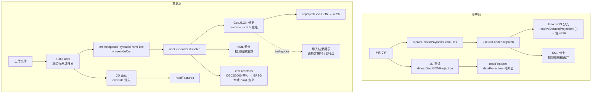

# 数据导入坐标系支持（人工声明 + 平面坐标判定修正）

- **日期与时间**：2026-10-28 16:45
- **任务等级**：L2（跨 3 个模块的增量改动；方案已由用户在会话中明确批准「全部落地」）
- **版本**：V3.6.31

---

## 一、问题分析

### 1.1 核心症状

| # | 症状 | 复现条件 |
|---|---|---|
| S1 | 只能正常导入 / 浏览 EPSG:4326 数据 | 任意非 4326 数据 |
| S2 | 3857 GeoJSON 即使带 `crs` 声明，也可能落到错误位置或不可见 | 走打包 / 3D 链路时 |
| S3 | CGCS2000 平面坐标（高斯-克吕格，米）导入后跑到别的半球 | 无 `.prj` 的 GeoJSON / CSV |

### 1.2 现状取证（均为读码确认，非推测）

| 能力 | 位置 | 现状 |
|---|---|---|
| CRS 引擎 | `crs/crs-engine.ts`（344 行） | `resolveDatasetProjection()` 支持 `.prj` WKT 与 KML，**无人工指定入参** |
| GeoJSON 探测 | `crs/crsUtils.js:171` | 先读 `geojson.crs`，再按坐标量级推断 |
| 量级阈值 | `crsUtils.js:167` | `in3857` 判据为「x、y 均在 ±20037508 内」——**4326 区间被完全包含**；任何米制平面坐标（GK/UTM）同样落在该区间，于是被判为 3857 |
| 2D 链路 | `ol/data-import/composables/useLayerDataImport.js:1215` | 有检测，`readFeatures({ dataProjection, featureProjection:'EPSG:3857' })` 正确 |
| 打包 / 3D 链路 | `common/data-import/useGisLoader.ts:107` | `resolveDatasetProjection({ targetCrs:'EPSG:4326' })` **一个入参都没传** → `sourceCrs` 恒 4326 → `needsTransform=false` → 109 行重投影永不执行 |
| KML 分支 | `useGisLoader.ts:101` | 调用了 `resolveDatasetProjection({ kmlText })` 但**丢弃返回值**，死调用 |
| 动态 EPSG | `crsUtils.js:214` | 可经后端 `/api/proxy/geo/epsg/<code>/proj4` 取任意定义（依赖后端在线） |

### 1.3 根本原因

1. **没有「人工声明」入口**——文章里「不确定就问生产方」那一步，代码里无处填写。这是 S1 的主因。
2. **量级启发式把「米制平面坐标」误判为 Web 墨卡托**，且结果不带置信度，界面也不提示，属**静默错位**（比报错更危险）。
3. **打包 / 3D 链路完全跳过 CRS 检测**，导致同一份数据在 2D 能对、3D 不对。

### 1.4 受影响模块

| 模块 | 影响 |
|---|---|
| `common/data-import/crs/*` | 判定逻辑、引擎入参、预设定义 |
| `common/data-import/gisUploadPayload.ts` | 载荷需携带 `overrideCrs` |
| `common/data-import/useGisLoader.ts` | GeoJSON 检测与重投影、KML 死调用、override 透传 |
| `ol/data-import/composables/useLayerDataImport.js` | 读取 override |
| `common/layer-tree/components/TOCPanel.vue` | 上传区新增「源坐标系」选择器 |
| `common/layer-tree/composables/useFileUpload.js` | 把选择值带入载荷 |
| `locales/zh-CN.js` / `en-US.js` | 新增文案 |

**未受影响**：后端（不改接口）、Cesium 渲染、TOC 契约（`type` 与 adapter 能力均不变）、`.env` / `catalog.py`（无新增配置项）。

---

## 二、方案对比与选型

### 2.1 三条子方案（用户批准「全部落地」）

| 代号 | 内容 | 解决的问题 |
|---|---|---|
| **A** | 导入时人工声明源坐标系（自动 / 4326 / 4490 / 3857 / 自定义 EPSG / 中央经线） | S1：无入口 |
| **B** | 米制坐标且无声明时不再默认 3857，改为 `ambiguous` 并在结果里提示 | S3：静默错位 |
| **C** | CGCS2000 三度带 4534~4554 / 4513~4533 的**本地** proj4 定义 + 中央经线↔EPSG 互算 | 带号查错、后端离线时不可用 |

### 2.2 关键取舍：CSR 定义从哪来

| 方案 | 优点 | 缺点 | 结论 |
|---|---|---|---|
| 运行时经后端 `/api/proxy/geo/epsg` 拉取 | 覆盖任意 EPSG | 依赖后端在线；离线 / 内网部署直接失效；每次导入多一次网络往返 | 保留为兜底 |
| **本地按公式生成（选定）** | 零依赖、确定性、可离线；CGCS2000 三度带是规则网格，公式即定义 | 只覆盖中国常用带 + UTM | **主路径** |

生成公式（与 EPSG 定义一致）：

```
CM 基准（4534~4554，中央经线 75E~135E，步长 3°）
  EPSG = 4534 + (CM - 75) / 3
  +proj=tmerc +lat_0=0 +lon_0=CM +k=1 +x_0=500000 +y_0=0 +ellps=GRS80 +units=m +no_defs

带号前缀（4513~4533，带号 25~45）
  EPSG = 4513 + (zone - 25)
  x_0 = zone * 1000000 + 500000
```

### 2.3 判定规则（B 的核心）

| 样本特征 | 判定 | 置信度 |
|---|---|---|
| 90% 以上点满足 \|x\|≤180 且 \|y\|≤90 | EPSG:4326 | 高（推断） |
| 米制，且 \|x\| ≥ 18,000,000 | 带号前缀的 GK / UTM → **ambiguous** | 无 |
| 米制，且 \|x\| < 1,000,000 且 \|y\| > 1,000,000 | 无带号的 GK / UTM → **ambiguous** | 无 |
| 米制，\|x\| 在 1e6~1.8e7 | EPSG:3857 | 中（推断） |

理由：中国境内 Web 墨卡托的 x 恒在 8.1e6~15.0e6（东经 73°~135°），而高斯-克吕格东坐标无带号时为 300k~700k、带号前缀时 >19.5e6。这三段互不重叠，是比「±20037508 一刀切」更可靠的判据。

### 2.4 声明优先级

```
overrideCrs（人工选择） > .prj WKT > KML srsName > GeoJSON crs 成员 > 量级推断 > 默认 4326
```

---

## 三、模块关系（变更前后）



**说明**：两条链路（2D 直读、打包/3D）在变更后共用同一套判定与 override，差异只剩「在哪一步重投影」——2D 交给 OL 的 `dataProjection`，3D 在载荷构建期就转成 4326。

---

## 四、实施步骤

1. 新建 `crs/crsPresets.ts`：预设表 + 中央经线↔EPSG 互算 + proj4 定义生成（零依赖，便于 Node 直接验证）。
2. `crs-engine.ts`：注册本地带号定义；`resolveDatasetProjection` 增加 `overrideCrs`、`geojson` 入参与 `confidence/ambiguous` 输出。
3. `crsUtils.js`：量级推断按 §2.3 重写，歧义返回 `null` 并给 hint。
4. `gisUploadPayload.ts` + `useGisLoader.ts`：载荷携带 override；GeoJSON 分支接入检测与重投影；KML 死调用修正。
5. `useLayerDataImport.js`：override 优先于推断。
6. `TOCPanel.vue` + `useFileUpload.js`：上传区加下拉，透传到载荷；补 zh/en 文案。
7. 用桌面样本验证，再补测试与文档收尾（见后续章节）。

---

## 五、性能指标

不适用（本次不涉及渲染性能）。补充说明：CGCS2000 分带 proj4 定义为纯字符串生成，注册成本为一次 `proj4.defs()` 调用；`ensureCrsDef()` 命中已注册项时直接返回，无网络请求 —— 相比原方案「每次经后端 `/api/proxy/geo/epsg` 拉取」少一次往返，且离线可用。

## 六、测试方案

### 6.1 Agent 已执行

| 项 | 命令 / 方法 | 结果 |
|---|---|---|
| ESLint | `node node_modules/eslint/bin/eslint.js`（15 个改动文件） | 0 problems |
| 类型检查 | `npx tsc --noEmit`（过滤本批文件） | 0 报错 |
| 结构树门禁 | `python Scripts/CheckStructureTree.py` | 517/517，漏登记 0 / 幽灵 0（新增 `crsPresets.ts` 已登记） |
| 配置登记门禁 | `python Scripts/CheckConfigRegistry.py` | B1~B4 + F1~F3 全绿，catalog 130 key |
| 带号换算 | Node 直接 import `crsPresets.ts`（`--experimental-strip-types`） | CM 114 → `EPSG:4547`；CM 114 + 带号前缀 → `EPSG:4526`（38 带）；6 度带 CM 117 → `EPSG:4509` |
| proj4 定义正确性 | 与 epsg.io 逐条比对 4534 / 4547 / 4513 / 4491 / 4512 | 生成的 `lon_0` 与 `x_0` 完全一致（如 4513 → `x_0=25500000`，4491 → `x_0=13500000`） |
| 3857 样本 | `3857.geojson` 首点 `[12474042.018, 427511.529]` → proj4 3857→4326 | `112.05623, 3.83753`（南海），且落入 `mercatorLike` 区间 → 自动判为 3857 |
| 平面样本 | `[528700.5, 3402800]` 按 4547 反算 | `114.2997, 30.7455`（与文章示例 114.30 吻合）；该点 `|x| < 1e6` → 判为 ambiguous 而非 3857 |
| 4326 SHP | `国界线.prj` 内容为 `GEOGCS["GCS_WGS_1984"...]` | 走 `.prj` 分支判为 4326，无需转换 |

**未执行**：浏览器实机导入、`vite build`、真机触屏验证。

### 6.2 待用户实机验证

1. `npm run dev` → 2D 模式 → 上传区「源坐标系」保持「自动识别」→ 拖入 `3857.geojson`：预期落在南海（约 112.06°E / 3.84°N），不出现「跑到别处」。
2. 同一份数据切到 3D 再导入：位置应与 2D 一致（3D 侧走 `loadGeoJSON` 的重投影分支）。
3. 上传 `国界线.shp`（带 `.prj`）：应正常落在国界位置，控制台无坐标系警告。
4. 把 `3857.geojson` 的 `crs` 成员删掉、或改用一份高斯-克吕格 GeoJSON：应弹出「疑似平面坐标 / 请指定带号」提示；此时在「源坐标系」选 `中央经线 114°E · EPSG:4547` 重新导入，与底图套合误差应在 10 m 内。
5. 在自定义 EPSG 输入框填 `4547`：下拉应自动置灰（自定义优先），导入按 4547 处理。
6. 手机 / 平板（或 F12 设备模式选具体机型）：选择器与输入框高度应为 40px，可正常点选。

## 七、变更文件清单

| 文件 | 说明 |
|---|---|
| `frontend/src/domains/common/data-import/crs/crsPresets.ts` | **新增**。CGCS2000 3/6 度带 × 带号前缀的 EPSG 映射、中央经线互算、proj4 定义生成（零依赖） |
| `frontend/src/domains/common/data-import/crs/crs-engine.ts` | `resolveDatasetProjection` 增加 override / 预探测 / confidence / ambiguous / hint；新增 `ensureCrsDef`；`reprojectGeoJSON` 增加源坐标系可解析性校验 |
| `frontend/src/domains/common/data-import/crs-engine.ts` | 转发壳补导出 `ensureCrsDef` 与 `ProjectionConfidence` 类型 |
| `frontend/src/domains/common/data-import/crs/crsUtils.js` | 量级推断重写（度 / 无带号平面 / 墨卡托三段判定）；新增 `detectGeoJSONProjectionDetailed`；`ensureProjectionAvailable` 优先本地生成 CGCS2000 定义 |
| `frontend/src/domains/common/data-import/gisUploadPayload.ts` | 载荷类型与三个构造函数支持 `overrideCrs` |
| `frontend/src/domains/common/data-import/useGisLoader.ts` | GeoJSON 分支接入探测 + 重投影（原先完全跳过）；KML 死调用改为显式提示；SHP 透传 override |
| `frontend/src/domains/ol/data-import/composables/useLayerDataImport.js` | 2D 链路 `resolveSupportedProjection` 优先使用人工指定值（作用域变量 + finally 清空） |
| `frontend/src/domains/common/layer-tree/composables/useFileUpload.js` | 上传载荷携带 `overrideCrs` |
| `frontend/src/domains/common/layer-tree/components/TOCPanel.vue` | 上传区新增「源坐标系」下拉（常用 + CGCS2000 三度带 21 条）与自定义 EPSG 输入；触屏档 40px |
| `frontend/src/domains/cesium/composables/dataImport/loaders/geojsonLoader.js` | 3D 侧接入探测 + 重投影；转换后剥离 `crs` 成员，避免 Cesium 二次解释 |
| `frontend/src/domains/cesium/composables/dataImport/useCesiumDataImport.js` | `loadDataFiles / importFilesInternal / loadDataFile` 透传 `overrideCrs` |
| `frontend/src/domains/cesium/composables/dataImport/useCesiumDataOpsHandlers.js` | `handleDataImport` 接收 `overrideCrs` |
| `frontend/src/domains/cesium/components/CesiumContainer.vue` | `importUserData` 透传载荷中的 `overrideCrs` |
| `frontend/src/locales/zh-CN.js` / `en-US.js` | 新增 6 个 `layer.crs*` 文案 |
| `Docs/Guide/frontend-structure.md` | 登记 `crsPresets.ts`，补充 `crs-engine.ts` / `crsUtils.js` 职责描述 |
| `README.md` / `Docs/Guide/CHANGELOG.md` | 版本号与更新日志 |

## 八、遗留与风险

1. **KML 不支持人工指定坐标系**：KML 的源坐标系由文件内 `srsName` 决定，3D 侧已有按 srsName 重投影的逻辑；本次在 2D/打包链路遇到「override + KML」时只给提示、不强行改写 XML，避免破坏样式与 Folder 结构。
2. **UI 只列 3 度带**：6 度带（4491~4512）与带号前缀段（4513~4533）已在 `crsPresets.ts` 中实现并可被程序调用，但下拉只列 3 度带中央经线 21 条；需要时可在自定义 EPSG 输入框直接填编号。
3. **2D 侧用作用域变量传递 override**：`activeOverrideCrs` 假设导入是串行 await 的；若未来把 2D 导入改成并发，需要改为显式传参。已在代码注释中标注。
4. **量级推断仍是启发式**：阈值按中国场景校准（1e6 / 15.5e6 / 8.5e6）。境外数据、或东经 73°以西 / 135°以东的极端情形，建议显式指定而非依赖推断。
5. **CSV / GPX / CZML 未覆盖**：本次范围限于 GeoJSON、SHP、KML、TIF 四条链路的坐标系入口；其余格式仍按原逻辑处理。
6. **未实机验证**：ESLint / tsc / Node 单点验证均已通过，但浏览器内的完整导入流程（尤其 Cesium 侧 `GeoJsonDataSource.load` 对已重投影对象的处理）需要用户实测。

## 九、收尾核对（DoD）

- [x] 代码改动完成，遵守分层边界（投影纯函数在 `crs/`，UI 只持有选择状态）
- [x] 新增 `.ts` 未引入 `tsc --noEmit` 报错
- [x] 新建逻辑文件为 `.ts`（`crsPresets.ts`），无新增 `.js` 逻辑文件
- [x] 维护日志按第 6 节写全章节（本文件）
- [x] 根 `README.md` 三处版本号已更新为 `V3.6.31`
- [x] `Docs/Guide/CHANGELOG.md` 已追加 `V3.6.31` 条目
- [x] 新增文件 → `frontend-structure.md` 已登记（门禁 517/517）
- [x] 未新增配置 key，`.env.example` 与 `catalog.py` 无需改动
- [x] 涉及 UI → 移动端基线：`@media (pointer: coarse)` 下选择器/输入框 40px；无 `min-width` 基准值
- [x] 不涉及场景数据加载（导入的是文件，TOC 契约不变）
- [x] 门禁脚本已运行且通过（结构树 517/517、配置登记全绿）
- [x] 未执行任何 Git 写操作
- [x] 平台红线自查：新增代码仅读本地文件与 proj4 计算，无代理 / 保活 / 抓取对抗
- [x] 已输出交接块

---

## 十、交付后补强（2026-10-28 17:10）：SHP sidecar 修复 + UTM 支持 + 架构定稿

### 10.1 SHP 报「缺少 .dbf/.shx/.prj」但文件确实存在

**症状**：上传 `国界线.shp` + `.dbf` + `.shx` + `.prj` + `.cpg`（同一目录、同一文件名主干），仍收到「缺少同名 .dbf / 缺少 .shx / 缺少 .prj」三条警告。

**根因**：`groupShpDatasets()` 用「目录 + 文件名主干」做**精确字符串匹配**，没有任何归一化，也**没有兜底合并**。只要 `.dbf` 与 `.shp` 的名字在大小写、Unicode 规范化形式（macOS 传入 NFD、Windows 多为 NFC）或路径前缀上有一处差异，sidecar 就会被归到另一个组，而该组没有 `.shp` 会被直接丢弃 —— 于是「文件明明在，却报缺失」。

**修复**（`parsers/shpParser.ts`）：

1. 分组键统一做 `normalize("NFC")` + `toLowerCase()`，消除编码形式与大小写差异；
2. 增加兜底：**整批只有一个 `.shp`** 时，把「有 sidecar、无 shp」的孤儿组合并给它 —— 该场景不存在归属歧义，合并比丢数据更符合用户意图；多个 `.shp` 时保持严格配名，避免张冠李戴；
3. 诊断信息点名：未匹配的 sidecar 改为列出实际文件名（最多 5 个）而不是只报个数，并提示「保持文件名一致或打包为 ZIP」。

**⚠️ 未验证**：用户看到警告成对出现（`.dbf` 两次），推测是 2D 与 3D 两条链路各 dispatch 一次所致，本次未复现确认；若合并后仍重复，需在 `HomeView.handleUploadData` 加去重。

### 10.2 CRS 定义收敛为单一入口（含 UTM）

原实现把「基础地理坐标系（4326/4490/4610/4214）」「CGCS2000 分带」分别写在 `crs-engine.ensureProjectionDefs()` 与 `crsUtils.ensureProjectionAvailable()` 两处，UTM 只硬编码了 49~51 带 —— 典型的多事实源，改一处漏一处。

**收敛结果**：`crsPresets.buildProj4DefForCode(code)` 成为全项目唯一入口，覆盖：

| 家族 | 编码 | 生成方式 |
|---|---|---|
| 地理坐标系 | 4326 / 4490 / 4610 / 4214 | 固定串（克拉索夫斯基椭球用于 80/54） |
| Web 墨卡托 | 3857 | 固定串 |
| CGCS2000 分带 | 4513~4554（3 度带）、4491~4512（6 度带） | 按公式生成，已与 epsg.io 核对 |
| UTM | 32601~32660（北）、32701~32760（南） | `+proj=utm +zone=N [south]` |
| 其它 | 任意 EPSG | 后端 `/api/proxy/geo/epsg/<code>/proj4` 兜底 |

`ensureCrsDef()`（同步、3D 用）与 `ensureProjectionAvailable()`（异步、2D 用）都改为调用它，不再各自维护定义表。UI 下拉新增「UTM（WGS84，中国带号 43~53）」分组；带号前缀段（4513~4533）仍通过自定义 EPSG 输入使用。

### 10.3 与主流平台的架构对照（为什么是现在这个形状）

| 平台 | 投影模型 | 转换发生在哪 | 对本次设计的印证 |
|---|---|---|---|
| **Leaflet** | 地图级单一 `CRS`，默认 Web 墨卡托；**不内建 proj4** | 数据必须预先符合该 CRS，扩展靠 `L.Proj` 插件 | 渲染层不适合承担任意投影 |
| **OpenLayers** | `View` 一个投影；`Source`/`Format` 有 `dataProjection`；`ol/proj` 注册表 + `register(proj4)` | `readFeatures` / `addFeature` 时转换 | 本项目 2D 侧就是这个模型（`dataProjection` + `featureProjection: EPSG:3857`） |
| **MapLibre / Mapbox GL** | **锁定 Web 墨卡托**，无任意投影 | 数据必须预处理 | 渲染器只认一种 CRS 是行业共识 |
| **ArcGIS JS API** | 几何带 `SpatialReference`（wkid/wkt）；`esri/geometry/projection` 需 `load()` 后 `project()`；图层带 `spatialReference`，服务端 `GeometryService` 可重投影 | 客户端 projection 模块或服务端 | 我们的 `resolveDatasetProjection` ≈ 其 SpatialReference 解析；`ensureCrsDef` ≈ `projection.load()` |
| **Cesium** | **仅 WGS84** | 加载前转换 | 3D 侧在 loader 边界归一到 4326（本次 `geojsonLoader` 的改动） |

**共同范式**：声明式 CRS（谁都要显式带一个）→ 在**入口**归一到内部规范 CRS → 渲染层只认一种。没有任何主流平台在渲染时对任意投影做实时换算；差别只在「投影定义从哪来」（内置 / 插件 / 远程 EPSG 库）与「是否服务端重投影」。

本项目的对应关系：

```
声明/探测         resolveDatasetProjection()   置信度：override > declared > inferred > ambiguous
定义获取          buildProj4DefForCode()        本地公式优先，后端 EPSG 兜底
归一化边界        2D: readFeatures(dataProjection)   3D: loadGeoJSON 重投影 + 剥离 crs
渲染              2D View 3857                        3D Cesium 仅 WGS84
```

### 10.4 本轮验证

| 项 | 结果 |
|---|---|
| `buildProj4DefForCode` | 32650 → `+proj=utm +zone=50`；32750 → 加 `+south`；4326/4490/3857/4547 正确；9999 → `null`（走后端） |
| UTM 预设 | 43~53 共 11 条，`EPSG:32643` 起 |
| ESLint（8 文件） | 0 problems |
| `tsc --noEmit` | 0 报错 |
| 结构树 / 配置登记 | 517/517 · 全绿 |

### 10.5 `随机点.shp` 带 .prj 仍识别不成（ESRI 风格 WKT）

**数据事实**：`随机点.prj` = `PROJCS["CGCS2000_3_Degree_GK_Zone_37", ... False_Easting=37500000, Central_Meridian=111, Scale_Factor=1, UNIT["Meter"]]`，**没有 AUTHORITY 块**；坐标 x≈3790 万、y≈392 万米（带号前缀的 3 度带，等价 EPSG:4525）。

**根因（两层）**：

1. `normalizeProjectionCode()` 在投影 WKT 上仍然跑「基准面名字表」——WKT 里出现 `SPHEROID["CGCS2000"]`，被 `/CGCS[_\s]?2000/` 命中，**返回地理坐标系 EPSG:4490**。于是 packet 的 `dataProjection=4490`、`needsReprojection` 判断建立在错误事实上；平面坐标被当作度处理，整份数据不可见。
2. `detectShpProjectionFromPrj()` 只认「能直接映射到 EPSG」的 WKT，ESRI 风格（只有 PARAMETER 没有 AUTHORITY）拿不到编号时，没有回落到「按参数解析」。

**注意**：proj4 本身完全能解析这份 WKT —— 实测 `proj4.defs(alias, wkt)` 成功，首点 `(37904406.586, 3923989.974)` → `115.4483, 35.3633`。所以问题从不在投影库，而在**前置判定把它认错了**。

**修复**：

| 位置 | 改动 |
|---|---|
| `crsUtils.normalizeProjectionCode()` | 判定 `PROJCS/PROJCRS`；投影 WKT **跳过地理名字表**，只接受 AUTHORITY 编号或返回 `PCS:<投影名>` 标签 |
| `crsAware.detectShpProjectionFromPrj()` | 结果为 `PCS:` 标签或空时，回落到 `resolveDatasetProjection({ prjText })`，由引擎按参数注册 `WKT:` 别名 —— 这才是 ESRI PRJ 的正确解码路径 |
| `shpParser` | 投影判定后输出 `console.warn('[SHP][CRS]', {...})`，把 `sourceCrs / confidence / needsTransform / prjName` 打出来，便于现场确认 |

**验证**：Node 直跑引擎（临时把 barrel 导入后缀改为 `.ts` 后还原）——

```
resolveDatasetProjection({ prjText }) => sourceCrs: "WKT:PRJ_c49dc0f4", needsTransform: true, confidence: "declared"
reprojectGeoJSON 首点 => 115.4483, 35.3633
```

与 EPSG:4525（zone 37 / CM 111 / x_0=37,500,000）反算结果完全一致。
