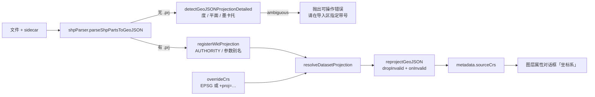

# 坐标系能力对齐 mapshaper（缺 CRS 不静默 + PROJ 串 + 逐要素降级 + sourceCrs 可见）

- **日期与时间**：2026-10-28 17:35
- **任务等级**：L2（跨 5 个模块的增量改动）
- **版本**：V3.6.31（提交前按用户要求把 V3.6.31 / V3.6.32 两个未提交条目合并为一个版本号，详见同目录 `2026-10-28-stage-review-version-merge.md`）
- **前置**：`2026-10-28-crs-import-override.md`（V3.6.31 建立的人工声明与判定链路）

---

## 一、问题分析

### 1.1 触发点

对照 mapshaper 源码（`src/crs/`、`src/commands/mapshaper-proj.mjs`、`src/shapefile/shp-import.mjs`）后发现四条差距：

| # | 差距 | mapshaper 的做法 |
|---|---|---|
| D1 | SHP 缺 `.prj` 时静默按 4326 处理 | `if (!srcInfo.crs) stop("Unable to project -- source coordinate system is unknown")` |
| D2 | 导入后无法复核「到底判成了什么 CRS」 | `dataset.info.crs` 常驻，`-info` 可打印 |
| D3 | 自定义输入只接受 EPSG | 接受 PROJ 串 / EPSG / ESRI / 别名 |
| D4 | 单个坏点导致整批失败 | 按弧段丢弃并计数：`Removed N paths containing unprojectable vertices` |

### 1.2 根本原因（本仓）

1. `registerWktProjection('')` 在**没有 `.prj`** 时直接返回 `EPSG:4326`，语义上把「未知」当成「已知」，掩盖了缺失（D1 的根）。
2. SHP 链路从不做坐标量级推断 —— GeoJSON 有 `detectGeoJSONProjection`，SHP 没有（V3.6.31 只补了 GeoJSON）。
3. `reprojectGeoJSON` 的坐标变换不校验结果，坏点直接写回 NaN（D4）。
4. `resolveDatasetProjection` 只认 EPSG / WKT / KML，PROJ 串会被 `normalizeCrs` 大写破坏（D3）。

---

## 二、方案与实施

### 2.1 D1：缺 CRS 不再静默

- `registerWktProjection('')` 改为返回**空编码**，让上层继续走 KML / 预探测 / 人工指定，最终落到 `default` 或 `ambiguous`。
- `shpParser` 在无 `.prj` 时对解析结果跑 `detectGeoJSONProjectionDetailed()`：
  - 落在经纬度范围 → 4326（`inferred`）；
  - 米制且像平面坐标 → `ambiguous` → **抛出可操作错误**：「检测到平面坐标……请在导入区『源坐标系』指定带号或 EPSG 后重试」。
- 与 mapshaper 的 `stop()` 同构：**宁可失败，不可错位**；差别是我们把「怎么修」写进了错误文案。

### 2.2 D2：sourceCrs 可见

- `shpPacketBuilder` 的 packet 增加 `sourceCrs`（与 `dataProjection` 同源）。
- 2D 入 TOC 时写入 `metadata.sourceCrs`。
- `LayerPropertiesDialog` 的「坐标系」行优先展示 `metadata.sourceCrs`，回退到原先的 `raw.crs → EPSG:4326`。

### 2.3 D3：PROJ 串

- `crsPresets` 新增 `isProj4String()` 与 `projDefinitionAlias()`（FNV-1a 散列 → `PROJ:xxxxxxxx`）。
- `crs-engine.ensureCrsDef()` / `resolveDatasetProjection()` / `crsUtils.ensureProjectionAvailable()` 三处均支持 `+proj=…`：先注册别名，再按别名转换。
- **踩坑**：`normalizeCrs()` 会把编码整体大写，而别名是小写哈希，导致 `proj4.defs()` 查不到；修正为「前缀大写 + 散列小写」`PROJ:4b4b248d`。
- UI 输入框去掉 `inputmode="numeric"`，placeholder 改为「EPSG 或 +proj=…」。

### 2.4 D4：逐要素降级

- `reprojectGeoJSON(geojson, src, dst, { onInvalid })`：
  - 坐标非有限，或目标为 4326 时超出 ±180/±90 → 该点标记无效；
  - 含无效点的要素**整体丢弃**（不留半条几何），统计进 `ReprojectStats`；
  - 通过 `onInvalid` 回调上报，`shpParser` 据此 `message.warning("...有 N 个要素落在有效范围外，已跳过")`。
- 范围校验只在目标为 4326 时启用 —— 3857 的坐标本就上千万，不能用经纬度阈值判断。

---

## 三、模块关系

---

## 四、测试方案

### 4.1 Agent 已执行

| 项 | 方法 | 结果 |
|---|---|---|
| PROJ 串覆盖 | `resolveDatasetProjection({ overrideCrs: '+proj=tmerc … lon_0=111 x_0=37500000' })` | `PROJ:4b4b248d`，`needsTransform: true` |
| PROJ 串转换 | 同上前提，`(37904406.586, 3923989.974)` | `115.4483, 35.3633`（与 EPSG:4525 一致） |
| 无 prj 语义 | `resolveDatasetProjection({ targetCrs: 'EPSG:4326' })` | `source EPSG:4326 / confidence default`（不再是 `declared`） |
| 逐要素降级 | 3857→4326，混入 `(999999999, 999999999)` | `{droppedFeatures:1, invalidPoints:1}`，剩余 1 个要素 |
| ESLint | 9 个改动文件 | 0 problems |
| `tsc --noEmit` | 过滤本批文件 | 0 报错 |
| 结构树 / 配置登记 | 两个门禁脚本 | 517/517 · 全绿 |

**未执行**：浏览器实机导入、`vite build`。

### 4.2 待用户实机验证

1. 把 `随机点.prj` 临时改名后再导入 `随机点.shp`：应弹出「检测到平面坐标……请指定带号或 EPSG」，而不是静默错位。
2. 同一文件在「源坐标系」选 `中央经线 111°E`（EPSG:4525）重试：应落在 115.448/35.363。
3. 自定义输入填 `+proj=tmerc +lat_0=0 +lon_0=111 +k=1 +x_0=37500000 +y_0=0 +ellps=GRS80 +units=m`：效果应与选 4525 相同。
4. 打开该图层「属性」：坐标系一行应显示 `WKT:PRJ_…` 或 `PROJ:…` 或 `EPSG:4525`，而非默认 4326。
5. 构造一份含极端坐标的 GeoJSON（如 `1e9`）：应提示「N 个要素已跳过」，其余正常上图。

---

## 五、变更文件清单

| 文件 | 说明 |
|---|---|
| `crs/crsPresets.ts` | 新增 `isProj4String` / `projDefinitionAlias` |
| `crs/crs-engine.ts` | 空 prj 返回空编码；override 与 `ensureCrsDef` 支持 PROJ 串；`reprojectGeoJSON` 支持丢弃非法要素并回调统计 |
| `crs/crsUtils.js` | `ensureProjectionAvailable` 支持 PROJ 串 |
| `parsers/shpParser.ts` | 无 prj 时坐标推断；ambiguous 抛可操作错误；接收 `overrideCrs`；降级计数告警 |
| `shpPacketBuilder.js` | packet 增加 `sourceCrs` |
| `ol/.../useLayerDataImport.js` | 3 处 SHP 解析透传 `overrideCrs`；图层 metadata 写 `sourceCrs` |
| `cesium/.../shpLoader.js` | 接收并透传 `overrideCrs` |
| `LayerPropertiesDialog.vue` | 「坐标系」行优先展示 `metadata.sourceCrs` |
| `TOCPanel.vue` | 自定义输入去掉数字键盘限制 |
| `locales/zh-CN.js` / `en-US.js` | placeholder 改为「EPSG 或 +proj=…」 |

---

## 六、遗留与风险

1. **「导入后重设 CRS」仍未实现**：mapshaper 的 `-proj init=` 依赖它保留原始几何；我们在导入时即归一，原始字节未留存，事后改判需要重新选文件。当前只能「导入前指定」。
2. **TOC 元数据的 `sourceCrs` 仅覆盖 packet 链路**：单文件 `.shp` 直传（走 `parseShpPartsToGeoJSON({shp})`）未写 metadata，属性面板会回退 4326。
3. **KML 仍不支持 override**（由 `srsName` 主导）。
4. **降级只统计要素级丢弃**，不逐点提示；若某图层大面积被丢，用户只看到一条汇总告警。
5. **`PROJ:` 别名不可跨会话复用**：别名由散列生成，同一串恒定；但手工输入 `PROJ:xxxx` 需保证与已注册的一致，否则报「无法解析源坐标系」。

---

## 七、收尾核对（DoD）

- [x] 代码改动完成，投影逻辑集中在 `crs/`，UI 只传值
- [x] 新增/修改 `.ts` 未引入 `tsc --noEmit` 报错
- [x] 未新增 `.js` 逻辑文件（改动的 `.js` 均为既有文件）
- [x] 维护日志写全章节（本文件）
- [x] README 三处版本号 → `V3.6.31`（原为 V3.6.32，提交前合并回 V3.6.31）
- [x] CHANGELOG 追加 `V3.6.31`（与前一版条目合并为单条）
- [x] 无文件增删，结构树 517/517 保持
- [x] 未新增配置 key
- [x] UI 仅文本与输入属性变化，触屏目标沿用 V3.6.31 的 40px 档
- [x] 门禁通过、未执行 Git 写操作
- [x] 已输出交接块

---

## 十一、遗留风险收口（2026-10-28 18:20）

上一轮结尾列了三条遗留。本轮把它们作为「同一交付周期内的补强」处理，版本仍为 V3.6.31（未提交，不另开号；期间一度顺延为 V3.6.32，提交前已按要求合并回 V3.6.31）。

| # | 遗留 | 根因 | 处置 |
|---|---|---|---|
| 1 | 导入后无法重设 CRS | 导入即归一，原始数值被覆盖，事后无从反推 | 新增 `crs/sourceSnapshot.ts`，在**重投影之前**留存原始几何；属性弹窗提供「重设源坐标系」，按快照重新投影并替换要素 |
| 2 | 单文件 `.shp` 直传不写 `sourceCrs` | 直传路径走的是另一条 `parseUploadedFeatures`，返回值只有要素 | 改为 `parseUploadedVector` 返回 `{ features, snapshot }`，直传也写 `sourceCrs` 并登记快照 |
| 3 | KML 只认 `srsName` | 2D/3D 都把文件声明当作唯一依据 | 2D `parseKmlTextToFeatures` 与 3D `prepareKmlText`（含 KMZ）把人工指定提到声明之前 |

### 11.1 为什么必须留快照，而不能「按现有坐标反推」

导入完成后几何已在 EPSG:3857。若把 `(x, y)` 当成「某个平面坐标」再反算，**任何**源坐标系都能算出一对合法经纬度（数学上总有解），结果是「看起来修好了，其实换了个错法」。快照保留的是原始数值与当时判定，重设只是换一种解释方式，因此可反复改判、且每次都可验证。

代价与边界：

- 非响应式 `Map`，不进 Vue 的深度代理；
- 单图层 > 20 万要素不存（属性面板入口自然不出现）；全量按估算体积 64MB、条目 12 个双淘汰；
- 刷新即清空；3D 导入不留快照（Cesium 侧无对应替换接口，本轮不做）。

### 11.2 两个入口的职责边界

| 能力 | 做什么 | 何时用 |
|---|---|---|
| `toggleLayerCRS`（既有） | WGS84 ⇄ GCJ-02 **偏移量**换算 | 几何本身没问题，只是要叠高德底图 |
| `redeclareLayerCrs`（本轮） | 换一个**源坐标系**重新投影 | 导入时判错了带号 / 把平面坐标当成了经纬度 |

两者不可合并：前者不改变数据归属，后者改变「这批数值属于哪个坐标系」。

### 11.3 怎么测（两条路径）

**路径 A：模块级断言（不需要浏览器，几十秒）**

本轮曾用一次性脚本 `Scripts/VerifyCrsPipeline.mjs`（用项目自带 rolldown 打包 `crsPresets` / `crs-engine` / `crsUtils` / `sourceSnapshot` 后跑 24 项断言）完成验证；该脚本属未跟踪文件，提交前已被清理，**未入库**。需要复跑时的最小做法：临时重建同结构的打包脚本，或直接看下面「界面手测」中用真实样本得到的坐标基准：

| 基准 | 期望值 |
|---|---|
| `EPSG:4547`（CM 114，`x_0=500000`） | `+lon_0=114` |
| `EPSG:4513`（带号前缀 25 带） | `+x_0=25500000` |
| `EPSG:32650` / `EPSG:32750` | `+proj=utm +zone=50`（南半球带 `+south`） |
| CM 114 → EPSG | `4547`（带号前缀则为 `4526`） |
| ESRI PRJ 首点 `(37904406.586, 3923989.974)` | `115.4483, 35.3633` |
| `3857.geojson` 首点 | `112.0562, 3.8375` |

**路径 B：界面手测（验证渲染与交互，需 dev server）**

1. `cd frontend && npm run dev`，进 2D。
2. 上传 `随机点.shp + .dbf + .shx + .prj`（同名、同一批）：控制台出现 `[SHP][CRS]` 且 `sourceCrs` 为 `WKT:PRJ_…`，点位落在 115.448E / 35.363N。
3. 只传 `随机点.shp`（不带 `.prj`）：应报「检测到平面坐标……请指定带号或 EPSG」，而不是静默画到别处。
4. 在「源坐标系」选 `中央经线 111°E · EPSG:4525` 重传：位置应与第 2 步一致（两条路径互为交叉验证）。
5. 打开该图层属性：能看到「坐标系 = EPSG:4525」，下方出现「重设源坐标系」；改成 `EPSG:4547`（114°E）应用，点位应整体平移（东移约 3°），说明改判生效且可反复。
6. 上传 `3857.geojson`：自动识别为 3857，落南海（112.06E / 3.84N），3D 视图下同一份数据位置一致。
7. 切 `en-US` 复验上传区文案；窄屏/触屏确认选择器高度 40px。

### 11.4 本轮验证

| 项 | 结果 |
|---|---|
| 模块级断言（临时脚本，未入库） | 24/24 通过（脚本已在提交前清理） |
| ESLint（10 个改动文件） | 0 problems |
| `tsc --noEmit` | 本批文件 0 报错 |
| `CheckStructureTree` | 519/519（新增 2 文件已登记） |
| `CheckConfigRegistry` | B1~B4 + F1~F3 全绿 |
| 文件行尾 | 首轮发现 3 个文件被脚本写出 `\r\r\n`（替换串自带 `\r\n` 又做了一次转换），已全部修回 CRLF |

### 11.5 仍未覆盖

1. **3D 侧无重设入口**：Cesium 的数据源没有「就地替换要素」的稳定接口，本轮不做；需要时重新导入。
2. **快照随刷新清空**：不做持久化，避免把可能几十 MB 的几何塞进 IndexedDB 而不给出口。
3. **WKT 别名不进快照的 `sourceCrs` 展示**：`WKT:PRJ_xxxx` 是散列别名，属性面板显示它而不是 `CGCS2000_3_Degree_GK_Zone_37`；`prjName` 已在判定结果里，后续可考虑展示人可读名。
