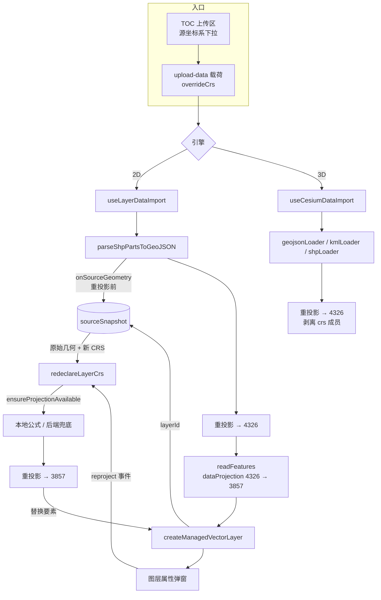

# 暂存区代码审查 + 多条目版本整合（V3.6.31）

- **日期与时间**：2026-10-28 18:20
- **任务等级**：L2 常规（审查 + 缺陷修复 + 版本/文档整合）
- **任务范围**：`git diff --cached` 的 58 个文件（+2362/−196），不含任何 Git 写操作

---

## 一、问题分析

### 1.1 核心症状

1. 暂存区里混着**多个未提交的版本条目**：`README` 与 `CHANGELOG` 同时存在 `V3.6.31` 与 `V3.6.32` 两条，页脚/简介行停在 `V3.6.32`，而版本表里 30/31/32 三行并存 —— 一次提交会带进两个版本号。
2. 其中约 25 个文件（`api/*`、`basemap/*`、`chat/*`、若干 `.vue`）不是本次 CRS 任务的产物，是并行会话的 ESLint 机械修复，未经过审查。
3. 机械修复的典型风险：`let x = <默认值>` → `let x;` 会把「默认值兜底」变成 `undefined` 透传，属于**静默行为变更**。

### 1.2 根本原因

- 版本号按「每次 L2 +1」递增，但两个条目始终没有提交，用户在提交前要求把它们**合并成一个**版本号 `V3.6.31`。
- ESLint 新增规则（`prefer-const` / `no-useless-assignment` / `preserve-caught-error` / `vue/no-v-html`）在另一个会话里被 `--fix` 批量应用，产生了大量「删初始值、加 `{ cause }`」的改动，缺少逐点确认。

### 1.3 受影响模块

导入管线（`data-import/*`）、2D 图层（`ol/layer/*`、`ol/data-import/*`）、3D 加载器（`cesium/dataImport/*`）、图层属性 UI（`layer-tree/*`）、API 层（`api/*`）、文档三件套（README / CHANGELOG / structure）。

---

## 二、修改内容

### 2.1 审查结论：机械修复全部安全

逐点核对了 10 处「删初始值」的变量，**所有写入点都在读取之前，或由 `catch`/`else` 兜底赋值**，行为等价：

| 文件 | 变量 | 保证 |
|---|---|---|
| `api/backend/client.js` | `message` | `error.response` 分支第 193 行必赋值；其余分支各自赋值后 reject |
| `api/ipLocation.js` | `errorMessage` | if/else 两路都赋值 |
| `api/locationSearch.js` | `rawList` | 六个 `else if` 全覆盖，末位 `else return []` |
| `common/chat/useAgentConfig.js` | `extraBodyParsed` | `catch` 直接 return |
| `common/chat/useChatAgentConfig.js` | `reply/usedModel/rawData` | 三条分支都赋值 |
| `common/user/AdminControlPanel.vue` | `nextValues` | `catch` 直接 return |
| `common/utils/useMarkdownRenderer.js` | `html` | 三分支全覆盖，末行还有 `html \|\| escapeHtml(...)` |
| `ol/layer/useLayerMetadataNormalization.js` | `persisted` | try 双分支 true，catch false |
| `ol/utils/usePositionCodeTool.js` | `reverseResult` | try/catch 都赋值 |
| `cesium/modules/planar-route/planarLine.ts` | `height` | if/else if/else 全覆盖 |
| `common/layer-tree/actions/exportService.js` | `sizeBytes` | if/else 都赋值 |
| `common/data-import/useKmzLoader.js` | `kmlString` | 无候选时先 throw |

`new Error(msg, { cause: error })` 与 `vue/no-v-html` 的 `eslint-disable-next-line`（附转义说明）均无行为影响。

### 2.2 本轮修掉的 4 个缺陷（都在本次 CRS 新代码里）

| # | 位置 | 缺陷 | 修法 |
|---|---|---|---|
| 1 | `useGisLoader.ts` KML 分支 | 告警文案「手动指定的 X 未应用」在 KML 支持 override 之后**已不成立**，会误导用户以为选择无效 | 删除该告警，注释改为说明「重投影发生在消费端，人工指定优先」 |
| 2 | `useLayerCrsRedeclare.js` | 用同步 `ensureCrsDef` 解析定义：只认内置表，**任意 EPSG（如 2154）会直接失败**，形成「能导入、不能重设」的能力断层 | 改用异步 `ensureProjectionAvailable`（本地公式优先 + 后端兜底），并用其返回的规范化编码 |
| 3 | 同上 | 替换要素后 `labelStyleCache`（以 feature 为键的 `Map`）仍强引用旧 feature，反复改判即泄漏 | 重设成功后 `clear()` |
| 4 | `useLayerDataImport.js` packet 分支 | 元数据 `sourceCrs` 取的是 `packet.sourceCrs`（文件声明，可能是 `PCS:` 标签），而非引擎实际判定结果 | 改为 `sourceGeometryCrs \|\| packet.sourceCrs \|\| packet.dataProjection` |

### 2.3 版本整合

- `README.md`：简介行、页脚 → `V3.6.31`；版本表把 `V3.6.32` 与 `V3.6.31` 合并为一行，并回补 `V3.6.29` 保持恒定 3 行。
- `Docs/Guide/CHANGELOG.md`：删除 `### V3.6.32` 标题，其 ①~⑦ 全部并入 `### V3.6.31`（按 A~I 重排），补齐条目间空行。
- 维护日志：`2026-10-28-crs-mapshaper-alignment.md` 的版本号与 DoD 同步为 V3.6.31。

### 2.4 关于被清理的自检脚本

`Scripts/VerifyCrsPipeline.mjs` 是上一轮生成的未跟踪文件，本轮开始时已被清理（`Scripts/` 目录 mtime 与用户消息时间一致）。按「不擅自恢复用户已删除内容」处理：**未重建**，并把 CHANGELOG / 日志里对它的引用改为「临时脚本，未入库 + 坐标基准表」。脚本本身已跑过 24/24，结论保留在日志中。

---

## 三、修改原因

- 一次提交只能对应一个版本号，否则 `vite.config.js` 从 README 正则提取的 `__APP_VERSION__` 与 CHANGELOG 会各说一套。
- 机械修复必须逐个确认写入点，否则「静默兜底变 undefined」这类 bug 会以优雅的 lint 通过形式混进生产。
- 告警文案与实际能力相反，比没有告警更糟：用户会绕开正确的操作路径。

## 四、影响范围

导入管线（2D/3D 共用入口）、图层属性弹窗、API 错误提示链路（未改语义）、文档版本三件套。

## 五、解决方案与数据流

关键点：`sourceSnapshot` 只在**重投影之前**写入，重设路径只读它，因此「改判」永远基于原始数值，不会因为反复改判而累积误差。

## 六、性能指标

不适用（无渲染性能改动）。补充：快照为普通 `Map`，单图层上限 20 万要素、全量估算 64MB、最多 12 个图层，超出按最旧淘汰。

## 七、测试方案

### 7.1 Agent 已执行

| 项 | 命令 | 结果 |
|---|---|---|
| ESLint（改动文件） | `node node_modules/eslint/bin/eslint.js <files>` | 0 problems |
| 类型检查 | `npx tsc --noEmit`（过滤本批文件） | 0 报错 |
| 结构树门禁 | `python Scripts/CheckStructureTree.py` | 519/519，漏登记 0 / 幽灵 0 |
| 配置登记门禁 | `python Scripts/CheckConfigRegistry.py` | B1~B4 + F1~F3 全绿 |
| 模块级断言（上一轮，脚本已清理） | 24 项 | 24/24（结论保留，脚本未入库） |

**未执行**：浏览器实机导入、`vite build`。

### 7.2 待用户实机验证

1. `cd frontend && npm run dev` → 2D，上传 `随机点.shp + .dbf + .shx + .prj`：控制台 `[SHP][CRS]` 的 `sourceCrs` 应为 `WKT:PRJ_…`，点位 115.448E / 35.363N。
2. 只传 `随机点.shp`（无 `.prj`）：应报「检测到平面坐标……请指定带号或 EPSG」。
3. 选 `中央经线 111°E · EPSG:4525` 重传：位置与第 1 步一致。
4. 打开图层属性 → 「重设源坐标系」→ 改 `EPSG:4547` 应用：点位整体东移约 3°，可反复改判。
5. 上传 `3857.geojson`：自动识别，落南海；切 3D 位置一致。
6. 自定义 EPSG 填一个**不在内置表**的编码（如 `2154`）：应能通过后端兜底完成重设（验证修复 #2）。

## 八、变更文件清单

| 文件 | 说明 |
|---|---|
| `README.md` | 版本整合：简介行 / 版本表 / 页脚统一 `V3.6.31`，版本表合并为 3 行 |
| `Docs/Guide/CHANGELOG.md` | `V3.6.32` 并入 `V3.6.31`，补齐条目间空行 |
| `Docs/Guide/frontend-structure.md` | （前序改动）登记 `sourceSnapshot.ts`、`useLayerCrsRedeclare.js` |
| `Docs/LLM_record/26-10/2026-10-28/2026-10-28-crs-mapshaper-alignment.md` | 版本号对齐、删除对未入库脚本的引用 |
| `Docs/LLM_record/26-10/2026-10-28/2026-10-28-stage-review-version-merge.md` | 本文件 |
| `frontend/src/domains/common/data-import/useGisLoader.ts` | 删除已不成立的 KML 告警 |
| `frontend/src/domains/ol/layer/composables/useLayerCrsRedeclare.js` | 异步定义解析、清理标注缓存 |
| `frontend/src/domains/ol/data-import/composables/useLayerDataImport.js` | 元数据 `sourceCrs` 取引擎判定结果 |

## 九、遗留与风险

1. **自检脚本未入库**：`Scripts/VerifyCrsPipeline.mjs` 已被清理，回归验证目前只有「手测 + 日志基准表」；若希望长期保留，需用户同意后再新建（属新增文件，需单独确认）。
2. **3D 侧无重设入口**：Cesium 数据源没有稳定的「就地替换要素」接口，需要时只能重新导入。
3. **快照随刷新清空**：不做持久化，避免几十 MB 几何进 IndexedDB 却没有清理出口。
4. **属性面板显示别名**：`WKT:PRJ_xxxx` 是散列别名，人可读名（`CGCS2000_3_Degree_GK_Zone_37`）在 `prjName` 里，尚未展示。
5. **并行改动未逐行业务审查**：那 25 个 ESLint 修复只确认了「变量写入点安全」，未评估其功能语义（本就不是本次任务范围，按 §2.5 不扩大范围）。
