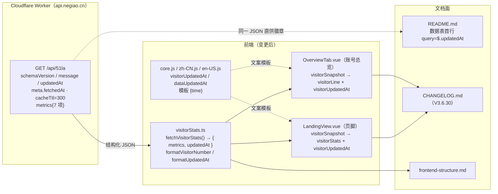

# 51.la 访客数据接入（含「数据更新于」时间戳）+ README 依赖版本校准

- **日期与时间**：2026-10-28 11:25
- **任务等级**：L2（功能开发 + 文档校准，涉及 6 个源码文件 + 4 个文档）
- **版本**：V3.6.30（V3.6.29 已提交并推送 origin/main，按 §5 顺延修订号）

---

## 一、问题分析

### 1.1 核心症状

| # | 症状 | 观察点 |
|---|---|---|
| S1 | README 顶部徽章与技术栈表的版本落后实际依赖 1~2 个大版本：Vite 6.2 ↔ 8.3.5、OpenLayers 10.5 ↔ 10.11.0、Cesium 1.132 ↔ 1.146.0、Rapier 0.14 ↔ 0.21.0、Pinia 2.3 ↔ 4.1.0、Vue Router 4.6 ↔ 5.4.0、Three.js 0.185 ↔ 0.186.1 | `README.md` 第 12~21 行、193~196 行 |
| S2 | Node 要求写「Vite 6 要求 Node 18+」，与当前依赖不符 | `README.md:219` |
| S3 | 51.la 访客数字无时间语义：读者会把「今日访问量」当成逐秒实时值；Worker 已新增 `updatedAt`，但前端类型与渲染链路未消费 | `visitorStats.ts` 首版仅取 `metrics` |

### 1.2 根本原因

- **S1/S2**：徽章是手写 shields 静态徽章，不随依赖派生。Dependabot 策略已于 V3.6.27 收敛为「只收 major」，但大版本落地后无人回写 README —— **依赖升级与文档更新之间没有门禁约束**（现有两个门禁只查结构树与配置登记，不查依赖版本）。
- **S3**：51.la 数据首版按「worker 输出 metrics → 组件渲染」设计，只把 `metrics` 纳入类型，响应顶层的元数据（`updatedAt / meta.*`）被丢弃。Worker 侧补齐 `updatedAt` 后，前端类型没有跟随，属于**接口契约变更未传导到消费端**。

### 1.3 受影响模块

| 模块 | 影响 |
|---|---|
| `domains/common/app/visitorStats.ts` | 取数返回值由 `VisitorMetrics` 扩展为 `{ metrics, updatedAt }`；新增时间格式化 |
| `app/LandingView.vue` | 页脚新增时间戳节点与样式；两处过期注释纠偏 |
| `domains/common/user/components/tabs/OverviewTab.vue` | 第三方口径行新增时间戳节点与样式 |
| `locales/core.js` / `zh-CN.js` / `en-US.js` | 新增 3 个 i18n key（含 `{time}` 插值模板） |
| `README.md` | 徽章/技术栈/Node 要求校准；数据表新增更新时间行；TOC 与空行修正；版本三处 |
| `Docs/Guide/CHANGELOG.md` | 新增 V3.6.30 条目；把误挂在 V3.6.29 的 51.la 段落迁入本条目 |
| `Docs/Guide/frontend-structure.md` | 删除误插的空行；`visitorStats.ts` 条目按新签名更新 |

**未受影响**：后端（零改动）、部署配置（未新增 env key）、TOC / `loadedDataSources`（不涉及场景数据加载）、`.env` / `.env.example` / `catalog.py`（无新配置项）。

---

## 二、方案对比与选型

### 2.1 时间戳取自哪个字段

接口实测返回（`curl https://api.negiao.cn/api/51la`，HTTP 200）：

```json
{
  "schemaVersion": 1, "label": "总访问量", "message": "79,782",
  "updatedAt": "2026-10-28T11:21:20.488+08:00",
  "meta": { "fetchedAt": "2026-10-28T11:21:20.488+08:00", "generatedAt": "...",
            "durationMs": 124, "cacheTtl": 300, "timezone": "+08:00",
            "source": "v6-widget.51.la", "worker": "negiao-api" },
  "metrics": { "activeRecent": 0, "todayUsers": 11, "todayPv": 69, ... }
}
```

| 方案 | 取值 | 结论 |
|---|---|---|
| A | `meta.fetchedAt` | 语义最准（回源抓取时刻），但埋两层 |
| **B** | **顶层 `updatedAt`** | **选定**：与 `meta.fetchedAt` 实测同值，且同名顶层字段可直接被 shields.io 的 `query=$.updatedAt` 消费 —— README 徽章免二次解析 |
| C | `meta.generatedAt` | 否决：语义为「本次响应生成时间」，缓存命中时会变成「现在」，无法反映数据新鲜度 |

### 2.2 时间如何呈现

| 方案 | 表现 | 结论 |
|---|---|---|
| 相对时间（「3 分钟前」） | 需定时器刷新，否则页面停留 10 分钟后就开始说谎 | 否决 |
| **绝对时间 `MM-DD HH:mm`** | 静态、无定时器、与接口时间一一对应 | **选定** |
| 完整 ISO | 精确但 29 字符，页脚与账号面板放不下 | 仅 README 徽章使用（无法格式化，见 §5 风险） |

**时区**：接口固定 `+08:00`，前端用 `new Date()` 按访客本地时区渲染。理由：海外访客应读自己的时钟；数据最多滞后 5 分钟，跨天/跨年歧义可忽略，故省略年份。

### 2.3 时间戳放几处

用户明确要求「底部 + 用户中心 + README」三处。三者共用同一字段、同一格式器（`formatUpdatedAt`），不存在多套规则。README 侧因 shields 不能格式化，只能原样展示 ISO 并加注时区。

### 2.4 README 徽章取值口径

一律以 `frontend/package-lock.json` 的**实际解析版本**为准（非 `package.json` 的 `^` 区间），避免「声明 8.3 实际装 8.3.5」这类二次漂移；FastAPI 无 lockfile，沿用 `backend/pyproject.toml` 下界 `>=0.100.0`，徽章保持 `0.100+`。

---

## 三、模块关系（变更前后）



**变更前**：`visitorStats.ts` 只返回 `metrics`，`updatedAt` 在类型层被丢弃；README 徽章与技术栈为手写值，与 lockfile 无关联。

---

## 四、修改内容

### 4.1 前端

| # | 文件 | 改动 |
|---|---|---|
| 1 | `visitorStats.ts` | `fetchVisitorMetrics()` → `fetchVisitorStats()`，返回 `VisitorStatsSnapshot { metrics, updatedAt }`（`updatedAt` 非字符串时归一为 `null`）；新增 `formatUpdatedAt()`（ISO → 本地时区 `MM-DD HH:mm`，不可解析返回空串）；文件头注释由「两件事」改为「三件事」 |
| 2 | `LandingView.vue` | `visitorMetrics` ref → `visitorSnapshot` ref；新增 `visitorUpdatedAt` computed；模板加 `footer-visitor__stamp` 节点（`v-if` 守卫）；样式新增 `.footer-visitor__stamp`；删除上一版遗留的「脚本插入 / min-height」过期注释，两处 `loadVisitorStats()` / `fetchVisitorMetrics()` 纠偏 |
| 3 | `OverviewTab.vue` | 同上：`visitorSnapshot` + `visitorUpdatedAt`；模板 `realtime-third` 行末追加 `realtime-third__stamp`；样式新增该类（无边框、等宽数字） |
| 4 | `locales/core.js` | 新增 `landing.visitorUpdatedAt`：`'数据更新于 {time}'` / `'Data updated {time}'` |
| 5 | `locales/zh-CN.js` / `en-US.js` | 新增 `overview.dataUpdatedAt`：`'更新于 {time}'` / `'Updated {time}'` |

### 4.2 文档

| # | 文件 | 改动 |
|---|---|---|
| 6 | `README.md` | ① 徽章 4 处：Vite 8.3 / OL 10.11 / Cesium 1.146 / Rapier 0.21；② 「2D/3D 双引擎」能力行同步；③ 技术栈表 5 处：Vite 8.3 / Pinia 4.1 / Router 5.4 / OL 10.11 / Cesium 1.146 / Three 0.186 / Rapier 0.21；④ Node 要求改为 `^20.19.0 \|\| >=22.12.0`；⑤ 访客数据表新增首行「数据更新时间」徽章（`query=$.updatedAt`）并补缓存语义说明；⑥ TOC 补「📊 全站访问数据（实时）」；⑦ 该章节末尾与「📜 版本演进」之间补空行；⑧ 版本三处升 V3.6.30，版本表新增首行并删除 V3.6.27 行（恒定 3 行） |
| 7 | `CHANGELOG.md` | 新增 `V3.6.30` 条目（含 51.la 接入、时间戳设计、依赖校准三节）；把上一批次误追加到 **V3.6.29** 的 `api.negiao.cn` 段落迁入新条目，恢复已发布条目的范围 |
| 8 | `frontend-structure.md` | 删除 `composables/` 段内误插的空行（打断 ASCII 树）；`visitorStats.ts` 条目按新签名与新增函数重写 |

---

## 五、影响范围

- **展示面**：落地页页脚（7 项指标 + 更新时间）、账号中心总览（3 项 + 更新时间）、GitHub README（8 个动态徽章）。
- **网络面**：无新增请求 —— 时间戳复用同一次 `fetchVisitorStats()` 响应，请求次数不变。
- **配置面**：未新增 env key，`deploy/.env.example` 与 `backend/config/catalog.py` 无需改动。
- **兼容性**：`fetchVisitorStats` 的两处调用点同步改名，仓内无第三处引用（已 grep 确认）。
- **性能指标**：不适用（纯文本渲染，零额外请求、零定时器）。

---

## 六、测试方案

### 6.1 Agent 已执行

| 项 | 命令 | 结果 |
|---|---|---|
| 接口实测 | `curl https://api.negiao.cn/api/51la` | HTTP 200；`updatedAt=2026-10-28T11:21:20.488+08:00`；`meta.cacheTtl=300`；`metrics` 7 项齐全 |
| ESLint | `node node_modules/eslint/bin/eslint.js`（6 个改动文件） | 0 problems |
| 类型检查 | `npx tsc --noEmit`（过滤本批文件） | 0 报错 |
| 生产构建 | `vite build --outDir <系统临时目录>` | 通过，14.44s，仅存量 chunk 体积提示。**注**：直接 `vite build` 会在 `vite:prepare-out-dir` 被沙箱 safe-delete 拦截（`frontend/dist/assets` 204 个文件 > 50 阈值，报 `SAFE_DELETE_BULK_CONFIRM_REQUIRED`），属环境限制而非代码问题，故改输出到临时目录，未污染仓库内 `dist` |
| 结构树门禁 | `python Scripts/CheckStructureTree.py` | 516/516，漏登记 0、幽灵条目 0 |
| 配置登记门禁 | `python Scripts/CheckConfigRegistry.py` | B1~B4 + F1~F3 全绿，catalog 130 key |
| 引用面核查 | `grep -rn "fetchVisitorMetrics" frontend/src` | 0 命中（旧名已无残留） |

**未执行**：浏览器实机渲染、README 徽章在 GitHub 上的实际渲染（需推送后由 shields.io 拉取）。

### 6.2 待用户实机验证

1. `cd frontend && npm run dev` → 打开首页拉到页脚：确认「网站数据概况」行末出现「数据更新于 MM-DD HH:mm」，且与 `curl` 返回的 `updatedAt` 一致（本地时区）。
2. 登录 → 账号中心 → 总览：第三方口径行末出现「更新于 …」，与页脚同一分钟。
3. 切到 `en-US`：分别显示 `Data updated …` / `Updated …`，无残留中文。
4. 屏蔽 `api.negiao.cn`（DevTools Network 右键 Block request domain）刷新：页脚访客整块与总览该行消失，页面其余部分正常（失败静默）。
5. 推送后看 GitHub README：徽章 Vite 8.3 / OL 10.11 / Cesium 1.146 / Rapier 0.21 显示正确；「数据更新时间」行显示 ISO 时间且随刷新变化。
6. 超宽/窄屏各看一眼页脚：更新时间与第 7 项指标同排或换行，不溢出、不与分隔线重叠。

---

## 七、变更文件清单

| 文件 | 说明 |
|---|---|
| `frontend/src/domains/common/app/visitorStats.ts` | 取数返回值扩展为 `{ metrics, updatedAt }`；新增 `formatUpdatedAt` |
| `frontend/src/app/LandingView.vue` | 页脚时间戳节点与样式；注释纠偏 |
| `frontend/src/domains/common/user/components/tabs/OverviewTab.vue` | 总览行时间戳节点与样式 |
| `frontend/src/locales/core.js` | `landing.visitorUpdatedAt`（中/英） |
| `frontend/src/locales/zh-CN.js` | `overview.dataUpdatedAt` |
| `frontend/src/locales/en-US.js` | `overview.dataUpdatedAt` |
| `README.md` | 徽章/技术栈/Node 要求校准；数据表首行；TOC；版本三处 |
| `Docs/Guide/CHANGELOG.md` | 新增 V3.6.30；迁移 51.la 段落 |
| `Docs/Guide/frontend-structure.md` | 删空行；更新 `visitorStats.ts` 条目 |
| `Docs/LLM_record/26-10/2026-10-28/2026-10-28-visitor-stats-51la.md` | 本日志 |

---

## 八、遗留与风险

1. **`visitorStats.ts` 仍硬编码 `https://api.negiao.cn/api/51la`**：与 `publicRuntime.ts` 的 `GITHUB_STATS_WORKER_URL`（读 `VITE_GITHUB_STATS_WORKER_URL`）构成两处域名事实源，Worker 迁址需改两处；`CheckConfigRegistry` 的 F3 只拦「原作者后端域名」，`negiao.cn` 不在名单，门禁无法兜住。**未改原因**：改为派生后，本地 `deploy/.env.local` 该值为空会导致 dev 环境无数据，属产品取舍，需用户决策。
2. **过滤规则重复**：`LandingView` 与 `OverviewTab` 各自实现 `Number.isFinite` 过滤与「全缺不渲染」判断，规则已出现两份；后续可抽 `useVisitorStats` composable 收敛。
3. **`LandingView.vue` 持续增行**：本次再净增约 20 行，该文件已远超 2000 行阈值；访客区块（模板 + 逻辑 + 样式约 90 行）具备独立成组件的条件（`app/components/FooterVisitorStats.vue`），建议下次触碰时抽离。
4. **README 更新时间徽章只能显示原始 ISO**：Worker 未提供格式化字段（如 `updatedAtText`），shields.io 也无法格式化时间；若希望徽章显示 `MM-DD HH:mm`，需在 Worker 侧加派生字段 —— 属另一仓库改动，本次未做。
5. **`Docs/README_EN.md` 仍停 V3.6.22**：本次未同步英文栏目；`Force_command.md` 未强制，但 SSOT 层面存在漂移，建议单独立项。
6. **§11.2 红线自查命令依赖 `rg`**：本机未安装 `rg` 时四条命令全部失败并被 `|| echo CLEAN` 兜底成「全绿」，属规范可执行性缺陷。本次改用 `grep` 复核并全绿（R2 的 36 处命中均为 `maxRayDistance` 子串误报）。修改 `Force_command.md` 属 L3，需单独批准。
7. **本次未改 `frontend/package.json` 的 `version: 2.0.0`**：与「版本号单一事实源在 README」冲突，属既有已知限制，已在 README「已知限制」列明。

---

## 九、收尾核对（DoD）

- [x] 代码改动完成，遵守分层边界与单一职责（纯函数留 `app/visitorStats.ts`，组件只持有 ref 与渲染）
- [x] 新增/修改 `.ts` 未引入 `tsc --noEmit` 报错（本批文件 0 报错）
- [x] 未新建 `.js` 逻辑文件（改动的 `.js` 均为既有 i18n 词表）
- [x] 维护日志已按第 6 节写全章节
- [x] 根 `README.md` 三处版本号已更新为 `V3.6.30`（简介行 / 版本表首行 / 页脚）
- [x] `Docs/Guide/CHANGELOG.md` 已追加 `V3.6.30` 条目
- [x] 涉及文档结构 → `frontend-structure.md` 已同步（无文件增删，仅描述与空行修正）
- [x] 未新增配置 key，`.env.example` 与 `catalog.py` 无需改动，仍跑门禁确认无孤儿
- [x] 涉及 UI → 移动端基线：新增元素均为文本、`pointer-events` 不涉及触控目标，无 `min-width`；页脚沿用既有 `flex-wrap`
- [x] 不涉及场景数据加载，TOC / `loadedDataSources` 契约不适用
- [x] 门禁脚本已运行且通过（结构树 516/516、配置登记全绿）
- [x] 未执行任何 Git 写操作
- [x] 平台红线自查已用 `grep` 复核全绿（R2 为 `maxRayDistance` 子串误报）
- [x] 已输出交接块

---

## 十、交付后调整（L1 零散修补，2026-10-28 11:45）

用户对 README 徽章布局提出两项调整，仅改 `README.md` 一个文件、无代码改动，按 §1 归 **L1**；因同属本次未提交的交付周期，**版本号维持 V3.6.30 不递增**（沿 V3.6.29 的「同批次不拆版本」处理方式）。

| # | 用户要求 | 实施 | 影响 |
|---|---|---|---|
| 1 | 访问统计数据做成顶部徽章，但要与旧徽章区分 | 删除文末 `## 📊 全站访问数据（实时）` 章节与对应 TOC 条目；把 7 项指标上移为顶部 `<table align="center">`（7 列 × 2 行：标签行 + 徽章行）；`updatedAt` 因 ISO 串约 300px、入表会拉失衡，单列于表格下方并附说明行 | 顶部形成三段可辨结构：技术栈（行内徽章）→ 演示链接 → 站点访问（表格）→ 仓库指标（行内徽章）；全文档不再有第二处访问数据表 |
| 2 | 去掉无意义的 `Total Clone` / `Unique Cloner` | 删除两枚 `dynamic/json` 徽章（源为 `.github/traffic.json`） | 同时移除与之重复的 shields endpoint「总访问量」徽章（表格内 `metrics.totalPv` 已承担该口径）；保留 `views` / `last-commit` / `stars` / `forks` |
| 3 | 「站点访问数据」表格要说清楚统计对象是部署网页的访问 | 表格上方新增一行可见标题 `🌐 站点访问数据 · 51.la · 实时` + 一句定义：统计对象是**部署后的网页**（`webgis.negiao.cn` 等访问域名）的页面访问量，**不是**本 GitHub 仓库的访问 / 克隆量，也不含 API 调用与爬虫抓取，且与站内页脚、账号总览同口径 | 首版口径只写在 HTML 注释里，页面上不可见；现在读者无需读源码即可区分「页面访问」与「仓库访问」 |


**补记（2026-10-28 12:05）**：用户编辑 README 时**误删**了表格上方的标题行与表格下方的时间徽章（`</table>` 之后只剩空行）。已按原设计恢复两处，并借恢复统一口径措辞：徽章 label 由「数据更新」改为**「数据统计时间」**，与站内页脚 / 账号总览的「数据更新于 {time}」区分；说明行改写为「即 Worker 最近一次回源抓取 `updatedAt` 的时刻（ISO 8601 / +08:00）；数据源 `api.negiao.cn/api/51la`，边缘缓存 5 分钟，故展示值最多比当前时间早 5 分钟」。
**为什么用表格而不是再加一行 `<p>`**：徽章是等宽排列的图片，两类口径并排时只能靠颜色区分；`<table align="center">` 提供列对齐 + 浅边框 + 独立的标签行，是 CSS 之外唯一能被 GitHub 稳定渲染的分组手段（GitHub 会剥离 `<style>`，也不解析 HTML 块内的 Markdown 表格语法）。

**未改动**：`.github/traffic.json` 与 `traffic-counter` 工作流保持原样 —— 该文件仍由 CI 更新，只是不再有徽章消费；是否停用工作流属部署面决策，按 §2.3 只提建议不动手。

**验证（本次调整）**：`README.md` 标签配对自检（`<table>/<tr>/<td>` 开闭数量一致）；`grep` 确认 `Total Clones` / `Unique Cloners` 在 `README.md` 中 0 命中；TOC 无悬挂条目；门禁复核仍为 516/516 与配置登记全绿（本次未增删文件）。
