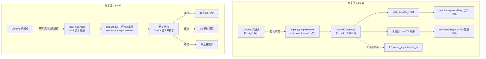

# 建筑抓取面板凭证框加固：登录密码被浏览器自动填充并外发

- **日期与时间**：2026-10-29 15:33
- **任务等级**：L2 常规（安全类 Bug 修复，跨 5 个源码文件）
- **版本**：V3.6.31 → V3.6.32
- **触发方式**：用户在 DevTools 网络面板发现两条第三方请求的凭据字段为本人登录密码

---

## 一、问题分析

### 1.1 核心症状

| # | 症状 | 观察点 |
|---|---|---|
| S1 | 高德请求携带登录密码 | `https://jsapi.amap.com/web/init?key=<登录密码>` |
| S2 | 天地图请求携带同一密码 | `https://tile0.tianditu.gov.cn/vts?t=vt&pk=djdgjagmjdgadgjda&tk=<登录密码>&v=1.0` |
| S3 | 两条互不相干的链路拿到**完全相同**的错值 | 同一 ref 同时供给两个 composable |
| S4 | 游客会话下填入的是管理员密码 | 用户明确观察：以游客身份登录，被填充值来自管理员账号 |
| S5 | 数据库侧值正确 | `api_keys.amap_key` 32 位 `90…`、`tianditu_tk` 32 位 `b8…`，互不相同、非该密码 |

> S4 是本次问题定级的关键：它排除了「用户手滑粘贴」，指向浏览器凭据自动填充。

### 1.2 根本原因（三层）

**第一层 · 自动填充被误触发**
`TencentBuildingPanel.vue` 的「临时凭证」输入框声明为 `type="password"` + `autocomplete="off"`。Chrome 密码管理器**对 password 类型字段忽略 `autocomplete="off"`**（其设计目标是协助密码管理器，故对该属性有选择性地不遵守），把本站点保存的登录凭据自动填入。凭据库按 **origin** 索引，不区分会话身份 —— 因此游客态下填入的仍是该 origin 上保存过的管理员密码。

**第二层 · 该值拥有高于 L2 的优先级**
`useAmapBuildingFetch.js` / `useTdtBuildingFetch.js` 的取值表达式为 `inputKey || getRuntimeMapTokensSync().amapKey`、`inputTk || …tiandituTk`。UI 原始输入非空即短路，管理端 L2 配置（`api_keys` 表）永不参与。这与 `Force_command.md` §4「每类信息只有一个权威来源」直接冲突。

**第三层 · 单一 ref 供三个数据源共用**
`const sourceCredential = ref('')` 被腾讯 / 高德 / 天地图三个 tab 共用，切换 tab 不重置。这解释了两条请求为何拿到同一个值，同时构成一个独立缺陷：即使用户正确填写天地图 tk，切到高德 tab 后该 tk 会被当作高德 key 发出。

### 1.3 受影响模块

| 模块 | 影响 |
|---|---|
| 建筑抓取面板（`TencentBuildingPanel.vue`） | 直接污染点，输入值与三个源的绑定 |
| 高德建筑抓取编排（`useAmapBuildingFetch.js`） | 优先级短路，凭证来源被 UI 覆盖 |
| 天地图抓取编排（`useTdtBuildingFetch.js`） | 同上，含单层与全量矢量两条路径 |
| 高德 / 天地图 fetcher | 未改；URL 拼装本身正确，只是入参被污染 |
| `api_keys` 表 / `runtimeMapTokens` | 未受影响，值本身正确 |
| 后端与 HF 日志 | 未污染：`proxyBase = ''`，两个 fetcher 直连第三方，不经同源中转 |

---

## 二、方案对比与选型

| 方案 | 做法 | 结论 |
|---|---|---|
| A · 删除临时凭证能力 | 移除输入框与 `inputKey` / `inputTk` 形参，凭证唯一来源回归 L2 | 结构性消除风险，但用户明确要求保留「自带 key」能力 |
| **B · 保留能力 + 加固（选定）** | 改用 `type="text"` 切断识别 + 三源凭据分离 + 格式闸门 | 既保留能力，又把「能被误填」与「误填后仍发出」两个环节同时切断 |
| C · 后端代理校验 | 临时凭证经后端中转，前端不直连带密钥请求 | 改动最大，且与本次事故链路无关（事故是值错，不是通道错） |

**选型理由**：本次事故由「值被污染」与「污染值被无条件采用」两个条件同时成立才导致。B 方案对两个条件各设一道闸：类型改为 `text` 使密码管理器不再命中（条件一失效），格式闸门使可疑串在发出前被拦（条件二的后果被截断）。

---

## 三、修改内容

1. **输入框类型与属性**（`TencentBuildingPanel.vue`）
   `type="password"` → `type="text"` + 类 `txb-credential-input`（`-webkit-text-security: disc` 遮蔽）；补 `autocorrect` / `autocapitalize` / `spellcheck` 关闭、`:name="map-source-credential-${source}"`、`data-lpignore` / `data-1p-ignore` / `data-bwignore`。
2. **三源凭据分离**（同文件）
   `credentials = reactive({ tencent, amap, tianditu })` + 带 setter 的 `computed` 代理 `sourceCredential`，输入框仍单实例，但各源保留各自草稿。
3. **格式闸门**（同文件）
   新增 `CREDENTIAL_PATTERN = /^[A-Za-z0-9]{24,64}$/` 与 `credentialFormatError(input)`；提交时先校验，非空且不符即 `message.warning` 并中止，留空放行。
4. **调用点**（同文件）
   天地图：`tdb.startVectorFetch(bbox, zoom, credential, layers)`；高德：`amb.startFetch(bbox, zoom, credential)`；腾讯不传第三参（当前无需凭证）。
5. **composable 形参恢复**（`useAmapBuildingFetch.js` / `useTdtBuildingFetch.js`）
   保留 `inputKey` / `inputTk` 覆盖能力，JSDoc 补注「面板侧已做 24~64 位字母数字闸门」。
6. **i18n**（`zh-CN.js` / `en-US.js`）
   新增 `shell.buildings.err_credential_format`。

---

## 四、变更前后关系

---

## 五、测试方案

### 5.1 Agent 已执行

| 项 | 命令 | 结果 |
|---|---|---|
| ESLint | `npx eslint` 5 个改动文件 | 0 problems |
| 构建 | `npm run build` | 通过，4412 modules / 12.67s |
| 结构树门禁 | `python Scripts/CheckStructureTree.py` | 520/520，漏登记 0、幽灵条目 0 |
| 配置登记门禁 | `python Scripts/CheckConfigRegistry.py` | 全绿（catalog 130 key、前端 VITE_ 15 个） |
| 平台红线 R1~R4 | `grep -riE`（本机无 `rg`，等价替代） | 全绿；R2 的 36 处命中全为 `xRay` 子串误报 |

> 说明：本地 `backend/data/webgis_auth.db` 的 `api_keys` 仅做过**只读**核验（长度与前缀比对），未打印明文、未修改任何数据。

### 5.2 待用户实机验证

| 步骤 | 预期结果 |
|---|---|
| 1. 浏览器中清除 `webgis.negiao.cn` 的已保存密码后重新登录 | 登录正常 |
| 2. 打开建筑抓取面板（游客态与管理员态各一次） | 凭证框**为空**，无圆点、无自动填充；聚焦时不出现密码管理器下拉 |
| 3. 三个 tab 依次切换 | 各自输入框内容互不串值 |
| 4. 留空后抓取（高德 / 天地图各一次） | 请求中 `key=` / `tk=` 为管理端 L2 的 32 位值，非登录密码 |
| 5. 填入 8 位字符串后抓取 | 提示「临时凭证格式不符」，且**不发出**任何第三方请求 |
| 6. 填入真实 32 位 key/tk 后抓取 | 正常抓取，`key=` / `tk=` 为该临时值 |
| 7. Firefox 下打开面板 | 凭证框内为明文（`-webkit-text-security` 不被支持），功能正常 |

---

## 六、影响范围

- **界面**：建筑抓取面板凭证框的显示方式（遮蔽由 CSS 提供）、三源输入值互不共享、新增一条错误提示文案。
- **数据链路**：高德 / 天地图请求的凭证来源恢复「临时优先、留空走 L2」的既定语义，未改变 fetcher 的 URL 结构。
- **未触碰**：`api_keys` 表结构与读写、`runtimeMapTokens` 缓存与轮换、后端任何接口、部署面配置。

---

## 七、遗留与风险

| # | 项 | 说明 |
|---|---|---|
| R1 | `ApiKeysManagementPanel.vue:565` | 「默认 AI API Key」仍是 `type="password"` 且无 `autocomplete`；一旦被自动填充并保存，密码会写入数据库（真正的 L2 污染）。已记入 `Docs/TODO/bugfix-optimization-plan.md`，待单独处理 |
| R2 | Firefox 无 `-webkit-text-security` | 凭证以明文显示，属渲染层降级，不影响安全边界 |
| R3 | 格式闸门为长度/字符集启发式 | 24~64 位字母数字可拦住误填的密码，但拦不住「同样长度的错误串」；无法做真值校验（需向第三方探测） |
| R4 | 密码已外发 | 已建议用户立即改密、清理浏览器凭据、核查两家控制台的调用来源；本仓库无法回收已发出的请求 |
| R5 | 游客可使用建筑抓取 | 该面板对游客开放，是「低权限会话触发高权限凭据注入」的前提条件。是否收紧权限属产品决策，未在本次改动范围内 |

---

## 八、变更文件清单

| 文件 | 说明 |
|---|---|
| `frontend/src/domains/common/data-import/components/TencentBuildingPanel.vue` | 凭证框改 text + CSS 遮蔽、三源独立草稿、格式闸门、调用点调整 |
| `frontend/src/domains/common/data-import/useAmapBuildingFetch.js` | 保留 `inputKey` 覆盖，补优先级来源注释与 JSDoc |
| `frontend/src/domains/common/data-import/useTdtBuildingFetch.js` | 保留 `inputTk` 覆盖（单层 + 全量两条路径），补 JSDoc |
| `frontend/src/locales/zh-CN.js` | 新增 `err_credential_format` |
| `frontend/src/locales/en-US.js` | 新增 `err_credential_format` |
| `README.md` | 版本号三处 + 版本演进表（V3.6.32 入表、V3.6.29 出表） |
| `Docs/Guide/CHANGELOG.md` | 追加 V3.6.32 完整条目 |
| `Docs/TODO/bugfix-optimization-plan.md` | 登记 R1 同类风险 |
