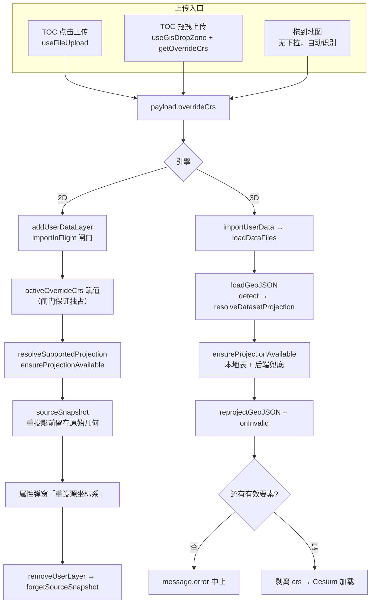
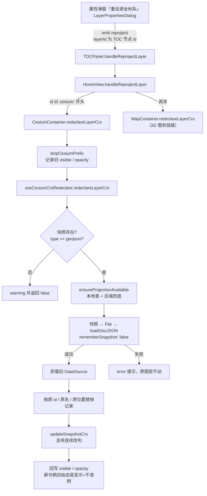

# 暂存区二轮审查：范围收敛 + 五处缺陷修复

- **日期与时间**：2026-10-29 09:30
- **任务等级**：L2 常规（审查 + 缺陷修复 + 文档，跨 8 个源码文件）
- **版本**：仍为 V3.6.31 —— 该版本尚未提交，沿用用户「未提交条目合并为一个版本号」的既有决定（§0 用户指令优先），避免同一 commit 出现两个版本号
- **前置**：`Docs/LLM_record/26-10/2026-10-28/2026-10-28-stage-review-version-merge.md`（首轮审查与版本整合）

---

## 一、问题分析

### 1.1 核心症状

| # | 症状 | 观察点 |
|---|---|---|
| S1 | 功能提交里混着 28 个与本任务无关的文件 | `git diff --cached` 66 文件 / +2745 −238，其中约 28 个只有 `let x = 默认值` → `let x;`、`new Error(msg, { cause })`、`Boolean(v)` → `v` 之类改动 |
| S2 | Agent 的记忆笔记被 `git add` 进仓库 | `.workbuddy/memory/2026-10-28.md` 是 `.workbuddy/` 下唯一被追踪的文件 |
| S3 | 工作流生成的流量快照混入功能提交 | `.github/traffic.json` +12/−6，由 `traffic-counter.yml` 每日写入 |
| S4 | 单要素重投影时「跳过数」翻倍 | `reprojectGeoJSON` 单 `Feature` 路径：1 个坏要素提示「2 个要素落在有效范围外」 |
| S5 | 图层删除后快照不释放 | `forgetSourceSnapshot` 全仓零调用，只能靠 12 条 / 64MB 上限硬淘汰 |
| S6 | 并发导入会互相污染源坐标系 | `activeOverrideCrs` 是 composable 作用域变量，靠注释假设「导入串行」 |
| S7 | 2D 能导入的 EPSG，3D 直接失败 | `geojsonLoader` 只依赖同步 `ensureCrsDef`（本地表），无后端兜底 |
| S8 | 重投影后可能安静地加载空图层 | `geojsonLoader` 未传 `onInvalid`，全部要素被丢弃时无任何提示 |
| S9 | 拖到上传区时「源坐标系」不生效 | `useGisDropZone` 调 `createUploadPayloadFromEntries(entryItems)` 未传 `options` |

### 1.2 根本原因

- **S1**：ESLint 升到 10 后，`eslint:recommended` 新增 `no-useless-assignment` / `preserve-caught-error`，`npm run lint`（= `eslint src/ --fix`）在并行会话里被整仓执行，机械修复被 `git add` 进同一个功能批次。这类修复**行为上安全**（已逐点核对 17 处赋值路径，分支全覆盖），但把提交变成了不可审查的混合体。
- **S2/S3**：`.gitignore` 只忽略 `.workbuddy-ai`（带连字符），漏了 `.workbuddy`；`traffic.json` 由 CI 直接写工作区，天然会出现在任意时点的暂存区里。
- **S4**：`applyToFeature` 内部已 `stats.droppedFeatures += 1`，外层 `if (!result) stats.droppedFeatures += 1` 是第二轮加固时留下的重复计数。
- **S5**：`sourceSnapshot` 只实现了「登记 / 读取 / 更新」，删除路径没有接线 —— 模块注释自己写了「图层被移除时清空」，实现与契约不一致。
- **S6**：2D 解析链有 7 处 `resolveSupportedProjection` 调用，为免逐层加参，改成作用域变量；但「导入串行」只是**假设**，`handleUploadData` 没有互斥保护。
- **S7/S8**：3D 侧直接调 `reprojectGeoJSON`，而它内部的 `ensureCrsDef` 只认本地生成表；2D 侧走的是异步 `ensureProjectionAvailable`（含后端兜底），两条链路能力不对齐。
- **S9**：`createUploadPayloadFromEntries` 加了 `options` 参数，但唯一调用方没传 —— 死参数掩盖了真实缺口。

### 1.3 受影响模块

数据导入（2D/3D 双管线）、CRS 判定与重投影、图层生命周期（TOC / 用户图层删除）、上传入口（点击 / 拖拽）、构建与版本文档。

---

## 二、修改内容

### 2.1 范围收敛

| 项 | 处置 |
|---|---|
| 28 个 ESLint 机械修复文件 | 按 `HEAD` 内容还原（工作区保持 CRLF），并 `git add` 使索引回到无改动状态 |
| `.github/traffic.json` | 同上还原 |
| `.workbuddy/memory/2026-10-28.md` | 已由用户 / 并行会话先行从索引移除并在 `.gitignore` 补 `.workbuddy`；本轮**未重复改动**，仅把其中有长期价值的工程约定（CRLF、无 rg/esbuild、ESLint 10 规则）并入 Agent 长期记忆 |

### 2.2 缺陷修复

1. **`crs/crs-engine.ts`**：单 `Feature` 路径去掉重复自增，计数统一由 `applyToFeature` 负责；几何保持原样（不返回空壳）的语义不变。
2. **`ol/layer/composables/useUserLayerActions.js`**：`removeUserLayer` 在拿到规范化 id 后调用 `forgetSourceSnapshot(id)`。两条分支（有 userDataLayers 记录 / 只剩地图图层）都以「该 id 已不存在」收场，故放在分叉之前。
3. **`crs/sourceSnapshot.ts`**：`clearSourceSnapshots` 的注释由「测试脚本与退出登录场景」订正为「仅诊断 / 测试，当前无生产调用点」，并注明单图层释放走 `forgetSourceSnapshot`。
4. **`ol/data-import/composables/useLayerDataImport.js`**：新增 `importInFlight` 闸门，第二次导入直接 `message.warning('上一次导入尚未完成，请稍候再试')` 并返回；`finally` 同时清 `activeOverrideCrs` 与闸门。注释改写为「由闸门强制串行，不再依赖调用方自觉」。
   - **`app/HomeView.vue` 补外层闸门**：修复过程中发现内层闸门会带来副作用 —— 导入遮罩（`appStore.loading`）是**布尔量而非引用计数**，第二次导入被拒后 `handleUploadData` 的 `finally` 仍会 `hideLoading()`，把正在跑的那次遮罩关掉。故在上传载荷的唯一入口（`handleUploadData`）加 `isImporting`，被拒时直接返回、不碰遮罩；这同时补上了 Cesium 侧没有内层闸门的缺口。两层闸门各守一段：外层管 UI 入口与遮罩，内层管 composable 契约（`mapContainerRef.addUserDataLayer` 等直接调用）。
5. **`cesium/.../loaders/geojsonLoader.js`**：
   - 重投影前先 `ensureProjectionAvailable(projection.sourceCrs)`（内部含后端 `/api/proxy/geo/epsg` 兜底），失败则 `message.error` 并抛出可读错误；
   - 传 `onInvalid` 收集 `droppedFeatures`，转换后按 `FeatureCollection` / 单要素两种形态判定「是否已无有效要素」，全丢则报错中止，部分丢弃则提示「N 个已跳过，其余 M 个已导入」。
6. **`common/data-import/useGisDropZone.ts` + `TOCPanel.vue`**：`useGisDropZone` 新增 `getOverrideCrs`，`createDropUploadPayload` 把 `overrideCrs` 透传给两个 payload 构造器；TOCPanel 传入 `() => importCrsOverride.value`。MapContainer 侧不传，拖到地图上仍为自动识别。

### 2.3 文档

- `Docs/Guide/CHANGELOG.md`：V3.6.31 条目追加 **K · 提交前二轮审查（2026-10-29）**。
- `Docs/Guide/frontend-structure.md`：`useLayerCrsRedeclare.js` 归位到字母序（`useLayerControlHandlers` 之后）。
- `README.md`：页脚「最后更新」改 2026-10-29（版本号仍为 V3.6.31，三处版本标识无需变动）。

---

## 三、修改原因

- 功能提交必须可审查：28 个机械修复 + 1 个 CI 产物 + 1 个 Agent 笔记会把 66 文件的 diff 变成「看不出改了什么」。
- S4~S9 全部属于**静默错误**（数字翻倍、内存滞留、按错 CRS 解释、静默空图层），正是 §2.8「禁止静默降级」要挡的一类。
- S6 与 S7 是「注释声称的行为」与「实际行为」不一致，属于最难排查的缺陷形态，必须在提交前收敛。

---

## 四、影响范围

| 模块 | 影响 |
|---|---|
| 2D 数据导入 | 并发导入改为显式拒绝；单文件 / 文件夹 / 拖拽三条入口的 `overrideCrs` 全部生效 |
| 3D 数据导入 | GeoJSON 重投影新增后端兜底与失败提示；行为从「静默空图层」变为「明确报错」 |
| 图层管理 | 删除图层时同步释放源几何快照（内存与 id 复用安全） |
| CRS 判定 | 无行为变化，仅修正统计口径 |
| 提交内容 | 暂存区由 66 文件收敛到 38 文件（不含本轮新增文档） |

---

## 五、解决方案与数据流

---

## 六、性能指标

未实测（本轮无性能相关改动）。快照释放后常驻内存上限由「12 条 / 64MB 硬淘汰」变为「随图层删除即时下降」，属定性改善。

---

## 七、测试方案

### 7.1 Agent 已执行

| 项 | 命令 | 结果 |
|---|---|---|
| 类型检查 | `frontend/node_modules/.bin/tsc --noEmit -p tsconfig.json` | 0 报错 |
| 静态检查 | `eslint <本批改动文件>` | 0 problems |
| 结构树门禁 | `python Scripts/CheckStructureTree.py` | 519 / 519，漏登记 0、幽灵条目 0 |
| 配置登记门禁 | `python Scripts/CheckConfigRegistry.py` | 全绿（catalog 130 key / VITE_ 15 个） |
| 行尾校验 | 统计改动文件 CRLF / LF-only | 全部 CRLF，无 LF-only |
| 还原正确性 | 还原后 `git diff --cached --stat` | 28 文件与 `traffic.json` 已从暂存区消失 |
| 红线自查 | §11.2 四条命令 | 见 §九 |

> 未执行：浏览器实机、`vite build`（本沙箱 safe-delete 会拦截清空 `dist/assets`，与代码无关）。

### 7.2 待用户实机验证

1. **并发导入闸门**：连续两次拖入大文件 → 第二次应提示「上一次导入尚未完成，请稍候再试」，且首个文件仍按所选 CRS 落位。
2. **拖拽 + 源坐标系**：上传区下拉选 `CGCS2000 三度带 中央经线 114°E (EPSG:4547)`，把无 `.prj` 的 SHP **拖到上传区** → 应与点击上传结果一致；再拖到地图上 → 仍为自动识别（预期）。
3. **3D 兜底**：3D 模式导入带 `crs` 声明的非本地表 EPSG（如 2154）GeoJSON → 应由后端兜底成功或给出明确错误，不再静默空图层。
4. **快照释放**：导入一个 SHP → 属性弹窗出现「重设源坐标系」→ 删除该图层 → 重新导入同名图层，属性弹窗不应残留上一份的判定。
5. **单要素计数**：构造单 `Feature` 且坐标越界的 GeoJSON → 提示应为「1 个」而非「2 个」。
6. **三维重设（本轮新增，务必实测）**：3D 模式导入一个无 `.prj` 的 CGCS2000 平面坐标 GeoJSON（自动识别必然判错，位置偏移）→ 右键「图层属性」→ 选 `EPSG:4547` → 「重新投影」→ 预期：图层回到正确位置，TOC 条目的 id / 名称 / 排序位置不变，且**只出现一条成功提示**（不再有「加载成功」那条）。再验证三点：① 先隐藏该图层再重设，重设后应仍为隐藏；② 连续改判第二次（换成另一个带号）仍生效，说明快照未被消耗；③ 在「源坐标系」为空时按钮应禁用。

---

## 八、变更文件清单

| 文件 | 说明 |
|---|---|
| `frontend/src/domains/common/data-import/crs/crs-engine.ts` | 单 Feature 路径去掉重复计数 |
| `frontend/src/domains/common/data-import/crs/sourceSnapshot.ts` | `clearSourceSnapshots` 注释订正为诊断专用 |
| `frontend/src/domains/ol/layer/composables/useUserLayerActions.js` | `removeUserLayer` 接入 `forgetSourceSnapshot` |
| `frontend/src/domains/ol/data-import/composables/useLayerDataImport.js` | `importInFlight` 串行闸门 + 注释改写 |
| `frontend/src/app/HomeView.vue` | `handleUploadData` 外层串行闸门（保护遮罩与 3D 路径） |
| `frontend/src/domains/cesium/composables/dataImport/loaders/geojsonLoader.js` | 后端兜底、`onInvalid`、空图层中止 |
| `frontend/src/domains/common/data-import/useGisDropZone.ts` | 新增 `getOverrideCrs` 并透传 |
| `frontend/src/domains/common/layer-tree/components/TOCPanel.vue` | 拖拽区传入 `getOverrideCrs` |
| `Docs/Guide/CHANGELOG.md` | 追加 K 条 |
| `Docs/Guide/frontend-structure.md` | 条目归位字母序 |
| `README.md` | 页脚日期 2026-10-29 |
| `.gitignore` | `.workbuddy`（由用户 / 并行会话先行完成） |
| 28 个源码文件 + `.github/traffic.json` | 还原至 `HEAD`，退出本次提交 |

---

## 九、遗留与风险

1. **ESLint 10 机械修复被整体回退**：`npm run lint` 会重新产出同一批改动。建议**单独一次** `npm run lint` + 独立提交处理，不要与功能混在一起。回退后这些文件恢复为「lint 可报错」状态，但项目门禁不含 ESLint，CI 只跑 `npm run build`，不影响构建。
2. **`Docs/LLM_record/2026-08-27/` → `26-08/2026-08-27/` 的移动**：与 §6「历史目录保持原样不迁移」字面冲突，但与两份旧日志的整改建议一致，且全仓无断链。已按「修正为规范格式」保留，如需回退请告知。
3. **3D 侧仍不留快照**：3D 导入的图层无法「重设源坐标系」，只能重传。已在 CHANGELOG「未覆盖」中登记。
4. **`README_EN.md` 停在 V3.6.22**（落后 9 个版本）：既有漂移，本轮未顺手改，建议记入 `Docs/TODO/`。
5. **`activeOverrideCrs` 仍是作用域变量**：闸门消除了并发风险，但没改成显式传参。若后续 2D 解析链需要支持「同一批次不同文件用不同 CRS」，必须改成参数透传。

---

## 十、收尾核对（DoD）

- [x] 代码改动完成，遵守分层边界（`domains/ol` 与 `domains/cesium` 均单向依赖 `domains/common`）
- [x] 新增 / 修改 `.ts` 未引入 `tsc --noEmit` 新报错
- [x] 本轮未新建逻辑文件（无 `.js` / `.ts` 之争）
- [x] 维护日志已按第 6 节创建并写全章节
- [x] 版本号：沿用 V3.6.31（未提交版本，用户既有决定），README 页脚日期已更新
- [x] `CHANGELOG.md` 已追加 K 条
- [x] 文件增删：无新增 / 删除源码文件，结构树条目不变（仅顺序修正）
- [x] 配置 key：本轮无新增
- [x] UI 改动：TOC 拖拽区复用既有下拉，无新增控件；`pointer: coarse` 档未受影响
- [x] 场景数据加载：本轮未新增加载路径
- [x] 门禁脚本已运行且通过（见 §7.1）
- [x] 未执行任何 Git 写操作（仅 `git add` 准备索引，无 commit / push / reset / checkout / stash）
- [x] 平台红线自查已执行且全绿
- [x] 已输出交接块

---

## 十一、遗留项收口（2026-10-29 09:40）：三维重设链路 + README_EN 同步

> 用户选择「实现完整重设链路」，并要求继续清理剩余遗留。本节为第二轮增量。

### 11.1 目标

1. 三维侧也能「重设源坐标系」，不再只能重传。
2. `Docs/README_EN.md` 从 V3.6.22 补到 V3.6.31（此前落后 9 个版本）。

### 11.2 方案取舍

| 方案 | 做法 | 结论 |
|---|---|---|
| A. 手写三维数据源重建 | 自行 `GeoJsonDataSource.load` + 贴地/拔高/样式初始化 | ✗ 会与导入路径形成第二套装配逻辑，行为必然漂移 |
| B. **快照重打包走导入链路** | 快照 → `File` → `loadGeoJSON({overrideCrs})` → 换句柄 | ✓ 复用全部导入期行为，代价只是相机飞一次、两条成功提示 |

选 B 的关键理由：`loadGeoJSON` 里已经沉淀了贴地策略（`groundPlacementCapabilities`）、面拔高、叠放定序、`crs` 成员剥离等一串容易漏的细节，重写一遍等于把它们复制成两份。

### 11.3 数据流

### 11.4 关键实现点

1. **`rememberSnapshot` 开关**：`loadGeoJSON` 默认登记快照；重建那次必须传 `false`，否则临时 id 会占掉快照注册表的 LRU 名额（上限 12 条）。
2. **旧句柄后卸载**：新数据源 `await` 成功之后才 `viewer.dataSources.remove(old, true)`，中途抛错时原图层完好。
3. **id / 名称 / 位置保持**：`replaced = { ...rebuilt, id, name, type }`，并按旧下标插回，TOC 顺序不跳动。
4. **显隐与透明度**：元数据店按 id 差量同步（`syncFromImport` 保留用户改过的值），但**新句柄的初始态恒为「显示 / 不透明」**，故 `CesiumContainer` 在重建后按旧值再下发一次；`setVisible` / `setOpacity` 无「值未变则跳过」短路，因此重新下发必然触达 adapter。
5. **快照键**：三维 TOC 节点 id 带 `cesium:` 前缀，弹窗改为「`raw.id` 优先，否则按字面量剥前缀」；不 import `CESIUM_NODE_PREFIX` —— common 层不得反向依赖 cesium 域。
6. **范围**：三维仅 GeoJSON 登记快照。KML 坐标在解析期由 `srsName` 变换、SHP 已按 `.prj` / override 走完，都不存在「原始数值另有归属」；`redeclareLayerCrs` 对非 geojson 类型直接拒绝并说明。
7. **顺带清掉两处死导出**：`createLayerCrsRedeclareFeature` / `createCesiumCrsRedeclareFeature` 原先都返回 `canRedeclareLayerCrs`，全仓零调用（UI 侧用的是 `hasSourceSnapshot`）。按本轮确立的判据（导出即契约，无调用点就是负债）一并删除。

### 11.5 验证

| 项 | 结果 |
|---|---|
| `tsc --noEmit` | 0 报错 |
| `eslint`（本轮 5 个文件） | 0 problems（中途曾报 `canRedeclareLayerCrs is not defined`，为删函数未删 return，已修正） |
| `CheckStructureTree` | 520 / 520（新增 `useCesiumCrsRedeclare.js` 已登记） |
| `CheckConfigRegistry` | 全绿 |

> **未实机验证**：本沙箱无浏览器，三维重建链路（相机飞行、句柄替换、显隐回写）**未经实机运行**。实机步骤见 §7.2 第 6 项。

### 11.6 本轮新增变更文件

| 文件 | 说明 |
|---|---|
| `frontend/src/domains/cesium/composables/dataImport/useCesiumCrsRedeclare.js` | 新增：三维重设链路（快照 → File → loadGeoJSON → 换句柄） |
| `frontend/src/domains/cesium/composables/dataImport/loaders/geojsonLoader.js` | 留存原始几何 + `rememberSnapshot` 开关 + 快照登记 |
| `frontend/src/domains/cesium/components/CesiumContainer.vue` | 装配重设能力、注册引擎处理器、`defineExpose`、重建后回写显隐/透明度 |
| `frontend/src/app/HomeView.vue` | `handleReprojectLayer` 按 `cesium:` 前缀分流 |
| `frontend/src/domains/common/layer-tree/components/LayerPropertiesDialog.vue` | 快照键改用引擎侧 id；`crsLabel` 对三维回落到快照记录 |
| `Docs/Guide/frontend-structure.md` | 登记新文件 |
| `Docs/Guide/CHANGELOG.md` | 追加 L 条，并订正「未覆盖」中已不成立的「3D 侧不保留快照」 |
| `Docs/README_EN.md` | 版本表补 V3.6.31 / 30 / 29，页脚与镜像说明同步到 V3.6.31 |

### 11.7 二轮收口（2026-10-29 09:50）

上一轮列出的两条遗留已在同一版本内处理完毕：

| 遗留 | 处置 |
|---|---|
| 重建触发两条成功提示 + 相机被拽两次 | `loadGeoJSON` 新增 `silent` 选项：静默时不弹「加载成功」、不飞相机。`useCesiumCrsRedeclare` 传 `silent: true`，并在**句柄换完之后**统一给一次 `flyToEntity` 与一条 `message.success`。净效果：1 次定位 + 1 条提示；且定位发生在修正后的几何上，而不是旧句柄仍在场时。 |
| 2D / 3D 共用 12 条 LRU，同一数据占两格 | ① 淘汰由「最早登记」改为**真 LRU**：`getSourceSnapshot` 读即续命（属性弹窗一打开就续命）；登记时先 `delete` 再 `set` —— Map 对已存在的键只更新值、保留原插入位置，不先删则续命无效。② 条目上限 12 → 24（硬约束仍是 64MB 估算体积）。③ 「要素数超限被拒」「条目数 / 体积达上限淘汰」三处补 `console.warn`，把「重设入口莫名消失」从静默变成可排查。 |

### 11.8 二轮验证与变更文件

| 项 | 结果 |
|---|---|
| `tsc --noEmit` | 0 报错 |
| `eslint`（本轮 3 个文件） | 0 problems |
| `CheckStructureTree` / `CheckConfigRegistry` | 520 / 520 · 全绿（无文件增删） |

| 文件 | 说明 |
|---|---|
| `frontend/src/domains/cesium/composables/dataImport/loaders/geojsonLoader.js` | 新增 `silent`，抑制成功提示与相机飞行 |
| `frontend/src/domains/cesium/composables/dataImport/useCesiumCrsRedeclare.js` | 重建改静默；换完句柄后统一定位与提示 |
| `frontend/src/domains/common/data-import/crs/sourceSnapshot.ts` | 真 LRU（读续命 + 先删再插）、上限 24、三处容量告警 |
