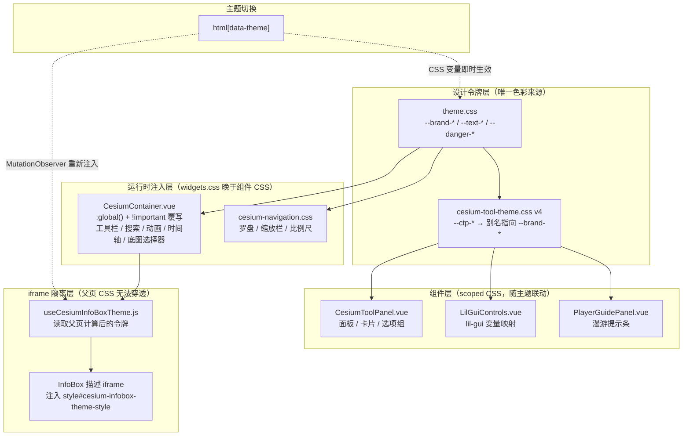

# Cesium 浮层与原生控件「浅色玻璃 + 品牌主题」统一（并入 V3.6.33）

- **日期与时间**：2026-10-30 22:40
- **任务等级**：L2 常规
- **版本**：V3.6.33（与同日的 `2026-10-30-tile-rectify-docs.md` 合并为同一版本发布）

---

## 一、问题分析

### 核心症状

三维场景里的界面语言与全站已经分裂成两套：

| 区域 | 症状 |
|---|---|
| 高级控制台（`CesiumToolPanel`） | Catppuccin 暗色海军蓝底 + 冰蓝描边，与 OL 控制中心、落地页的浅色玻璃完全不是一套语言 |
| lil-gui 参数控件 | 同为暗色底，嵌在面板里像一块「黑洞」 |
| Cesium 原生控件（工具栏 / 搜索 / 动画 / 时间轴 / 底图选择器） | 仍是 Cesium 默认的深色圆角样式，品牌色只出现在应用自有组件上 |
| InfoBox 属性卡片 | 暗色卡片 + 浅青正文（`#edffff`），与右侧白色抽屉并置时对比突兀 |
| 导航控件（罗盘 / 缩放栏 / 比例尺） | 半透明深色 + 青色描边，另一套独立配色 |
| 右下角坐标 | 纯文本、`pointer-events: none`，看得见但拿不走 |

### 根本原因

三维域的配色一直以「独立暗色身份」为设计前提（`cesium-tool-theme.css` v3 的域约定明确写着「不并入全局 `--panel-*` 浮层令牌，也不随绿/蓝主题联动」）。这套约定在单引擎时代成立，但在「2D/3D 一键切换」成为主路径后失效：同一个用户在 0.5 秒内从 OL 浅色控制中心切到 Cesium 暗色控制台，观感断裂；而主题切换（绿/蓝）只作用于应用自有组件，Cesium 侧纹丝不动。

叠加一层技术约束：Cesium 的 `widgets.css` 在**运行时注入**，晚于组件 CSS，因此任何覆写都必须带 `!important`；InfoBox 的描述正文又渲染在**独立 iframe** 里，父页 CSS 完全无法穿透。这两点决定了「改配色」不是改几个变量，而要分别处理「组件样式」「运行时注入样式」「iframe 内文档」三个层面。

### 受影响模块

- 设计令牌：`frontend/src/assets/cesium-tool-theme.css`（`--ctp-*` 全族）
- 三维面板：`CesiumToolPanel.vue`、`LilGuiControls.vue`
- 三维容器与原生控件：`CesiumContainer.vue`、`vendors/cesium-navigation/styles/cesium-navigation.css`
- 三维浮层：`PlayerGuidePanel.vue`
- 跨域公共层：`theme.css`（全局图标规则）、`TOCPanel.vue`、`LandingView.vue`、`SidePanel.vue`、`TopBar.vue`
- 二维控制条：`MapControlsBar.vue`、`MapContainer.vue`、`useMapState.js`
- 交互修复：`LayerControlPanel.vue`

---

## 二、模块关系与数据流向

> 图示要点：主题切换有**两条**生效路径 —— 常规组件靠 CSS 变量自动跟随；InfoBox iframe 因为跨文档拿不到父页变量，只能靠 `MutationObserver` 监听 `data-theme` 后重新注入。这是本次唯一需要 JS 参与配色同步的位置。

---

## 三、解决方案

### 3.1 令牌层：`--ctp-*` 从「独立暗色」改为「品牌别名」

方案对比：

| 方案 | 做法 | 结论 |
|---|---|---|
| **A 保留 `--ctp-*` 名字，值改为 `var(--brand-*)`** | 使用处（约 200 处 `rgba(var(--ctp-x-rgb), α)`）零改动，只换定义 | **选定**：改动面最小，且未来再换肤只需改这一处 |
| B 全量替换 `--ctp-*` 为 `--brand-*` | 语义更干净 | 否决：200+ 处替换，diff 噪音淹没真实改动，回归风险高 |
| C 保持暗色，只做局部微调 | 零风险 | 否决：不解决「两套语言」的根本问题 |

落地后 `--ctp-*` 成为一层**别名薄壳**：`-rgb` 三元组指向 `--brand-primary-rgb` / `--brand-accent-rgb`，实色指向 `--brand-primary` 等。代价是 `--ctp-green-alt` 等旧语义令牌事实上与 `--ctp-green` 重合（见第八节第 3 条）。

### 3.2 运行时注入层：统一 `!important` 覆写

Cesium 的 `widgets.css` 运行时注入、晚于组件样式，因此原生控件一律用 `:global()` + `!important` 覆写，并**统一采用实色白底**而非半透明玻璃 —— 控件层级复杂，半透明叠加后会发灰失真。

覆写范围：`.cesium-button`（工具栏四钮）、geocoder 输入框与结果列表、`cesium-animation-*`（动画控件 20+ 选择器）、`cesium-timeline-*`（时间轴刻度）、`cesium-baseLayerPicker-*`（底图选择器下拉）。

### 3.3 iframe 隔离层：InfoBox 主题注入

InfoBox 描述正文在独立 iframe 内，父页 CSS 无法穿透。新建 `useCesiumInfoBoxTheme.js`：

1. `applyInfoBoxTheme()` 读取父页 `getComputedStyle(documentElement)` 解析后的 `--text-*` / `--brand-*`，拼成一段 CSS 写入 `iframe.contentDocument.head` 的 `<style id="cesium-infobox-theme-style">`（幂等，重复调用只更新内容）。
2. Cesium 每次设置描述都用 `document.open()/write()/close()` **整篇重写 iframe 文档**，注入的 `<style>` 会随之销毁 —— 因此监听 iframe 的 `load` 事件重新注入。
3. 主题切换时 `data-theme` 变化 → `MutationObserver` 触发重新注入，保证 iframe 内文字跟随绿/蓝主题。
4. 在 `initViewer()` 中绑定，在 `onUnmounted` 与 `resetCesiumViewerForRetry()` 中清理。

配套：`identifyPresentation.js` 产出的属性表补 `cesium-identify-key` / `-value` / `-heading` 类名作为挂钩点，同时把内联色改成深色兜底（`#33443a` / `#2e7d32`），保证即使注入失败也是「白底深字」而不是白底浅字。

### 3.4 坐标 HUD：从「只读文本」改为「可复制按钮」

原 `.coordinate-display` 是 `pointer-events: none` 的纯文本，坐标看得见但拿不走。改为 `<button>`：

- 结构化为「位置 / 姿态 / 相机海拔」三组，标签与值分离，桌面横排、移动端纵排三行；
- 左侧复制图标 + 漫游态徽标，点击复制 `标签: 值` 逐行文本；
- 复制结果走 `message` 提示。

### 3.5 面板宽度与重复样式

- `.cesium-tool-panel` 展开宽度 380 → **520px**，`.compact` 仍 380px；`compactMode` 默认值改为 `!== false`（默认收起，需要宽屏时手动展开）。
- 删除文件后半段**整块重复**的 shell / panel / tab / scroll 定义（约 230 行）—— 这些规则与文件前段完全同名同值，仅因历史追加而重复，属纯冗余。
- `.module-card-body` 去掉 `max-height: 360px` + 内部滚动，改由外层 `.panel-scroll` 统一滚动，避免「多重滚动互相干扰」。

### 3.6 移动端与 iOS 修复

| 问题 | 根因 | 修法 |
|---|---|---|
| 落地页导航 / 页脚图标在 iPhone 上塌成 0 宽 | lucide 输出的 SVG 作为 flex 子项默认 `flex-shrink: 1`，且部分图标只有 CSS 尺寸没有 `width`/`height` 属性 | 图标补无单位固有尺寸属性；`.navbar / .footer / .cta-method svg` 与全局 `svg.lucide` 统一 `flex: none` |
| 目录树图标同样塌陷 / 在按钮内不居中 | 同上 + WebKit 行盒基线偏移 | `TOCPanel` 补 `svg { flex: none }` 与图标容器 `line-height: 0` |
| 侧栏折叠手柄在移动端点按后缩成 30px | 桌面 `.toggle-handle:hover { width: 30px }` 特异性高于移动端基准 80px | 移动端媒体查询内补 `:hover/:active` 的 80px 覆盖 |
| 移动端语言切换激活态像一条扁线 | `.lang-btn` 只给了横向内边距、纵向为 0，且激活态用的是浅底内描边 | 纵向 `align-self: stretch`、最小宽度 46px，激活态改用实心品牌渐变胶囊 |
| OL 控制条在移动端占满底部 | 横向条带 + 坐标文本 | 改为右侧竖向图标条，隐藏坐标区与复制入口 |
| Cesium 导航控件移动端偏小 | 整体 `scale(0.8)` | 罗盘 0.9、缩放栏 1.2（视觉约 38px 宽、命中高度 44px） |

### 3.7 交互修复：URL 子菜单「移不过去」

图层面板右键菜单的「URL 操作」子菜单，父项 `@mouseleave` 立即置 `false`，而子菜单 `left` 是**按菜单宽度写死的偏移**（比父项实际宽度多出几像素），指针穿过中间缝隙时 `mouseleave` 已触发，子菜单当场消失。

修法两条：① 子菜单改用 `left: 100%` / `right: 100%` 贴父项边缘，消灭缝隙；② 关闭改为 220ms 延迟 + 进入子菜单即取消。

---

## 四、修改内容

### 4.1 设计令牌

- `cesium-tool-theme.css` 重写为 v4：暗海军蓝 / Catppuccin 青绿全族改为「浅玻璃 + 品牌主题」，`-rgb` 三元组别名指向 `--brand-*`，警示族改指向全局 `--danger-rgb` / `--warning-rgb`。

### 4.2 三维面板

- `CesiumToolPanel.vue`：展开宽度 520px；`compactMode` 默认收起；折叠按钮图标 `Settings` → `Maximize2`/`Minimize2` 双态；删除约 230 行重复 CSS；模块卡 / 选项卡 / overlay 卡 / 徽章全部改白底 + 品牌色；`.panel-page` 与 `.module-card` 补 `min-width: 0`；场景 Tab 快捷操作强制单行（`flex-wrap: nowrap` + 省略号）；`.cesium-tool-shell` 的 `max-width` 由 390 对齐到 520。
- `LilGuiControls.vue`：lil-gui 的 `--background-color` / `--title-*` / `--widget-color` / `--hover-color` / `--focus-color` / `--number-color` / `--string-color` 全部改为浅色 + 品牌色；`color-scheme` 改 `light`。

### 4.3 三维容器与原生控件

- `CesiumContainer.vue`：新增 InfoBox 主题化接入（`bindInfoBoxTheme` / `watchThemeChange` / 两处 `cleanupInfoBoxTheme`）；坐标显示改 `<button>` + 复制；`.cesium-performanceDisplay` 改白底胶囊（FPS 固定蓝 `#2563eb`、MS 用 `--brand-gold-dark`、throttled 用红）；InfoBox 卡片白底 + 品牌渐变标题栏 + `z-index: calc(var(--z-panel) + 5)`；原生控件 5 组 `:global()` 覆写。
- `useCesiumInfoBoxTheme.js`（新建）：见 3.3。
- `cesium-navigation.css`：比例尺 / 罗盘 / 缩放栏全部重写为浅色玻璃 + 品牌色（含切角、顶部高光线、HUD 角标）；删除文件末尾整块「高对比度深色主题覆盖」；移动端缩放档位调整。
- `PlayerGuidePanel.vue`：深色药丸 → 浅色玻璃；`bottom` 32 → 86px（移动端 142px），为坐标 HUD 让位；移动端键位条允许换行。

### 4.4 跨域公共层

- `theme.css`：新增全局 `svg.lucide { flex: none }`。
- `TOCPanel.vue`：`svg { flex: none }`，三处图标容器补 `line-height: 0`。
- `LandingView.vue`：5 处 GitHub 图标补 `width="15" height="15"`；`.navbar / .footer / .cta-method svg` 与 `.btn-primary svg` / `.mobile-menu__contact svg` / `.mobile-menu__arrow` 补 `flex: none` 与固定尺寸；移动端 `.lang-btn` 与激活态重做。
- `SidePanel.vue`：移动端 `.toggle-handle:hover/:active` 锁定 80px。
- `TopBar.vue`：移动端 `.logo-link` 间距。

### 4.5 二维侧

- `MapControlsBar.vue`：移动端改右侧竖条，隐藏 `.coordinate-section` 与 `.copy-tooltip`。
- `MapContainer.vue`：移动端比例尺 `bottom` 4 → 30px。
- `useMapState.js`：经纬网标签字体改 `Times New Roman`，`offsetY` -55 → -80、`offsetX` -75 → -50。

### 4.6 交互修复

- `LayerControlPanel.vue`：URL 子菜单改为 `left: 100%` / `right: 100%` + 220ms 延迟关闭 + 进入即取消；`closeLayerContextMenu` / `onLayerContextMenu` 均先取消挂起的定时器；`onBeforeUnmount` 补 `cancelUrlSubmenuClose()`。

### 4.7 文案

- `locales/core.js`：落地页 `feature11` 中英双段（见 `2026-10-30-tile-rectify-docs.md`）。
- `locales/zh-CN.js` / `en-US.js`：`load3DModel` 缩短为「加载3D」/「Load 3D」；`cesium.scene.home` 缩短为「初始视角」/「Home view」（为单行按钮腾宽度）；新增坐标 HUD 的提示与无障碍文案 4 键（`copyCoordinateSuccess` / `copyCoordinateFailed` / `copyCoordinateTitle` / `copyCoordinateAria`）。

---

## 五、修改原因

1. **切换引擎时的观感断裂**：2D 浅色、3D 暗色，同一产品两副面孔。
2. **主题切换在三维域失效**：绿/蓝主题只作用于应用自有组件，Cesium 侧完全不跟随，等于功能残缺。
3. **暗色底 + 浅色正文在 InfoBox 里已经不可读**：卡片改白底后，Cesium 自带的 `#edffff` 正文变成白底浅字。
4. **坐标拿不走**：`pointer-events: none` 的纯文本对「要拿坐标去别处用」的场景完全无效。
5. **iOS 上图标塌陷属高频复发区**：桌面 Chrome 视口更宽，先不触发，只有真机暴露。

---

## 六、影响范围

| 模块 | 影响 |
|---|---|
| 三维工具面板 | 观感与布局全面变化：默认收起、展开 520px、单层滚动 |
| Cesium 原生控件 | 工具栏 / 搜索 / 动画 / 时间轴 / 底图选择器全部改白底品牌色 |
| InfoBox | 白底卡片 + 品牌渐变标题；iframe 内文字随主题联动 |
| 坐标显示 | 由只读文本变为可点击复制按钮，结构改为三组 |
| 导航控件 | 罗盘 / 缩放栏 / 比例尺重绘；移动端尺寸调整 |
| 二维移动端 | 控制条改右侧竖条，坐标区在移动端不可用 |
| 主题系统 | 三维域首次纳入 `[data-theme]` 联动范围 |
| 鉴权 / 数据库 / URL 参数 / 数据加载 | **无影响** |
| 后端 | **零改动** |

---

## 七、性能指标

未实测 —— 本次为样式与交互层改动。可注意的两点：

1. `useCesiumInfoBoxTheme` 的 `MutationObserver` 只监听 `documentElement` 的 `data-theme` 属性（`attributeFilter` 限定），不监听子树，主题切换频率极低，开销可忽略。
2. `CesiumToolPanel` 删除卡片内滚动后，长模块一次性渲染全部 DOM。当前最大模块（特效）控件数在数十量级，未观察到卡顿；若后续模块继续膨胀，应改为虚拟滚动而非恢复嵌套滚动。

---

## 八、测试方案

### Agent 已执行

| 检查 | 命令 | 结果 |
|---|---|---|
| 前端静态检查 | `npx eslint`（本次改动全部 `.vue` / `.js`） | **0 problems** |
| 类型检查 | `npx tsc --noEmit` | **0 错** |
| 构建 | `npx vite build --outDir <系统临时目录>` | **✓ built in 11.28s**，SFC 与 `:global()` 编译通过 |
| 结构树门禁 | `python Scripts/CheckStructureTree.py` | **521 / 521**，漏登记 0、幽灵条目 0 |
| 配置登记门禁 | `python Scripts/CheckConfigRegistry.py` | **7 项全通过** |
| 行尾完整性 | 逐文件统计 `\r\n` / 裸 `\n` | 29 个改动文件全部 CRLF，裸 LF 0 |
| 令牌可用性 | 逐个核对 `--brand-*` / `--text-*` / `--danger-*` / `--radius-*` / `--font-zh` 是否在 `theme.css` 定义 | 全部存在，无未定义变量引用 |
| 类名有效性 | `MapControlsBar` 移动端新规则的选择器与模板比对 | `.coordinate-section` / `.divider` / `.map-controls-group` 均存在 |
| 冗余规则核对 | 删除的 CSS 块选择器与文件前段逐条比对 | 25 个选择器全部在前段已有同名定义，无孤儿 |

- **未做 iOS 真机验证**：沙箱内无 WebKit，`flex: none` / `line-height: 0` 的实际效果需真机复验。
- **未做 InfoBox iframe 注入的浏览器实测**：仅静态核对 Cesium `document.open/write/close` 的重写语义与 `load` 事件时序。
- **平台红线 §11.2 四条 `rg` 自查**：本次不涉及 `backend/`、`deploy/` 中的代理 / 中转 / 自动化代码，触发条件不成立。

### 待用户实机验证

1. 三维模式打开高级控制台：确认默认收起、点击 `Maximize2` 展开为 520px 宽、`Minimize2` 收回 380px，且刷新后状态保留。
2. 展开任一模块（如特效）：确认面板**只有一条**滚动条（外层），卡片内部不再出现第二条。
3. 点击三维要素打开 InfoBox：确认标题栏为品牌渐变、正文为白底深字；切换绿/蓝主题后正文颜色同步变化。
4. 移动鼠标取点后点击右下角坐标卡：确认复制成功并弹出「坐标已复制」，粘贴内容为三行「标签: 值」。
5. 切换主题，确认罗盘 / 缩放栏 / 比例尺 / 工具栏 / 动画控件 / 时间轴 / 底图选择器全部跟随。
6. 2D 模式窗口宽度拖到 768px 以下：确认控制条变为右侧竖条、坐标区隐藏、比例尺不再被遮挡。
7. 图层面板右键 → 悬停「URL 操作」→ 指针斜向移入子菜单：确认子菜单不再中途消失。
8. **iPhone 真机**：落地页导航图标、主题切换图标、目录树图标均不塌陷且在按钮内居中；侧栏折叠手柄点按不缩小。

---

## 九、变更文件清单

| 文件（仓库相对路径） | 改动 |
|---|---|
| `frontend/src/assets/cesium-tool-theme.css` | v4：`--ctp-*` 全族改为浅玻璃 + `--brand-*` 别名 |
| `frontend/src/assets/theme.css` | 新增全局 `svg.lucide { flex: none }` |
| `frontend/src/domains/cesium/components/CesiumToolPanel.vue` | 面板宽度 / 默认收起 / 删除 230 行重复 CSS / 卡片重绘 / 单行快捷操作 / shell max-width 对齐 |
| `frontend/src/domains/cesium/components/LilGuiControls.vue` | lil-gui 浅色变量映射 |
| `frontend/src/domains/cesium/components/CesiumContainer.vue` | InfoBox 主题接入、坐标 HUD 改按钮、原生控件 `:global()` 覆写、性能胶囊重绘 |
| `frontend/src/domains/cesium/composables/core/useCesiumInfoBoxTheme.js` | 新建：InfoBox iframe 主题注入 |
| `frontend/src/domains/cesium/vendors/cesium-navigation/styles/cesium-navigation.css` | 比例尺 / 罗盘 / 缩放栏重写，删除深色覆盖块 |
| `frontend/src/domains/cesium/modules/player-controller/PlayerGuidePanel.vue` | 浅色玻璃 + 位置上移 + 移动端换行 |
| `frontend/src/domains/common/basemap/identifyPresentation.js` | 属性表补主题类名钩子 + 深色内联兜底 |
| `frontend/src/domains/common/layer-tree/components/TOCPanel.vue` | 图标 `flex: none` 与 `line-height: 0` |
| `frontend/src/domains/common/shell/SidePanel.vue` | 移动端折叠手柄 hover 宽度锁定 |
| `frontend/src/domains/common/shell/TopBar.vue` | 移动端 logo 间距 |
| `frontend/src/app/LandingView.vue` | 图标固有尺寸与 `flex: none`、移动端语言切换胶囊 |
| `frontend/src/domains/ol/components/MapControlsBar.vue` | 移动端右侧竖条 + 隐藏坐标区 |
| `frontend/src/domains/ol/components/MapContainer.vue` | 移动端比例尺下移 |
| `frontend/src/domains/ol/composables/useMapState.js` | 经纬网标签字体与偏移 |
| `frontend/src/domains/ol/layer/components/LayerControlPanel.vue` | URL 子菜单缝隙与延迟关闭修复 |
| `frontend/src/locales/zh-CN.js` / `en-US.js` | 按钮文案缩短 + 坐标 HUD 文案 4 键 |
| `Docs/Guide/frontend-structure.md` | 补录 `useCesiumInfoBoxTheme.js` |

---

## 十、遗留与风险

1. **`--ctp-*` 令牌语义塌缩**：`--ctp-green` / `--ctp-green-alt` / `--ctp-active-rgb` 等原本语义不同的令牌现在全部指向同一个 `--brand-primary`。当前无功能影响（使用处本就只取色），但「令牌名不再描述用途」，后续新增控件容易选错。建议下一轮把仍在使用中的 `--ctp-*` 逐步替换为直接引用 `--brand-*`，最终删除该文件。
2. **`identifyPresentation.js` 的内联兜底色仍按绿主题写死**（`#2e7d32` / `#33443a`）。蓝主题下若 iframe 注入失败，会退回绿字。属兜底路径，实际触发概率低，未改。
3. **全局 `svg.lucide { flex: none }` 是跨域强规则**：它禁止所有 lucide 图标参与收缩。当前未发现依赖图标收缩的布局，但若将来出现「窄容器内图标应缩小」的设计，需在该处显式 `flex: 1 1 auto`。
4. **坐标 HUD 可见文本仍为中文**：`经度 / 纬度 / 海拔 / 方位 / 俯仰 / 翻滚` 由 `CesiumContainer.vue` 与 `useCesiumInteractions.js` 直接拼字符串，英文界面下仍显示中文。本次只把**提示与无障碍文案**（toast / title / aria）接入 i18n；整体本地化需先把 `coordinateDisplay` 改为结构化坐标（`{lng, lat, height}`）再在组件内按语言格式化，属独立重构，已记入 `Docs/TODO/bugfix-optimization-plan.md`。
5. **InfoBox 注入存在一帧 FOUC**：Cesium 每次重写 iframe 文档到 `load` 事件之间，正文短暂无样式。实测窗口极短，未做额外处理。
6. **未做 iOS 真机验证**：见第八节。
