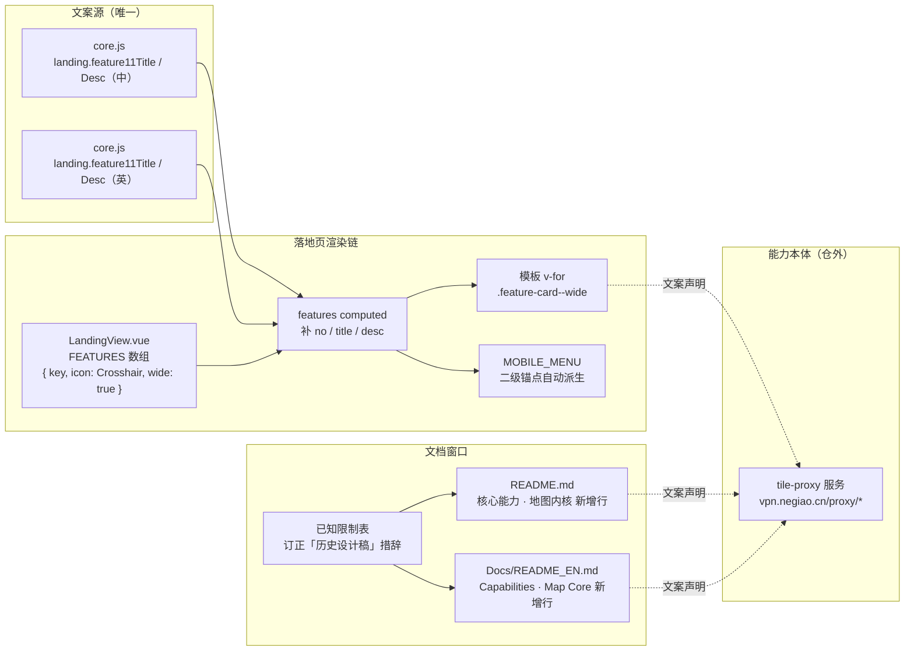

# 落地页与 README 补充「非标准瓦片在线纠偏」能力说明

- **日期与时间**：2026-10-30 12:35
- **任务等级**：L2 常规
- **版本**：V3.6.33

---

## 一、问题分析

### 核心症状

「非标准瓦片（GCJ-02 / BD-09）在线纠偏为 WGS-84」是本项目底图链路的核心能力之一，但在两个对外窗口都缺席：

| 位置 | 现状 | 缺口 |
|---|---|---|
| 落地页核心功能区（`LandingView.vue`，10 张卡） | `feature2`（丰富底图源）描述中仅有「GCJ-02 纠偏」五个字，BD-09 完全未出现 | 无独立卡片，能力不可被检索、不可被扫读 |
| 根 `README.md`「核心能力 · 地图内核」表 | 仅第 153 行底图源一行带过「GCJ-02/BD-09 纠偏」 | 无独立行，无机制说明（谁做、怎么做、前端是否需要改） |
| `Docs/README_EN.md`「Capabilities · Map Core」 | 同上，且英文措辞为 `GCJ-02/BD-09 rectification` | 同上 |

### 根本原因

该能力于 **2026-09-15 整包迁出本仓**（`backend/domains/tiles/` → 独立仓 `tile-proxy`，线上 `vpn.negiao.cn/proxy/*`），起因是 HF Space 平台政策禁止挂载 `/proxy/*` 第三方中转。迁移当次只更新了 `Docs/Architecture/tile-rectify-system.md` 与 README「已知限制」表，**未回填任何对外介绍文案**。

此后历次 README / 落地页迭代均以「功能面板」为单位组织文案（数据导入、建筑抓取、空间分析、AI 助手……），而纠偏属于**没有独立面板的基础设施**——它作用于所有底图请求，界面上看不到入口，因此在按面板盘点功能时被系统性漏掉。这不是一次疏忽，而是「以 UI 入口为盘点单位」的组织方式必然产生的盲区。

### 受影响模块

- 落地页功能网格：`frontend/src/app/LandingView.vue`（`FEATURES` 数组 + 网格 CSS）
- 落地页文案：`frontend/src/locales/core.js`（`landing.*` 中英双段同文件）
- 中文 README：`README.md`（核心能力表 + 已知限制表 + 版本三处）
- 英文 README：`Docs/README_EN.md`（对应两表 + 版本表 + 页脚）
- 版本记录：`Docs/Guide/CHANGELOG.md`

---

## 二、事实基线（实施前逐项读码核对，不作臆造）

| 事实 | 依据 |
|---|---|
| 纠偏实现**不在本仓** | `Docs/Architecture/tile-rectify-system.md` §1、§6；`backend/domains/tiles/` 已不存在 |
| 线上入口 `https://vpn.negiao.cn/proxy/*`（Azure VPS，nginx → 127.0.0.1:9002） | 同上 §1 表 |
| 本仓残留仅 `backend/core/coord_transform.py` 纯坐标数学（`wgs2gcj` / `gcj2wgs` 牛顿迭代 / `bd2wgs`），无网络 IO | 实读该文件 221 行；`grep gcj2wgs backend/**/*.py` 仅命中此一处（排除 `.venv`） |
| 对外四条纠偏路由 + 通用直通 | `tile-rectify-system.md` §3 |
| 服务端**逐瓦片重采样**，输出与请求方网格对齐的 256×256 图，前端零改造 | 同上 §2 |
| **实际走纠偏代理的图源**（关键） | 实读 `basemapConfig.ts`：GCJ-02 → `imagery_amap_wgs` / `vector_amap_wgs` / `amap_label`（高德）、`vector_tengxun_wgs`（腾讯）、`vector_Google_clean` / `imagery_google_water`（Google 中国）；BD-09 → `vector_baidu_wgs`（百度）。**天地图各图源以 `tk` 直连 `t0.tianditu.gov.cn` / DataServer，不走纠偏**——它发布 CGCS2000，与 WGS-84 差异在 1 m 量级，本无需纠偏 |
| `bd2wgs` 属**跨网格**（百度网格居中原点、Y 轴向上、`res=2^(18-z)`） | `frontend/src/config/publicRuntime.ts` `bd2wgsProxyUrl` 注释的「索引契约」段 |
| 前端接入唯一入口 `publicRuntime.ts` 的 `gcj2wgsProxyUrl` / `bd2wgsProxyUrl`，基址 `VITE_TILE_PROXY_BASE_URL` | 同上 §3 末段 |
| **HF Space 禁止挂 `/proxy/*`** | `tile-rectify-system.md` §1；`.workbuddy-ai/memory/MEMORY.md` 硬约束 |
| 文案不得写成「后端已内置纠偏」 | 由上两条推出，否则与已知限制表自相矛盾 |

> 结论：文案只能主张「**服务端纠偏后按标准 XYZ 使用**」，不能主张「本仓后端提供该接口」；且**不得把天地图列为 GCJ-02 图源**。

---

## 三、方案对比

| 方案 | 做法 | 优点 | 缺点 | 结论 |
|---|---|---|---|---|
| **A 新增第 11 张功能卡** | `FEATURES` 追加 `feature11`，与「建筑白模」同为整行宽卡 | 能力独立成条，可被扫读与检索；与 README 新增行一一对应 | 需核对网格行数，避免孤卡 | **选定** |
| B 并入 `feature2` 文案 | 仅把「GCJ-02 纠偏」扩写为「GCJ-02 / BD-09 在线纠偏至 WGS-84」 | 零布局风险、零 CSS 改动 | 纠偏仍只是底图源的一句话，撑不起一条独立能力；与「之前遗留、忘了加」的诉求不符 | 否决 |
| C 新增独立区块 | 功能网格与「关键技术」之间插横向「坐标系兼容」带 | 视觉最突出 | 需新写一整套区块样式与入场动效，改动面最大，且破坏既有 5 段式节奏 | 否决 |

### 网格行数核对（方案 A 的关键前提）

现有 `.features-grid` 是**凑满**的布局，直接加卡会产生孤卡，故先算清两种断点：

| 断点 | 列数 | 卡位占用 | 行数 |
|---|---|---|---|
| `>1024px` | 3 | 主卡 `feature1` 跨 2×2 = 4 格；`feature2~9` = 8 格；`feature10` 宽卡 = 3 格 → 合计 15 格 | 5 行，恰好铺满 |
| `≤1024px` | 2 | 主卡整行；其余 9 卡 = 4.5 行 → 由 `:last-child { grid-column: auto }` 撤销末卡跨列后凑成 5 行 | 6 行，恰好铺满 |

加入 `feature11` 且**同样标记为宽卡**后：

| 断点 | 卡位占用 | 行数 | 是否铺满 |
|---|---|---|---|
| 3 列 | 4 + 8 + 3 + 3 = 18 格 | 6 行 | ✅ 无孤卡 |
| 2 列 | 主卡 1 行 + 10 张小卡 = 5 行 | 6 行 | ✅ 无孤卡 |

> 关键结论：`grid-column: 1 / -1` 只写在 `@media (min-width: 1025px)` 内，2 列断点下宽卡本就退化为普通卡，因此**无需改动任何 CSS 规则**，只需订正三处已失效的行数注释。

---

## 四、模块关系与数据流向

> 图示要点：落地页与两份 README 都只是**声明层**，真实能力在仓外服务；三者共用同一套事实基线（第二节表格），任何一处措辞都不得越出该基线。

---

## 五、修改内容

### 5.1 落地页新增第 11 张功能卡

- `frontend/src/app/LandingView.vue`
  - lucide 导入新增 `Crosshair`（按字母序插在 `CloudSun` 与 `ExternalLink` 之间）
  - `FEATURES` 追加 `{ key: 'feature11', icon: Crosshair, wide: true }`
  - 订正三处行数注释：功能卡总数 10 → 11（`MOBILE_MENU` 注释）、3 列网格算式、2 列断点说明
- `frontend/src/locales/core.js`
  - 中文段追加 `feature11Title` / `feature11Desc`
  - 英文段追加同名两键

### 5.2 两份 README 新增能力行

- `README.md`「核心能力 · 地图内核」表新增「🧩 非标准瓦片在线纠偏」行
- `Docs/README_EN.md`「Capabilities · Map Core」表新增对应行

### 5.3 订正已知限制表的失实措辞

原措辞为「迁至独立服务，`tile-rectify-system.md` 为**历史设计稿**」。该文档实际仍是对外接入契约的权威来源（文档自述「本页只保留业务说明与接入契约」），称其为「历史设计稿」会让人误判能力已下线。改为「实现已迁出本仓、能力仍在线」并给出服务地址与禁止挂载的原因。

### 5.4 版本与日志

- `README.md` 三处版本号 → V3.6.33
- `Docs/Guide/CHANGELOG.md` 顶部追加 V3.6.33 条目
- `Docs/README_EN.md` 版本表补 V3.6.33，并回填缺失的 V3.6.32 行（见第十一节第 1 条）

### 5.5 实施期事实纠错（草案 → 定稿）

首版草案写的是「高德、腾讯、**天地图**发布的是 GCJ-02 瓦片」。落地前按 §2.6「禁止臆造事实」逐条回读 `basemapConfig.ts` 中 `gcj2wgsProxyUrl` / `bd2wgsProxyUrl` 的全部 14 处调用点，确认**天地图不在其中**——其各图源以 `tk` 直连 `t0.tianditu.gov.cn` 与 DataServer；真正经纠偏代理的是高德、腾讯、Google 中国（GCJ-02）与百度（BD-09）。

该错误来源可追溯：`Docs/Architecture/tile-rectify-system.md` §2 的「谁在用」列把天地图归入 GCJ-02。**照抄文档即会写出假事实**，这正是规范要求「先读实际代码」的典型场景。

已改正范围：落地页中文 + 英文、`README.md` + `Docs/README_EN.md` 能力行（共 4 处），以及两处版本摘要。架构文档本身的错误归属未改，按 §2.5 记入 `Docs/TODO/bugfix-optimization-plan.md`。

---

## 六、修改原因

1. **对外介绍与真实能力脱节**：纠偏是本项目底图链路的技术门槛所在（国内合规图源无一发布 WGS-84 瓦片），却在两个对外窗口都没有独立说明。
2. **盲区成因需在文档里留痕**：以 UI 面板为盘点单位会漏掉无面板的基础设施，本次在日志中固化该教训，供后续盘点参考。
3. **失实措辞会反向误导**：把仍在生产运行的服务写成「历史设计稿」，等于自我否认能力。

---

## 七、影响范围

| 模块 | 影响 |
|---|---|
| 落地页功能网格 | 卡片数 10 → 11，3 列 / 2 列断点行数均由 5 行变为 6 行，无孤卡 |
| 落地页移动端二级菜单 | 自动派生自 `features`，新增 1 个锚点，无需手改 |
| i18n | 中英各新增 2 键，无既有键改动 |
| README / README_EN | 各新增 1 行表格、订正 1 行已知限制、版本号递增 |
| 鉴权 / 数据库 / URL 参数 / 图层管理 | **无影响**（纯文案与展示层） |
| 后端 | **零改动** |

---

## 八、性能指标

未实测——本次为纯文案与展示层改动，不涉及运行时逻辑，无可比对的前后指标。

---

## 九、测试方案

### Agent 已执行

| 检查 | 命令 | 结果 |
|---|---|---|
| 前端静态检查 | `npx eslint src/app/LandingView.vue src/locales/core.js` | **0 problems**（退出码 0） |
| 前端构建 | `npx vite build --outDir <系统临时目录>` | **✓ built in 16.41s**；`Crosshair` 导入解析正常、SFC 编译通过；仅既有 chunk 体积告警（与本改动无关） |
| 结构树门禁 | `python Scripts/CheckStructureTree.py` | **520 / 520**，漏登记 0、幽灵条目 0 |
| 配置登记门禁 | `python Scripts/CheckConfigRegistry.py` | **7 项全通过**（catalog 130 key · 前端 `VITE_` 15 个） |
| 行尾完整性 | 逐文件统计 `\r\n` / `\n` / `\r\r\n` | 5 个改动文件全部 CRLF，`doubleCR=0`、`bareLF=0`，无整文件级 diff |
| 事实核对 | `grep gcj2wgsProxyUrl/bd2wgsProxyUrl basemapConfig.ts` | 14 处调用点逐一确认归属，**天地图不在其中**（见 5.5） |

- **未跑 `tsc --noEmit`**：本次未新增任何 `.ts` 文件，且改动的 `.vue` 为纯 JS（`<script setup>` 无 `lang="ts"`），不在类型检查覆盖范围。
- **平台红线 §11.2 四条 `rg` 自查**：本次改动不涉及 `backend/`、`deploy/`、`frontend/src/` 中的代理 / 中转 / 自动化代码，四条自查的触发条件（后端或部署面改动且即将 push 到 HF）不成立，故未执行；如需在 push 前统一跑一遍，结论不会因本次改动而变化。

### 待用户实机验证

1. `npm run dev` 后打开落地页，滚到「核心功能」区，确认末尾出现**两张连续的整行宽卡**（建筑白模 → 非标准瓦片在线纠偏），末行无空缺。
2. 浏览器宽度拖到 1000px 左右（2 列断点），确认 11 张卡铺满 6 行、最后一行无孤卡。
3. 切到英文（`en-US`），确认第 11 张卡标题与描述为英文且不溢出。
4. 移动端菜单（≤1024px 汉堡菜单）展开「核心功能」，确认二级列表出现第 11 项且点击可定位。
5. 触屏设备或 F12 设备模式（选具体机型使 `pointer: coarse` 生效），确认卡片文字不被裁切。

---

## 十、变更文件清单

| 文件（仓库相对路径） | 改动 |
|---|---|
| `README.md` | ① 核心能力 · 地图内核新增「🧩 非标准瓦片在线纠偏」行；② 已知限制表订正瓦片纠偏一行的失实措辞并补链接；③ 版本号三处 → V3.6.33（项目简介行 / 版本演进表首行 / 页脚日期） |
| `Docs/README_EN.md` | ① Capabilities · Map Core 新增对应行；② Known Limitations 同行订正；③ 版本表补 V3.6.33 与缺失的 V3.6.32 两行、删最旧的 V3.6.29（保持 3 行）；④ 页脚 → V3.6.33 / synced 2026-10-30 |
| `Docs/Guide/CHANGELOG.md` | 顶部追加 V3.6.33 完整条目（背景 / A 落地页 / B README / C 措辞订正 / D 断档回填 / 验证 / 未覆盖） |
| `frontend/src/app/LandingView.vue` | ① lucide 导入新增 `Crosshair`；② `FEATURES` 追加 `feature11`（`wide: true`）；③ 订正三处已失效的行数注释（移动端菜单注释、3 列网格算式、2 列断点说明） |
| `frontend/src/locales/core.js` | 中英双段各新增 `feature11Title` / `feature11Desc`（共 4 键） |
| `Docs/TODO/bugfix-optimization-plan.md` | 追加「架构文档坐标系归属失实」（天地图被误列为 GCJ-02），按 §2.5 只记不改 |
| `Docs/LLM_record/26-10/2026-10-30/2026-10-30-tile-rectify-docs.md` | 本日志（新建） |

> 说明：`Docs/Architecture/tile-rectify-system.md` **未改动**（见第十一节第 2 条）；`frontend` 侧无新增文件，故结构树无增删。

---

## 十一、遗留与风险

1. **`Docs/README_EN.md` 版本滞后一版**：其版本表首行为 V3.6.31，缺 V3.6.32（建筑抓取凭证框加固）。本次因要在同表插入 V3.6.33，若不回填会在表中留下可见断档，故一并补齐 V3.6.32 的英文摘要。该补齐属**同一表格内的必要连贯性修复**，非独立范围扩张。
2. **`Docs/Architecture/tile-rectify-system.md` §2 坐标系归属失实**（既有问题，未修）：该表把「天地图」列入 GCJ-02 使用者，而代码中天地图各图源均以 `tk` 直连、**不走**纠偏代理；天地图发布 CGCS2000，与 WGS-84 差异在 1 m 量级，本无需纠偏。本次文案已按代码核对避开该错误，文档本身按 §2.5 未改，已记入 `Docs/TODO/bugfix-optimization-plan.md`。**这是本次最值得记住的一条**：照抄架构文档会直接产出假事实。
3. **`Docs/README_EN.md` 技术栈数字漂移**（既有问题，未修）：英文版写 `OpenLayers 10.5 + Cesium 1.132` 与 `96 layer definitions`，中文版为 `10.11 + 1.146` 与 `106`。属历史遗留漂移，本次不动，建议后续单独立项校准。
4. **落地页两张宽卡相邻的视觉密度**：`feature10`（建筑白模，含合规声明长文案）与 `feature11`（纠偏）连续两张整行卡，桌面端读作两条「汇总条带」。若实机观感偏重，可改为「宽卡 + 普通卡」并把 `feature10` 拆行，但会破坏 3 列 6 行的整除关系，需重新排版。
5. **纠偏能力的实测入口未验证**：本次仅补文案，未实机验证 `vpn.negiao.cn/proxy/*` 当前可用性。文案按「能力存在」表述，依据是前端既有调用（`basemapConfig.ts` 的 14 处代理调用）与 `tile-rectify-system.md` 的接入契约；若该服务已下线，四处文案需同步回退。

6. **新增的「OSM代理」底图当前不可用**（见附录 A）：OSM 基金会对代理出口按瓦片使用政策拦截，返回「403 Access blocked」提示图且 HTTP 仍为 200。用户决定保留官方源，故该条以已知不可用状态入库，修法已记入 `Docs/TODO/bugfix-optimization-plan.md`。

---

## 附录 A：同日追加 —— OSM 代理底图（并入 V3.6.33）

### A.1 背景与实施

用户要求新增一张「`vpn.negiao.cn/proxy` 接口下的 OSM 代理」底图，位置放在 Google 代理后。

| 项 | 落地 |
|---|---|
| 图层定义 | `osm_Backend_Proxy`（`name: 'OSM代理'`，`category: 'custom'` / `group: '自定义'`，`maxZoom: 19`），插在 `google_Backend_Proxy` 之后、`ships66` 之前 → 定义数组第 103 位 |
| 预设 | `osm_Backend_Proxy_preset`（`stack` 仅自身 —— OSM 矢量图自带注记，不叠注记层，与 `vector_osm_preset` 同构），插在 `google_Backend_Proxy_preset` 之后 → 预设第 **12** 位 |
| Cesium | 描述符由 `getDescriptorById` 自动派生，未改 |
| 数量同步 | 预设 90 → 91、图层定义 106 → 107；`README_EN` 滞后的 96 一并校准为 107 |

### A.2 预设下标耦合（已获用户确认后执行）

`ALL_BASEMAP_PRESETS` 把 `index + 1` 直接写进 label，且 `?l=` 与后台 `default_basemap_index` 均按数组下标解析。插入第 12 位后，原第 12~90 项整体 +1：下拉编号重排、已分享链接与管理员默认底图会解析成**另一张**底图。用户选择「严格插在 Google 代理后」，接受该副作用。

### A.3 上线前实测：该底图当前不可用

| 上游（均经同一代理） | 瓦片 | HTTP | 实际内容 |
|---|---|---|---|
| `tile.openstreetmap.org` | 10/521/341 | 200 | **6987 B「403 Access blocked」提示图** |
| `tile.openstreetmap.org` | 12/3374/1554 | 200 | 同上（MD5 完全一致） |
| `tile.openstreetmap.de` | 10/521/341 | 200 | 37512 B 真实瓦片 |
| `tile.openstreetmap.de` | 12/3374/1554 | 200 | 27989 B 真实瓦片 |
| `mt1.google.com`（对照） | 10/512/320 | 200 | 1863 B 真实卫星瓦片 |

- **判据**：响应头 `Age: 16` + `last-modified` 为请求前 16 秒 → 上游**实时**返回，不是本地缓存。
- **根因**：OSM 基金会瓦片使用政策拒绝单一出口 IP 的批量转发。短时间十余次请求即可触发；正常浏览一屏地图（数十张瓦片）必然命中。
- **放大风险**：代理对拦截图同样下发 `Cache-Control: max-age=604800`，错误图会在 Cloudflare 边缘留存 7 天，且 `x-proxy-status` 仍标 `SUCCESS`（代理不校验响应内容）。
- **决策**：用户选择**保留官方源**。故代码注释中已写明「本图层目前不可用」，修法记入 `Docs/TODO/bugfix-optimization-plan.md`；README 示例源不把「代理版」作为卖点。
- **后续（同日 13:00）**：根因进一步定位到代理侧出站头冒充浏览器（见 `tile-proxy` 1.2.0），已在独立仓实现身份修复 + 相同字节瓦片检测，待部署。另查明演示页 `/tile-proxy/` 的 OSM 看似正常，实为边缘缓存（`age` 4.1 万~6.6 万秒）而非不同做法。

### A.4 验证

`eslint`（改动文件）0 problems；`tsc --noEmit` 0 错；`vite build` ✓ 16.91s（4412 modules）；`CheckStructureTree` 520/520；`CheckConfigRegistry` 全绿；6 个改动文件行尾均为 CRLF（`bareLF=0` / `doubleCR=0`）。

---

## 零散修补（L1）

### 导航栏图标 iOS「塌陷」（14:40）

- **症状**：iPhone 上落地页导航栏的图标（GitHub 标记、登录按钮里的 LogIn）在窄屏被压成接近 0 宽。
- **根因**：图标 SVG 作为 flex 子项时默认 `flex-shrink: 1`。`.nav-actions` 是 `flex: 1` 的弹性行，
  子项 `.btn-primary` 未锁 `flex-shrink`，空间不足时它先被压缩，内部 SVG 随之塌陷；
  `.icon-github` 更只有 CSS 尺寸、没有 `width`/`height` 属性，iOS Safari 在拿不到 CSS 尺寸时
  会按 viewBox 比例算出 0。桌面视口更宽，所以先不触发。
- **改动**：`LandingView.vue` 单文件 +20 行 —— 5 处 `<svg class="icon-github">` 补 `width="15" height="15"`
  固有尺寸；新增 `.navbar svg / .footer svg / .cta-method svg { flex: none }`，让图标不参与收缩
  （尺寸仍由各自 CSS 决定，属性只作兜底）。
- **同步修复**：`vpn.negiao.cn` 前端同类问题 —— `AppShell.vue` 的 `.menu` / `.icon-btn` 与
  `SideNav.vue` 的 `.nav-item svg / .contact-link svg / .brand svg` 补 `flex: none`（+11 行）。
- **验证**：WebGIS-Dev `eslint` 0、`vite build` ✓ 16.78s（4412 modules）；vpn `vue-tsc --noEmit` 0 错、
  `vite build` ✓ 1.31s（157 modules）。**未做 iOS 真机验证**（沙箱无 WebKit），需用户在 iPhone 上复验。

### 补记（14:45）：真正的差异是「尺寸属性带单位」

上一节的 `flex: none` 只解决了「被挤压」。用户反馈主题切换与目录图标仍塌陷，继续比对后定位到真正的差异：

| 组件 | 渲染出的属性 | 结果 |
|---|---|---|
| `GitHubMark` | `width="16" height="16"` —— 无单位 | 正常 |
| `AppIcon` | `width="15px" height="15px"` —— **带单位** | 塌陷 |

SVG 的 `width`/`height` **属性**要求无单位数值；带 `px` 时 WebKit 会把该属性判为非法并丢弃，图标因此算不出固有尺寸。
主题切换按钮用的正是 `AppIcon`，所以只有它坏，而紧挨着的 GitHub 标（`GitHubMark`）一直正常 —— 不是图标本身的问题，是写法不同。

**改法**（即用户提出的「换成 GitHub 那种写法」）：
- `AppIcon.vue`：新增 `attrSize`（数值型才输出），属性改绑无单位值；内联样式仍带单位，并补 `minWidth`/`minHeight` 兜底。
- `TOCPanel.vue`：目录「样式模板」区的 `Palette` / `Paintbrush` 等 lucide 图标，scoped 样式加 `svg { flex: none }`。

**验证**：vpn `npm run build`（含 vue-tsc）✓ 1.63s，产物含 `minWidth`；WebGIS-Dev `eslint` 0、`vite build` ✓ 9.46s，
产物含 `svg[data-v-…]{flex:none}`。仍未做 iOS 真机验证。

### 补记（15:00）：按钮内图标居中（WebKit 专属）

用户反馈图标能显示但**在按钮里不居中**。用 puppeteer 做真实移动端模拟（390×844、isMobile、hasTouch）实测：
Chromium 下三个按钮（汉堡 / GitHub / 主题）的 `dx=dy=0`，几何完全居中，且页面无横向溢出 —— 说明偏移只在 WebKit 出现。

**改法**（针对 WebKit 的实现差异，不是再猜尺寸）：
- vpn `AppShell.vue`：`.menu` / `.icon-btn` 由 `display:grid + place-items:center` 改为
  `display:flex + align-items/justify-content:center` —— WebKit 对 grid 内 SVG（替换元素）做
  `place-items` 居中时不稳定，图标会偏上/偏左；再补 `line-height: 0` 消掉行盒基线偏移。
  `.identity-action` 补 `line-height: 1`，图标与文字并排时不偏高。
- WebGIS-Dev `TOCPanel.vue`：`.section-icon` / `.upload-icon` / `.share-icon` 补 `line-height: 0`。

**验证**：vpn `npm run build`（含 vue-tsc）✓ 1.79s、WebGIS `vite build` ✓ 10.53s；改后 Chromium 实测仍 `dx=dy=0`、无回归。
WebKit 下的实际效果需用户在 iPhone 上确认 —— 本轮无法在沙箱内复现 Safari 的 grid 居中缺陷。

---

## 附录 B：合并发布说明（22:40 补记）

V3.6.33 最终由两条工作线合并而成，本文件只覆盖其中「纠偏文案 / OSM 底图 / iOS 图标」一线；同日另一线「Cesium 浮层与原生控件主题统一」见
[`2026-10-30-cesium-ui-light-theme.md`](2026-10-30-cesium-ui-light-theme.md)。两线共用同一版本号与同一提交，`CHANGELOG` 与两份 README 的 V3.6.33 条目已按合并后的范围重写。

**对本文第十、十一节的两处订正**：

1. 第十节末尾原写「`frontend` 侧无新增文件，故结构树无增删」—— 合并后不再成立：另一线新增了
   `frontend/src/domains/cesium/composables/core/useCesiumInfoBoxTheme.js`。该文件初次遗漏登记，`CheckStructureTree.py`
   报「漏登记 1」，已在 `Docs/Guide/frontend-structure.md` 的 `composables/core/` 段补录（置于 `useCesiumNavigation.js` 之前），
   门禁恢复 **521 / 521**。
2. 第九节「Agent 已执行」中「未跑 `tsc --noEmit`」的结论仅对本文范围成立；合并后的整包已跑 `tsc --noEmit`（0 错）与
   `vite build`（✓ 11.28s），详见另一线日志第八节。

