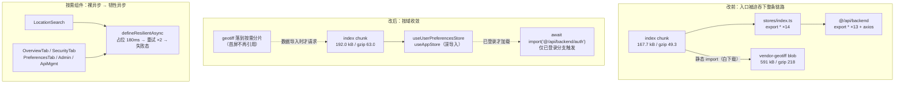

# 首屏打包与依赖加载优化（构建链根治 + 异步组件韧性）

- **日期与时间**：2026-10-31 10:55
- **任务等级**：L2 常规
- **版本**：V3.6.35

---

## 一、问题分析

### 核心症状

用户在移动端部署环境反馈两组现象，起初被当成两件独立的事：

| # | 症状 | 用户描述 |
|:--:|---|---|
| 1 | 首屏慢 | 落地页与「登录 → 进入 OL」的加载/响应速度不理想 |
| 2 | 进入 OL 后局部 UI 空白 | 地点搜索框整块消失（含 `<search-icon>`）；账号中心「总览」只有数据、没有图标与布局；网络面板里相关依赖长时间停在「正在加载中」 |
| 3 | 无自愈 | 上述空白不会自行恢复，只能刷新 |

用户当时的判断是「昨日修复引入了非必要的依赖」。

### 排查过程与根本原因

先做**证伪**再定位，避免沿着「昨日改动」这条错误线索走：

1. 昨日提交 `fdf13e91`（ios bug修复）只改了 `LandingView.vue` 的 15 行 CSS（汉堡按钮 `align-items` / span 宽度），**不含任何 import 变更**，不足以造成 OL 侧缺依赖。
2. 今日暂存改动（`MapControlsBar` / `CesiumContainer` / `LayerPanel` / `TOCTreeItem` / `LandingView` / 两个 locale）中，唯一触及搜索链路的 `LayerPanel.vue` 只新增了一个 `:search-active` prop 透传，无破坏性。
3. 构建产物自检：108 个 chunk 内部引用全部可解析，`index.html` 引用全部存在，**不存在 404 型缺失**。排除「产物本身缺文件」。
4. 静态 import 图环路检测：**0 个静态环路**（仅动态 import 形成的 SCC，不构成初始化死锁）。排除「循环依赖导致绑定为空」。

于是转向「产物结构」本身，发现三个叠加的结构性缺陷：

**根因 1 —— 手工 `manualChunks` 在 Vite 8 / rolldown 下已失效，且反向把重库拉进入口。**
`vite.config.js` 里那份 20 余个 `vendor-*` 命名分组是 Rollup 时代的策略。实测产物中分组语义已错乱：

| 现象 | 证据 |
|---|---|
| 应用模块被塞进以第三方库命名的 chunk | `vendor-geotiff-*.js`（591 kB）内部含有 `api/backend/admin.js` 的 `apiGetProxyRateLimit`（`async function Mr(){return mt.get("/api/admin/config/proxy-rate-limit")}`） |
| chunk 名与内容不对应 | `vendor-lucide-*.js`（120 kB）装的是 Vue 运行时（首行即 `@vue/shared` 的 `makeMap`）+ 图标；`vendor-vue-*.js`（48 kB）里只剩 vue-router |
| 入口被迫引用巨型 blob | 入口 chunk 顶部出现 `import{Mr as Te}from"./vendor-geotiff-C_-saSR9.js"` → 落地页必须下载 591 kB（gzip 约 218 kB）的栅格解析代码，而首屏完全用不到 |

**根因 2 —— `stores/index.ts` 是 `export *` 聚合桶，首屏 4 个文件都从它取 store。**
该桶汇总 14 个 store（含 `@ol/stores/*`、`@common/chat/stores/useChatStore`、`@common/data-import/stores/useDownloadStore`）。`export *` 对含副作用（`defineStore` 调用）的模块无法 tree-shake，整张 store 图被拖进入口 chunk。同理，`@/api/backend` 也是 `export *` 桶（13 个模块 + axios 实例 + 拦截器副作用），被 `useAuthStore` / `useUserPreferencesStore` 静态导入，整层 API 进入口。

**根因 3 —— 按需组件裸用 `defineAsyncComponent`，无占位、无重试、无超时。**
`LocationSearch`（`LayerControlPanel.vue:447`）与 `OverviewTab` 等账号中心分页（`FloatingAccountPanel.vue:28-32`）都是裸 `defineAsyncComponent(() => import(...))`。分片请求一旦挂起或中断，该区域**永久空白且不自愈**，用户看到的就是「数据在、界面没加载」「搜索框连同图标一起消失」。移动网络 RTT 抖动大，这个缺口被放大成高频问题。

> 结论：症状 2 与症状 1 **同源** —— 都是产物结构与按需加载策略的问题。修「依赖加载」即同时修「UI 空白」。

### 受影响模块

`vite.config.js`（构建链）、`main.js`、`router` 首屏路由（`LandingView` / `RegisterView`）、`GlobalLoading`、`useAuthStore`、`useUserPreferencesStore`、`LayerControlPanel`、`FloatingAccountPanel`。

---

## 二、模块关系与数据流向

> 图示要点：改前入口的静态依赖图里有两条「不该有」的边 —— 指向 14-store 聚合桶、指向 591 kB 的 geotiff blob。改后这两条边被切断，重库回到按需分片；同时所有关键按需组件获得「占位 + 重试 + 超时」三件套。

---

## 三、解决方案

### 3.1 分包策略：从「手工分组」退回「默认分组」

| 方案 | 做法 | 结论 |
|---|---|---|
| A 保留 manualChunks，逐个修匹配条件 | 继续按包名分组，尝试绕过 rolldown 的合并行为 | 否决：分组语义由 bundler 决定，逐条试探不可维护，且无法保证下次升级不复发 |
| B 改用 rolldown 原生 `advancedChunks` | 用新 API 重写全部 20 余条规则 | 否决（本轮）：需重新校准全部阈值与命名，属独立工作量，且当前默认分组已达标 |
| **C 移除 manualChunks，交回默认分组** | 只保留 `chunkFileNames` 的 Jekyll 下划线约束 | **选定**：一次消除「重库进 入口」的结构性风险，规则可预测 |

对照实测（同一份源码）：

| 指标 | 手工分组 | 默认分组 |
|---|---|---|
| 入口 chunk | 108.8 kB（gzip 31.8） | 192.0 kB（gzip 63.0） |
| 首屏预加载 | 92 kB gzip | 57 kB gzip |
| 入口静态引用的重库 | **geotiff 218 kB + planar-route 6 kB** | 无 |
| **首屏 gzip 合计** | **约 365 kB** | **约 120 kB** |
| chunk 数 | 108 | 约 152 |

入口单文件变大、但总量降到三分之一 —— 因为入口不再背 591 kB 的 blob。chunk 数增加只影响「用户触发功能时」的按需请求，不影响首屏。

同时删除两项随之失效的配置：`modulePreload.resolveDependencies` 的 `SKIP_PRELOAD_CHUNKS` 白名单（默认分组不再产出 `vendor-*` 名字，过滤恒为 no-op）与只被 manualChunks 使用的 `isNodeModulePackage` 辅助函数。

### 3.2 首屏依赖裁剪：聚合桶 → 深导入 + 按需 import

- 4 个首屏文件改深导入（`main.js` / `LandingView` / `RegisterView` / `GlobalLoading`）。
- `useAuthStore.ensureValidSession()`：`apiAuthMe` 改为函数内 `await import('@/api/backend/auth')`。该函数在无 token 时**提前 return**，故登录页首屏不会触发加载。
- `useUserPreferencesStore`：3 处调用点同样改为按需 import。`bootstrap` 在无 token 时同样提前 return。

选「按需 import」而非「深导入 `@/api/backend/auth`」：后者仍会静态引入 `client.js`（axios 实例 + 拦截器），只是少 12 个模块；前者能让 axios 整体退出首屏图。

### 3.3 按需组件韧性：新增 `defineResilientAsync`

`@common/utils/defineResilientAsync.ts`（新建，`.ts`）：

1. `loader` 外包一层**线性退避重试**（默认 2 次，间隔 400/800ms）。
2. `loadingComponent`：延迟 180ms 显示占位块，避免快网闪烁。
3. `errorComponent`：重试耗尽后显示可读失败文案。
4. **占位与失败态全部用内联样式**渲染 —— 关键设计：若样式分片同时失败，兜底 UI 仍可见，否则「兜底」会跟着一起消失。

应用于 6 处：`LocationSearch`、`OverviewTab`、`SecurityTab`、`PreferencesTab`、`AdminControlPanel`、`ApiManagementPanel`。

---

## 四、修改内容

### 4.1 构建配置

- `vite.config.js`：删除 `manualChunks`（含 20 余条分组规则与逐条注释，改为一段说明「为何移除 + 实测对照 + 后续若需分组应用 `advancedChunks`」）；删除 `modulePreload.resolveDependencies` 白名单，仅保留 `polyfill: true`；删除 `isNodeModulePackage`；更新 `rollupOptions` 上方注释。

### 4.2 首屏依赖

- `main.js` / `LandingView.vue` / `RegisterView.vue`：`from './stores'` → `@common/user/stores/useUserPreferencesStore`。
- `GlobalLoading.vue`：`useAppStore` 由 `@/stores` → `@common/app/stores/useAppStore`。
- `useAuthStore.ts`：删除顶层 `import { apiAuthMe } from '@/api/backend'`，改为 `ensureValidSession` 内按需 import。
- `useUserPreferencesStore.ts`：删除顶层 API 导入，3 处调用点（拉取偏好 / 回写语言 / 保存偏好）改按需 import。

### 4.3 异步组件韧性

- 新建 `src/domains/common/utils/defineResilientAsync.ts`。
- `FloatingAccountPanel.vue`：5 个 `defineAsyncComponent` → `defineResilientAsync`（各自文案与最小高度）；移除已不用的 `defineAsyncComponent` 导入。
- `LayerControlPanel.vue`：`LocationSearch` 改 `defineResilientAsync`（`minHeight: 38`）；`defineAsyncComponent` 从 vue 导入中移除，新增 `defineResilientAsync` 导入。

### 4.4 文档

- `Docs/Guide/frontend-structure.md`：登记 `defineResilientAsync.ts`。
- `README.md`：版本号三处（简介行 / 版本表首行 + 删最旧行 / 页脚）。
- `Docs/Guide/CHANGELOG.md`：追加 V3.6.35 条目。

---

## 五、修改原因

1. **首屏传输里有一半是首屏用不到的代码**：591 kB 的 geotiff blob 被入口静态引用，是「打包配置失效」的直接后果，不是业务需要。
2. **聚合桶让 tree-shaking 彻底失效**：`export *` + 副作用模块 = 全量进入口，这是仓库级的反模式，首屏 4 个文件全部命中。
3. **按需组件没有失败路径**：移动网络下分片请求失败是常态而非异常，裸 `defineAsyncComponent` 把常态当成了不会发生。
4. **用户报的「UI 空白」与「首屏慢」同源**：都来自产物结构与按需加载策略，分开修会互相掩盖。

---

## 六、影响范围

| 模块 | 影响 |
|---|---|
| 构建产物结构 | chunk 划分方式整体变化（108 → 约 152），chunk 命名由 `vendor-*` 变为按模块名 |
| 首屏加载 | 传输量约降到三分之一；入口文件本身变大但总量大幅下降 |
| 鉴权 / 用户偏好 | API 调用时机由「模块加载时」推迟到「首次实际请求」，行为不变 |
| 账号中心 / 图层面板 | 新增占位与失败态；成功路径渲染结果不变 |
| 后端 / 配置 key / 数据源加载链路 | **零改动** |

> ⚠️ 部署注意：chunk 命名整体变化，**旧版本缓存页面引用的旧 chunk 名将全部失效**。上线后如有用户停留在旧页面，动态导入会 404 —— 本次新增的韧性包装会重试并给出失败态，但正确的处置是发布后让用户刷新。若部署端有长缓存策略，需同步确认 `index.html` 不被强缓存。

---

## 七、性能指标

同一份源码、同一台机器、同一构建命令，仅改配置与导入方式：

| 指标 | 改前 | 改后 | 变化 |
|---|---|---|---|
| 入口 chunk（raw） | 167.66 kB | 191.97 kB | +14.5%（入口吸收了原被拆出的应用模块） |
| 入口 chunk（gzip） | 49.32 kB | 63.03 kB | +27.8% |
| 首屏预加载（gzip 合计） | 92 kB（8 个分片） | 57 kB（10 个分片） | −38% |
| 入口静态引用的重库 | geotiff 218 kB + planar-route 6 kB（gzip） | 无 | **−224 kB** |
| **首屏 gzip 合计** | **约 365 kB** | **约 120 kB** | **−67%** |
| chunk 总数 | 108 | 约 152 | +41% |
| 构建耗时 | 17.7 s | 17.0 s | 持平 |

**未实测**：真实网络下的 FCP / LCP / TTI 未测量（本机无 Chromium/Playwright，无法跑 Lighthouse）。上表均为产物体积口径，与运行时指标正相关但不等价。

---

## 八、测试方案

### Agent 已执行

| 检查 | 命令 | 结果 |
|---|---|---|
| 构建 | `npx vite build --outDir <临时目录>` | 成功（16.96 s），无编译错误 |
| 类型检查 | `npx tsc --noEmit` | 退出码 0，0 错 |
| 静态检查 | `npx eslint`（改动 9 个文件） | 0 problems |
| 结构树门禁 | `python Scripts/CheckStructureTree.py` | 522/522，漏登记 0、幽灵 0 |
| 配置登记门禁 | `python Scripts/CheckConfigRegistry.py` | B1~B4 / F1~F3 全通过，catalog 130 key |
| 产物引用完整性 | 脚本枚举所有 chunk 内 `./*.js|css` 引用并校验存在性 | 缺失 0（`rapier_wasm3d_bg.js` 为 compat 版 base64 内联字符串，非真实请求） |
| chunk 级静态环路 | Tarjan SCC（仅静态 import 边） | 0 个环路 |
| 入口依赖图核验 | 解析 `index.html` 预加载清单 + 入口 chunk 静态 import | 入口不再引用 geotiff；预加载 10 个分片共 57 kB gzip |
| 图标导出核验 | `require('@lucide/vue')` 检查 `Search` / `SearchIcon` | 均为 function，`<search-icon>` 解析无问题（排除图标缺失的代码级成因） |

- **未做浏览器实机验证**：本机无 Playwright/Chromium，首屏时序、占位块视觉效果、失败态文案均未目视确认。
- **未做移动端真机验证**：重试逻辑在弱网下的实际触发次数未观测。
- 平台红线 §11.2 四条自查：本次不涉及 `backend/`、`deploy/` 的代理/中转/自动化代码，触发条件不成立。

### 待用户实机验证

1. **首屏体积**：部署后打开 DevTools → Network，勾选 Disable cache，记录首屏 JS+CSS 的 transfer 总量，应显著低于改前（参考值约 120 kB gzip）。
2. **落地页**：确认首屏渲染正常、无白屏、无控制台报错；确认 Network 中不再出现 `geotiff-*.js` 的请求。
3. **登录 → 进入 OL**：确认跳转与地图初始化正常；Network 中 `axios` 相关分片应在登录后才出现，而非首屏。
4. **地点搜索框**：正常网络下应直接显示（无占位闪烁）；用 DevTools 限速到 Slow 3G，确认先出现灰色占位块、随后渲染搜索框。
5. **弱网失败路径**：DevTools → Network → 对 `LocationSearch-*.js` 右键 Block request URL，重新打开图层面板：确认出现「搜索框加载失败，请检查网络后重试」而不是空白；解除屏蔽后刷新应恢复。
6. **账号中心总览**：同样方式 Block `OverviewTab-*.js`，确认出现占位/失败态；正常时五个页签切换无异常。
7. **回归**：语言切换、偏好保存、退出登录、刷新后保持登录态 —— 这些路径依赖本次改动过的 `useUserPreferencesStore` / `useAuthStore`，需确认无回归。

---

## 九、变更文件清单

| 文件（仓库相对路径） | 改动 |
|---|---|
| `frontend/vite.config.js` | 删除 `manualChunks` / `modulePreload` 白名单 / `isNodeModulePackage`，补决策说明 |
| `frontend/src/main.js` | store 深导入 |
| `frontend/src/app/LandingView.vue` | store 深导入 |
| `frontend/src/app/RegisterView.vue` | store 深导入 |
| `frontend/src/domains/common/shell/GlobalLoading.vue` | `useAppStore` 深导入 |
| `frontend/src/domains/common/user/stores/useAuthStore.ts` | API 按需 import |
| `frontend/src/domains/common/user/stores/useUserPreferencesStore.ts` | 3 处 API 调用改按需 import |
| `frontend/src/domains/common/utils/defineResilientAsync.ts` | **新建**：异步组件韧性工厂 |
| `frontend/src/domains/common/user/components/FloatingAccountPanel.vue` | 5 个异步分页改韧性包装 |
| `frontend/src/domains/ol/layer/components/LayerControlPanel.vue` | 地点搜索改韧性包装 |
| `Docs/Guide/frontend-structure.md` | 登记新文件 |
| `Docs/Guide/CHANGELOG.md` | 追加 V3.6.35 |
| `README.md` | 版本号三处 |

---

## 十、遗留与风险

1. **chunk 命名整体变化**：上线瞬间，停留在旧页面的用户若触发动态导入会 404。韧性包装会重试并显示失败态，但根治手段是确保 `index.html` 不被强缓存（部署端确认）。
2. **`manualChunks` 移除后失去「按包分组」能力**：若后续需要为某个重库单独设缓存策略（如长期不变的 vendor 包），需改用 rolldown 的 `output.advancedChunks`，不能回退到 `manualChunks`。
3. **Font Awesome 仍是首屏唯一的跨域 CSS 依赖**：`index.html` 以 `media="print"` + `onload` 交换方式从 `cdn.bootcdn.net` 加载 FA 6.4.0（非阻塞，但占用带宽与一次跨域握手）。仓库有 36 处 `fa*` 用法，集中在落地页 / 注册页 / 法律页 / 账号中心。它同时是「账号中心图标丢失」的另一条潜在路径（CDN 慢或被拦 → 图标不显示而数据照常渲染）。迁移到 lucide 需逐处核对尺寸与对齐，属独立任务，已记入 `Docs/TODO/bugfix-optimization-plan.md`。
4. **占位块视觉未目视确认**：`defineResilientAsync` 的占位为内联样式灰块（最小高度按调用方给定），在账号中心与搜索框的实际观感需实机确认；若与周边样式冲突，调 `minHeight` 即可。
5. **重试策略为固定线性退避**：未做「按错误类型区分是否重试」（如 404 重试无意义）。当前实现对所有失败一律重试 2 次，最坏情况多耗 2 次 RTT。
6. **本次未触及第二任务（Cesium 侧卡顿）**：按用户要求，Cesium 各模块分析与数据导入链路引擎优化留待第一任务验收后进行。已记录初步线索：`CesiumContainer` chunk 447 kB、`HomeView` chunk 442 kB，按需加载扇出较大，需在第二任务中专项分析。
