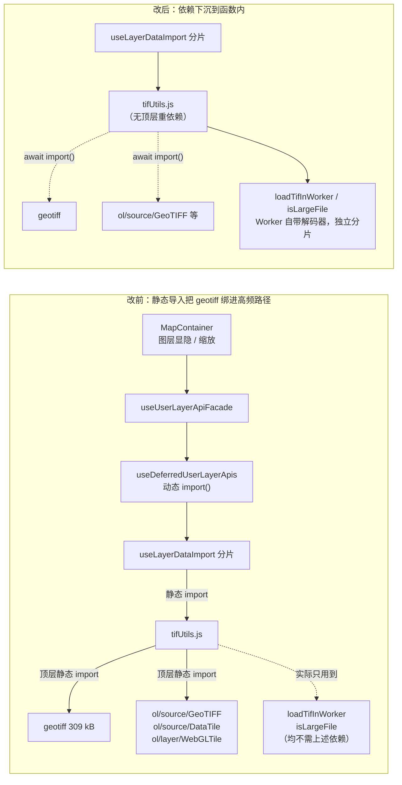
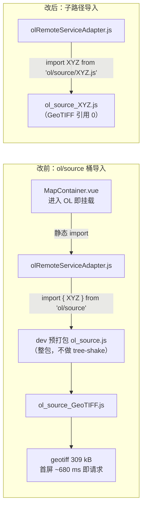

# TIF 解码依赖（geotiff 309 kB）改为按需加载

- **日期与时间**：2026-10-31 11:10
- **任务等级**：L2 常规
- **版本**：V3.6.36

---

## 一、问题分析

### 核心症状

用户在 dev 环境（`localhost:5173`）进入 OL 后，Network 面板立即出现：

```
/node_modules/.vite/deps/geotiff-COldV-5R.js?v=973b0c6c
```

该依赖体积很大（生产产物 309 kB），且进入 OL 的主路径并不涉及 TIF 解析。用户判断「它应该延迟加载」，并指出这会拖慢 OL 首屏。

### 排查过程

1. **确认不是 dev 特有问题**：`node_modules/.vite/deps/` 只是 Vite 的依赖预打包目录，模块图与生产一致。查生产产物（V3.6.35 构建）确认：`geotiff` 被 `useLayerDataImport-*.js` **静态** import，而该分片是动态加载的 —— 所以生产环境同样会在某次操作后拉 309 kB。
2. **确认调用链是懒的**：`useLayerDataImport` 由 `useDeferredUserLayerApis.js` 动态 `import()`，无任何挂载期预取。链路上没有「eager 调用」。
3. **于是问题不在「谁提前调用了」，而在「分片粒度」**：`useLayerDataImport` 这个分片同时装着两类完全不同的东西 —— 通用图层操作（显隐 / 缩放）与重型导入解析（TIF / SHP / 压缩包）。只要用户触发任意一次图层操作，整块（含 geotiff）就一起下载。

### 根本原因

`tifUtils.js` 在**模块顶层**静态导入四个重量级依赖：

```js
import { fromBlob, Pool } from 'geotiff';        // ~309 kB
import DataTileSource from 'ol/source/DataTile.js';
import WebGLTileLayer from 'ol/layer/WebGLTile.js';
import GeoTIFF from 'ol/source/GeoTIFF.js';       // 内部还会引入 geotiff
```

但这四个依赖只被 `loadTifDirect` / `createTIFWebGLLayer` / `createRemoteGeoTIFFLayer` 使用，而**这三个函数在仓库内没有任何调用点**。真正被使用的只有：

- `loadTifInWorker` —— 把解码丢进 `workers/tiffWorker.js`（Worker 自己 import geotiff，独立分片）；
- `isLargeFile` —— 仅比较 `file.size`。

即：**四个重量级依赖 100% 服务于死代码，却把 geotiff 绑进了「图层显隐」这类高频路径的分片。**

### 根本原因二（首轮修复后 dev 仍复现，~680 ms）

按根因一修完后，用户在 dev 环境实测仍看到 geotiff 请求，DevTools 时序为 `Queued at 678.13 ms / Started at 679.65 ms` —— 即**首屏模块图加载阶段**就发起，说明还有另一条静态边。

继续排查 `node_modules/.vite/deps/` 的预打包图，发现三个文件引用 geotiff：`geotiff-*.js`（本体）、`ol_source_GeoTIFF.js`、`lib-*.js`（proj4 的 global.js，属字符串误命中）。其中 `ol_source_GeoTIFF.js` 被 **`ol_source.js`** 引用 —— 而 `ol_source.js` 是 Vite 为 **`ol/source` 桶入口** 生成的预打包分片。

链路因此是：

```
MapContainer.vue（进入 OL 即挂载）
  → 静态 import createOlRemoteServiceAdapter
  → olRemoteServiceAdapter.js: import { XYZ } from 'ol/source'   ← 桶导入
  → dev: Vite 预打包 ol/source 为单个 deps 文件（含全部 source 子模块）
  → ol_source_GeoTIFF.js
  → geotiff（309 kB）
```

关键差异：**生产构建能对桶入口做 tree-shake**（只保留 XYZ），所以生产产物里 geotiff 早已不可达；但 **dev 的依赖预打包是「按 import 说明符整包打包」，不做 tree-shaking**，于是整个 `ol/source` 连同 GeoTIFF 源一起进了首屏图。这解释了为什么「生产验证通过、dev 仍复现」。

`MapContainer.vue:235` 的静态导入解释了 680 ms 这个时序 —— 它不是「等某个操作」，而是进入 OL 时就成立。

### 受影响模块

- `frontend/src/domains/common/data-import/tifUtils.js`（根因一）
- `frontend/src/domains/ol/services/olRemoteServiceAdapter.js`（根因二）

受影响的运行时链路：`useDeferredUserLayerApis → useLayerDataImport → tifUtils`（根因一）；`MapContainer → olRemoteServiceAdapter → ol/source 桶`（根因二）。

---

## 二、模块关系与数据流向



> 图示要点：改前的重依赖边是**模块顶层**的，所以只要 `tifUtils` 被加载就必然触发；改后这些边变成函数内的动态 `import()`，只有真正处理 TIF 时才建立。

第二条路径（根因二，dev 专属）：



> 图示要点：生产构建对桶入口做 tree-shake，所以这条边只在 dev 暴露；dev 的依赖预打包按 import 说明符整包打包，不做 tree-shake，于是整个 `ol/source` 连同 GeoTIFF 源进入首屏图。

---

## 三、解决方案

| 方案 | 做法 | 结论 |
|---|---|---|
| A 把三个死函数整段删除 | 直接删 `loadTifDirect` / `createTIFWebGLLayer` / `createRemoteGeoTIFFLayer` / `getDefaultTifStyle` | 否决：属既有能力储备，删除需用户批准（§2.4「确需清理时先列清单请求批准」），且删除会丢失远程 COG 能力的落点 |
| B 拆 `useLayerDataImport` 为「轻操作 / 重解析」两个模块 | 从架构上分离关注点 | 否决（本轮）：改动面覆盖 facade、导入入口与十余个调用点，属第二任务（数据导入链路）的范畴 |
| **C 依赖下沉到函数内按需 import** | 保留全部导出与行为，只把 4 个顶层导入移入函数体 | **选定**：单文件改动、零调用点破坏、直接切断静态边 |

实施细节：

- `loadTifDirect` 本为 `async`，直接加 `const { fromBlob, Pool } = await import('geotiff')`。
- `createTIFWebGLLayer` / `createRemoteGeoTIFFLayer` 由同步转 `async`（内部 `Promise.all([await import(...), await import(...)])`）。二者无调用点，签名变化不影响现有代码；JSDoc 已标注「后续启用需 await」。
- `getDefaultTifStyle` 为纯函数，无依赖，未动。
- 文件头补一段说明，写明「重量级依赖禁止提到模块顶层」及其原因，防止后续被改回去。

---

## 四、修改内容

`frontend/src/domains/common/data-import/tifUtils.js`：

1. 删除 4 条顶层静态导入（`geotiff` / `ol/source/DataTile.js` / `ol/layer/WebGLTile.js` / `ol/source/GeoTIFF.js`）。
2. 文件头新增约束说明（含本次事故的因果链）。
3. `loadTifDirect`：函数内 `await import('geotiff')`。
4. `createTIFWebGLLayer`：转 `async`，函数内并行 `import('ol/source/DataTile.js')` + `import('ol/layer/WebGLTile.js')`。
5. `createRemoteGeoTIFFLayer`：转 `async`，函数内并行 `import('ol/source/GeoTIFF.js')` + `import('ol/layer/WebGLTile.js')`。
6. 三个函数的 JSDoc 补「自 2026-10-31 起为 async」与返回值类型。

`frontend/src/domains/ol/services/olRemoteServiceAdapter.js`：

1. `import { XYZ } from 'ol/source'` → `import XYZ from 'ol/source/XYZ.js'`（桶导入改子路径，全仓唯一一处 `ol/source` 桶用法）。
2. 补注释写明「禁止桶导入」及其原因（dev 预打包不做 tree-shaking），防止后续改回。

---

## 五、修改原因

1. **高频路径不该背低频能力**：图层显隐 / 缩放是进入 OL 后最先发生的操作，TIF 解码只在用户上传栅格时用得上，两者被绑在同一个分片里。
2. **静态导入把「可选能力」变成「必付成本」**：`tifUtils` 顶层那 4 条 import 使 geotiff 成为该分片的硬依赖，无法被 tree-shake（模块有副作用且被具名导入）。
3. **死代码不应主导体积**：四个重依赖只服务三个无调用点的函数，属纯负担。

---

## 六、影响范围

| 模块 | 影响 |
|---|---|
| 图层操作（显隐 / 缩放 / 定位） | 不再连带下载 geotiff（309 kB） |
| TIF 导入 | 行为不变 —— 大文件走 Worker（Worker 自带解码器），小文件走 `loadTifDirect`（首次调用时加载 geotiff） |
| `createTIFWebGLLayer` / `createRemoteGeoTIFFLayer` | 签名由同步变 async；仓库内无调用点，无破坏 |
| 后端 / 配置 key / 首屏入口 | **零改动** |

---

## 七、性能指标

| 指标 | 改前 | 改后 |
|---|---|---|
| `useLayerDataImport` 分片静态依赖含 geotiff | 是 | **否** |
| geotiff 静态引用方 | `useLayerDataImport` + 各编解码分片 | 仅 `GeoTIFF-*.js`（无静态引用方）与编解码分片 |
| 进入 OL 后图层操作触发的额外下载 | +309 kB（geotiff） | 0 |
| `index.html` 预加载图含 geotiff | 否 | 否（未变化） |
| dev 首屏是否产出 `ol/source` 桶分片 | 是（`ol_source.js`，内含 GeoTIFF 源 → geotiff） | **否**（桶分片不再产出） |
| dev 进入 OL 后 geotiff 请求时机 | ~680 ms（首屏模块图） | 仅在实际处理 TIF / 远程 GeoTIFF 时 |

**未实测**：真实网络下「进入 OL → 点击图层显隐」的 transfer 差值未用浏览器量化（本机无 Chromium/Playwright）。上表为产物体积口径。

---

## 八、测试方案

### Agent 已执行

| 检查 | 命令 | 结果 |
|---|---|---|
| 构建 | `npx vite build --outDir <临时目录>` | 成功（15.99 s） |
| 类型检查 | `npx tsc --noEmit` | 退出码 0 |
| 静态检查 | `npx eslint src/domains/common/data-import/tifUtils.js` | 0 problems |
| 静态引用核验 | 遍历产物 chunk，检查 `from"./geotiff-*.js"` | 引用方仅 `GeoTIFF-*.js` 与 deflate/jpeg/lerc/lzw/packbits/raw/webimage/zstd 编解码分片；`useLayerDataImport` **不在其列** |
| 可达性核验 | 检查 `GeoTIFF-*.js` 的静态引用方 | **无**；仅由 `useLayerDataImport` 内动态 `import()` 可达 |
| 首屏核验 | `grep geotiff index.html` | 0 命中 |
| 同类扫描 | 检索 three / jszip / shpjs / proj4 / echarts / hljs / marked / lil-gui 的静态引用方 | 除 geotiff 外无「重库被静态绑定到高频路径」的情况（`proj4` 分片仅 1 kB，属薄封装） |
| dev 预打包重建 | `npx vite optimize --force` | 成功；优化列表不再包含裸 `ol/source` 桶 |
| dev 桶分片核验 | 检查 `node_modules/.vite/deps/` | `ol_source.js`（桶）**不再产出**；`ol_source_GeoTIFF.js` 仅被其 `.js` 后缀变体引用；`ol_source_XYZ.js` 内 GeoTIFF 引用为 **0** |
| 桶导入清零 | `grep -rn "from 'ol/source'" src/` | 仅命中注释，实际导入 0 处 |

- **未做真实 TIF 导入回归**：本机无法通过 UI 上传文件，`loadTifDirect` 的动态 import 路径只做了静态可达性核对。
- **未做 dev server 实测**：`node_modules/.vite/deps/` 为预打包产物，需重启 dev server 后重新观察 Network。

### 待用户实机验证

1. **重启 dev server**（`npm run dev`）并**硬刷新浏览器**（Ctrl+Shift+R）—— 预打包产物已由 Agent 用 `vite optimize --force` 重建，但正在运行的 dev server 与浏览器侧都可能仍持有旧模块图。
2. 进入 OL，打开 Network 面板并清空记录，依次执行：底图切换 → 图层显隐 → 缩放定位。**预期：全程不出现 `geotiff` 相关请求。**
3. 上传一个 TIF 文件（> 50 MB 走 Worker 路径）：确认解码与图层渲染正常。**预期：此时才出现 geotiff 请求（或 Worker 分片内的解码器）。**
4. 上传一个 TIF 文件（< 50 MB 走主线程路径）：确认 `loadTifDirect` 的动态 import 生效且解码结果正确。
5. 生产构建部署后重复第 2 步，确认 `geotiff-*.js` 不再随图层操作下载。

---

## 九、变更文件清单

| 文件（仓库相对路径） | 改动 |
|---|---|
| `frontend/src/domains/common/data-import/tifUtils.js` | 4 个顶层重依赖下沉为函数内按需 import；两个函数转 async；补约束说明 |
| `frontend/src/domains/ol/services/olRemoteServiceAdapter.js` | `ol/source` 桶导入改子路径 `ol/source/XYZ.js`；补禁止桶导入的说明 |
| `README.md` | 版本号三处（V3.6.36） |
| `Docs/Guide/CHANGELOG.md` | 追加 V3.6.36 条目 |

---

## 十、遗留与风险

1. **`useLayerDataImport` 仍是「轻操作 + 重解析」混合分片**：geotiff 已剥离，但该分片仍静态带着 `shpParser`、`crsAware`、`archiveProcessor`、`useGisLoader` 等导入专用模块（合计约 51 kB）。彻底的解法是按方案 B 拆分模块，属第二任务（数据导入链路引擎）的合理切入点 —— 用户反馈的「连最简单的数据导入都很卡顿」很可能与此结构有关。
2. **两个函数转为 async 后无调用点**：若后续有人按旧签名同步调用，会拿到 Promise 而非对象。已在 JSDoc 标注，但**没有类型系统兜底**（该文件为 `.js`，不在 `tsc --noEmit` 覆盖范围内）。若这三个函数后续要启用，建议迁移为 `.ts`。
3. **未删除死代码**：`loadTifDirect` / `createTIFWebGLLayer` / `createRemoteGeoTIFFLayer` / `getDefaultTifStyle` 均无调用点，属能力储备。是否清理需用户决定（§2.4）。
4. **dev 环境缓存**：Vite 依赖预打包产物在 `node_modules/.vite/` 下，改动后需重启 dev server；若仍看到旧 `geotiff-*.js` 请求，可删除该目录后重启。
5. **其余 ol 桶导入未处理**：`ol/geom`、`ol/control`、`ol/format` 仍存在桶导入（如 `MapContainer.vue:202` 的 `from 'ol/control'`、`useMapEventHandlers.js:32` 的 `from 'ol/geom'`）。当前它们未牵入重量级依赖，dev 侧代价有限；但同一机理随时可能复现。建议加一条 ESLint `no-restricted-imports` 规则，禁止 `ol/source` / `ol/layer` / `ol/geom` / `ol/control` / `ol/format` 等桶路径（须先把存量用法改为子路径，属独立收尾项，预估 0.3 人日）。
6. **dev 与 prod 行为差异未在仓库文档中显式记录**：本次事故的核心认知是「dev 的预打包不做 tree-shaking」，此前仓库无相关说明。已在 `olRemoteServiceAdapter.js` 就地注释；若要长期防复发，应写入 `Docs/Guide/dev-conventions.md` 的「分层边界 / 导入约定」一节。
