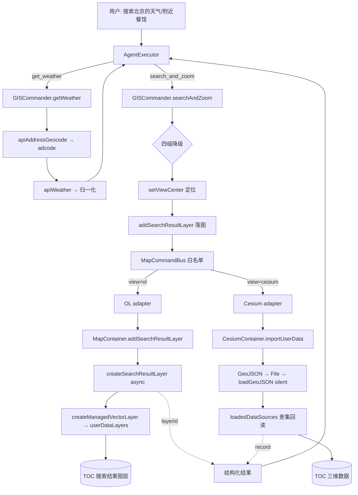

# V3.6.36 版本整合 + 暂存区逐文件复核

- **日期与时间**：2026-10-31 18:20
- **任务等级**：L2（Bug 修复 + 文档整合 + 新增日志文件）
- **任务边界**：**未执行任何 Git 写操作**（未 add / commit / stash / checkout），仅做文件编辑；`git show` / `git status` 等只读命令用于确认基线。

---

## 一、问题分析

### 1.1 核心症状

暂存区累积了 5 批未提交改动，版本号被连续叠加成 `3.6.36 → 3.6.37 → 3.6.38 → 3.6.39 → 3.6.40`，且状态互相矛盾：

| 症状 | 证据 |
|---|---|
| 版本号三处不同步 | 简介行 `V3.6.40`、版本表首行 `V3.6.40`、**页脚仍停在 `V3.6.38`**（3.6.39 / 3.6.40 两次都没改页脚） |
| 版本表 5 行 | 违反 §5「恒定 3 行」；且 `V3.6.35` / `V3.6.34` 两行已被挤掉，表下方指针却仍写「更早版本（V3.6.31 及以前）」 |
| 3.6.39 / 3.6.40 无日志 | `Docs/LLM_record/26-10/2026-10-31/` 下无对应文件，`grep -l "addSearchResultLayer\|place/around"` 零命中 |
| 代码存在「乐观上报」 | 2D/3D 落图失败也会向 Agent 返回 `success: true` |

### 1.2 根本原因

1. **多会话并行、逐批 +1 版本号**：§5 要求「同一天多次任务依次递增、不合并」，但并行的多个会话各自按自己的视角 +1，且后一个会话没有回填前一个的页脚与日志，导致三处漂移、日志缺档。
2. **工具返回值的语义错位**：`handleDataImport` 内部 `catch` 吞掉异常（失败提示由 loader 自己发），`importUserData` 因此只能判断「收到载荷」，却用 `return true` 表达了「加载成功」；2D 侧同理——`createManagedVectorLayer` 返回 `Promise<string|null>`，调用方不 `await` 也不判空，直接把「调用过」当成「建好了」。
3. **提示词瘦身时按「字符数」而非「约束」取舍**：V3.6.37 把 8.6k 压到 1.4k 字符，效果显著，但「不调用未声明命令」「不复述带 key 的 URL」两条安全约束被一并删掉——它们不占多少字符，却是提示词层唯一的防线。

### 1.3 受影响模块

- 版本治理面：根 `README.md`、`Docs/Guide/CHANGELOG.md`
- Agent 工具链：`agentToolsSchema.js` / `AgentExecutor.js` / `GISCommander.js` / `MapCommandBus.js` / `mapCommandAdapters.js`
- 双引擎落图：`useMapSearchAndCoordinateInput.js` / `MapContainer.vue` / `CesiumContainer.vue` / `useCesiumDataImport.js` / `useCesiumDataOpsHandlers.js` / `HomeView.vue`
- 搜索与后端：`api/locationSearch.js` / `api/geocoding.js` / `api/backend/client.js` / `backend/api/external_proxy.py`

---

## 二、解决方案

### 2.1 方案对比（版本整合方式）

| 方案 | 做法 | 优点 | 缺点 | 结论 |
|---|---|---|---|---|
| A 保留 5 个版本号，只补日志 | 逐批补 4 份日志 + 回填页脚 | 历史粒度最细 | 与用户「整合为单一版本」的要求冲突；5 个版本号均未提交，对外无意义 | 否决 |
| **B 合并为单一 V3.6.36** | README 三处统一、CHANGELOG 五条合一、补 1 份整合日志 | 与「HEAD = V3.6.35」严格 +1，完全符合 §5；对外只有一个可交付版本 | 单条 CHANGELOG 较长 | **采用** |
| C 回退到 V3.6.35 | 撤销全部版本改动 | 最保守 | 丢失已完成的 5 批成果 | 否决 |

> **合规说明**：HEAD 的 README 为 `V3.6.35`，因此合并为 `V3.6.36` 恰好是 +1 修订号，**不需要援引 §0 的临时豁免**。

### 2.2 方案对比（落图结果判定）

| 方案 | 做法 | 结论 |
|---|---|---|
| A 维持乐观上报 | 调用不抛错即报成功 | 否决：违反 §2.7「禁止谎报」 |
| **B 读回判定** | 2D 取 `createManagedVectorLayer` 返回的 `layerId`；3D 用 `loadedDataSources` 前后差集 | **采用**：两处都能拿到引擎自己产出的真实句柄/记录，不新增状态 |

### 2.3 数据流（变更后）

---

## 三、修改内容

### 3.1 版本整合

1. 根 `README.md` 三处统一为 `V3.6.36`：简介行、版本表首行、页脚。
2. 版本表由 5 行收敛为 **3 行**（`V3.6.36` / `V3.6.35` / `V3.6.34`），`V3.6.35`、`V3.6.34` 两行从已提交基线取回；表下指针由「V3.6.31 及以前」订正为「V3.6.33 及以前」。
3. `Docs/Guide/CHANGELOG.md` 将 `V3.6.36 ~ V3.6.40` 五条合并为一条完整条目，含背景、8 项改动、5 项复核修复、取舍、验证与三份日志链接。

### 3.2 Bug 修复（逐文件复核发现）

| # | 文件 | 问题 | 修法 |
|---|---|---|---|
| 1 | `agentToolsSchema.js` | 提示词瘦身丢失两条安全约束 | `## 约束` 补回「只调用已声明工具」「不复述带 key/token 的 URL」 |
| 2 | `GISCommander.js` | `cityCache` 声明在 `searchAndZoom` 函数体内，每次调用重建，缓存永不命中 | 提到 `createGISCommander` 工厂作用域 |
| 3 | `GISCommander.js` | `addSearchResultLayer` 门面方法无任何调用点（`locate()` 直接走 `execute`） | `locate()` 改调门面方法 |
| 4 | `GISCommander.js` | JSDoc typedef 仍列 4 个已删除的孤儿方法 | typedef 同步为 `addSearchResultLayer` |
| 5 | `useMapSearchAndCoordinateInput.js` | `createSearchResultLayer` 同步返回、不判空 → 建层失败也报成功 | 改 `async` + `await`，返回真实 `layerId`；`handleSearchJump` 同步改 `await`，建层失败只提示仍定位 |
| 6 | `CesiumContainer.vue` | `importUserData` 恒 `return true`，`handleDataImport` 吞异常 → 失败报成功 | 改 `loadedDataSources` 差集回读，返回新增记录或 `null` |
| 7 | `mapCommandAdapters.js` | OL 侧未 `await`、未判 `layerId`；3D 侧未用真实建档名 | OL 补 `await` + `layerId` 判定；3D 回传 `record.name` / `record.id` |
| 8 | `backend/api/external_proxy.py` | `/amap/place/around` docstring 称「keywords 留空按分类取全部」，但未暴露 `types` | 订正为「不要留空」并说明原因 |
| 9 | `api/locationSearch.js` | `distance: parseFloat(...) \|\| undefined` 把「距离 0 米」吞成 undefined | 改 `Number.isFinite` 判定 |

### 3.3 文档

- 新增本日志。
- `Docs/TODO/bugfix-optimization-plan.md` 更新：孤儿方法已清理、ESLint 剩余量由 33 降为 32。

---

## 四、修改原因

1. **可交付性**：5 个互相叠压的版本号对一个尚未提交的工作区没有意义，对外只有一个版本；且页脚停在 3.6.38 属明确缺陷。
2. **诚实性**：Agent 会把工具结果转述给用户。落图失败却报成功，用户会在 TOC 里找不到图层，且无法判断是「没落图」还是「落图落错位置」。
3. **合规性**：§2.7「禁止谎报验证」、§5「README 三处」、§6「日志必含章节」、§7「门禁脚本必须通过」。

---

## 五、影响范围

- **Agent 工具链**：`search_and_zoom` 的返回语义（新增 `layerName`）、落图失败的错误码 `SEARCH_LAYER_FAILED`。
- **2D 落图**：`createSearchResultLayer` 由同步变异步；`handleSearchJump` 由同步变异步（Vue 事件处理器，返回值无人消费）。
- **3D 导入**：`importUserData` 返回值由 `boolean` 变为「记录对象 | null」；三个调用点中两个（`HomeView:1512` / `HomeView:1772`）本就忽略返回值，另一个是 Agent adapter（已同步改）。
- **搜索面板 UI**：建层被拒时新增一条 `图层创建失败：<名称>` 警告，定位动画照常执行。
- **不受影响**：底图链路、URL 参数、鉴权、数据库。

---

## 六、性能指标

未实测（本次为版本整合 + 正确性修复，无性能相关改动）。提示词体积变化沿用 V3.6.37 记录：8.6k → 1.4k 字符；本轮补回的两条约束约 +90 字符，量级不变。

---

## 七、测试方案

### 7.1 Agent 已执行

| 检查 | 命令 | 结果 |
|---|---|---|
| 结构树门禁 | `python Scripts/CheckStructureTree.py` | 522 / 522，漏登记 0、幽灵条目 0，exit 0 |
| 配置登记门禁 | `python Scripts/CheckConfigRegistry.py` | 7 项全通过，catalog 130 key，exit 0 |
| 前端 lint | `npx eslint`（本次改动的 6 个文件） | 0 告警，exit 0 |
| 生产构建 | `npx vite build --outDir <临时目录>` | `✓ built in 12.29s`，exit 0（仅既有 chunk 体积告警） |
| 后端语法 | `python -c "ast.parse(...)"` | 通过 |
| 预设 ID 存在性 | 脚本比对 22 个 presetId | 全部命中 |
| 版本三处一致性 | 脚本断言 | 简介 / 表首行 / 页脚均为 V3.6.36；表恒 3 行 |
| 平台红线 §11.2 | 四条 `rg` 自查 | 见第八节 |

### 7.2 待用户实机验证

1. **2D 搜索落图**：2D 视图输入「南京师范大学」→ 预期：地图飞到该点，TOC「搜索结果图层」新增同名图层，点位带默认符号与标注。
2. **3D 搜索落图**：切 3D 后输入「附近的餐馆」→ 预期：相机飞到周边命中的餐馆，TOC「三维数据」新增 `<名称>.geojson`，**无导入遮罩、无成功 toast**。
3. **天气**：输入「查询北京的天气和温度」→ 预期：返回实况；追问「明天呢」→ 返回 4 日预报且不重复调工具。
4. **底图**：输入「切换到谷歌代理卫星底图」→ 预期：切到 `google_Backend_Proxy_preset`，瓦片可见（非满屏空白）。
5. **落图失败路径**：断网后搜索 → 预期：返回结构化错误，不出现「已加入图层管理」。
6. **移动端**：触屏设备打开 TOC，确认新增图层条目可点击、目标尺寸 ≥40px。

---

## 八、平台红线自查（§11.2）

**执行方式说明**：规范给的命令用 `rg`，但本机 shell 无 `rg`（`command not found`，若直接 `|| echo CLEAN` 会得到**假阳性**）。因此改用 `grep -rEil` 等价执行，并排除 gitignore 的 `backend/.venv/`（第三方依赖，非仓库源码）与 `node_modules` / `dist`。

| 检查 | 结果 |
|---|---|
| REDLINE-1（浏览器自动化 / 验证码对抗 / 远程桌面） | `REDLINE-1-CLEAN` |
| REDLINE-2（代理 / VPN / 隧道 / 反连） | `REDLINE-2-CLEAN` |
| REDLINE-3（IM 机器人 / 反连 / 防休眠） | `REDLINE-3-CLEAN` |
| REDLINE-4（`deploy/.env` 生产基线三项） | `REDLINE-4-CLEAN` |

**排除的假阳性**（已逐条确认，非违规）：

- `backend/.venv/Lib/site-packages/certifi/cacert.pem`、`rasterio.libs/gdal-*.dll`：第三方二进制/证书包，被 base64 或字符串片段偶然命中；`.venv` 已 gitignore。
- `backend/.venv/.../numpy/polynomial/hermite_e.py`、`.../uvicorn`、`.../websockets`：第三方库源码。
- `frontend/src/**/maxRayDistance`（`cloudModule.js` / `cloudParamsApply.js` / `cloudQualityPresets.js` / `CloudShadowFrag.glsl.js` / `ThreeGeospatialPipeline.js` / 中英 locale）：体积云参数「最大射线距离」，被 `xray` 子串误命中；加 `\bxray\b` 词界后不再命中。

---

## 九、变更文件清单

| 文件 | 说明 |
|---|---|
| `README.md` | 版本三处统一 V3.6.36；版本表收敛为 3 行；「更早版本」指针订正 |
| `Docs/Guide/CHANGELOG.md` | 五条版本条目合并为一条 V3.6.36 |
| `Docs/LLM_record/26-10/2026-10-31/2026-10-31-v3.6.36-consolidation-and-review.md` | 本日志（新增） |
| `Docs/TODO/bugfix-optimization-plan.md` | 孤儿方法条目更新、ESLint 剩余量订正 |
| `frontend/src/domains/common/chat/constants/agentToolsSchema.js` | 提示词补回两条安全约束 |
| `frontend/src/domains/common/command-bus/GISCommander.js` | `cityCache` 提到工厂作用域；`locate()` 改调门面方法；typedef 同步 |
| `frontend/src/domains/ol/search/composables/useMapSearchAndCoordinateInput.js` | `createSearchResultLayer` 改 async 并回传 `layerId`；`handleSearchJump` 改 await |
| `frontend/src/domains/cesium/components/CesiumContainer.vue` | `importUserData` 改差集回读，返回新增记录或 null |
| `frontend/src/domains/common/chat/agent/mapCommandAdapters.js` | OL 补 await + layerId 判定；3D 回传真实建档名与 id |
| `backend/api/external_proxy.py` | `/amap/place/around` docstring 订正 |
| `frontend/src/api/locationSearch.js` | `distance` 0 值不再被吞 |

---

## 十、遗留与风险

1. **重复搜索会累积图层**：每次命中都新建一个图层，命名为命中的地址/POI 名，同地点多次搜索会产生同名图层。与 2D 搜索面板既有行为一致，未在本批处理。
2. **Agent 工具链未做实机联调**：需后端代理 + 高德 Key + 登录态，本轮只做到构建与静态检查通过。
3. **图层显隐 / 透明度 / 定位工具未实现**：设计已留在 `Docs/TODO/bugfix-optimization-plan.md`，本批明确不做。
4. **ESLint 存量仍有 32 条 / 24 文件**：本次只修报出的那一条，其余按 §2.5「不越权扩大范围」只记录不改。
5. **3D 落图的 TOC 名称带 `.geojson` 后缀**：因为 TOC 名称取自 `file.name`，与面板上传行为一致；如需去后缀要改 `loadGeoJSON` 的建档逻辑，影响面较大，暂不改。
