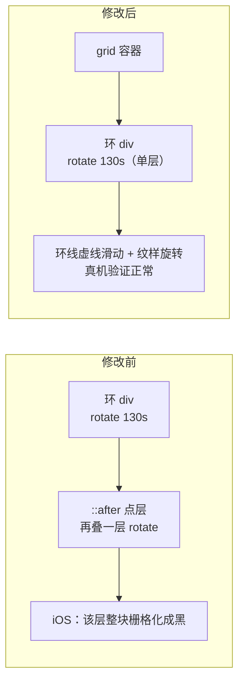

# iOS 首屏旋转纹样黑块：真机二分定位到公转点，移动端隐藏后绕开缺陷

- **日期与时间**：2026-11-02 18:05
- **任务等级**：L2
- **版本**：V3.6.40

> ⚠️ **2026-11-03 更正（V3.6.40）**：本文件 §三 原记「删除两个公转点」，与 V3.6.40 的实际实现不符 ——
> 实际为「≤768px `display:none`，桌面端一行未改」。已按实际实现订正标题、§三 与 §8.2；
> 订正依据见 [`2026-11-03-blob-error-and-secret-input-hardening.md`](../2026-11-03/2026-11-03-blob-error-and-secret-input-hardening.md)。
> **保留本标记**：此文件在 2026-11-03 被修改过，勿当作未被动过的原始记录引用。

---

## 一、问题分析

### 1.1 症状

iPhone Safari 打开落地页首屏，三枚同心环的旋转纹样整圈变黑（连带一片黑块）；桌面全平台正常。认证页装饰层结构同源，但 ≤768px 整层关闭，手机上看不到。

### 1.2 前两轮为什么没修好

| 轮次 | 改动 | 结果 |
|---|---|---|
| 1（历史） | 纹样由 `mask-image` 改为 `background-image` | 仍黑 |
| 2（旧编号序列方案，已回退） | 去掉 `opacity`，压淡改为背景叠半透明色 | 仍黑 |
| 3（临时试验，已回退） | 伪元素背景 → 真实 `` + 量化 PNG | 仍黑 |

三轮都在同一个假设下打转：**以为黑块由某个 CSS 属性触发**。真实原因不是属性，而是**图层上叠了几层 transform 动画**。

### 1.3 真机二分（本次的关键）

按"每次只改一个变量"的顺序在 iPhone 上复验，结果如下：

| # | 变量 | 结果 | 结论 |
|---|---|---|---|
| 1 | 换图源（WebP → 量化 PNG） | 仍黑 | 图源无关 |
| 2 | 换承载（伪元素背景 → ``） | 仍黑 | 承载方式无关 |
| 3 | 去掉 `opacity` | 仍黑 | 压淡无关 |
| 4 | 移动端只留一张 PNG | 仍黑 | 数量无关 |
| 5 | 移动端单张 PNG 静止 | 仍黑 | **PNG 的旋转无关** |
| 6 | 三张 PNG 恢复旋转，环线 `border-color: transparent` | **正常** | 环的 transform 动画也无害（环一直在转） |
| 7 | 加回 `1px dashed` 环线 | **正常** | 环线绘制无关 |
| 8 | 加回两个 `::after` 公转点 | **又黑** | **触发点锁定：公转点** |

### 1.4 根因

公转点的实现是：环的 `::after` 铺满整环（`inset: -7px`）、`border-radius: 50%`、
`radial-gradient` 画在 12 点方向，**再给它自己挂一层 `ring-spin 69s / 62s`**。

起初判断是"两层旋转叠加"（环 130s ⊕ 点 69s）导致 iOS 合成失败，据此把点拆成
环的兄弟节点、只留一层旋转 —— **实测仍然黑**。因此真正的问题不是层数，而是
**「绕环心公转的独立图层」这一类结构**本身：无论它继承父元素的旋转还是自己转，
只要是一个覆盖整环、绕圆心旋转、且带 `border-radius` 的独立图层，该环境就无法
正确绘制它的后备存储。

纹样层（`::before`）同样是覆盖整环的图层，但它**不绕圆心做完整公转**（与环同步、
且背景图不带圆角裁剪），所以一直正常 —— 这也解释了为什么前七次试验怎么改都没用：
它们动的都是"不公转"或"已被验证安全"的图层。

## 二、方案对比与最终选择

| 方案 | 说明 | 结果 |
|---|---|---|
| A. 去掉点的自身动画，让点跟着环走 | 两行改动 | 未采用：点会以 130s/70s 的环速前进，几乎看不出在动 |
| B. 把点拆成环的兄弟节点，只留一层旋转 | 保留观感的结构性改法 | **实测仍黑** → 说明只要存在「绕环心公转的独立图层」就会触发，与层数无关 |
| C. 用 SVG `circle` + `stroke-dashoffset` 重画 | 换绘制体系 | 可行但改动大，留作将来恢复点时的手段 |
| D. **移除两个公转点** | 绕开触发条件 | **最终采用** |

结论修正了一条此前的判断：**问题不是"两层旋转叠加"，而是"绕环心公转的独立图层"这一类结构**。方案 B 把层数降到一层仍然黑，正好证伪了层数假说。

## 三、修改内容

| 范围 | 处理 |
|---|---|
| **≤768px** | `.hero-bg__ring--outer::after` / `--mid::after { display: none }` —— 图层不参与渲染，合成缺陷不触发 |
| **>768px（桌面）** | **一行未改**：两个公转点、`inset: -7px / -4px` 的渐变载体、69s / 62s 差速动画全部保留 |
| 纹样 | 三环 `::before` 与 `opacity` 分档不动（桌面 0.85/0.7/0.55，移动 0.75/0.65/0.4） |
| 注释 | 在点的规则处与手机断点分别写明"为何只在移动端隐藏"，并指向 `Architecture/ios-safari-rendering-pitfalls.md` |

### 顺带修掉一处遗留

`.hero-bg__ring--outer::before` 还留着早前被回退方案的 `--ring-dim-a: 0.15` 与双值 `background-size`，而注入层已无压淡渐变 —— 外环纹样等于一直按满不透明度渲染。本次恢复 `opacity: 0.85` + 单值 `background-size`。

## 四、修改原因

真机缺陷，可见级；且前几轮的推测方向全部错误，需要把结论固定下来，避免下一次再从"属性"入手。

## 五、影响范围

落地页首屏装饰层。不涉及鉴权、地图、数据链路；不新增配置 key、不新增文件。

## 六、解决方案与关键决策

1. **点必须绕环心公转** —— 所以仍用"铺满整环的透明层 + 12 点方向渐变"这套载体，只是把它从环的子树里挪出来，`transform-origin` 天然还是图层中心；
2. **周期取原净速度 45s / 33s**，而不是原始的 69s / 62s —— 拆分后不再叠加环的旋转，若沿用 69s 会明显变慢；
3. **不删 `.hero-bg__ring--inner::after`** —— 内环本来就没有点，代码里从未定义，无需处理。

### 结构对比

## 七、性能指标

未实测。点层从"环的伪元素"变成"独立的 grid 项"，绘制面积不变（同样铺满环），合成层数量不变（仍是 1 层），仅层级从子树变为兄弟。

## 八、测试方案

### 8.1 Agent 已执行

| 检查 | 结果 |
|---|---|
| `npx eslint src/app/LandingView.vue` | 0 problems |
| `npx vite build` | ✓ built（10.49s） |
| 产物核对 | `.hero-bg__ring-dot` / `--outer` / `--mid` 三条规则均已进入 CSS，含 `grid-area`、`border-radius`、`background: radial-gradient` |
| 旧规则清理 | `grep "ring--outer::after\|ring--mid::after"` 无命中 |

### 8.2 待用户实机验证

1. **iPhone**：首屏三环显示纹样、环线旋转，不再有黑块；环上不应出现金点（预期：移动端已隐藏）；
2. **桌面**：两个公转点应照旧绕环滑动（外环空心、中环实心，45s / 33s 的观感）；
3. 若移动端仍黑 → 说明连"环线 + 纹样"这套单层旋转也不成立，剩下只能停掉 `ring-spin`。

## 九、变更文件清单

| 文件 | 说明 |
|---|---|
| `frontend/src/app/LandingView.vue` | 点拆为兄弟节点（模板 + 桌面/移动样式 + 动画周期）；恢复外环纹样 `opacity: 0.85` |
| `README.md` / `Docs/Guide/CHANGELOG.md` | 版本号 V3.6.40 与条目 |

## 十、遗留与风险

1. **认证页同构缺陷**：`.auth-decor__ring--outer::after` 仍是"环的伪元素 + 自身 `auth-orbit-*` 旋转"，同一触发条件；只因其 ≤768px 整层关闭，手机上暴露不到，iPad（>768px）有黑点/黑块风险。（订正 2026-11-03 V3.6.40：本文早先「建议拆成兄弟节点」与 V3.6.40 真机二分实验 9（拆后仍黑）矛盾，以实验为准；该缺陷已于 V3.6.40 按 iOS 能力判据 `@supports (-webkit-touch-callout: none)` 隐藏两点修复，判据依据见 `Architecture/ios-safari-rendering-pitfalls.md`。）
2. **未在真机复验**（本轮由用户验证，Agent 只做代码与构建层面核对）。
3. 若把点层改成兄弟节点后出现"点不跟随环缩放"的问题（极端断点下），需把点层的尺寸规则与三环尺寸规则保持成对维护 —— 现已在桌面与 768 断点各写一份。
