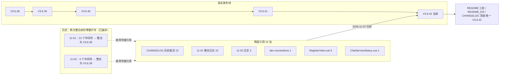

# V3.6.42 暂存区审查与全仓版本号归并

- **日期与时间**：2026-11-07 08:56
- **任务等级**：L2（code review + 缺陷修复 + 版本整合 + 文档/结构树同步）
- **版本**：V3.6.42（未提交批次的整合发布号）

---

## 一、问题分析

### 1.1 核心症状

用户要求「code review 暂存区的代码，合并为版本 3.6.42；所有冲突的文档记录等都合并修改为 3.6.42」。实查发现两类问题：

1. **版本号倒挂**：全仓存在 32 处高于当前版本的废弃中间号字面。它们是 11-01（13 个版本整合为 V3.6.38）与 11-02（4 个中间号整合为 V3.6.39）两次整合**被废弃的曾用中间号**，残留在 CHANGELOG 历史条目、`dev-conventions.md`、前端代码注释与历史日志中。更棘手的是 V3.6.38 整合条目第 ⑤ 项本身标着「原 V3.6.42」——与当前版本撞名。
2. **英文 README 落后 9 个版本**：`Docs/README_EN.md` 页脚与演进表停在 V3.6.33（2026-10-30），第 326 行仍写「lags the current code (V3.6.31)」。

### 1.2 根因

- 历史整合只改了「当前版本号三处 + CHANGELOG 顶部条目」，**没有清理历史条目/日志/代码注释里对废弃中间号的引用**；
- 英文 README 未纳入历次 L2 收尾的同步清单（长期遗留，多份交接块曾提示）；
- 暂存区本身（8 文件）版本号是统一的 3.6.42，冲突全部来自**未纳入本批的存量文档**。

### 1.3 受影响模块

文档体系（README / README_EN / CHANGELOG / dev-conventions / 2 份历史日志）、前端代码注释（`RegisterView.vue` / `ChatServiceStatus.vue`）、数据导入面板注释。业务运行逻辑不受影响。

---

## 二、Code review 结论（暂存区 8 文件 / +249 −34）

| 项 | 结果 |
|---|---|
| 功能正确性 | 字典 20 层 / META 20 条 / 21 个选项；`normalize('all')`=20、`('ba,af')`→`BA,AF`、非法码回退全量 |
| 拓扑合成（独立复跑） | `AF/CA/BN/AX→Point`、`AR→Polygon`、`BA→LineString`、`BV→Polygon`，`stats.out` 均为 1 |
| 关键接线 | 只改字典不改拓扑会静默丢数据，本次两文件同改，分派集合与 8 个新层一致 |
| ESLint（3 个暂存代码文件） | 0 problems |
| 门禁 | CheckStructureTree 526/526；CheckConfigRegistry 全绿 |
| 平台红线 | 本批暂存改动不触及 backend / deploy / 工作流 |

**未发现阻塞性缺陷。** 非阻塞发现 4 项，其中 1 项已修：

| # | 发现 | 处置 |
|---|---|---|
| 1 | `TencentBuildingPanel.vue` 注释仍写死「20 层」，与日志声称的「按字典动态」不符，下次扩层又脱钩 | **本次已修**：改为「层数由 `tdtVectorLayers` 字典决定」 |
| 2 | `TDT_VECTOR_LAYER_META.rule` 是文档性字段，真实分派靠 `tdtVectorTopology.js` 里硬编码层码列表 —— 两处维护同一份集合，属第二事实源 | 记入交接块，建议后续由 `rule` 驱动分派（L3 方案题） |
| 3 | `CE.keys` 新增 `Z5/I8`，但拓扑 CE 分支仍只输出 `height_m/floors/A6/name`，字典展示与实际产物不一致 | 已在 `Docs/TODO/bugfix-optimization-plan.md` 记录，按 §2.5 不顺手改 |
| 4 | `topoPoints` / `topoPassthrough` / `fuseByS8` 产物不带 `_layer`（仅 `topoLines` 带）；BV 等既有层同样如此，下游无消费者 | 既有行为，非本次引入，不修；原日志「`_layer`/`_tile` 标记沿用旧约定」表述不够准确 |

`.github/traffic.json` 为 CI 自动更新的访问统计（+2 天数据），无人工逻辑。

---

## 三、解决方案与选型

| 方案 | 做法 | 取舍 |
|---|---|---|
| A 只改暂存区 | 版本号已是 3.6.42，不动存量 | 用户明确要「所有冲突」，不满足 |
| **B 机械全替换 + 可追溯说明（选定）** | 32 处废弃中间号统一改为 V3.6.42；CHANGELOG 与 11-01 日志各补一条归并说明；两处语义倒挂句改写 | 满足「全仓无倒挂号」，历史叙事由说明兜住 |
| C 保留历史号不动 | 只同步当前生效引用 | 违背用户明确指令（§0 优先级 1） |

选 B，依据 §0「用户在当前会话的明确指令可临时豁免本规范任意条款」——本轮据此豁免 §2.4 对历史日志的改写限制，但**不改动功能内容、发布日期、整合结论**，只归并版本号表述。

### 3.1 版本号归并关系（Mermaid）

### 3.2 语义修正明细

- `11-01 整合日志` 原「README 三处『曾用最高号』→ `V3.6.38`」机械替换后会变成「`V3.6.42` → `V3.6.38`」（倒挂），改为「三处统一为 `V3.6.38`（原文所用中间号已归并至 V3.6.42）」；
- `CHANGELOG V3.6.39` 的「4 个中间版本（V3.6.40–V3.6.42）」改为「4 个中间版本（曾用号已统一归并至 V3.6.42）」；
- 两份归并说明**不写具体废弃号段**，避免再次引入倒挂字面。

---

## 四、修改内容

| # | 文件 | 改动 |
|---|---|---|
| 1 | `Docs/Guide/CHANGELOG.md` | 顶部补「版本号归并」说明；13 处中间号归并；V3.6.39 区间句改写；V3.6.42 条目补「提交前整合」结论 |
| 2 | `Docs/LLM_record/26-11/2026-11-01/2026-11-01-v3.6.38-consolidated.md` | 10 处归并 + 标题去区间 + 补归并说明 + 倒挂句改写 |
| 3 | `Docs/LLM_record/26-11/2026-11-02/2026-11-02-fontawesome-cdn-revert.md` | 2 处错误号（曾用废弃号）归并为 V3.6.42 |
| 4 | `Docs/Guide/dev-conventions.md` | 「源自曾用废弃号」→ V3.6.42 |
| 5 | `frontend/src/app/RegisterView.vue` | 5 处「曾用废弃号 · 视觉纪律」→ V3.6.42 |
| 6 | `frontend/src/domains/common/chat/components/ChatServiceStatus.vue` | 「曾用废弃号 · 重排」→ V3.6.42 |
| 7 | `Docs/README_EN.md` | 页脚 / current code 说明 / 演进表三行同步至 42·41·40，Earlier versions 改 V3.6.39 and before |
| 8 | `README.md` | 页脚「最后更新」→ 2026-11-07（版本号三处仍为 V3.6.42） |
| 9 | `frontend/src/domains/common/data-import/components/TencentBuildingPanel.vue` | 注释去掉硬编码「20 层」 |

## 五、修改原因与影响范围

用户要一次性消除「多次不规范 commit」留下的版本号通胀与文档倒挂。影响面仅限文档表述与注释，**无运行时逻辑改动**：前端 `__APP_VERSION__` 由 `vite.config.js` 从 README「项目简介」行正则提取，该行保持 V3.6.42 不变，构建结果不受影响；结构树无文件增删，门禁条目数不变。

## 六、性能指标

不适用（本次无运行时代码逻辑改动，注释与文档为主）。

## 七、测试方案

**Agent 已执行**（下列均为本会话实跑，非引用日志自述）

| 项 | 命令 / 方式 | 结果 |
|---|---|---|
| 字典模块 | `node --input-type=module` 直接 import `tdtVectorLayers.js` | 20 层 / META 20 条 / 缺失 0 / 21 选项 / 全选标签「全部图层（20 层）」 |
| 归一化 | 同上 | `all`→20、`ba,af`→`BA,AF`、非法码→回退 20 |
| 拓扑合成 | `node` 构造 Map 喂 `topoTdtVectorLayers` | AF/CA/BN/AX→Point、AR→Polygon、BA→LineString、BV→Polygon |
| ESLint | `node node_modules/eslint/bin/eslint.js` 3 文件 | 0 problems |
| 结构树 / 配置登记 | `python Scripts/CheckStructureTree.py` / `CheckConfigRegistry.py` | 526:526 无漂移 / 全绿（catalog 134 key） |
| 版本号残留 | `grep -rnoE "V?3\.6\.(4[3-9]|5[0-9])" README.md Docs/ frontend/src/` | 0 命中 |
| README 三处 | `grep` | 简介行 / 演进表首行 / 页脚均 V3.6.42 |

**待用户实机验证**

1. `npm run dev` → 数据导入 → 天地图 tab：应显示 20 个可勾选项 +「全部图层（20 层）」。
2. 勾选 `BA AF CA BN AR` 与 `CE` 做小范围抓取：分层统计出现新层，`AR` 为面、`BA` 为线、`AF/CA/BN` 为点。
3. 仅勾 `CE` 回归：建筑数与属性应与改动前一致。
4. 浏览器 F12 查看 `__APP_VERSION__` 是否为 `3.6.42`（验证 README 机器读取源未受归并影响）。
5. 在 GitHub 渲染下确认中英两份 README 的版本表三行与页脚一致。

## 八、变更文件清单

| 文件 | 说明 |
|---|---|
| `README.md` | 页脚日期同步 |
| `Docs/README_EN.md` | 版本声明、演进表、页脚同步至 3.6.42 |
| `Docs/Guide/CHANGELOG.md` | 归并说明 + 历史条目版本号归一 + 提交前审查结论 |
| `Docs/Guide/dev-conventions.md` | 悬空版本引用归并 |
| `Docs/LLM_record/26-11/2026-11-01/2026-11-01-v3.6.38-consolidated.md` | 历史日志归并说明与版本号归一 |
| `Docs/LLM_record/26-11/2026-11-02/2026-11-02-fontawesome-cdn-revert.md` | 错误版本号（曾用废弃号）归并 |
| `frontend/src/app/RegisterView.vue` | 5 处代码注释版本引用归并 |
| `frontend/src/domains/common/chat/components/ChatServiceStatus.vue` | 1 处版本引用归并 |
| `frontend/src/domains/common/data-import/components/TencentBuildingPanel.vue` | 注释去硬编码层数 |
| `Docs/LLM_record/26-11/2026-11-07/2026-11-07-v3.6.42-stage-review-merge.md` | 本日志 |

## 九、遗留与风险

1. 历史整合条目中的「13 个版本 / 13 节 / 13 行」计数与归并后的单一版本号表述并存，已由归并说明解释；若日后要求恢复历史原貌，需从 git 历史取回。
2. `Docs/README_EN.md` 演进表按 §5「最新 3 条」收敛为 42/41/40，V3.6.33 及以前的英文摘要移出（完整历史在 CHANGELOG）。
3. `META.rule` 与拓扑分派双份层码维护（见二·2），属架构隐患，未修。
4. `CE.keys` 与拓扑输出不一致（见二·3，已入 TODO）。
5. 3.6.42 尚未提交；本轮只改工作区、未执行任何 Git 写操作，提交前需用户选择性 `git add`。
6. 未实机：浏览器内天地图面板勾选新层抓取需用户执行。

## 十、DoD 自查

| 项 | 状态 |
|---|---|
| 分层边界与单一职责 | ✅ 无业务逻辑新增，仅注释/文档 |
| 新增 `.ts` 无 tsc 新错 | ✅ 本轮无新增 `.ts` |
| 新建逻辑文件默认 `.ts` | ✅ 未新建逻辑文件 |
| 维护日志 | ✅ 本文件（含 Mermaid 图，待用户审查） |
| README 三处版本号 | ✅ 均为 V3.6.42 |
| CHANGELOG 条目 | ✅ V3.6.42 条目已存在并补审查结论 |
| 结构树同步 | ✅ 无文件增删，526:526 |
| 配置 key | ✅ 无新增 |
| 移动端基线 | ✅ 无 UI 元素新增 |
| 场景数据注册 | ✅ 未新增数据源类型 |
| 门禁脚本 | ✅ 两项通过 |
| 未执行任何 Git 写操作 | ✅ 仅 `status` / `diff` / `show` / `log` |
| 平台红线自查 | ✅ 未触及 backend/deploy/工作流 |
| 交接块 | ✅ 见会话末尾 |
