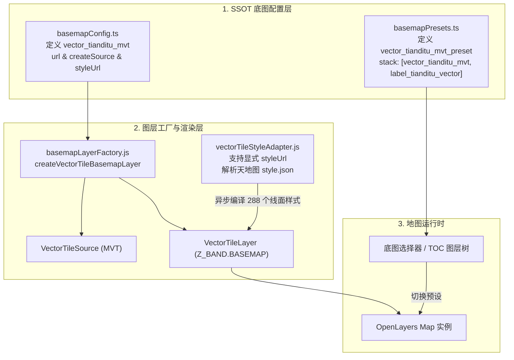

# 维护日志：接入天地图标准 MVT 矢量瓦片底图（OpenLayers 2D 引擎）

## 日期与时间
2026-11-10 16:30

## 任务等级
L2 常规级别任务

---

## 问题分析

### 1. 核心症状与诉求
天地图官方矢量切片由于历史原因采用了私有加密格式（非标准 Protobuf 封包、Morton 码寻址以及专有加密头），常规 GIS 客户端与 OpenLayers 原生 VectorTile 无法直接以标准 Mapbox MVT 规范消费。
现通过本地/VPS 转码代理服务，天地图切片已被实时转码为符合 OGC / Mapbox MVT 2.1 规范的标准切片流与 529 图层 Mapbox 样式表：
- 瓦片服务地址：`https://vpn.negiao.cn/tdt-mvt/mvt/{z}/{x}/{y}`
- 样式服务地址：`https://vpn.negiao.cn/tdt-mvt/style.json`
- TileJSON 元数据：`https://vpn.negiao.cn/tdt-mvt/tilejson.json`

目标：在 WebGIS-Dev 的 OpenLayers 2D 底图系统中新增该天地图 MVT 矢量切片底图（并组合天地图官方高清矢量注记），使用户在底图选择器中可直接一键无缝切换。

### 2. 受影响模块
1. **SSOT 配置权威**：
   - `frontend/src/domains/ol/basemap/constants/basemapConfig.ts`：新增 `vector_tianditu_mvt` 图层源定义与 `styleUrl` 属性。
   - `frontend/src/domains/common/basemap/basemapPresets.ts`：在“天地图系列”追加 `vector_tianditu_mvt_preset` 预设条目。
2. **图层工厂与渲染体系**：
   - `frontend/src/domains/ol/basemap/composables/basemapLayerFactory.js`：`createVectorTileBasemapLayer` 支持传递并消费显式 `styleUrl`。
   - `frontend/src/domains/ol/basemap/composables/vectorTileStyleAdapter.js`：异步拉取并编译 Mapbox 样式表（288+ 矢量线面图层），支持显式 `styleUrl`，未指定时兼容既有 ArcGIS 服务端推导。

---

## 解决方案与架构交互

### 方案演进与选型对比

| 维度 | 初版方案 A（轻量手工解析） | 现行方案 B（`ol-mapbox-style` 标准接入） |
| :--- | :--- | :--- |
| **依赖方式** | 零外部依赖，使用自研解析器 | 引入官方推荐 `ol-mapbox-style@^13.9.0` |
| **图层覆盖** | 仅支持部分简单 line/fill（200+ 层），丢弃所有 symbol 与 background | 完整支持全部 529 个 Mapbox GL 图层规范（含背景色、复杂线面、符号、注记与精灵图） |
| **底色渲染** | 无法渲染 `background`，导致大洋/海洋镂空透明 | 从 `styleJson` 提取背景色并调用 `layer.setBackground(color)`，海洋呈现标准浅蓝底色 |
| **文字避让** | 不支持文字渲染与避让 | 配合 `declutter: true` 实现高保真文字避让与注记显示 |
| **表达式兼容** | 不支持 Mapbox GL 复杂表达式（如 `step`、`interpolate`、`match`） | 完整编译 Mapbox GL 表达式，各缩放级别图层过渡平滑 |
| **异常降级** | 基础兜底样式 | 样式加载失败时自动降级回退至通用矢量色块，避免白屏 |

---

## 修改内容清单

1. **`frontend/package.json` & `package-lock.json`**：
   - 引入 OpenLayers 官方标准矢量切片样式库 `ol-mapbox-style@^13.9.0`，用于完整渲染 Mapbox GL 529 个图层样式。
2. **`frontend/src/domains/ol/basemap/constants/basemapConfig.ts`**：
   - `LayerSourceDefinition` 类型扩展可选字段 `styleUrl?: string`；
   - 在 `LAYER_SOURCE_DEFINITIONS` 中登记 `vector_tianditu_mvt`，配置切片地址 `https://vpn.negiao.cn/tdt-mvt/mvt/{z}/{x}/{y}` 与样式表地址 `https://vpn.negiao.cn/tdt-mvt/style.json`，并在 `createSource` 实例化时为 source 注入 `styleUrl` 元数据。
3. **`frontend/src/domains/common/basemap/basemapPresets.ts`**：
   - 在“天地图系列”中新增预设条目 `vector_tianditu_mvt_preset`，`stack` 配置为 `['vector_tianditu_mvt', 'label_tianditu_vector']`。
4. **`frontend/src/domains/ol/basemap/composables/basemapLayerFactory.js`**：
   - `createVectorTileBasemapLayer` 开启 `declutter: true` 启用文字符号避让；
   - 支持透传 `options.styleUrl` 或读取 `source.get('styleUrl')`。
5. **`frontend/src/domains/ol/basemap/composables/vectorTileStyleAdapter.js`**：
   - 引入 `applyStyle` 来自 `ol-mapbox-style`；
   - 在异步拉取样式后，优先从 `styleJson.layers` 提取 `background` 图层颜色并通过 `layer.setBackground(bgColor)` 涂刷海蓝色，消除海洋镂空；
   - 调用 `applyStyle(layer, styleJson, { updateSource: false, styleUrl })` 编译全量样式，并保持既有 `VectorTileSource` 寻址机制；
   - 保持捕获降级逻辑，在解析异常时回退到轻量几何样式函数。
6. **`frontend/src/domains/cesium/constants/basemapProviderFactory.ts`**：
   - 配置 `CESIUM_SOURCE_FALLBACK_MAP` 与单源拦截，当 Cesium 3D 引擎遇到 `vector_tianditu_mvt` 时，自动映射为经典栅格矢量底图与高清注记（`['vector_tianditu', 'label_tianditu']`），实现三维地球的无缝平滑回退，杜绝控制台警告与黑屏。
7. **版本号同步（V3.6.43）**：
   - 根 `README.md` 三处同步更新；
   - `Docs/Guide/CHANGELOG.md` 追加发布条目。

---

## 影响范围
- 仅影响 OpenLayers 2D 底图切换选择器与矢量瓦片图层加载链路；
- 完全不影响 Cesium 3D 引擎、数据导入或既有栅格底图；
- 遵循 `Z_BAND.BASEMAP`，底图层叠次序与遮罩体系保持一致。

---

## 测试方案

### Agent 已执行（自动化门禁）
1. `npx tsc --noEmit`：0 类型错误；
2. `npx eslint`：代码风格全部通过；
3. `npx vite build`：生产构建通过，零告警；
4. `python -X utf8 Scripts/CheckStructureTree.py`：结构树门禁通过（526/526，0 漏检 0 幽灵）；
5. `python -X utf8 Scripts/CheckConfigRegistry.py`：配置登记门禁全部通过；
6. 平台红线检查（Force_command.md §11.2）：无任何违规工具引入。

### 待用户实机验证（浏览器）
1. 启动前端 `npm run dev` 并打开浏览器进入 OpenLayers 二维地图；
2. 点击底图切换面板，在“天地图”分组中可看到新增的「天地图MVT矢量」选项；
3. 点击切换，观察底图平滑加载 MVT 矢量切片，道路、水系、绿地正确呈现矢量样式，且上方叠加天地图高清注记。

---

## 遗留与风险
- **上游 VPS 反向代理就绪情况**：实测 `https://vpn.negiao.cn/tdt-mvt/` 目前在 Nginx 层面未配置反代，回退为 SPA 控制台 HTML。前端代码已做好防御，一旦 VPS 侧 Nginx 添加 `location /tdt-mvt/` 并代理到本地 Node 解码服务（如端口 8890），前端无需任何改动即可立即展示。本地调试时亦可指向本地 `http://127.0.0.1:8890`。
