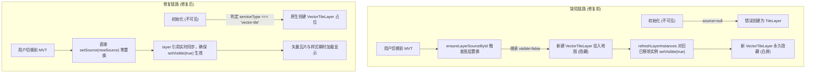

# 维护日志：修复天地图 MVT 矢量底图切换无法渲染缺陷（OpenLayers 2D 引擎）

## 日期与时间
2026-11-11 18:20

## 任务等级
L1 级别缺陷修复任务

---

## 问题分析

### 1. 核心症状与诉求
在 OpenLayers 2D 底图系统中：
- 用户从其他底图（如 Google、天地图栅格等）切换到「天地图MVT矢量」底图时，底图无法显示（呈现空白）；
- 但在当前选中国「天地图MVT矢量」的状态下，按 F5 强制刷新页面后，底图却能完全正常加载和渲染；
- 用户初步排查怀疑是“动态切换时缺少了相关依赖”。

### 2. 根因剖析（Root Cause）

经过对底图生命周期、图层工厂与状态管理器的完整调用链追踪，发现根本原因**并非缺少外部依赖**（`ol-mapbox-style` 已静态打包引入），而是**底图引导期实例类型错配**叠加**图层动态置换时状态更新闭包失效**导致的严重可见性丢失：

1. **引导期类型降级错配（`useBasemapLayerBootstrap.js`）**：
   - 页面初始化时，若默认激活底图不是天地图 MVT 矢量，其对应 `item.visible` 为 `false`；
   - 此时 `config.createSource()` 未被调用，传入图层工厂的 `source` 为 `null`；
   - `createBasemapLayerFromSource(null)` 内部通过 `isVectorTileSource(source)` 判断类型；由于 `null` 判定为 `false`，错误地将该图层作为普通栅格切片（`createRasterBasemapLayer`）实例化为了 `TileLayer` 并在地图中占位。
2. **动态置换时的陈旧闭包引用与可见性永久隐藏（`useMapState.js:refreshLayerInstances`）**：
   - 当用户从其他底图点击切换到天地图 MVT 矢量时，`item.visible` 变为 `true`，触发 `refreshLayerInstances`；
   - 循环体头部执行 `const layer = instanceMap[item.id];`，此时 `layer` 拿到的是引导期创建的旧 `TileLayer`（其当前 `visible` 仍为 `false`）；
   - 随后执行 `ensureLayerSourceById`，发现图层类型不匹配（`TileLayer` 无法挂载 `VectorTileSource`），调用 `applyBasemapSourceToLayer` 整体重建出新的 `VectorTileLayer`，从地图移除旧图层并挂载新图层，更新 `instanceMap[item.id] = replacedLayer`；
   - **致命缺陷**：`applyBasemapSourceToLayer` 重建时继承了旧图层的 `visible`（此时仍为 `false`），因此新图层以 `visible: false` 挂入地图；而 `refreshLayerInstances` 循环体中的 `layer` 变量并未重同步，随后的 `layer.setVisible(targetVisible)`、`layer.setZIndex()` 全都调用在了**已经被从 Map 移除的陈旧 `TileLayer` 实例上**！
   - **结果**：地图中的活体 `VectorTileLayer` 永远保持 `visible: false`，OpenLayers 根本不会触发任何瓦片网络请求，导致视觉上“空白无法显示”。
3. **为什么强制刷新页面却恢复正常？**
   - 强制刷新时，`selectedLayerRef` 记录的即为天地图 MVT 预设，`item.visible` 在引导期即为 `true`；
   - `source` 正常生成，`createBasemapLayerFromSource` 直接命中 `isVectorTileSource`，以 `visible: true` 实例化并挂入地图，因此刷新后立即可见。

---

## 解决方案与修改内容

### 修改清单

1. **`frontend/src/domains/ol/basemap/composables/useBasemapLayerBootstrap.js`**：
   - 检查 `config.serviceType === 'vector-tile'`，即时 `source` 尚未创建（`null`），也直接通过 `createVectorTileBasemapLayer` 原生创建 `VectorTileLayer` 占位，杜绝生成跨类型的 `TileLayer`。
2. **`frontend/src/domains/ol/composables/useMapState.js`**：
   - 在 `refreshLayerInstances` 循环中，`ensureLayerSourceById` 执行后立即刷新 `layer = instanceMap[item.id]`，确保后续的 `setVisible(true)`、`setZIndex`、`setOpacity` 始终作用在地图内的当前活跃实例上；
   - `ensureLayerSourceById` 增加 `isVisible = true` 参数，并透传给 `applyBasemapSourceToLayer`。
3. **`frontend/src/domains/ol/basemap/composables/basemapLayerFactory.js`**：
   - `applyBasemapSourceToLayer` 参数扩展可选覆盖 `visible/zIndex/opacity`；
   - 在同类型矢量图层轻量换源（`layer.setSource(source)`）路径下，若新源具备 `styleUrl` 元数据，自动补全调用 `applyVectorTileServerStyleAsync` 样式编译流程。
4. **版本号同步（V3.6.44）**：
   - 根 `README.md` 三处同步（项目简介、版本演进首行、页脚）；
   - `Docs/Guide/CHANGELOG.md` 追加 V3.6.44 发布条目。

---

## 测试方案

### Agent 已执行（自动化门禁）
1. `npx tsc --noEmit`：0 类型错误；
2. `npx eslint`：通过，零代码风格告警；
3. `python -X utf8 Scripts/CheckStructureTree.py`：526/526 全部匹配通过；
4. `python -X utf8 Scripts/CheckConfigRegistry.py`：配置登记 7 项检查全绿。

### 待用户实机验证（浏览器）
1. 打开浏览器进入 OpenLayers 2D 地图，默认处于任意非天地图 MVT 底图（如 Google 卫星或天地图影像）；
2. 打开底图选择器，点击切换到「天地图MVT矢量」；
3. **预期表现**：底图无需按 F5 刷新，立即平滑加载并渲染出高德风矢量的道路、水系、海蓝背景与中文注记；多次在其他底图间来回切换均稳定展示。
