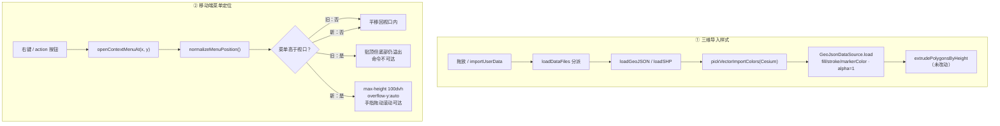

# 三维导入白模口径与移动端 TOC 菜单可达性修复

- **日期与时间**：2026-11-13 09:55
- **任务等级**：L2
- **版本**：V3.6.45

---

## 一、问题分析

### 1.1 症状

1. **三维建筑导入后是半透明的**：面填充能透出底图与相邻建筑，密集区体块边界糊成一片，读不出「白模」应有的实体感。
2. **移动端 TOC 图层菜单底部命令不可达**：数据图层的 action 较多（重命名 / 缩放 / 透明度 / 导出 / 删除…），手机上一屏放不下，菜单底部被视口裁掉，既看不到也点不到。

### 1.2 根因

| # | 位置 | 根因 |
|---|---|---|
| 1 | `loaders/geojsonLoader.js:208` | 默认样式 `fill: #3ddc84 withAlpha(0.3)` —— 导入期一次性写死半透明 |
| 1 | `loaders/shpLoader.js:64` | 默认样式 `fill: #ffcc00 withAlpha(0.25)` —— 同一问题的另一处 |
| 2 | `TOCTreeItem.vue` `.toc-context-menu` | `position: fixed` 且**无 `max-height` / `overflow`**，菜单高度随 action 数无限增长 |
| 2 | `TOCTreeItem.vue` `normalizeMenuPosition()` | 只做「越界平移」：`y = Math.max(gap, viewportHeight - rect.height - gap)`。当 `rect.height > viewportHeight` 时结果为负，`Math.max` 只能把菜单贴到顶部，**溢出部分仍在视口外**——上移对「比屏幕还高」的菜单无效 |

### 1.3 受影响模块

- Cesium 数据导入：GeoJSON、SHP、以及建筑抓取产物（`天地图建筑白模_*.geojson` 经 `importUserData → loadDataFiles → loadGeoJSON` 入库，与普通 GeoJSON 同一条链路）。
- 2D / 3D 共用图层面板：TOC 树项的右键 / action 菜单（`TOCTreeItem.vue`，`<teleport to="body">`）。

---

## 二、解决方案

### 2.1 三维导入：白模口径（纯色不透明 + 批次随机色）

**不做**「按真实建筑色采样」或「按高度渐变」：白模的价值是去掉贴图与颜色干扰，让体量与间距成为唯一的视觉信息；半透明会让相邻体块互相透色，正好破坏这一点。

| 决策 | 取值 | 理由 |
|---|---|---|
| 透明度 | `alpha = 1` | 白模要求实体感；透明度已由图层面板滑杆（`dataSourceDisplay.js`）按图层实时调，不在导入期预设 |
| 颜色 | 5 色板按导入批次随机取一 | 用户明确「颜色可以随机」；一次导入共用一色，便于在图层树中区分来源批次 |
| 色板 | `#4caf50` `#26a69a` `#42a5f5` `#7e57c2` `#ffa726` | 中明度、中饱和，浅色底图上可辨且不刺眼；避开纯白（与地形同色）与纯红（近似报错语义） |
| 作用范围 | `fill` / `stroke` / `markerColor` 同色 | 一次导入内点线面同色，避免同批次内出现多套配色 |
| 拉伸 | 不改 | `extrudePolygonsByHeight` 已按 `height_m` 等属性拉伸，本次只改材质透明度 |

实现上抽成 `loaders/utils.js` 的 `pickVectorImportColors(Cesium)`，GeoJSON 与 SHP 两个 loader 共用，避免两份色板漂移（单一职责 + 单一事实源）。

### 2.2 移动端菜单：高度约束 + 内部滚动

| 层 | 改动 |
|---|---|
| CSS 容器 | `max-height: calc(100vh - 16px)` → `calc(100dvh - 16px)`（渐进增强）；`overflow-y: auto`；`overscroll-behavior: contain`；`-webkit-overflow-scrolling: touch` |
| CSS 触屏档 | 追加 `max-height: calc(100dvh - 16px - env(safe-area-inset-bottom, 0px))` 与 `padding-bottom` 安全区补偿 |
| JS 定位 | `window.visualViewport?.height/width ?? innerHeight/innerWidth`；注释明确「高度已被 CSS 钳制，此处只做贴边，溢出交给滚动」 |

> **关于「拖动」**：菜单超高时，手指在菜单内上下滑动即为滚动（`overflow-y: auto` + 惯性滚动），可看到并点到全部命令。未做成「拖动菜单本体移动位置」——那会与滚动争夺同一个手势，反而让用户无法稳定滚到目标项。

### 2.3 数据流（变更前后）

---

## 三、修改内容

| # | 文件 | 改动 |
|---|---|---|
| 1 | `frontend/src/domains/cesium/composables/dataImport/loaders/utils.js` | 新增 `VECTOR_IMPORT_PALETTE` 与 `pickVectorImportColors(Cesium)`（注释含功能/参数/返回/核心逻辑） |
| 2 | `.../loaders/geojsonLoader.js` | 引入并改用 `pickVectorImportColors`；删除 `withAlpha(0.3)` |
| 3 | `.../loaders/shpLoader.js` | 同步改用同一函数；删除 `withAlpha(0.25)` |
| 4 | `frontend/src/domains/common/layer-tree/components/TOCTreeItem.vue` | 菜单容器加高度约束与滚动；触屏档加安全区；`normalizeMenuPosition` 改用 `visualViewport` |
| 5 | `README.md` | 版本三处升 V3.6.45；版本表收敛为 3 行（45/44/43） |
| 6 | `Docs/Guide/CHANGELOG.md` | 新增 V3.6.45 条目 |
| 7 | `Docs/LLM_record/26-11/2026-11-13/2026-11-13-3d-import-style-and-mobile-toc-menu.md` | 本日志 |

## 四、修改原因

- 半透明填充与「白模」的用途相悖：白模用于查看建筑体量、密度、间距，半透明会让遮挡关系失效。
- 移动端没有 hover，也没有可滚动的右键菜单替代品；底部 action 不可达等于功能缺失（重命名、删除等正好排在菜单末尾）。

## 五、影响范围

| 面 | 影响 |
|---|---|
| 三维导入 | GeoJSON / SHP / 建筑抓取产物：面由半透明变不透明纯色，颜色按批次随机 |
| 图层面板 | 仅菜单容器尺寸与滚动行为；菜单项顺序、命令分发、关闭逻辑均未动 |
| 2D 引擎 | 不影响（2D 导入样式走 `getRandomStyle()`，本次未触及） |
| 配置 / 结构树 | 无新增配置 key、无文件增删 |

## 六、性能指标

不适用（无渲染算法变更）。补充：菜单 `max-height` 只影响布局，`overflow-y: auto` 在菜单未超高时不产生滚动容器开销。

## 七、测试方案

**Agent 已执行**

| 项 | 命令 / 方式 | 结果 |
|---|---|---|
| 配色函数 | `node --input-type=module` 直接 import `utils.js`，30 次抽样 | 5 色全部出现；`fill.alpha === 1`；`stroke/markerColor` 与 `fill` 同引用 |
| 半透明残留 | `grep -rn "withAlpha" frontend/src/domains/cesium` | 仅剩图层透明度滑杆（`dataSourceDisplay.js`）与绘制工具；导入默认样式 0 残留 |
| ESLint | 4 个改动文件 | 0 problems |
| SFC 模板 | `@vue/compiler-sfc` 编译 `TOCTreeItem.vue` | 通过 |
| 门禁 | `CheckStructureTree.py` / `CheckConfigRegistry.py` | 526:526 / 全绿 |
| 设计一致性 | 读 `terrainClampService.js` | 贴地对 polygon 设 `heightReference`，与 `extrudedHeight` 的共存属既有行为，本次未改 |

**待用户实机验证**

1. `npm run dev` → 切 3D → 导入建筑 GeoJSON（或天地图建筑抓取后「导入到 3D」）：体块应**不透明**，颜色为 5 色之一；再次导入另一份数据，颜色应大概率不同。
2. 用图层面板的透明度滑杆把该图层降到 50%：应仍能半透明（说明透明度改由滑杆控制，而非导入预设）。
3. 手机（或真机调试）打开 TOC → 点数据图层的 action 按钮：菜单应限制在屏幕内，**手指在菜单内上下拖动**能看到并点到最后一个命令。
4. iOS Safari 重点确认：底部最后一项不被 Home Indicator 遮挡；地址栏收起时菜单不被裁切。
5. 回归：桌面右键菜单定位仍贴鼠标点，且不出现意外滚动条（菜单未超高时不应有滚动条）。

## 八、变更文件清单

| 文件 | 说明 |
|---|---|
| `frontend/src/domains/cesium/composables/dataImport/loaders/utils.js` | 新增白模配色工具 |
| `frontend/src/domains/cesium/composables/dataImport/loaders/geojsonLoader.js` | GeoJSON 导入改白模口径 |
| `frontend/src/domains/cesium/composables/dataImport/loaders/shpLoader.js` | SHP 导入同步口径 |
| `frontend/src/domains/common/layer-tree/components/TOCTreeItem.vue` | 菜单高度约束、滚动、安全区、visualViewport 定位 |
| `README.md` | 版本三处 + 版本表收敛 |
| `Docs/Guide/CHANGELOG.md` | V3.6.45 条目 |
| `Docs/LLM_record/26-11/2026-11-13/2026-11-13-3d-import-style-and-mobile-toc-menu.md` | 本日志 |

## 九、遗留与风险

1. 点 / 线 / 面共用同一色：同批次可识别，但同批次内不再按几何类型分色；如需分色另开。
2. `terrainClampService` 对 polygon 设 `heightReference = CLAMP_TO_GROUND`，与 `extrudedHeight` 的共存行为本次未实机验证；若建筑未拉伸，属既有的贴地 / 拉伸交互问题，另开处理。
3. 未做「拖动菜单本体」：与滚动争手势，按 2.2 的取舍只保留滚动。
4. 颜色随机不可复现：同一文件二次导入可能换色，属预期；若需稳定配色，后续可改为按文件名哈希取色。
5. 未实机：浏览器 / 真机表现待用户验证。

## 十、DoD 自查

| 项 | 状态 |
|---|---|
| 分层边界与单一职责 | ✅ 配色抽到 `loaders/utils.js`，两个 loader 共用 |
| 新增 `.ts` 无 tsc 新错 | ✅ 无新增 `.ts` |
| 新建逻辑文件默认 `.ts` | ✅ 未新建文件（改既有 `.js`） |
| 维护日志 | ✅ 本文件（含 Mermaid，待用户审查） |
| README 三处版本号 | ✅ 均为 V3.6.45 |
| CHANGELOG 条目 | ✅ 已追加 |
| 结构树同步 | ✅ 无文件增删（526:526） |
| 配置 key | ✅ 无新增 |
| 移动端基线 | ✅ 菜单项 44px、底部安全区、触屏滚动 |
| 场景数据注册 | ✅ 走既有 `dataImport.load*`，未新增数据源 |
| 门禁脚本 | ✅ 两项通过 |
| 未执行 Git 写操作 | ✅ 仅只读命令 |
| 平台红线自查 | ✅ 未触及 backend / deploy / 工作流 |
| 交接块 | ✅ 见会话末尾 |

---

## 十一、交付后补强（2026-11-13 10:10）：图层「导入到 3D」自动切换

**用户反馈**：建筑图层的 action「导入到 3D」逻辑不对——现在要求用户先手动切到 3D 再导入；应改为自动切换 3D 并导入。

**根因**：`HomeView.handleImportOlLayerTo3D` 在 `!is3DMode.value || !cesiumContainerRef.value` 时只给出「请先切换到 3D 视图，再导入该图层」并 return。切换视图的负担被交回用户，而菜单项语义本身就是「导入到 3D」。

**修法**（仅 `frontend/src/app/HomeView.vue` 一个函数）：

| 步骤 | 处理 |
|---|---|
| 1 | 快照仍先于切换获取（`exportUserLayerGeoJSON` 依赖 OL 受管图层），失败提示留在当前 2D 上下文 |
| 2 | 未在 3D → `await setMapView(MAP_VIEW_CESIUM)`；返回 false 则提示「3D 视图加载失败，无法导入该图层」 |
| 3 | `await waitForAgentMapViewReady(MAP_VIEW_CESIUM, { timeoutMs: 30000 })`：`setMapView` 只等组件模块加载完，viewer 由 `CesiumContainer` 挂载后异步创建，必须等相机可用；轮询幂等，已在 3D 时立即返回 |
| 4 | 未就绪 → 提示「3D 视图尚未就绪，请稍后重试」；此时已切到 3D，再点一次即走 3D 直导路径 |

**为什么不在 `setMapView` 里加等待**：它是通用切换入口，调用方还包括 URL 同步、`toggle3D`、Agent 命令总线；把「等 viewer」塞进去会拖慢所有切换路径。就绪等待只属于「需要在 3D 里立刻做一件事」的场景，放在调用点更合适。

**验证**：`HomeView.vue` ESLint 0 problems；`tsc --noEmit` 0 报错；`@vue/compiler-sfc` 模板编译通过；旧提示「请先切换到 3D」已 0 命中；`CheckStructureTree` 526/526、配置登记全绿（无文件增删）。

**未实机**：自动切换依赖 Cesium 首次加载耗时，需用户实测冷启动（首次进 3D）时导入是否等待正常。

---

## 十二、交付后补强（2026-11-13 10:20）：InfoBox 属性卡片高度自适应

**用户反馈**：`cesium-infoBox-iframe` 高度像是被固定了，属性信息多了也不撑开、少了也留白。

**根因（已核对 Cesium 1.146 源码与样式）**：

| 位置 | 事实 |
|---|---|
| `Widgets/widgets.css` `.cesium-infoBox` | 只有 `top / width / max-width`，**无 `height`** |
| `Widgets/widgets.css` `.cesium-infoBox-iframe` | 只有 `border / width`，**无 `height`** |
| `Widgets/InfoBox/InfoBox.js` | 全文无 `.style.height` 或 `height:` 设置 |
| 浏览器默认 | `iframe` 元素的默认高度是 **150px**，Cesium 未覆盖 → 这就是"固定高度"的来源 |

因此不是项目 `CesiumContainer.vue` 的 `:global(.cesium-infoBox)` 覆盖所致（那里只改了颜色/边框/阴影）。

**修法**（`useCesiumInfoBoxTheme.js`，与主题注入同一职责）：

1. `measureFrameContentHeight(doc)`：取 `documentElement.scrollHeight` / `body.scrollHeight` / `body.offsetHeight` 三者最大值（Cesium 已把 body margin/padding 归零，故与可见高度一致）；
2. `syncFrameHeight()`：`frame.style.height = min(内容高度, 视口 × 0.6)`；内容超出上限时由 iframe 内部滚动；
3. `MutationObserver` 监听 iframe body（描述异步写入 / 表格展开）；
4. `ResizeObserver` 监听 iframe，但**只在宽度变化时**重算 —— 高度是本模块写入的，若响应高度会形成自激循环；
5. `load` 事件统一走 `handleFrameLoad()`（主题 + 内容监听 + 高度），`cleanupInfoBoxTheme()` 逐一断开并移除 `load` / `window.resize` 监听；
6. 注入样式补 `html, body { overflow-x: hidden }`。

**为何上限取 60%**：InfoBox 的 `top` 是 50px，60% + 50px 在各种视口下都不会顶穿屏幕；同时保证超长属性表（几十行）不会把卡片拉成一整屏、盖住地图。

**验证**：ESLint 0 problems；6 个新函数各定义 1 次；`addEventListener` / `removeEventListener` 成对；3 个 Observer 均在 cleanup 中 `disconnect`。

**未实机**：需在 3D 点选点/线/面要素，分别看 1 行描述、十几行属性表、展开表格三种形态下的高度表现；iOS Safari 需复验 `visualViewport` 取值。

---

## 十三、交付后补强（2026-11-13 10:30）：图层数据导出补齐属性

**用户反馈**：TOC 图层导出 CSV / TXT / KML / GeoJSON 时没有用上当前图层的全部属性，建筑导出后连高度都没了。

**根因（两套链路，各一处）**：

| 链路 | 位置 | 事实 |
|---|---|---|
| 2D | `layerExportService.js` | CSV/TXT 表头硬编码 `ID,经度,纬度,名称,几何类型,部件,环,点序号`，`exportRows` 只放这 8 个值，**属性从未进入行数据** |
| 3D | `cesiumLayerSerialization.ts` | `LayerShape` 只有 `type/lonLats`；`collectEntityShapes` 不读 `entity.properties`；`buildGeoJSONFeatureCollection` 只写 `layerId/layerName/shapeType/vertexCount`；`buildCoordinateCSV` 只有 `shape,seq,lng,lat`；`buildCoordinateTXT` 只有坐标；`buildKML` 不写 `ExtendedData` |

**未改（已核实本就没有问题）**：

- 2D GeoJSON：`...stripGeometryFromProperties(feature)` 全量带出；
- 2D KML：OL 10.11 `writePlacemark` 无条件把非保留键写入 `ExtendedData`（过滤表仅 `address/description/name/open/phoneNumber/styleUrl/visibility` + geometry 名），已读源码确认。

**修法**：

1. 2D：`collectAttributeColumns(features)` 取所有要素属性键并集（去 `geometry` 与名称别名），`formatAttributeValue` 统一字符串化；CSV/TXT 表头与每行同步扩列，TXT 额外清洗制表符/换行；
2. 3D：`LayerShape.properties` + `readEntityProperties(entity, time)`（复用 `resolveValue`，与属性表 `collectEntityProperties` 同口径）；CSV 扩列并转义、TXT 加 `# @键=值`、GeoJSON 合并、KML 加 `ExtendedData`；
3. 无属性时输出与改动前一致，避免影响既有下游解析。

**验证（实跑）**：

| 项 | 结果 |
|---|---|
| 3D `collectEntityShapes` | 两条实体属性快照 `{"height_m":"32.5","floors":"10","name":"楼A","extra":"{\"a\":1}"}` |
| 3D CSV | 表头 `shape,seq,lng,lat,height_m,floors,name,extra,A6`；首行 `polygon_1,1,5.729578,11.459156,32.5,10,楼A,"{""a"":1}",` |
| 3D TXT | `# @height_m=32.5 | # @floors=10 | # @name=楼A` |
| 3D KML | 命中 `<Data name="height_m"><value>32.5</value></Data>` 与 `name="floors"` |
| 3D GeoJSON | `properties.height_m === "32.5"`，元信息键并存 |
| 2D 属性列 | `["height_m","floors","A6","_layer"]`，排除 `name/名称/geometry`；对象 JSON 化、null 空串 |
| ESLint / tsc | 两文件均 0 problems / 0 报错 |

**未实机**：浏览器内下载文件需用户验证（尤其 Excel 打开含引号字段的 CSV 是否列位正确）。

---

## 十四、交付后补强（2026-11-13 10:45）：导出标准化与导出→导入闭环

**用户反馈**：导出的数据无法再导入本系统（提示「文件解析失败: …」），TXT 是纯坐标、外部工具也不认；要求标准格式导出且全部可原样回读。

**根因（三处）**：

| # | 位置 | 事实 |
|---|---|---|
| 1 | 2D `layerExportService.js` | CSV 表头为中文固定 8 列；TXT 为纯坐标文本 |
| 2 | 3D `cesiumLayerSerialization.ts` | CSV 表头为 `shape,seq,lng,lat`；TXT 为分块坐标文本 |
| 3 | 导入侧 | 2D / 3D 均无 CSV/TXT 分支；2D `buildSingleUploadPayload` 对 csv/txt 返回 null（**静默丢弃**），`TOCPanel` 的 `accept="."` 还是非法值 |

**关于用户看到的报错**：`文件解析失败: A requested file or directory could not be found at the time an operation was processed.` —— 前半句是本项目 2D 导入的兜底文案（`useLayerDataImport.js`），后半句是**浏览器读不到文件**时的系统错误（文件在选中后被移动/删除，或拖拽的是失效引用），不是格式判断错误。本轮修的是「格式不支持」这一根因；若仍出现该文案，请确认文件仍在原路径。

**修法**：

1. 新增 `frontend/src/domains/common/data-import/parsers/tabularParser.ts`：
   - `parseCsvToGeoJSON`：列名别名识别（`lng/lon/longitude/x/经度`、`lat/y/纬度`、`name/名称`、`geometry_type/几何类型`、`part/ring/vertex`），引号内逗号与 BOM 处理，Point 逐行 / LineString 按 id+part / Polygon 再按 ring 分环并闭合，数值属性转 number；
   - `parseWktToGeoJSON`：`POINT/MULTIPOINT/LINESTRING/MULTILINESTRING/POLYGON/MULTIPOLYGON`，跨行几何按括号配平累积，`# @k=v` 注释行归属下一个几何。
2. 导出统一列契约：2D 与 3D 的 CSV 均为 `id,lng,lat,name,geometry_type,part,ring,vertex,<属性…>`；TXT 均改为 WKT + `# @k=v` 属性注释。
3. 导入接线四条：`dataDispatcher.dispatchGisData`（CSV/WKT → geojson packet）、`vectorUtils.getNormalizedUploadType` + `useGisLoader.isSupportedExt`、2D `parseUploadedVector` 与 `buildSingleUploadPayload`、3D `loadDataFile`（转 GeoJSON 后复用 `loadGeoJSON`）。
4. 修复 `TOCPanel` 的 `accept="."`，并在 2D/3D 文件选择器补 `.csv,.txt,.wkt`。

**验证（实跑）**：

| 项 | 结果 |
|---|---|
| CSV 解析 | 面 + 点各 1 → 2 个 Feature，面环 4 点闭合、`height_m/floors/note/name` 全保留；引号内逗号正确 |
| CSV 中文别名 | `ID/经度/纬度/名称/几何类型/部件/点序号` → `LineString` 2 点，属性 `height_m` |
| WKT 解析 | `POLYGON` + `POINT` → 2 个 Feature，属性 `height_m/name` 归属正确；跨行面、`MULTIPOINT` 通过 |
| 端到端闭环 | 3D 导出 2 shapes → CSV 回读 2、WKT 回读 2，几何类型与 `height_m` 完全一致 |
| 缺列提示 | `parseCsvToGeoJSON("a,b")` 抛「缺少经纬度列…」 |
| ESLint / tsc / 门禁 | 全部 0 problems / 0 报错；结构树 527/527（新文件已登记） |

**未实机**：浏览器内的下载与拖拽导入仍需用户验证（尤其 Excel 另存为 CSV 后列名可能变化，解析器已做别名兼容）。
