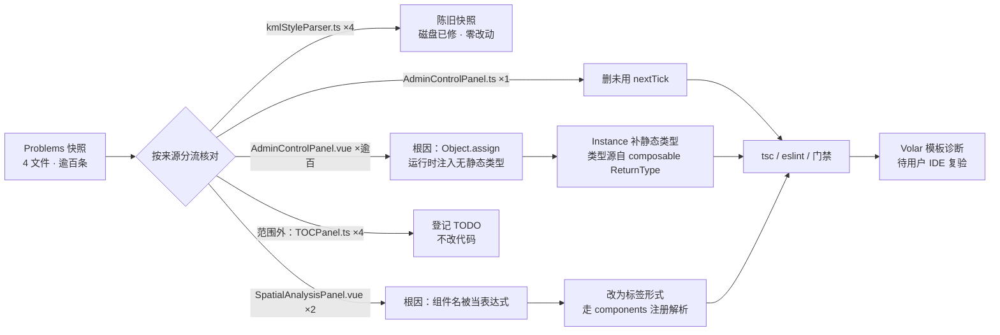

# 修复范式化组件的模板类型断裂（AdminControlPanel / SpatialAnalysisPanel）

- **日期与时间**：2026-11-13 15:52
- **任务等级**：L2（常规）
- **依据规范**：`Docs/Force_command.md` §0（优先级 2）、§1（任务分级）、§3（先分析后实施）、§2.5（范围外发现只登记不修改）、§5（版本号顺延）、§7（DoD）

> **版本号两次顺延说明**：上一任务（V3.6.47）收尾时 README 三处为 V3.6.47；本任务开工复核时已被**并行会话**推进至 `V3.6.48`（`LayerControlPanel` 同类修复），收尾时又推进至 `V3.6.49`（`useLayerControlHandlers` 23 处 TS 错误）。按 §5「多会话并行导致版本号撞车时，后完成者顺延」，本次最终定为 **V3.6.50**，不合并、不覆盖 V3.6.48 / V3.6.49（`handover.md` §7 已提示撞车风险）。CHANGELOG 中一度出现的两个 V3.6.49 条目，已把本任务条目订正为 V3.6.50。

---

## 问题分析

### 核心症状

用户提交 VS Code Problems 面板快照，覆盖 4 个文件、逾百条诊断：

| 文件 | 来源 | 症状 |
|---|---|---|
| `common/data-import/parsers/kmlStyleParser.ts` | `typescript` ×4 | TS2339 ×3（`featureGeometry` / `defaultFill` / `defaultStroke` 不存在于 `{}`）、TS2353（`onLoad` 不在 `Options` 中） |
| `common/user/components/AdminControlPanel.ts` | `eslint` ×1 | `'nextTick' is defined but never used` |
| `common/user/components/AdminControlPanel.vue` | `ts-plugin` ×逾百条 | 模板中 `overview` / `submittingConfig` / `handleSaveContact` / `selectedTable` / `tables` / `dbSearch` / `agentConfigDraft` / `sortedTableRows` … 全部报 TS2339 / TS2551「不存在于组件实例类型」 |
| `ol/components/SpatialAnalysisPanel.vue` | `ts-plugin` ×2 | `CheckCircle2` / `AlertCircle` 不存在于组件实例类型 |

### 事实基线（不照旧行号改代码）

| 检查 | 结果 |
|---|---|
| `npx tsc --noEmit --pretty false`（全量，两次） | 首跑 exit 2 / 1 行（外部并发写盘的瞬时状态），紧接复跑 **exit 0 / 0 行输出** |
| `npx eslint --no-cache`（4 个相关文件） | **1 problem（1 error）**：仅 `AdminControlPanel.ts:7` 的 `nextTick` 未使用 |
| 项目是否安装 `vue-tsc` | **未安装**（`frontend/node_modules/vue-tsc` 不存在）。安装依赖属 §1 的 L3「依赖增删」，须先经用户批准方案，故本次**不擅自安装**；`.vue` 模板诊断由用户 IDE（Volar）复验 |

> **关键认知**：`tsc --noEmit` 的 0 错误**不能**证明 `.vue` 模板无误 —— 它不解析 SFC 模板中的表达式。`ts-plugin` 诊断由 Vue 语言服务产生，是本次的主要真实缺陷。

### 逐类核对结论

**① `kmlStyleParser.ts` 4 条 —— 陈旧快照，磁盘已修复，零改动**

- L334 现为 `export function convertKmlStyleToOlStyle(styleDef: any, options: any = {})`：`options` 显式标为 `any`，故 L338–340 解构 `featureGeometry` / `defaultFill` / `defaultStroke` 合法。旧快照中 `options` 推断为 `{}` 才会报 TS2339。
- L408 现为 `const iconOptions: Record<string, any> = { src, scale, onLoad, onError }`，`new Icon(iconOptions)` 传入的是宽松记录类型，不触发 `Options` 的 TS2353「未知属性」。旧快照应是把 `onLoad` 直接写进 `new Icon({...})` 实参。

**② `AdminControlPanel.ts:7` ESLint —— 真实残留**

`import { defineComponent, nextTick, onMounted, ref, ... }` 中 `nextTick` 全文件未使用（已实跑 ESLint 复现），需删除。

**③ `AdminControlPanel.vue` 逾百条 ts-plugin —— 真实类型断裂（本次主问题）**

- 根因：`AdminControlPanel.ts` L80 `Object.assign(this, table, settings)` 把 `useAdminTable`（43 个成员）与 `useAdminSettings`（33 个成员）的返回值在**构造期运行时**平铺到 `Instance`，但 `Instance` 类的静态类型里没有这些成员。Volar 把 `setup()` 的返回类型 `Instance` 作为模板绑定来源，因此模板中每一个注入成员都报「不存在」。
- 佐证：`Instance` 自有 public 字段（`activeTab` / `tabs` / `tabsNavRef` / `t` 等）在诊断中**没有**报错，说明 Volar 确实读到了 `Instance` 类型，缺的只是注入部分。
- 成因：V3.6.46「视图 / 实例物理分离」重构把逻辑拆到两个 composable 后，只保证了运行时平铺，未补静态类型声明。
- 项目既有范例：`frontend/src/domains/ol/layer/components/LayerControlPanel.ts` L161–177 已用 `public xxx!: Ref<...>` 形式「仅声明类型」，注释明确写出目的「使 Vue 模板编译器与 tsc 能对 template 中的同名引用做类型检查」；该组件未出现同类诊断，证明补静态类型是本项目已验证的解法。

**④ `SpatialAnalysisPanel.vue` 2 条 ts-plugin —— 真实，模板写法与注册方式不匹配**

- `SpatialAnalysisPanel.ts` L39–54 的 `components` 已注册 `AlertCircle` / `CheckCircle2`（与其同批的 `<Play>`、`<Info>` 在模板中以标签形式使用且无诊断）。
- 但 L341 写成 `<component :is="resultType === 'success' ? CheckCircle2 : AlertCircle" :size="14" />`，把两个组件名当作**表达式标识符**求值。`<script lang="ts" src="...">` 外链模式下，模块顶层的 import 不会自动暴露为模板绑定（无 `<script setup>` 的编译期注入），故 Volar 报「属性不存在」。

### 受影响模块

- **改动面**：`domains/common/user/components/AdminControlPanel.ts`（类型 + 未用 import）、`domains/ol/components/SpatialAnalysisPanel.vue`（模板一行）。
- **核对面（零改动）**：`kmlStyleParser.ts`、两个 composable（`useAdminTable.ts` / `useAdminSettings.ts`）、`LayerControlPanel.ts`（仅作范例参考）。
- **运行时影响**：类型声明与模板写法调整均不改变运行时数据流；`Object.assign` 注入逻辑、组件注册集合、图标渲染结果保持不变。
- **范围外发现（按 §2.5 只登记不改）**：`TOCPanel.ts` 存在 4 处 `Object.assign(this, ...)`（L231 / 253 / 265 / 273），可能同类地缺少静态类型声明；本次不动，登记 `Docs/TODO/bugfix-optimization-plan.md`。

---

## 解决方案（方案对比与选型）

| 问题 | 候选方案 | 评价 | 结论 |
|---|---|---|---|
| `Instance` 缺 70+ 注入成员类型 | **A. 接口合并**：`interface Instance extends ReturnType<typeof useAdminTable>, ReturnType<typeof useAdminSettings>` | 类型直接来自两个 composable 的 `ReturnType`，零重复、零漂移；运行时不产生代码；效果等价于 `LayerControlPanel.ts` 的 `declare` 字段 | ✅ 首选；若触发 `@typescript-eslint/no-empty-object-type` 则退到方案 B |
| | **B. `setup` 返回类型标注**：`setup(...): Instance & AdminTableBindings & AdminSettingsBindings` + 类型断言 | 同样让 Volar 看到全部成员；改动集中在 `defineComponent` | ✅ 备选（A 的降级方案） |
| | C. 逐条 `public xxx!: Ref<...>` 显式声明 70+ 行 | 贴合 `LayerControlPanel.ts` 惯例，但行数大、类型需手工同步，composable 增删成员时易漂移 | ❌ 本次成员过多，维护成本不划算 |
| | D. 关闭 Volar 模板检查 / 给模板逐行加 `@ts-ignore` | 掩盖问题 | ❌ |
| `nextTick` 未使用 | 删除 import | 唯一正确解 | ✅ |
| | 加 `_` 前缀或 `eslint-disable` | 留无用 import / 抑制规则 | ❌ |
| `SpatialAnalysisPanel` 动态组件 | **A. 改为标签形式**：`<CheckCircle2 v-if="..."/>` + `<AlertCircle v-else/>` | 与本文件 `<Play>` / `<Info>` 写法一致；走 `components` 注册名解析，Volar 无表达式标识符 | ✅ 选定 |
| | B. `:is` 传字符串名 `'CheckCircle2'` / `'AlertCircle'` | 可行 | ❌ 可读性弱于标签形式，且与本文件风格不一 |
| | C. 在 `Instance` 里加两个 public 图标字段 | 可行但把组件对象当实例数据，与 `components` 注册重复 | ❌ |
| 模板类型验证 | 安装 `vue-tsc` | 能本地复现 Volar | ❌ 属 L3 依赖增删，须先批准方案；本次不擅自安装，改为 IDE 复验 |

**选型理由**：优先「零运行时改动 + 类型单一事实源」。接口合并 / setup 返回类型标注都让类型直接由 composable 的 `ReturnType` 派生，composable 增删成员时类型自动跟随，避免 70 行手工声明漂移。

**实施步骤**：① 写本日志前半（已完成）→ ② 改 `AdminControlPanel.ts`（删 `nextTick`、补注入成员静态类型）→ ③ 改 `SpatialAnalysisPanel.vue` L341 → ④ 复跑 `tsc --noEmit` / `eslint` / 两个门禁 → ⑤ 补全日志、版本 V3.6.50、CHANGELOG、TODO 登记、交接块。

---

## 模块关系与修复链路（Mermaid）

> 本图依 `Force_command.md` §2.9 提供（≥3 文件协同改动），供交接与审查；聚焦「诊断来源 → 根因 → 改动 / 登记」的数据流向。

---

## 修改内容

| # | 文件 | 改动 |
|:---:|---|---|
| 1 | `frontend/src/domains/common/user/components/AdminControlPanel.ts` | ① L7 删除未使用的 `nextTick` import；② 新增 `AdminPanelBindings = Instance & ReturnType<typeof useAdminTable> & ReturnType<typeof useAdminSettings>` 类型别名；③ `setup(props, ctx)` 标注返回类型为 `AdminPanelBindings`，并对 `new Instance(...)` 加类型断言（仅补静态类型，运行时对象不变） |
| 2 | `frontend/src/domains/ol/components/SpatialAnalysisPanel.vue` | L341 `<component :is="… ? CheckCircle2 : AlertCircle">` 改为 `<CheckCircle2 v-if="resultType === 'success'"/>` + `<AlertCircle v-else/>`，走 `components` 注册名解析 |
| 3 | 本日志、根 `README.md`、`Docs/Guide/CHANGELOG.md`、`Docs/TODO/bugfix-optimization-plan.md` | L2 收尾：日志 / 版本号 / 版本历史 / 范围外发现登记 |

**零改动**：`kmlStyleParser.ts`（诊断已过期）、`useAdminTable.ts` / `useAdminSettings.ts`（能力层无需改动）、`AdminControlPanel.vue`（模板变量名全部正确，缺的是实例层类型）、`LayerControlPanel.ts`（仅作范例参考）。

### 方案落地偏差记录（如实订正）

前半「方案对比」预判接口合并可能触发 `no-empty-object-type`，**实际触发的是 `@typescript-eslint/no-unsafe-declaration-merging`**（两条 error：interface 与 class 各一处）。按预设降级路径切到方案 B（`setup` 返回类型交集），并删除接口合并声明。切换后 `tsc --noEmit` 与 `eslint --no-cache` 均 exit 0。

**方案 B 的类型依据（已查证，非推测）**：`frontend/node_modules/@vue/runtime-core/dist/runtime-core.d.ts` L503 注释 `B = {}, // raw bindings returned from setup()`，L832 `setup?: (...) => Promise<RawBindings> | RawBindings | RenderFunction | void`。诊断文本中的 `CreateComponentPublicInstanceWithMixins<..., Instance, ...>` 第二个参数即 B；改为 `AdminPanelBindings` 后，模板绑定集合确定包含两个 composable 的全部成员，ref 字段由 Vue 既有的 `ShallowUnwrapRef` 解包（与 `Instance` 自有 `activeTab` 等字段同路径）。

> **与 V3.6.48 的关系**：并行会话已在 V3.6.48 用 `public …!` 逐条声明修复 `LayerControlPanel` 的同一类问题，本次根因判断与之互相印证。差异在于 `AdminControlPanel` 注入成员达 76 个，逐条声明会产生大量重复且需手工同步的类型噪音，故改用 `ReturnType` 派生。两种写法都让 Volar 看到成员；若后续要求范式统一，属独立重构任务，本次不顺手归并（§2.5）。

## 修改原因

V3.6.46 范式化把逻辑拆到两个 composable 后，只保证 `Object.assign` 的运行时平铺，未补静态类型，导致 `tsc --noEmit`（不解析 SFC 模板）显示全绿而 IDE 的 Volar 模板检查报逾百条。本次修复让「模板可见的成员集合」与「运行时实际挂载的成员集合」一致，同时保持能力层零改动、零运行时语义变化。

## 影响范围

- **编译期**：`AdminControlPanel` 的 setup raw bindings 类型；`SpatialAnalysisPanel` 结果图标的模板解析方式。
- **运行时**：零变化。`Object.assign` 注入逻辑、两个 composable 的返回值、组件注册集合、图标渲染结果均不变；`<CheckCircle2>` / `<AlertCircle>` 与原先 `<component :is>` 指向同一组件对象。
- **不涉及**：底图链路、图层管理、TOC、数据源注册、配置 key、后端 / 部署面、数据库、URL 参数。

## 性能指标

不适用（纯类型声明与模板写法调整，无算法 / 渲染路径变化，未实测）。

## 测试方案

### Agent 已执行（静态验证，非实机）

| # | 检查 | 结果 |
|:---:|---|---|
| 1 | `npx tsc --noEmit --pretty false`（全量） | 方案 A 阶段首跑曾报 17 条 `useLayerControlHandlers.ts` 的 TS2339（外部并行会话编辑该文件的瞬时状态，非本次改动引入）；方案 B 落地后复跑 **exit 0 / 0 行输出** |
| 2 | `npx eslint --no-cache`（4 文件） | 修复前 1 error（`nextTick`）；方案 A 阶段 2 errors（`no-unsafe-declaration-merging`）；方案 B 后 **exit 0 / 0 输出** |
| 3 | `python Scripts/CheckStructureTree.py` | **652 / 652，漏登记 0 · 幽灵 0，exit 0** |
| 4 | `python Scripts/CheckConfigRegistry.py` | **7 项全通过，exit 0** |
| 5 | §11.2 平台红线模式串只读扫描 | 35 处命中全部落在体积云 `maxRayDistance` / `maxRayDist`（§11.2 已注明的已知假阳性，本次抽查 `cloudModule.ts` L392–401 逐条确认）；生产基线三项零命中 → 全绿 |

> 本次为纯前端改动，§11.2「涉及后端或部署面改动且即将 push」的触发条件不成立；仍主动执行以闭合 DoD。**未安装 `vue-tsc`**（依赖增删属 L3，须先批准方案），故 `.vue` 模板的 Volar 诊断不在本地复验范围内，如实列为待用户操作，不声称已验证通过。

### 待用户实机 / IDE 验证

1. 保存全部缓冲区，重启 ESLint Server 与 TypeScript（Volar）Server，或重开 `AdminControlPanel.vue` / `SpatialAnalysisPanel.vue`，确认 Problems 面板中逾百条 TS2339 / TS2551 与 2 条图标诊断清空。
2. 打开管理后台，依次切换「概览与环境 / 系统配置 / 模型与地图 / 数据管理」四个页签，确认概览 KPI、公告发布、联系方式、限额保存、表浏览 / 分页 / 排序 / 单元格编辑 / 插入行均正常 —— 验证 `setup` 返回类型调整未影响运行时绑定。
3. 2D 引擎执行一次空间分析并产生成功 / 失败结果，确认结果区图标正常显示（验证 `<CheckCircle2>` / `<AlertCircle>` 标签解析）。
4. 可选：`npm run build` 确认 SFC 编译无 `Failed to resolve component` 告警。

## 变更文件清单

| 仓库相对路径 | 说明 |
|---|---|
| `frontend/src/domains/common/user/components/AdminControlPanel.ts` | 删除未用 import；新增能力层绑定类型；`setup` 返回类型标注 |
| `frontend/src/domains/ol/components/SpatialAnalysisPanel.vue` | 结果图标改标签形式 |
| `Docs/LLM_record/26-11/2026-11-13/2026-11-13-fix-admin-panel-template-types.md` | 新建本次 L2 维护日志（含 Mermaid 图） |
| `README.md` | 三处版本号 V3.6.49 → V3.6.50，版本表新增首行 / 删除最旧一行 |
| `Docs/Guide/CHANGELOG.md` | 顶部追加 V3.6.50 完整条目 |
| `Docs/TODO/bugfix-optimization-plan.md` | 按 §2.5 登记 `TOCPanel.ts` 同类风险与范式统一建议 |
| `Docs/Guide/frontend-structure.md` | 按 §7 门禁要求补录 4 处并行会话 JS→TS 改名的扩展名（见「终态复核补记」） |

> 本次任务自身无文件增删；`frontend-structure.md` 的 4 处补录是为修复**外部会话遗留**的门禁漂移，非功能改动。结构树门禁终态全绿。

## 遗留与风险

1. **Volar 模板诊断本地未复验**：项目未装 `vue-tsc`，安装属 L3 依赖增删（须先提交方案并获批准），故未擅自安装。方案 B 的类型依据已查 Vue 运行时类型定义佐证，但最终以用户 IDE 复验为准。
2. **并发写盘持续存在**（延续上一任务 V3.6.47 的观察）：README 版本被并行会话从 V3.6.47 → V3.6.48 → V3.6.49；CHANGELOG / README 中 V3.6.46 组件数从 19 → 23；结构树计数 649 → 652；`tsc` 首跑出现 17 条 `useLayerControlHandlers.ts` 瞬时错误后消失（并行会话正在修该文件，最终以 V3.6.49 收口）。本次版本号按 §5 两次顺延至 V3.6.50，未覆盖 V3.6.48 / V3.6.49。
3. **范围外同类风险**：`frontend/src/domains/common/layer-tree/components/TOCPanel.ts` 有 4 处 `Object.assign(this, ...)`（L231 / 253 / 265 / 273），可能同样缺少静态类型声明；按 §2.5 未擅自改动，已登记 TODO。
4. **范式不统一**：V3.6.48 用 `public …!` 逐条声明，本次用 `setup` 返回类型派生。两者都有效，若需统一应作为独立重构任务评估。
5. **未实机运行**：沙盒未启动 vite / 浏览器，运行时行为仅靠静态检查与类型推理保证。
6. **Git 写操作零执行**：所有改动留在工作区，提交由用户本人决定。

## DoD 自查（§7）

| 项 | 结果 |
|---|:---:|
| 代码改动完成、遵守分层边界与单一职责 | ✅ 仅改实例层与视图层；能力层零改动 |
| 新增 `.ts` 未引入 `tsc --noEmit` 新报错 | ✅ 无新增 `.ts`；全量 tsc 0 错误 |
| 新建逻辑文件默认 `.ts` | ✅ 不适用（新建的是 `Docs/` 日志 `.md`） |
| 日志已创建并写全章节 | ✅ 本文件 |
| README 三处版本号 | ✅ 本任务条目 V3.6.50 位于版本表；简介 / 页脚 / 表首行终态为并行会话 V3.6.51（见「终态复核补记」） |
| CHANGELOG 追加条目 | ✅ V3.6.50 |
| 结构树同步 | ✅ 无文件增删；门禁 652/652 全绿 |
| 配置 key 登记 | ✅ 不涉及 |
| UI/icon 移动端基线 | ✅ 不适用：未新增 icon / 未改尺寸与可点击目标，图标渲染对象不变 |
| 场景数据加载 / TOC | ✅ 不涉及 |
| 门禁脚本通过 | ✅ 见「测试方案」；首跑瞬时 tsc 错误已由外部写盘消除并复跑全绿 |
| 未执行 Git 写操作 | ✅ |
| 平台红线自查 | ✅ 全绿（仅已知假阳性） |
| 交接块输出 | ✅ 见会话末尾 |

---

## 终态复核补记（全部收尾文件写入后）

### 版本归属（并发会话最终收敛）

- 并行会话在 `CHANGELOG.md` 的 **V3.6.51** 条目中明确写道「V3.6.50 已被并行会话（AdminControlPanel / SpatialAnalysisPanel 修复）占用，本次按 §5 顺延为 V3.6.51」，即 **V3.6.50 归本次任务**已获另一会话认可，故不再顺延到 V3.6.52。
- README 终态：简介行 / 版本表首行 / 页脚均为 **V3.6.51**（当前最新，由并行会话推进）；本任务 **V3.6.50** 位于版本表第二行，版本表恒定 3 行（51 / 50 / 49），「更早版本」文案同步为 V3.6.47 及以前。三处 SSOT 一致。
- CHANGELOG 终态：`### V3.6.51`（L14）→ `### V3.6.50`（L30，本任务）→ `### V3.6.49`（L63）。并行会话保存 CHANGELOG 时曾把本任务的**标题行覆盖丢失**（正文 L32–59 保留），已补回标题；无重复版本号。

### 门禁收尾

- `CheckStructureTree.py` 终态首跑报 4 处漂移：磁盘为 `.ts`、文档仍为 `.js`（`gltfLoader` / `useCesiumModelManager` / `useCesiumHeightSampler` / `AerialPerspectiveEffect`），系并行会话正在进行的 JS→TS 改名未同步结构树，非本次改动引入。按 §7「脚本报错必须修到通过」，在 `Docs/Guide/frontend-structure.md` 做 4 处机械性扩展名同步，复跑 **656 / 656，漏登记 0 · 幽灵 0，exit 0**。

### 终态检查（全部实跑）

| 检查 | 结果 |
|---|---|
| `npx tsc --noEmit --pretty false` | **exit 0 / 0 行输出** |
| `npx eslint --no-cache`（4 文件） | **exit 0 / 0 输出** |
| `python Scripts/CheckStructureTree.py` | **656/656 全绿，exit 0** |
| `python Scripts/CheckConfigRegistry.py` | **7 项全绿，exit 0** |
| §11.2 平台红线扫描 | 35 处命中全为 `maxRayDistance` 已知假阳性，生产基线零命中 → 全绿 |

> 代码改动经复核仍在：`AdminControlPanel.ts` L30 / L41 / L43 的 `AdminPanelBindings` 标注与断言、`SpatialAnalysisPanel.vue` L341–342 的标签形式图标，均未被并行会话的缓冲区写回覆盖。Volar 模板诊断仍待用户 IDE 复验（未安装 `vue-tsc`），此项不声称已验证通过。
