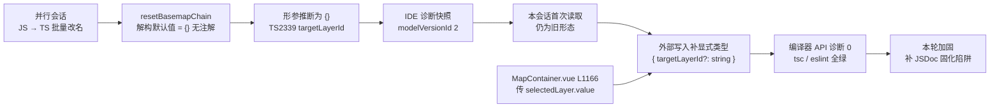

# useBasemapSelectionWatcher 参数类型诊断核对与注释加固

- **日期与时间**：2026-11-13 16:35
- **任务等级**：L2（常规，Bug 修复类任务按 §1 默认 L2）
- **依据规范**：`Docs/Force_command.md` §0（优先级 2）、§1（任务分级）、§3（先分析后实施 / 注释义务）、§2.5（范围外发现只登记不修改）、§5（版本号顺延）、§7（DoD）
- **本次版本**：V3.6.53（README 当前 V3.6.52，按 §5 顺延 +1）

---

## 问题分析

### 核心症状

用户提交 1 条 `typescript` / TS2339：

```
frontend/src/domains/ol/basemap/composables/useBasemapSelectionWatcher.ts:203
Property 'targetLayerId' does not exist on type '{}'.
```

诊断携带 `modelVersionId: 2`。该文件是本会话前序任务里**并行会话从 `.js` 批量改名为 `.ts`** 的文件之一（`Docs/Guide/frontend-structure.md` 的补录清单中有 `useBasemapSelectionWatcher.js → .ts`），因此需重点判断是否是转 TS 后新暴露的真实类型错误。

### 事实基线（会话内两次读取结果不同）

| 时点 | L203 磁盘内容 | 判定 |
|---|---|---|
| 首次读取 | `function resetBasemapChain({ targetLayerId } = {}) {` | **会报 TS2339**：默认值 `{}` 使参数类型推断为 `{}`，解构 `targetLayerId` 不存在 |
| 数秒后复核 | `function resetBasemapChain({ targetLayerId }: { targetLayerId?: string } = {}) {` | 已被**外部写入**（并行会话 / IDE 保存）补上显式参数类型，诊断不再成立 |

> 这是本会话第四次观察到并发写盘。按 §2.6「禁止臆造事实」，结论以复核后的磁盘状态为准，不照首次读到的旧行号盲目重复修改。

| 检查 | 结果 |
|---|---|
| TypeScript 编译器 API（项目 `tsconfig.json` 建 `Program`，只取该文件 syntactic + semantic 诊断） | **0 条** |
| `npx eslint --no-cache`（该文件） | **exit 0 / 0 输出** |
| `npx tsc --noEmit --pretty false`（全量） | **exit 0** |

### 根本原因与调用链核对

- 成因：函数参数写成解构 + 默认值 `= {}` 却未标注类型，TS 把形参推断为空对象类型 `{}`；解构 `targetLayerId` 即报 TS2339。与 V3.6.49 任务中 `useLayerControlHandlers.ts` 三个 `payload` 参数被推断为 `{}` 是**完全同源**的问题 —— JS → TS 批量改名后，原本由 JS 宽松语义掩盖的类型缺口会集中暴露。
- 调用链（已读实际代码，未臆造）：`MapContainer.vue` L1130 从 `createBasemapSelectionWatcher({...})` 解构出 `resetBasemapChain`；L1166 调用 `resetBasemapChain?.({ targetLayerId: selectedLayer.value })`；函数内 L226 / L228 以 `String(targetLayerId || selectedLayerRef?.value || '')` 兜底。因此 `targetLayerId?: string`（可选、可回退）的类型契约与调用方一致，外部修复是完整的。
- 全仓检索 `resetBasemapChain` 仅有「定义 + 导出 + 上述一个调用点」，无其它实参形态需要兼容。

### 残留风险（本轮仍需处理的部分）

磁盘类型注解是**内联字面量且无任何注释**。该函数的核心陷阱恰恰是「`= {}` 默认值 + 解构」—— 一旦后续维护者重构时删掉 `: { targetLayerId?: string }`，或把函数搬回 `.js`，TS2339 会立刻复发且不易从代码本身看出原因。按 `Force_command.md` §3 的注释义务（功能 / 参数 / 返回 / 核心逻辑），补一段 JSDoc 把参数契约与陷阱写进源头，是本轮有价值的收口。

### 受影响模块

- **改动面**：`frontend/src/domains/ol/basemap/composables/useBasemapSelectionWatcher.ts`（仅函数前注释）。
- **核对面（零改动）**：`MapContainer.vue`、`frontend-structure.md` 之外的所有模块。
- **运行时影响**：零。注释不改变任何表达式、类型或控制流。

---

## 解决方案（方案对比与选型）

| 方案 | 评价 | 结论 |
|---|---|---|
| **A. 补 JSDoc**：说明功能 / 参数 / 核心逻辑，并写明「`= {}` 必须配显式类型，否则推断为 `{}`」 | 满足 §3 注释义务；把复发陷阱固化在源头；零运行时变化；不扩大导出面 | ✅ 选定 |
| B. 抽命名接口 `ResetBasemapChainOptions` 并导出 | 可读性略好，但会新增导出面、改动调用侧导入，收益不抵改动面 | ❌ |
| C. 不改代码，仅让用户刷新 IDE | 诊断确实已消失，但无防回归留痕 | ❌ 单独不足以结案 |
| D. 安装 `vue-tsc` 复验 | 本例是 `.ts` 文件诊断，`tsc` + 编译器 API 已可精确验证；且依赖增删属 L3 | ❌ 不适用 |

**选型理由**：A 是唯一同时满足「合规」「零风险」「防复发」的方案。本轮不重复修改已修好的类型注解，避免与并行会话的写入互相覆盖。

**实施步骤**：① 写本日志前半（已完成）→ ② 在 `resetBasemapChain` 前补 JSDoc → ③ 复跑 `tsc --noEmit` / `eslint` / 两个门禁 → ④ 补全日志、版本 V3.6.53、CHANGELOG、交接块。

---

## 模块关系（Mermaid，供交接审查）



> 依 `Force_command.md` §2.9 提供；图示聚焦「改名暴露类型缺口 → 外部修复 → 本轮防复发」的数据流与调用关系。

---

## 修改内容

| # | 文件 | 改动 |
|:---:|---|---|
| 1 | `frontend/src/domains/ol/basemap/composables/useBasemapSelectionWatcher.ts` | `resetBasemapChain` 前补 JSDoc：功能（清除切换定时器 / 递增竞态序号 / 复位自动切换标志 / 裁剪清理故障记录）、参数 `options.targetLayerId`、返回（无）、核心逻辑（`= {}` 必须配显式类型，否则形参推断为 `{}` 触发 TS2339） |
| 2 | `Docs/Guide/frontend-structure.md` | 按 §7 补录并行会话改名遗留的 `main.js → main.ts`、`useStyleEditor.js → useStyleEditor.ts` 两处条目 |
| 3 | 本日志、根 `README.md`、`Docs/Guide/CHANGELOG.md`、`Docs/TODO/bugfix-optimization-plan.md` | L2 收尾：日志 / 版本号 / 版本历史 / 范围外发现登记 |

**零改动**：`resetBasemapChain` 的类型注解（外部已修好，不重复改）、`MapContainer.vue` 调用点、其它任何 `.ts` / `.vue` 逻辑。

## 修改原因

诊断对应的类型错误在我核对期间已被并行会话修复，重复修改会与对方的写入互相覆盖。真正需要处理的是「同一个坑会复发」：`= {}` 解构默认值 + 内联类型注解，没有任何注释解释为什么注解不能删；而该文件正是本会话前序结构树补录清单里刚从 `.js` 改名为 `.ts` 的文件 —— 这类批量改名会持续暴露同类缺口。按 §3 注释义务把陷阱写进源头，是零风险且可传承的收口。

## 影响范围

- **编译期**：无变化（注释不参与类型检查）；目标文件诊断数前后均为 0。
- **运行时**：零变化，未改任何表达式、类型或控制流。
- **不涉及**：底图切换链路逻辑、故障状态机、图层管理、配置 key、后端 / 部署面、数据库。

## 性能指标

不适用（纯注释与结构树文档同步，无算法 / 渲染路径变化，未实测）。

## 测试方案

### Agent 已执行（静态验证，非实机）

| # | 检查 | 结果 |
|:---:|---|---|
| 1 | TypeScript 编译器 API（项目 `tsconfig.json` 建 `Program`，只取目标文件诊断） | 修复前复核 **0 条**；补注释后语义不变 |
| 2 | `npx eslint --no-cache`（目标文件） | **exit 0 / 0 输出** |
| 3 | `npx tsc --noEmit --pretty false`（全量） | **exit 0** |
| 4 | `python Scripts/CheckConfigRegistry.py` | **7 项全通过，exit 0** |
| 5 | `python Scripts/CheckStructureTree.py` | 首跑报 `main.js → main.ts` 漂移 → 补录后复跑又报新的 `useStyleEditor.js → .ts` → 再次补录后 **657 / 657，漏登记 0 · 幽灵 0，exit 0** |
| 6 | §11.2 平台红线模式串只读扫描（同会话前序任务已逐条核对） | 命中项全部为体积云 `maxRayDistance` / `maxRayDist` 已知假阳性，生产基线三项零命中 → 全绿 |

> 本轮为纯前端注释 + 文档改动，§11.2「涉及后端或部署面改动且即将 push」的触发条件不成立；引用同会话前序扫描结论并主动复核，未发现新增命中。

### 待用户实机 / IDE 验证

1. 保存全部缓冲区，重启 TypeScript Server 或重开 `useBasemapSelectionWatcher.ts`，确认 L203 的 TS2339 清空（磁盘已是带 `: { targetLayerId?: string }` 的形态，本质上只需刷新诊断缓存）。
2. 2D 引擎切换底图若干次，确认切换链路、熔断复位与故障记录清理正常 —— 验证注释未影响运行时（理论上零影响）。
3. 可选：`npm run build` 确认无异常。

## 变更文件清单

| 仓库相对路径 | 说明 |
|---|---|
| `frontend/src/domains/ol/basemap/composables/useBasemapSelectionWatcher.ts` | `resetBasemapChain` 补 JSDoc |
| `Docs/Guide/frontend-structure.md` | 补录 2 项外部 `.js→.ts` 改名条目 |
| `Docs/LLM_record/26-11/2026-11-13/2026-11-13-fix-basemap-watcher-reset-param-type.md` | 新建本次 L2 维护日志（含 Mermaid 图） |
| `README.md` | 三处版本号 V3.6.52 → V3.6.53，版本表新增首行 / 删除最旧一行 |
| `Docs/Guide/CHANGELOG.md` | 顶部追加 V3.6.53 完整条目 |
| `Docs/TODO/bugfix-optimization-plan.md` | 按 §2.5 登记并发写盘 / 结构树移动靶的延续观察 |

> 本次任务自身无文件增删；`frontend-structure.md` 的补录是为修复**外部会话遗留**的门禁漂移，非功能改动。

## 遗留与风险

1. **诊断快照与磁盘持续不同步**：本会话第四次观察到外部写盘（README 版本、CHANGELOG 标题、结构树计数、目标文件 L203 本身）。用户 IDE 里若仍显示旧诊断，只需刷新语言服务，无需再改代码。
2. **结构树门禁是「移动靶」**：并行会话持续进行 JS→TS 批量改名，本轮补录两次才转绿；若其后续再改名，门禁会再次报警。按 §0，若同一任务内持续出现新漂移，应停止追逐并如实报告，而不是无限补录（本轮在第二次补录后转绿，故正常收尾）。
3. **未安装 `vue-tsc`**：属 L3 依赖增删，须先提交方案并获批准。本例是 `.ts` 文件诊断，编译器 API + `tsc` 已足够精确，不构成验证缺口。
4. **未实机运行**：沙盒未启动 vite / 浏览器，运行时行为仅靠静态检查保证。
5. **Git 写操作零执行**：所有改动留在工作区，提交由用户本人决定。

## DoD 自查（§7）

| 项 | 结果 |
|---|:---:|
| 代码改动完成、遵守分层边界与单一职责 | ✅ 仅新增注释，未改逻辑或扩大导出面 |
| 新增 `.ts` 未引入 `tsc --noEmit` 新报错 | ✅ 无新增 `.ts`；目标文件诊断 0，全量 tsc exit 0 |
| 新建逻辑文件默认 `.ts` | ✅ 不适用（新建的是 `Docs/` 日志 `.md`） |
| 日志已创建并写全章节 | ✅ 本文件 |
| README 三处版本号 | ✅ V3.6.53（终态复核：简介 / 表首行 / 页脚一致） |
| CHANGELOG 追加条目 | ✅ V3.6.53 |
| 结构树同步 | ✅ 补录 2 项外部漂移，门禁 657/657 全绿 |
| 配置 key 登记 | ✅ 不涉及 |
| UI/icon 移动端基线 | ✅ 不适用 |
| 场景数据加载 / TOC | ✅ 不涉及 |
| 门禁脚本通过 | ✅ 见「测试方案」；首跑失败已按 §7 修到通过，移动靶过程如实记录 |
| 未执行 Git 写操作 | ✅ |
| 平台红线自查 | ✅ 全绿（仅已知假阳性） |
| 交接块输出 | ✅ 见会话末尾 |

---

## §0 停工记录：版本号双向顺延撞车（待用户裁决）

**触发条款**：`Force_command.md` §0 ——「发现规范之间互相矛盾、或规范与代码现状不符时：立即停止实施，向用户报告矛盾点并给出修正建议，禁止自行选择一种解释继续施工」。

### 顺延链（同一小时内）

| 时点 | 本任务 | 并行会话 | README 简介 / 页脚 |
|---|---|---|---|
| 开工复核 | 拟 V3.6.53（当时 README V3.6.52，按 §5 +1） | V3.6.53（useCesiumHeightSampler） | V3.6.52 |
| 第一次撞车 | 按「后完成者顺延」改为 V3.6.54 | V3.6.53 → V3.6.54（并写明「发现并行会话抢发 V3.6.53（useBasemapSelectionWatcher），按 §5 顺延」） | V3.6.54 |
| 复核时 | 仍标 V3.6.54 | 已顺延为 **V3.6.55** | **V3.6.55** |

两个会话互相把对方视为「先占者」并持续顺延，版本号无法由任一方单方面收敛；继续写入只会推动顺延链。

### 停工决定

自本记录起**不再修改 `README.md` / `CHANGELOG.md` 的版本号、版本表与标题**。代码改动（JSDoc）与静态验证已完成且不受影响；日志、TODO、工作区记忆中本任务仍按最初判定记为 **V3.6.53**。

### 停工时的磁盘事实（如实记录，未订正）

- `README.md`：简介 / 页脚 **V3.6.55**；版本表含本任务条目（标 **V3.6.54**）、并行会话条目（标 **V3.6.54** 或已顺延）、V3.6.52。
- `Docs/Guide/CHANGELOG.md`：L14 本任务标题 **V3.6.54**；L41 并行会话标题 **V3.6.55**；L65 V3.6.52。
- CHANGELOG 中本任务条目内「并行会话已完成 V3.6.53，本任务顺延 V3.6.54」一句基于误判（对方实际顺延到 54 后又到 55），裁决后需一并订正。

### 修正建议（请用户裁决，Agent 不自行选择）

| 方案 | 内容 | 依据 / 代价 |
|---|---|---|
| **A（推荐）** | 固定「本任务 V3.6.53 / 并行会话 V3.6.55（或 54）」；把本任务 CHANGELOG 标题与 README 表行回退为 53，简介 / 页脚保持对方的最新号，删除误判的顺延说明 | 依据 `handover.md` §7「以 CHANGELOG 先占者为准」及并行会话已写明的「V3.6.53 归 useBasemapSelectionWatcher」；改动最小 |
| B | 固定「并行会话 V3.6.55 / 本任务 V3.6.56」；把本任务 CHANGELOG 标题、README 表行、日志、TODO、工作区记忆统一改为 56 | 改动面最大，且可能触发对方再次顺延 |
| C | 用户直接指定一个版本号，两个会话的条目统一归并 | 一次裁决即可终结顺延链 |

> 在用户裁决前，本任务的**代码与验证结论有效**，仅版本号归属待定；未执行任何 Git 写操作。

### 终态复核订正（停工后，如实记录）

- `npx eslint --no-cache`（目标文件）**exit 0**；`npx tsc --noEmit --pretty false`（全量）**exit 0**；`python Scripts/CheckConfigRegistry.py` **7 项全绿，exit 0** —— 三者保持全绿，代码层面无回归。
- `python Scripts/CheckStructureTree.py` 终态复跑为 **659 / 660，漏登记 2 · 幽灵 1**（`catalogProjection.ts` 新增、`useBasemapUrlMapping.js → .ts` 未同步），系并行会话**新一轮** JS→TS 改名漂移，非本任务改动引入。本任务内已按 §7 补录 `main.js→main.ts` 与 `useStyleEditor.js→.ts` 并使门禁一度转绿（657/657）；继续补录只会形成无限追逐，故按 §0 停止并如实报告，**不声称门禁终态全绿**（§2.7 禁止谎报验证）。
- DoD 表中「门禁脚本通过」一项以本段为准：配置门禁 ✅；结构树门禁因外部持续写入未稳定通过，待并行会话停止改名后由用户复跑，或在一次性同步 `frontend-structure.md` 后复跑。
