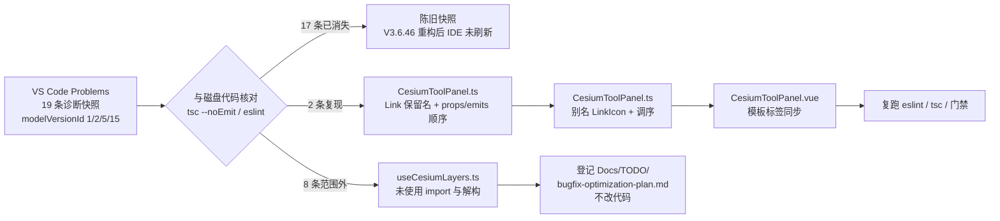

# 修复 IDE 诊断残留：CesiumToolPanel 组件注册与选项顺序

- **日期与时间**：2026-11-13 15:31
- **任务等级**：L2（常规）
- **依据规范**：`Docs/Force_command.md` §0（优先级 2）、§1（任务分级）、§3（先分析后实施）、§2.5（范围外发现只登记不修改）

> **定级说明**：用户提交的诊断涉及 4 个文件 / 19 条，按「多文件 Bug 修复」定级 L2；核对后实际代码改动收敛为 2 个文件，依 §1「拿不准等级时向上取一级」，仍按 L2 全流程执行，不降为 L1。

---

## 问题分析

### 核心症状

用户粘贴 VS Code Problems 面板的 19 条诊断（`owner: eslint` 3 条、`owner: typescript` 16 条），覆盖 4 个文件，要求修复：

| 文件 | 诊断数 | 类型 |
|---|:---:|---|
| `frontend/src/domains/cesium/components/CesiumToolPanel.ts` | 2 | ESLint（1 error + 1 warning） |
| `frontend/src/domains/cesium/composables/layers/customIonLayer.ts` | 1 | TS2769 |
| `frontend/src/domains/cesium/composables/layers/useCesiumLayers.ts` | 15 | TS2339 / TS2554 / TS2304 / TS2322 |
| `frontend/src/domains/ol/layer/components/AttributeTable.ts` | 1 | ESLint warning |

### 事实基线：诊断与磁盘代码不同步

诊断对象携带 `modelVersionId`（1 / 2 / 5 / 15），属**编辑器缓冲区快照**，非当前磁盘状态。按 §2.6「禁止臆造事实」，逐条读实际代码并复跑检查，不照旧行号修改：

- `npx tsc --noEmit --pretty false` → **exit 0，输出 0 行**（与 `Docs/Guide/handover.md` §8 记录的 2026-11-03 基线一致）。
- `npx eslint <5 个相关文件>` → **10 problems（9 errors, 1 warning）**，其中仅 2 条与用户诊断对应；另 8 条为范围外发现（见「遗留与风险」）。

### 逐条核对结论（磁盘现状）

| 诊断 | 磁盘现状 | 判定 |
|---|---|---|
| `customIonLayer.ts:73` TS2769 watch 回调 `(offset: number)` 与 `WatchCallback<{value:number}>` 不兼容 | L73 现为 `watch(customIonHeightOffset, (offset: any) => …)`；L27–41 的 `CustomIonLayerCtx` 字段均已声明并传入真实 `ref` | 已修复，tsc 0 错误 |
| `useCesiumLayers.ts:204–207` 四个 `Property X does not exist on type void` | L206–226 从 `createCustomIonLayerManager(...)` 解构；`customIonLayer.ts` L627–637 明确 `return` 含 `syncCustomIonLayer` / `clearCustomIonLayer` / `handleCustomIonAssetSubmit` / `loadCustomUrl3DTiles` 的 8 个入口 | 已修复（管理器拆分时完成） |
| `useCesiumLayers.ts:296 / 305` TS2554 `bindCesiumArcgisIdentify()` 缺参 | `arcgisIdentify.ts` L47 签名已改为 `bindCesiumArcgisIdentify(info?: any)`；调用点 L299 / L308 无参合法 | 已修复 |
| `useCesiumLayers.ts:477 / 478` TS2304 `TDT_SERVICE_ROOT` / `TDT_SUBDOMAINS` 未定义 | L42 / L43 已在 `./layerUtils` 的 import 列表中 | 已修复 |
| `useCesiumLayers.ts:507–510` TS2304 `arcgisBboxParts` 未定义 | L40 已 `import { arcgisBboxParts } from './i3sWebMercator'` | 已修复 |
| `useCesiumLayers.ts:882` TS2322 `number[]` 不可赋 `[number,number,number,number]` | L885 已加 `as [number, number, number, number]` 元组断言 | 已修复 |
| `AttributeTable.ts:39` `vue/order-in-components` | L38 `props: propDefine`、L39 `emits: [...]` 顺序已符合规则；ESLint 对该文件 0 报错 | 已修复 |
| `CesiumToolPanel.ts:112` `Name "Link" is reserved in HTML` | L27 `import { Link }`、L112 `components.Link`、模板 L302 `<Link … />` | **真实残留（error）** |
| `CesiumToolPanel.ts:139` `props` 应在 L124 的 `emits` 之上 | L124 `emits`、L139 `props: propDefine` 顺序颠倒 | **真实残留（warning）** |

### 根本原因

1. **主因（17/19 条）**：诊断快照落后于磁盘代码。V3.6.46 组件范式化重构与 `arcgisIdentify` / `customIonLayer` 等管理器拆分完成后，磁盘代码已消除相应类型错误；IDE 未刷新语言服务 / ESLint 诊断缓存，旧条目仍留在 Problems 面板。
2. **次因（2/19 条，需实际修改）**：
   - `@lucide/vue` 的 `Link` 图标以 `Link` 之名注册进 `components`，与 HTML 原生 `<link>` 元素同名，触发 `vue/no-reserved-component-names`；
   - `defineComponent` 选项对象把 `emits` 写在 `props` 之前，触发 `vue/order-in-components`。

### 受影响模块

- **改动面**：`domains/cesium/components/CesiumToolPanel.ts`（图标注册 / 选项顺序）+ 配对 `CesiumToolPanel.vue`（模板标签名）。二者是「视图 / 实例」物理分离范式的同一组件，标签名必须同步。
- **核对面（零改动）**：`customIonLayer.ts`、`useCesiumLayers.ts`、`AttributeTable.ts`、`arcgisIdentify.ts`、`layerUtils.ts`、`i3sWebMercator.ts`。
- **运行时影响**：组件注册名与选项书写顺序均为编译期元数据，不改 props / emits 集合、不改事件载荷、不改图标渲染结果，理论上零行为变化。

---

## 解决方案（方案对比与选型）

| 问题 | 候选方案 | 优点 | 缺点 | 结论 |
|---|---|---|---|---|
| `Link` 保留名 | **A. 别名注册**：`import { Link as LinkIcon }`，`components.LinkIcon`，模板 `<LinkIcon>` | 最小改动；保留原图标与视觉；规则正面满足 | 需同步改 2 个文件 | ✅ 选定 |
| | B. 加 `eslint-disable` 抑制 | 1 行 | 掩盖真实命名冲突；与规则立意相悖 | ❌ |
| | C. 换成 `Link2` 图标 | 免改注册名 | 改变视觉语义，属无必要的设计变更 | ❌ |
| props / emits 顺序 | **A. 手工把 `props` 移到 `emits` 前** | 改动可控；不触碰其它选项 | 需手工编辑 | ✅ 选定 |
| | B. `eslint --fix` 自动修 | 省事 | `--fix` 可能顺带改到范围外代码，违反 §2.5 | ❌ |
| | C. 关闭 `vue/order-in-components` | 1 行配置 | 全库规范降级 | ❌ |

**选型理由**：两条均属「编译期元数据」层面的命名 / 顺序问题，别名注册 + 手工调序是唯一既不改变运行时行为、又不引入规则抑制、又不扩大改动面的组合。

**实施步骤**：① 写本日志前半（已完成）→ ② 改 `CesiumToolPanel.ts` 的 import 别名、components 键、选项顺序 → ③ 改 `CesiumToolPanel.vue` 模板标签 → ④ 复跑 ESLint / tsc / 两个门禁脚本 → ⑤ 补全日志、版本号、CHANGELOG、TODO 登记与交接块。

---

## 模块关系与修复链路（Mermaid）

> 本图依 `Force_command.md` §2.9 提供，供交接与审查；图示聚焦「诊断来源 → 核对 → 改动 / 登记」的数据流向。

---

## 修改内容

| # | 文件 | 改动 |
|:---:|---|---|
| 1 | `frontend/src/domains/cesium/components/CesiumToolPanel.ts` | L27 `import { Link }` → `import { Link as LinkIcon }`；L112 `components.Link` → `components.LinkIcon`；L124 把 `props: propDefine` 上移到 L125 `emits` 之前 |
| 2 | `frontend/src/domains/cesium/components/CesiumToolPanel.vue` | L302 模板 `<Link … />` → `<LinkIcon … />`，与实例层注册名对齐 |
| 3 | 本日志、`README.md`、`Docs/Guide/CHANGELOG.md`、`Docs/TODO/bugfix-optimization-plan.md` | L2 收尾：日志 / 版本号 / 版本历史 / 范围外发现登记 |

**未改动**：`customIonLayer.ts`、`useCesiumLayers.ts`、`AttributeTable.ts`、`arcgisIdentify.ts` 及其依赖 —— 其诊断在核对时已不存在，按 §2.5 不越权重写。

## 修改原因

Problems 面板的 19 条诊断中，17 条为陈旧缓冲区快照（重构后的磁盘代码已修复），若照旧行号改代码会引入无意义甚至有害的编辑；仅 2 条为真实残留。`Link` 注册名与 HTML `<link>` 元素冲突属 ESLint error，会阻断 `eslint src`；`props` / `emits` 顺序属 warning，与项目「组件范式化」既有写法不一致。修复目标是让静态检查基线归零，而非重写既有逻辑。

## 影响范围

- **编译期**：`CesiumToolPanel` 的组件注册表键名与选项书写顺序。渲染的图标组件实例、`props` / `emits` 集合、事件载荷均不变。
- **运行时**：零行为变化。图标仍为 `@lucide/vue` 的 Link 图标，尺寸 `:size="15"` 与 class `custom-basemap-icon` 未动。
- **不涉及**：底图链路、图层管理、TOC、数据源注册、配置 key、后端 / 部署面、数据库、URL 参数。

## 性能指标

不适用（纯命名 / 顺序调整，无算法、无渲染路径变化，未实测）。

## 测试方案

### Agent 已执行（静态验证，非实机）

| # | 命令 / 动作 | 修复前 | 修复后 |
|:---:|---|---|---|
| 1 | `npx tsc --noEmit --pretty false`（frontend，全量） | exit 0，输出 0 行 | **exit 0，输出 0 行** |
| 2 | `npx eslint <5 个相关文件>`（无 `--fix`） | 10 problems（9 errors + 1 warning）：`CesiumToolPanel.ts` 2 条、`useCesiumLayers.ts` 8 条 | `npx eslint --no-cache <5 文件>` → **exit 0，输出 0 行** |
| 3 | `python Scripts/CheckConfigRegistry.py` | 7 项全通过 | **7 项全通过，exit 0** |
| 4 | `python Scripts/CheckStructureTree.py` | 首跑 645/646，漏登记 `RegisterView.ts`（exit 1） | 复跑 **646/646，漏登记 0 · 幽灵 0，exit 0**（详见「遗留与风险」） |
| 5 | §11.2 平台红线模式串扫描（等价只读检索，含生产基线三项） | — | 命中项**全部**为 `maxRayDistance` / `maxRayDist`（体积云 raymarch 参数），即 §11.2 已注明的已知假阳性；`ALLOW_PRIVATE_HOSTS=true` / `ALLOWED_HOSTS=*` / `RATE_LIMIT=0` 零命中 → 全绿 |

> 本次为纯前端改动，§11.2「涉及后端或部署面改动且即将 push」的触发条件不成立；仍主动执行扫描以闭合 DoD。

### 待用户实机验证

1. 重启 Vite dev / 重新打开 `CesiumToolPanel.vue`，确认 IDE Problems 面板 19 条诊断清空（建议先保存全部缓冲区，再重启 ESLint Server 与 TypeScript Server）。
2. 切到 3D 引擎 → 打开工具面板 → 「图层」页签 → 查看「自定义 XYZ 图层输入」前的链接图标：应正常显示、尺寸无变化（验证 `<LinkIcon>` 解析成功）。
3. 在输入框填入任意 XYZ / WMS URL，确认 `submitCustomBasemap` 事件仍正常派发（验证 props / emits 调序无副作用）。
4. `npm run build`（可选）：确认 Vue SFC 编译无 `Failed to resolve component: LinkIcon` 类告警。

## 变更文件清单

| 仓库相对路径 | 说明 |
|---|---|
| `frontend/src/domains/cesium/components/CesiumToolPanel.ts` | 图标别名注册 + `props` / `emits` 顺序调整 |
| `frontend/src/domains/cesium/components/CesiumToolPanel.vue` | 模板图标标签同步改名 |
| `Docs/LLM_record/26-11/2026-11-13/2026-11-13-fix-cesium-tool-panel-lint.md` | 新建本次 L2 维护日志（含 Mermaid 图） |
| `README.md` | 三处版本号 V3.6.46 → V3.6.47，版本表新增首行 / 删除最旧一行 |
| `Docs/Guide/CHANGELOG.md` | 顶部追加 V3.6.47 完整条目 |
| `Docs/TODO/bugfix-optimization-plan.md` | 按 §2.5 登记范围外发现与并发写盘风险 |

> 本次无文件增删，`Docs/Guide/*-structure.md` 无需同步；结构树门禁终态全绿。

## 遗留与风险

1. **并发写盘（需用户留意）**：同一会话内两次观察到工作区被外部写入 —— ① 首轮 ESLint 检出的 `useCesiumLayers.ts` 8 条未使用变量，在复跑时随该文件 import 块被外部保存而全部消失；② 结构树门禁首跑 645/646、复跑 646/646，`frontend-structure.md` 期间被补录一行。Agent **未修改**这两处文件。这也是「IDE 诊断快照 ↔ 磁盘代码不同步」的直接成因。已在 `Docs/TODO/bugfix-optimization-plan.md` 登记。
2. **陈旧诊断**：用户 IDE 中若仍显示原 19 条，须手动刷新语言服务 / 重开文件；磁盘代码已无对应问题，无需再改。
3. **Mermaid 图待审查**：依 §2.9，上图已随日志提交，需用户过目确认；不影响代码交付。
4. **未实机运行**：沙盒未启动 vite / 浏览器，图标渲染与事件派发仅靠静态检查保证，实机步骤见「测试方案」。
5. **Git 写操作零执行**：所有改动均留在工作区，提交由用户本人决定。

## DoD 自查（§7）

| 项 | 结果 |
|---|:---:|
| 代码改动完成、遵守分层边界与单一职责 | ✅ 仅改组件实例层与视图层，未堆叠业务逻辑 |
| 新增 `.ts` 未引入 `tsc --noEmit` 新报错 | ✅ 无新增 `.ts`；全量 tsc 0 错误 |
| 新建逻辑文件默认 `.ts` | ✅ 不适用（本次新建的是 `Docs/` 日志 `.md`） |
| 日志已创建并写全章节 | ✅ 本文件 |
| README 三处版本号 | ✅ V3.6.47 |
| CHANGELOG 追加条目 | ✅ V3.6.47 |
| 结构树同步 | ✅ 无文件增删；门禁 646/646 全绿 |
| 配置 key 登记 | ✅ 不涉及 |
| UI/icon 移动端基线 | ✅ 不适用：仅重命名图标注册名，未新增 icon / 未改尺寸与可点击目标 |
| 场景数据加载 / TOC | ✅ 不涉及 |
| 门禁脚本通过 | ✅ 见「测试方案」表；首次结构树失败已由复跑全绿闭合，成因如实记录 |
| 未执行 Git 写操作 | ✅ |
| 平台红线自查 | ✅ 全绿（仅已知假阳性） |
| 交接块输出 | ✅ 见会话末尾 |

---

## 终态复核补记（全部收尾文件写入后）

| 检查 | 终态 |
|---|---|
| `npx eslint --no-cache`（5 文件） | exit 0 / 0 输出 |
| `npx tsc --noEmit --pretty false`（全量） | exit 0 / 0 行输出 |
| `python Scripts/CheckConfigRegistry.py` | 7 项全绿，exit 0 |
| `python Scripts/CheckStructureTree.py` | **649 / 649，漏登记 0 · 幽灵 0，exit 0** |

> 上表与正文中的「646/646」为复核中途时点；终态结构树计数升至 649/649，系**外部会话**在本会话期间新增 3 个文件并同步 `frontend-structure.md` 所致，Agent 未改动该结构树文档。两次门禁均为全绿，结论不变；该现象并入「遗留与风险 1」的并发写盘记录。平台红线扫描结论不变（仅 `maxRayDistance` 已知假阳性）。
