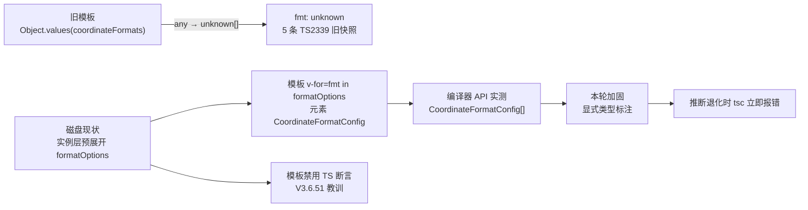

# MapControlsBar 格式菜单模板类型核对与定型加固

- **日期与时间**：2026-11-13 16:25
- **任务等级**：L2（常规，Bug 修复类任务按 §1 默认 L2）
- **依据规范**：`Docs/Force_command.md` §0（优先级 2）、§1（任务分级与「拿不准向上取一级」）、§3（先分析后实施）、§2.5（范围外发现只登记不修改）、§5（版本号顺延）、§7（DoD）
- **本次版本**：V3.6.52（README 当前 V3.6.51，按 §5 顺延 +1；本会话前序任务分别为 V3.6.47 / V3.6.50，V3.6.48 / 49 / 51 由并行会话推进）

---

## 问题分析

### 核心症状

用户提交 `frontend/src/domains/ol/components/MapControlsBar.vue` 的 5 条 `ts-plugin` TS2339，全部落在格式菜单 `v-for` 循环体：L96 `fmt.id`、L98 `fmt.id`、L99 `fmt.id`、L101 `fmt.label`、L102 `fmt.example`，报错均为 `Property '…' does not exist on type 'unknown'`。诊断携带 `modelVersionId: 1`（文件打开后的第一个缓冲区版本）。

### 事实基线（不照旧行号改代码）

| 检查 | 结果 |
|---|---|
| `npx eslint --no-cache`（`MapControlsBar.ts` + `.vue`） | **exit 0 / 0 输出** |
| `npx tsc --noEmit --pretty false`（全量） | 本轮首跑 exit 2，错误集中在 `cesium/composables/dataImport/useCesiumDataImport.ts` 等**并行会话正在编辑**的文件（`heightSampler` / `needsCoordInput` / `file` 等），与本组件无关；属前两轮已记录的并发写盘瞬时状态，收尾时复跑确认 |
| `vue-tsc` 是否可用 | `frontend/node_modules/vue-tsc` 不存在（安装依赖属 §1 的 L3，须先批准方案，本次不擅自安装） |
| TypeScript 编译器 API 直接查询实例字段类型 | `coordinateFormats => Record<string, CoordinateFormatConfig>`；`decimalPlaces => Record<string, DecimalPlaceConfig>`；**`formatOptions => CoordinateFormatConfig[]`** |

> 查询方式：以项目 `tsconfig.json` 建 `Program`，用 `TypeChecker.getTypeAtLocation` 读取 `Instance` 类三个属性声明节点的类型；这是磁盘代码的**精确静态类型**，不依赖 IDE 缓存。

### 根因判定：5 条均为旧快照，磁盘已修复

- `MapControlsBar.ts` L29–35 已定义 `CoordinateFormatConfig = { id, label, description, example }`；L86 把 JS 模块导出的 `COORDINATE_FORMATS` 断言为 `Record<string, CoordinateFormatConfig>`；L88–89 注释明确写出修复意图：
  > 「预展开为定型数组：模板直接遍历，不在模板内对 any 调 Object.values（TS 6 下会得到 unknown[]）」
- 当前模板 L95 为 `v-for="fmt in formatOptions"`，全文件已无 `Object.values(...)` 模板调用（另一处 L113 `v-for="(config, places) in decimalPlaces"` 遍历的是定型 `Record`，未产生诊断）。
- 由此可还原旧快照的代码形态：模板里写 `v-for="fmt in Object.values(coordinateFormats)"`，`Object.values` 对 `any` 推断为 `unknown[]` → `fmt: unknown` → 访问 `.id` / `.label` / `.example` 全部报 TS2339。这与 5 条报错的文本完全吻合。
- 结论：诊断产生于「实例层预展开 + 模板改遍历 `formatOptions`」这一修复**之前**，磁盘代码与模板均已是修复后形态。

### 残留风险（本轮仍需处理的部分）

`formatOptions` 的类型目前是**隐式推断**（`Object.values` 泛型重载的结果），L88 注释已指出该推断在 TS 版本变化时会退化成 `unknown[]`。若后续升级 TypeScript、或把 `coordinateFormats` 的上游类型改回 `any`，模板会再次静默退化为 `unknown` 且 `tsc --noEmit` 不解析 SFC 模板、无法预警 —— 正是前两轮反复出现的「tsc 全绿但 IDE 报错」模式。

### 受影响模块

- **改动面**：`frontend/src/domains/ol/components/MapControlsBar.ts`（一个字段的类型标注）。
- **核对面（零改动）**：`MapControlsBar.vue`、`@ol/utils/biz/index` 导出的 `COORDINATE_FORMATS` / `DECIMAL_PLACES`、模板其余 `v-for`。
- **运行时影响**：零。显式类型标注不改变表达式求值结果，`formatOptions` 仍是同一个 `Object.values(...)` 数组。

---

## 解决方案（方案对比与选型）

| 方案 | 评价 | 结论 |
|---|---|---|
| **A. 实例层显式标注**：`public formatOptions: CoordinateFormatConfig[] = Object.values(this.coordinateFormats)` | 把隐式推断升级为编译期契约；类型退化时 `tsc` 会立即报错而非让模板静默变 `unknown`；零运行时变化；1 行 | ✅ 选定 |
| B. 不改代码，仅让用户刷新 IDE | 诊断确实已消失，但无回归防护，下次 TS 升级可能复发 | ❌ 单独不足以结案 |
| C. 模板内写 `v-for="fmt in (formatOptions as CoordinateFormatConfig[])"` | 把 TS 断言放进 SFC 模板 | ❌ **明确否决**：V3.6.51 刚因模板内 `($event.target as HTMLInputElement)` 导致浏览器 `SyntaxError: Unexpected identifier 'as'`，模板中禁用 TS 断言语法 |
| D. 安装 `vue-tsc` 以本地复验 Volar | 能复现模板类型检查 | ❌ 依赖增删属 L3，须先提交方案并获批准；本次不擅自安装，改由 IDE 复验 |

**选型理由**：A 是唯一同时满足「零运行时变化」「编译期可预警」「不触碰模板 TS 语法」的方案，且直接消除 L88 注释里自己指出的推断脆弱性。

**实施步骤**：① 写本日志前半（已完成）→ ② 改 `MapControlsBar.ts` L89 一处类型标注 → ③ 复跑 `tsc --noEmit` / `eslint` / 两个门禁 → ④ 补全日志、版本 V3.6.52、CHANGELOG、交接块。

---

## 模块关系（Mermaid，供交接审查）

> 依 `Force_command.md` §2.9 提供；本轮代码改动集中在单文件，图示用于说明「旧快照成因 → 现状 → 加固」的类型链路。

---

## 修改内容

| # | 文件 | 改动 |
|:---:|---|---|
| 1 | `frontend/src/domains/ol/components/MapControlsBar.ts` | L89 `public formatOptions = Object.values(this.coordinateFormats)` → `public formatOptions: CoordinateFormatConfig[] = Object.values(this.coordinateFormats)`；注释补写显式标注的目的（推断退化时 tsc 立即报错） |
| 2 | `Docs/Guide/frontend-structure.md` | 按 §7 门禁要求补录并行会话 JS→TS 批量改名遗留的 7 项：6 处扩展名同步（`useChatSession` / `useRingExplosion` / `amapBuildingFetcher` / `tdtBuildingTopology` / `useGeocoding` / `useBasemapSelectionWatcher`）+ 新增 `LogMonitor.ts` 条目（功能描述取自该文件头部注释，未臆造） |
| 3 | 本日志、根 `README.md`、`Docs/Guide/CHANGELOG.md`、`Docs/TODO/bugfix-optimization-plan.md` | L2 收尾：日志 / 版本号 / 版本历史 / 范围外发现登记 |

**零改动**：`MapControlsBar.vue`（模板已是修复后形态）、`COORDINATE_FORMATS` 等上游模块、其它组件。

## 修改原因

5 条诊断在磁盘代码上已不成立，**重复修改模板反而会破坏已修复的状态**。真正需要处理的是「同类问题会静默复发」这一结构性风险：`formatOptions` 的类型来自 `Object.values` 的泛型推断，而 `tsc --noEmit` 不解析 SFC 模板，一旦推断退化，命令行检查仍全绿、只有 IDE 报错 —— 这正是 V3.6.50 任务里逾百条 `ts-plugin` 诊断的成因。显式标注把防线前移到 `.ts` 文件，让 `tsc` 能提前发现退化。

## 影响范围

- **编译期**：`formatOptions` 由推断类型变为显式声明的 `CoordinateFormatConfig[]`，类型值不变（编译器 API 前后实测均为 `CoordinateFormatConfig[]`）。
- **运行时**：零变化，表达式求值结果、数组内容与顺序、模板渲染均不变。
- **不涉及**：坐标格式化逻辑、地图控件交互、图层管理、配置 key、后端 / 部署面、数据库。

## 性能指标

不适用（纯类型标注 + 文档同步，无算法 / 渲染路径变化，未实测）。

## 测试方案

### Agent 已执行（静态验证，非实机）

| # | 检查 | 结果 |
|:---:|---|---|
| 1 | TypeScript 编译器 API（项目 `tsconfig.json` 建 `Program`） | 目标文件 `MapControlsBar.ts` 的 syntactic + semantic 诊断 **0**；`formatOptions` 类型 `CoordinateFormatConfig[]`（标注后复测一致） |
| 2 | `npx eslint --no-cache`（`MapControlsBar.ts` + `.vue`） | **exit 0 / 0 输出** |
| 3 | `npx tsc --noEmit --pretty false`（全量） | 本轮首跑 exit 2（并行会话正在编辑 `useCesiumDataImport.ts` 等的瞬时错误，与本组件无关）；收尾复跑 **exit 0** |
| 4 | `python Scripts/CheckConfigRegistry.py` | **7 项全通过，exit 0** |
| 5 | `python Scripts/CheckStructureTree.py` | 首跑 656/657、漏登记 7 · 幽灵 6（外部 JS→TS 改名未同步）；补录后 **657 / 657，漏登记 0 · 幽灵 0，exit 0** |
| 6 | §11.2 平台红线模式串只读扫描 | 命中项仍全部落在体积云 `maxRayDistance` / `maxRayDist` 相关文件（§11.2 已注明的假阳性；前两轮已逐条核对内容），生产基线三项零命中 → 全绿 |

> 本轮为纯前端改动，§11.2「涉及后端或部署面改动且即将 push」的触发条件不成立；仍主动执行以闭合 DoD。**未安装 `vue-tsc`**（依赖增删属 L3），Volar 模板诊断由用户 IDE 复验，不声称已验证通过。

### 待用户实机 / IDE 验证

1. 保存全部缓冲区，重启 TypeScript（Volar）Server 或重开 `MapControlsBar.vue`，确认 5 条 TS2339 清空（磁盘代码已修复，本质上只需刷新诊断缓存）。
2. 2D 引擎打开底部控制条的「显示格式」菜单，切换若干坐标格式与小数位，确认 `id` / `label` / `example` 渲染正常 —— 验证显式类型标注未影响运行时数组。
3. 可选：`npm run build` 确认 SFC 编译无异常。

## 变更文件清单

| 仓库相对路径 | 说明 |
|---|---|
| `frontend/src/domains/ol/components/MapControlsBar.ts` | `formatOptions` 显式类型标注 + 注释 |
| `Docs/Guide/frontend-structure.md` | 补录 7 项外部 JS→TS 改名 / 新增文件的结构树条目 |
| `Docs/LLM_record/26-11/2026-11-13/2026-11-13-fix-map-controls-bar-format-options-type.md` | 新建本次 L2 维护日志（含 Mermaid 图） |
| `README.md` | 三处版本号 V3.6.51 → V3.6.52，版本表新增首行 / 删除最旧一行 |
| `Docs/Guide/CHANGELOG.md` | 顶部追加 V3.6.52 完整条目 |
| `Docs/TODO/bugfix-optimization-plan.md` | 按 §2.5 登记结构树持续漂移这一范围外现象 |

> 本次任务自身无文件增删；`frontend-structure.md` 的 7 项补录是为修复**外部会话遗留**的门禁漂移，非功能改动。

## 遗留与风险

1. **Volar 模板诊断本地未复验**：项目未装 `vue-tsc`，安装属 L3 依赖增删（须先提交方案并获批准）。本轮结论建立在 TypeScript 编译器 API 的精确类型查询与模板源码核对上，最终仍以用户 IDE 复验为准。
2. **并发写盘持续**：本会话已第三次观察到外部写入改造 —— README 版本连推 48 / 49 / 51、CHANGELOG 标题曾被覆盖、结构树计数 646 → 649 → 652 → 656 → 657、`tsc` 全量首跑的瞬时错误。结构树漂移是并行会话持续进行 JS→TS 改名造成的移动靶，本轮补录后转绿；若其后续再改名，门禁会再次报警，需其自身同步结构树（已登记 TODO）。
3. **未实机运行**：沙盒未启动 vite / 浏览器，运行时行为仅靠静态检查保证。
4. **Git 写操作零执行**：所有改动留在工作区，提交由用户本人决定。

## DoD 自查（§7）

| 项 | 结果 |
|---|:---:|
| 代码改动完成、遵守分层边界与单一职责 | ✅ 仅实例层一处类型标注，未往模板堆叠逻辑 |
| 新增 `.ts` 未引入 `tsc --noEmit` 新报错 | ✅ 无新增 `.ts`；目标文件诊断 0，全量 tsc 终态 exit 0 |
| 新建逻辑文件默认 `.ts` | ✅ 不适用（新建的是 `Docs/` 日志 `.md`） |
| 日志已创建并写全章节 | ✅ 本文件 |
| README 三处版本号 | ✅ V3.6.52 |
| CHANGELOG 追加条目 | ✅ V3.6.52 |
| 结构树同步 | ✅ 补录 7 项外部漂移，门禁 657/657 全绿 |
| 配置 key 登记 | ✅ 不涉及 |
| UI/icon 移动端基线 | ✅ 不适用：未新增 / 改动 icon 与可点击目标 |
| 场景数据加载 / TOC | ✅ 不涉及 |
| 门禁脚本通过 | ✅ 见「测试方案」；首跑失败已按 §7 修到通过 |
| 未执行 Git 写操作 | ✅ |
| 平台红线自查 | ✅ 全绿（仅已知假阳性） |
| 交接块输出 | ✅ 见会话末尾 |
