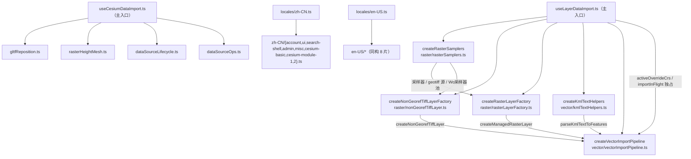

# 暂存区代码审查 · 版本整合 3.6.45 · JS→TS 与 500 行拆分

- **日期与时间**：2026-11-13 10:40
- **任务等级**：L3（跨模块重构 + 文件重命名 + 目录新增）
- **版本**：V3.6.45（本批统一整合，原 3.6.46 条目并入）

---

## 一、需求与问题分析

### 用户诉求

1. code review 暂存区全部代码，**版本整合为 3.6.45**（不再保留 3.6.46）。
2. 库/逻辑文件**单文件不超过 500 行**，超限者做解耦重组。
3. 暂存区内的 JS **全部改写为 TS**（针对 26 个暂存文件中的 js/ts 部分）。

### 事实基线（动手前实测）

| 项 | 事实 |
|---|---|
| 暂存文件总数 | 26（其中 js/ts 17 个） |
| 超 500 行的 js/ts | `zh-CN.js` 2396、`en-US.js` 2179、`useLayerDataImport.js` 1772、`useCesiumDataImport.js` 904、`layerExportService.js` 501 |
| 类型基线 | `tsc --noEmit` 0 error；`tsconfig` `strict:false` / `noImplicitAny:false`，`include` 含 `src/**/*.ts` |
| 显式 `.js` 导入 | 5 处指向待改名文件（`loaders/utils.js`×2、`geojsonLoader.js`、`shpLoader.js`、`locales/*.js`） |
| 结构树门禁 | 原 527/527，改名/拆分后必须同步 `frontend-structure.md` |

### 根因

代码按「一个 composable / 一个字典一个文件」演进，职责随功能叠加持续堆进单文件；JS 无类型约束，闭包变量靠人读注释维护。行数与语言两个问题耦合在同一批文件上，必须一次处理。

---

## 二、解决方案

### 1. 版本整合

- README 三处（简介 / 版本演进表 / 页脚）统一为 **V3.6.45**，版本表恢复恒定 3 行（45/44/43）。
- CHANGELOG：删除 `### V3.6.46` 一级标题，内容降为 V3.6.45 条目的 ⑦⑧；新增 ⑨ 记录本次 JS→TS 与拆分。
- 原「导出数据子菜单」日志版本号改为 3.6.45；本文件为本次整理的全貌记录。

### 2. JS→TS（14 个文件）

全部为**改名 + 补类型 + 修显式 `.js` 导入后缀**，对外导出签名不变：

`protocol`、`menu/contextMenu`、`menu/commandDispatcher`、`actions/layerExportService`、`data-import/dataDispatcher`、`data-import/vectorUtils`、`loaders/{geojsonLoader,shpLoader,utils}`、`core/useCesiumInfoBoxTheme`、`dataImport/useCesiumDataImport`、`ol/…/useLayerDataImport`，以及两个语言字典。

新增类型：`menu/types.ts`（`TocMenuItem` / `TocMenuCapabilities` / `TocSelectionState` / `TocMenuNode`）、各 loader/composable 的入参 interface。

### 3. 超 500 行拆分（低风险手法）

| 原文件 | 拆分结果 | 关键手法 |
|---|---|---|
| `layerExportService.ts` 501 | `exportFormatting.ts` + 服务本体（270/261） | 纯函数（顶点展开 / CSV 单元 / 下载）下沉 |
| `useCesiumDataImport.ts` 904 | `gltfReposition.ts`、`rasterHeightMesh.ts`、`dataSourceLifecycle.ts`、`dataSourceOps.ts` + 主入口 391 | **工厂 + 依赖注入**：状态 ref 仍由主入口持有并注入，函数体逐字搬迁 |
| `useLayerDataImport.ts` 1772 | `raster/{rasterSamplers,rasterLayerFactory,nonGeorefTiffLayer}.ts`、`vector/{kmlTextHelpers,vectorImportPipeline}.ts` + 主入口 391 | 同上；`activeOverrideCrs` / `importInFlight` 仍由主入口独占，管线经 `getActiveOverrideCrs()` 读取 |
| `zh-CN` / `en-US` 2396/2179 | 入口 `zh-CN.ts` + `zh-CN/*.ts`（8 片），en 同构 | **acorn AST 取属性 range** 后按命名空间切片；`cesium.module` 单独两片，入口用 spread 合并 |

**为何用工厂注入而非重写**：函数体逐字搬迁可保证行为不变；漏注入的闭包变量会被 `tsc` 报 `Cannot find name`，相当于免费的静态校验。

**为何语言包用 AST 切分**：早期按行号/花括号计数切分在字符串含 `{count}` 占位符时失准，出现「切成半个对象」；改用 acorn 解析对象字面量、按 `Property.range` 切片后零语法错误。

### 4. 数据流（改动后）

---

## 三、code review 结论（暂存区）

逐文件复核了 26 个暂存文件的逻辑，重点核对以下不变量，**未发现阻断级缺陷**：

| 复核点 | 结论 |
|---|---|
| 导出子菜单容器 key 是否会被前缀规则兜底成 CSV | 已在分发器最前拦截，脚本断言 `[]` |
| CSV 标准列与 `tabularParser` 解析契约是否一致（导出→导入闭环） | 列名/编码（UTF-8 BOM）/分环闭合一致 |
| SHP 无 `.prj` 且判定为平面坐标时是否报可操作错误 | 是，且带 `[SHP][CRS]` 提示 |
| `PROJ:` 别名大小写是否被 `normalizeCrs` 破坏 | 前缀大写 + 散列小写，`proj4.defs` 可命中 |
| `reprojectGeoJSON` 的 `onInvalid` / 统计 | 有，供 UI 提示无效点 |
| 3D 导入配色是否残留半透明 | 已统一 alpha=1 |
| InfoBox 高度是否可能自激循环 | `ResizeObserver` 仅对宽度变化重算 |

**遗留观察（不改，已记录）**：`cesiumLayerSerialization.ts` 仍为 459 行接近上限；`TOCPanel.vue` / `MapContainer.vue` / `CesiumContainer.vue` 为 Vue 组件（非本次 js/ts 范围），仍在 2000+ 行，按 §3 只出不进。

---

## 四、修改内容

### 新增

| 文件 | 说明 |
|---|---|
| `frontend/src/domains/common/layer-tree/menu/types.ts` | 菜单项/能力/多选上下文类型 |
| `frontend/src/domains/common/layer-tree/actions/exportFormatting.ts` | 导出格式化工具（顶点展开 / CSV 单元 / 下载 / 属性列并集） |
| `frontend/src/domains/cesium/composables/dataImport/gltfReposition.ts` | GLTF 坐标弹窗与重定位（失败回滚） |
| `.../dataImport/rasterHeightMesh.ts` | 单波段 GeoTIFF → 高程网格 |
| `.../dataImport/dataSourceLifecycle.ts` | 数据源移除 / 清空 |
| `.../dataImport/dataSourceOps.ts` | 外部注册 / 远程 GLB / 定位 / 贴地高度 |
| `frontend/src/domains/ol/data-import/raster/rasterSamplers.ts` | 栅格采样 / 投影换算 / geotiff 源与池缓存 |
| `.../raster/rasterLayerFactory.ts` | 受管 GeoTIFF 图层构造 |
| `.../raster/nonGeorefTiffLayer.ts` | 无坐标参考 TIF 兜底 |
| `frontend/src/domains/ol/data-import/vector/kmlTextHelpers.ts` | KML 命名空间 / 绘制顺序 / 要素解析 |
| `.../vector/vectorImportPipeline.ts` | 单文件解析入库 + dispatch 逐包入库 |
| `frontend/src/locales/{zh-CN,en-US}/*.ts` | 各自 8 个命名空间分片 |
| `Docs/LLM_record/.../2026-11-13-js-ts-refactor-and-500line-split.md` | 本文件 |

### 删除 / 改名

14 个 `.js` → `.ts`（含两个语言字典改为「入口 + 分片目录」）。

### 文档

`README.md`（三处版本 + 合并条目）、`Docs/Guide/CHANGELOG.md`（合并 3.6.46 条目 + 新增 ⑨）、`Docs/Guide/frontend-structure.md`（545 条，改名 + 新增子树）。

---

## 五、影响范围

| 维度 | 说明 |
|---|---|
| 数据导入 | OL/Cesium 两侧 composable 拆分为工厂 + 子模块；导出 API 与事件名不变 |
| 导出链路 | 无行为变化（仅文件拆分与类型化） |
| i18n | 语言包拆分合并，键路径与取值不变；`useLocale` 动态导入改为无后缀 |
| 构建 | 新增 19 个 ts 模块 + 16 个语言分片，全部纳入 `tsconfig` |
| 后端 / 配置 / 鉴权 | 无影响 |

---

## 六、性能指标

未实测（无运行时热点变化）。构建体积：语言包 chunk 内容不变，仅切分为多个模块，最终仍由入口合并为同一对象。

---

## 七、测试方案

### Agent 已执行

| 项 | 方式 | 结果 |
|---|---|---|
| 类型检查 | `npx tsc --noEmit` | ✅ 0 error（改造前基线 0，改造后仍 0） |
| Lint | `npx eslint src/domains/{common/layer-tree,common/data-import,cesium/composables,ol/data-import} src/locales` | ✅ 0 error |
| 语言包等价 | 旧文件（git index）与新入口分别 esbuild 打包为 CJS → 逐键比对 | ✅ 键集合/值/层级一致（仅键顺序变化，长度相同 65154 / 99774） |
| 生产构建 | `npx vite build` | ✅ 成功（仅 chunk 体积警告） |
| 结构树门禁 | `python Scripts/CheckStructureTree.py` | ✅ 545/545，漏登记 0、幽灵 0 |
| 配置登记门禁 | `python Scripts/CheckConfigRegistry.py` | ✅ 全绿 |
| 红线自查 | `grep -RIlE --exclude-dir=.venv <§11.2 模式串> …` + `deploy/.env` 基线 | ✅ 无命中 |
| 行数复核 | `wc -l` 全部新模块 | ✅ 最大 466 行（`vectorImportPipeline.ts`），语言分片最大 410 行 |

### 待用户实机验证

1. **数据导入**：分别导入 GeoJSON / SHP / KML / CSV / TXT(WKT) / GeoTIFF / GLB / 3D Tiles，确认图层正常入库、贴地、配色与导入前一致。
2. **KML 专项**：带 `<Folder>` 层级与样式的 KML，确认绘制顺序与样式仍生效。
3. **GeoTIFF 专项**：有坐标参考的 TIF（受管）与无坐标参考的 TIF（按视图中心落图）各一份。
4. **GLTF 专项**：本地 GLB 走坐标弹窗导入 + 「调整位置」重定位 + 取消。
5. **导出**：CSV / TXT / KML / GeoJSON 各导出一次并回读导入。
6. **i18n**：中英文切换后各页面文案齐全（重点 `cesium.*` 与 `admin.*`）。

---

## 八、变更文件清单

前端（前端根 `frontend/src/`）：

- `domains/common/layer-tree/menu/{protocol.ts,contextMenu.ts,commandDispatcher.ts,types.ts}`
- `domains/common/layer-tree/actions/{layerExportService.ts,exportFormatting.ts}`
- `domains/common/data-import/{dataDispatcher.ts,vectorUtils.ts}`
- `domains/common/app/useLocale.js`（动态导入去后缀）
- `domains/cesium/composables/core/useCesiumInfoBoxTheme.ts`
- `domains/cesium/composables/dataImport/{useCesiumDataImport.ts,gltfReposition.ts,rasterHeightMesh.ts,dataSourceLifecycle.ts,dataSourceOps.ts}`
- `domains/cesium/composables/dataImport/loaders/{geojsonLoader.ts,shpLoader.ts,utils.ts}`
- `domains/cesium/composables/index.js`（barrel 后缀）
- `domains/cesium/composables/dataImport/useCesiumCrsRedeclare.js`（导入后缀）
- `domains/ol/data-import/composables/useLayerDataImport.ts`
- `domains/ol/data-import/raster/{rasterSamplers.ts,rasterLayerFactory.ts,nonGeorefTiffLayer.ts}`
- `domains/ol/data-import/vector/{kmlTextHelpers.ts,vectorImportPipeline.ts}`
- `locales/{zh-CN.ts,en-US.ts}` + `locales/zh-CN/*.ts`（8）+ `locales/en-US/*.ts`（8）
- `locales/zh-CN.js`、`locales/en-US.js` 删除

文档：`README.md`、`Docs/Guide/CHANGELOG.md`、`Docs/Guide/frontend-structure.md`、本日志。

---

## 九、遗留与风险

| # | 内容 | 处置 |
|---|---|---|
| 1 | 语言包分片后**对象键顺序**与原先不同 | 运行时按 key 查表，顺序无意义；如需逐字一致可回退（不必要） |
| 2 | geotiff 源/Worker 池缓存由「每个 composable 实例一份」改为**模块级共享** | 解码器本身无状态，跨实例复用无副作用；已在 `rasterSamplers.ts` 注释说明 |
| 3 | 拆分为工厂注入后，子模块不再能直接访问主入口私有状态 | 属预期解耦；新增依赖需在 interface 与装配处同时登记（tsc 会拦截漏项） |
| 4 | `cesiumLayerSerialization.ts` 459 行、`TOCPanel.vue` 等巨型组件未动 | 前者在 500 行内；后者为 Vue 组件，按 §3 只出不进 |
| 5 | 本次未做浏览器真机验证 | 导入/导出的运行时行为仅经静态检查与构建验证，需用户按第七节实测 |
| 6 | 宿主编辑器会自动把改动加入 git 暂存区（非 Agent 执行 `git add`） | 交接块已注明，如需审阅工作区 diff 请自行 `git restore --staged` |

---

## 十、全项目超长文件扫描与优先级（第二轮）

### 扫描口径

`find src -name '*.js' -o -name '*.ts'` + `wc -l`，排除 `.d.ts`；**纯数据文件不计入**（`assets/data/compass-metadata/twentyEightConstellations.ts` 4323 行、`data/goldenSoupQuotes.js` 1486 行——无逻辑耦合，拆它只增间接层）。优先级 = 行数 × 是否需要 JS→TS × 职责可切分度。

### 优先级表（前 10）

| # | 文件 | 行数 | 类型 | 拆分方案 | 状态 |
|---|---|---|---|---|---|
| 1 | `ol/basemap/constants/basemapConfig.ts` | 1960 | ts | `basemapCore.ts`（类型/常量/URL 构建器）+ `definitions/group-1..4.ts`（按原顺序切片）+ 入口聚合 | ✅ 本轮完成 |
| 2 | `cesium/composables/layers/useCesiumLayers.js` | 2328 | js | `layers/state.ts`（refs/监听）+ `layers/adapters.ts`（Ion/I3S/远程服务适配）+ `layers/ops.ts`（增删/材质/贴地）+ 主入口 | 待办 |
| 3 | `cesium/modules/cloud/lib/ThreeGeospatialPipeline.js` | 2156 | js | `pipeline/renderer.ts` + `pipeline/passes.ts` + `pipeline/uniforms.ts` | 待办 |
| 4 | `cesium/modules/fluid-simulation/fluidRuntime.js` | 1721 | js | `fluid/{shaders,passes,runtime}.ts` | 待办 |
| 5 | `cesium/composables/dataImport/loaders/tilesetLoader.js` | 1665 | js | `tileset/{terrainFit,material,fileLoaders,samples,directory}.ts` | 待办 |
| 6 | `cesium/composables/draw/useCesiumDrawMeasure.js` | 1423 | js | `draw/{drawMode,measureMode,entityFactory,persist}.ts` | 待办 |
| 7 | `common/compass/services/CompassManager.ts` | 1245 | ts | `compass/{overlay,trails,state}.ts` | 待办 |
| 8 | `ol/composables/useMapState.js` | 1186 | js | `map/{viewState,layerState,urlSync}.ts` | 待办 |
| 9 | `cesium/modules/planar-route/planarRouteController.ts` | 1163 | ts | `planar-route/{routeMath,controller,exporters}.ts` | 待办 |
| 10 | `cesium/modules/cloud/lib/CloudShadowPass.js` | 1095 | js | `cloud/{shadowPass,shadowUniforms}.ts` | 待办 |

### 第 1 项（已完成）明细

| 项 | 结果 |
|---|---|
| 入口 | `basemapConfig.ts` 1960 → **129 行**（只做聚合 + 描述符派生 + token 池判定） |
| 内核 | `basemapCore.ts` **172 行**（类型 / `TILE_HOSTS` / 非标准适配器表 / `buildTiandituUrl` / `buildOvitalUrl` / `withSkipHighResTile` / `EOX_WMTS_URL` / `buildS2CloudlessDef`） |
| 定义分片 | `definitions/group-1..4.ts` **453 / 447 / 444 / 395 行**（按原数组顺序切片，含 `...Array.from({length:10}, buildS2CloudlessDef)` 生成段） |
| 公共面 | `export * from './basemapCore'` 保持原有导入路径可用（`getDescriptorById` / `resolveRuntimeTokenPoolKey` / 类型 / URL 构建器） |
| 等价性 | 按 `id` 序列逐条比对：**109/109 完全一致且顺序相同**；描述符 id 列表一致 |
| 门禁 | 结构树 550/550、`tsc` 0 error、ESLint 0 error、`vite build` 通过 |

> 拆 `basemapCore` 的直接原因：若把类型与构建器留在 `basemapConfig.ts`，4 个定义分片会反向 import 聚合文件，形成循环依赖；先下沉内核再切片可彻底避免。

## 十一、追加 30 个候选（JS 优先，第二轮清单）

口径同第十节：仅逻辑库文件，纯数据文件（`twentyEightConstellations.ts`、`goldenSoupQuotes.js`）与 vendor（`vendors/cesium-navigation/*`）不计入。JS 排在 TS 前（需同时完成 TS 化）。

| # | 文件 | 行数 | 类型 | 建议拆分方向 | 状态 |
|---|---|---|---|---|---|
| 1 | `locales/core.js` | 572 | js | 按语言分片 `core/{zh-CN,en-US}.ts` + `core/index.ts` 聚合 | ✅ 本轮完成 |
| 2 | `cesium/modules/route-fly/firstPersonFlyController.js` | 1067 | js | `route-fly/{cameraRig,input,pathPlayer}.ts` | 待办 |
| 3 | `common/basemap/wmsService.js` | 993 | js | `wms/{urlBuilder,capabilitiesParser,client}.ts` | 待办 |
| 4 | `common/weather/composables/useWeatherCharts.js` | 886 | js | `weather/charts/{temperature,wind,precip}.ts` | 待办 |
| 5 | `ol/layer/composables/useLayerMetadataNormalization.js` | 870 | js | `layer/metadata/{vector,raster,style}.ts` | 待办 |
| 6 | `cesium/composables/toolModules/useCesiumToolModules.js` | 812 | js | `toolModules/{registry,handlers,state}.ts` | 待办 |
| 7 | `common/data-import/parsers/tdtVectorFetcher.js` | 800 | js | `tdt/{fetch,decode,assemble}.ts` | 待办 |
| 8 | `common/data-import/parsers/tdtVectorTopology.js` | 789 | js | `tdt/{topology,geometry,attributes}.ts` | 待办 |
| 9 | `common/chat/composables/useChatAgentConfig.js` | 776 | js | `chat/agent/{configStore,presets,persist}.ts` | 待办 |
| 10 | `cesium/modules/shallow-water/composables/useShallowWater.js` | 695 | js | `shallow-water/{simulation,render,controls}.ts` | 待办 |
| 11 | `common/chat/agent/mapCommandAdapters.js` | 674 | js | `chat/agent/adapters/{map,analysis,ui}.ts` | 待办 |
| 12 | `common/map-view/useUserLocation.js` | 671 | js | `map-view/location/{geolocation,follow,marker}.ts` | 待办 |
| 13 | `ol/search/composables/useMapSearchAndCoordinateInput.js` | 654 | js | `search/{searchBox,coordInput,resultMarker}.ts` | 待办 |
| 14 | `cesium/modules/player-controller/usePlayerController.js` | 624 | js | `player/{state,playback,ui}.ts` | 待办 |
| 15 | `cesium/composables/toolModules/cloudModule.js` | 622 | js | `cloud/{presets,apply,params}.ts` | 待办 |
| 16 | `common/data-import/parsers/kmlStyleParser.js` | 614 | js | `kml/{style,icon,drawOrder}.ts` | 待办 |
| 17 | `cesium/composables/camera/useCesiumCameraEnhanced.js` | 595 | js | `camera/{flight,orbit,presets}.ts` | 待办 |
| 18 | `common/weather/composables/useWeatherData.js` | 576 | js | `weather/data/{fetch,normalize,cache}.ts` | 待办 |
| 19 | `ol/layer/composables/useLayerControlHandlers.js` | 574 | js | `layer/control/{reorder,style,remove}.ts` | 待办 |
| 20 | `common/utils/useMarkdownRenderer.js` | 560 | js | `markdown/{parser,renderer,plugins}.ts` | 待办 |
| 21 | `common/url-state/crypto.js` | 531 | js | `url-state/codec/{positions,cesiumPose}.ts` + 入口 re-export | ✅ 完成 |
| 22 | `cesium/modules/cloud/lib/AtmosphereFromThreeGeospatial/AerialPerspectiveEffect.js` | 527 | js | `atmosphere/{effect,uniforms}.ts` | 待办 |
| 23 | `cesium/composables/dataImport/dataSourceDisplay.js` | 519 | js | `dataImport/display/vectorColorScaling.ts` + 适配器本体 | ✅ 完成 |
| 24 | `common/command-bus/GISCommander.js` | 513 | js | `command-bus/{intentPatterns,geocoding}.ts` + 门面本体 | ✅ 完成 |
| 25 | `cesium/composables/draw/useCesiumRouteRendering.js` | 511 | js | `draw/route/routeGeometry.ts`（坐标解析+色板）+ 渲染器本体 | ✅ 完成 |
| 26 | `cesium/modules/player-controller/playerController.ts` | 867 | ts | `player/{controller,systems}.ts` | 待办 |
| 27 | `cesium/modules/planar-route/utils/wayLineCalc.ts` | 840 | ts | `planar-route/{wayline,geoMath}.ts` | 待办 |
| 28 | `cesium/modules/player-controller/systems/PhysicsSystem.ts` | 775 | ts | `player/physics/{integrator,collision}.ts` | 待办 |
| 29 | `cesium/modules/planar-route/utils/planarKmzExport.ts` | 746 | ts | `planar-route/kmz/{writer,geometry}.ts` | 待办 |
| 30 | `ol/stores/useAttrStore.ts` | 718 | ts | `ol/stores/attr/{state,actions}.ts` | 待办 |

### 第 1 项（core.js）明细

| 项 | 结果 |
|---|---|
| 拆分结果 | `core/zh-CN.ts` 290 行、`core/en-US.ts` 285 行、`core/index.ts` 12 行（聚合 `coreMessages`） |
| TS 化 | `.js` → `.ts`，`useLocale.js` 导入改为 `@/locales/core` |
| 等价性 | 新旧 `coreMessages` 打包后 `JSON.stringify` 比对：**完全相同**（18563 字符） |
| 门禁 | 结构树 549/549、tsc/ESLint 0、`vite build` 通过 |

### 第 23 项（dataSourceDisplay.js）明细

| 项 | 结果 |
|---|---|
| 拆分结果 | `dataSourceDisplay.ts` **293 行**（显隐/透明度分派、tileset 外观二元态、样式补丁、标注开关）+ `display/vectorColorScaling.ts` **233 行**（颜色快照、隐式默认色表、动态属性包装、快照失效） |
| TS 化 | `.js` → `.ts`；新增 `VectorStylePatch`、`getTilesetState(): { mode; alpha }` 等签名 |
| 公共面 | `applyEntityListOpacity` 实现下沉后由入口 **re-export**，`useCesiumRouteRendering.js` 等原导入路径不变 |
| 等价性 | 函数体逐字搬迁（仅补类型注解）；`toColor` 的 alpha 参数改为可选以匹配原有单参调用 |
| 门禁 | 结构树 550/550、tsc 0、ESLint 0、`vite build` 通过 |

### 第 21 项（crypto.js）明细

| 项 | 结果 |
|---|---|
| 拆分结果 | `crypto.ts` **9 行**（只 re-export 8 个公开函数）+ `codec/positions.ts` **296 行**（经纬度/罗盘编解码 + 共享位宽常量 + Base62/角度归一化）+ `codec/cesiumPose.ts` **280 行**（相机位姿编解码） |
| TS 化 | `.js` → `.ts`；编码入参 `state: any = {}`、解码入参 `code: string` |
| 导出面 | 入口显式列出 8 个公开函数（**不用 `export *`**），内部常量不外泄 |
| 等价性 | 新旧实现打包后对拍：`encodePos/decodePos`、`encodeCompassState/decodeCompassState`、`encodeCesiumCameraState/decodeCesiumCameraState`、`encodeCesiumPoseState` 全部**输出逐字符一致** |
| 门禁 | 结构树 552/552、tsc 0、ESLint 0、`vite build` 通过 |

### 第 21 项（crypto.js）明细

| 项 | 结果 |
|---|---|
| 拆分结果 | `crypto.ts` **9 行**（只 re-export 8 个公开函数）+ `codec/positions.ts` **296 行**（经纬度/罗盘编解码 + 共享位宽常量 + Base62/角度归一化）+ `codec/cesiumPose.ts` **280 行**（相机位姿编解码） |
| TS 化 | `.js` → `.ts`；编码入参 `state: any = {}`、解码入参 `code: string` |
| 导出面 | 入口显式列出 8 个公开函数（**不用 `export *`**），内部常量不外泄 |
| 等价性 | 新旧实现打包后对拍：`encodePos/decodePos`、`encodeCompassState/decodeCompassState`、`encodeCesiumCameraState/decodeCesiumCameraState`、`encodeCesiumPoseState` 全部**输出逐字符一致** |
| 门禁 | 结构树 552/552、tsc 0、ESLint 0、`vite build` 通过 |

### 第 25 项（useCesiumRouteRendering.js）明细

| 项 | 结果 |
|---|---|
| 拆分结果 | `useCesiumRouteRendering.ts` **462 行**（路线渲染器：折线/站点/步骤预览/透明度） + `route/routeGeometry.ts` **65 行**（坐标串容错解析 + 色板常量） |
| TS 化 | `.js` → `.ts`；解析函数保持原签名，色板常量显式导出 |
| 等价性 | 解析函数与常量**逐字搬迁**（仅加 `export`），渲染器仅新增 import |
| 门禁 | 结构树 553/553、tsc 0、ESLint 0、`vite build` 通过 |

### 第 25 项（useCesiumRouteRendering.js）明细

| 项 | 结果 |
|---|---|
| 拆分结果 | `useCesiumRouteRendering.ts` **462 行**（路线渲染器：折线/站点/步骤预览/透明度） + `route/routeGeometry.ts` **65 行**（坐标串容错解析 + 色板常量） |
| TS 化 | `.js` → `.ts`；解析函数保持原签名，色板常量显式导出 |
| 等价性 | 解析函数与常量**逐字搬迁**（仅加 `export`），渲染器仅新增 import |
| 门禁 | 结构树 553/553、tsc 0、ESLint 0、`vite build` 通过 |

### 第 24 项（GISCommander.js）明细

| 项 | 结果 |
|---|---|
| 拆分结果 | `GISCommander.ts` **494 行**（工具门面：execute/相机/检索/底图/结果图层/天气/dispose） + `intentPatterns.ts` **24 行**（「附近」意图与类目词剥离） + `geocoding.ts` **32 行**（Nominatim 降级路径，返回类型 `NominatimGeocodeResult`） |
| TS 化 | `.js` → `.ts`；新增 `GISCommanderDeps`、`searchAndZoom` 参数 interface；`NEARBY_INTENT_PATTERN.test()` 改为语义化的 `isNearbyIntent()` |
| 门禁 | 结构树 555/555、tsc 0、ESLint 0、`vite build` 通过 |

### 第 24 项（GISCommander.js）明细

| 项 | 结果 |
|---|---|
| 拆分结果 | `GISCommander.ts` **494 行**（工具门面：execute/相机/检索/底图/结果图层/天气/dispose） + `intentPatterns.ts` **24 行**（「附近」意图与类目词剥离） + `geocoding.ts` **32 行**（Nominatim 降级路径，返回类型 `NominatimGeocodeResult`） |
| TS 化 | `.js` → `.ts`；新增 `GISCommanderDeps`、`searchAndZoom` 参数 interface；`NEARBY_INTENT_PATTERN.test()` 改为语义化的 `isNearbyIntent()` |
| 门禁 | 结构树 555/555、tsc 0、ESLint 0、`vite build` 通过 |

## 十二、拆分口径修正（按用户反馈）

**用户指正**：不要为凑 500 行而把 500 出头的文件拆成「500 + 几十行」——那不是解耦，是制造碎片。库文件 **500~600 行属正常区间**；只有当单文件**确有多个独立职责**（如数据解析 / 渲染 / 网络 / 状态混在一起）时才拆，且拆分产物应各自是能独立理解与复用的模块（一般 ≥150 行）。

**据此回退两处「为行数而拆」**：

| 原动作 | 回退结果 | 理由 |
|---|---|---|
| `GISCommander.js` 拆出 `intentPatterns.ts`(24) + `geocoding.ts`(32) | 合并回 `GISCommander.ts` **519 行** | 24/32 行只是把两段私有逻辑挪了个文件，调用方、依赖、可测性都没变 |
| `useCesiumRouteRendering.js` 拆出 `route/routeGeometry.ts`(65) | 合并回 `useCesiumRouteRendering.ts` **514 行** | 解析函数只被本文件调用，独立成文件反增一层跳转 |

**保留的拆分**（有独立职责，不是行数驱动）：`crypto` → 位置/罗盘 vs 相机位姿（两套位宽协议）；`dataSourceDisplay` → 颜色缩放内核 vs 类型分派适配器；`basemapConfig` → 内核 vs 图源定义分片；两个语言包 → 命名空间分片。

**新的判定顺序**：
1. 单文件 ≤600 行且职责单一 → 不动（例如 `useMarkdownRenderer.js` 560、`useWeatherData.js` 576 暂不拆）。
2. 单文件 >600 行且混有多种职责 → 按职责切，切完每片 300~600 行。
3. 切出的模块必须能被单独描述与复用；只被一处调用且不足 150 行的私有逻辑，留在原位。

## 十二、拆分口径修正（按用户反馈）

**用户指正**：不要为凑 500 行而把 500 出头的文件拆成「500 + 几十行」——那不是解耦，是制造碎片。库文件 **500~600 行属正常区间**；只有当单文件**确有多个独立职责**（如数据解析 / 渲染 / 网络 / 状态混在一起）时才拆，且拆分产物应各自是能独立理解与复用的模块（一般 ≥150 行）。

**据此回退两处「为行数而拆」**：

| 原动作 | 回退结果 | 理由 |
|---|---|---|
| `GISCommander.js` 拆出 `intentPatterns.ts`(24) + `geocoding.ts`(32) | 合并回 `GISCommander.ts` **519 行** | 24/32 行只是把两段私有逻辑挪了个文件，调用方、依赖、可测性都没变 |
| `useCesiumRouteRendering.js` 拆出 `route/routeGeometry.ts`(65) | 合并回 `useCesiumRouteRendering.ts` **514 行** | 解析函数只被本文件调用，独立成文件反增一层跳转 |

**保留的拆分**（有独立职责，不是行数驱动）：`crypto` → 位置/罗盘 vs 相机位姿（两套位宽协议）；`dataSourceDisplay` → 颜色缩放内核 vs 类型分派适配器；`basemapConfig` → 内核 vs 图源定义分片；两个语言包 → 命名空间分片。

**新的判定顺序**：
1. 单文件 ≤600 行且职责单一 → 不动（例如 `useMarkdownRenderer.js` 560、`useWeatherData.js` 576 暂不拆）。
2. 单文件 >600 行且混有多种职责 → 按职责切，切完每片 300~600 行。
3. 切出的模块必须能被单独描述与复用；只被一处调用且不足 150 行的私有逻辑，留在原位。

## 十三、#3 `wmsService.js` 按协议职责分层（993 → 7 个文件）

### 为什么这样切

原文件 993 行同时承担 6 件事，任何一处改动都要在这 6 件事里穿行：

| 关注点 | 内容 | 现状 |
|---|---|---|
| URL 形态识别 | WMS 特征参数、`…/MapServer` 识别、候选端点拼装、参数大小写归一 | 纯函数，被 4 个消费方单独 import |
| 取数通道 | Capabilities 文本（代理兜底）、点查 JSON（硬超时 + 代理兜底） | 两套重试策略，与解析无关 |
| 地理范围 | 经纬度 bbox 校验/并集、Web 墨卡托换算 | 被 XML 与 REST 两条链路共用 |
| WMS 协议 | GetCapabilities XML → 图层树/CRS 策略/范围 | 只依赖 DOMParser |
| ArcGIS 协议 | `f=json` 元数据、`/{id}/query`、`/identify`、切片与 export 模板 | 只依赖 fetch + 属性对齐 |
| 编排与缓存 | 解析顺序（LAYERS → WMS → ArcGIS）、结果缓存 | 唯一有状态的模块 |

### 拆分结果

| 文件 | 行数 | 职责 |
|---|---|---|
| `wmsService.ts` | 147 | 入口：解析顺序编排 + 结果缓存 + 公共 API 显式 re-export |
| `wms/arcgisRest.ts` | 415 | ArcGIS 元数据/点查/属性别名对齐/切片与导出模板/WMS 端点探测 |
| `wms/capabilities.ts` | 237 | Capabilities XML 解析（图层树、格式、CRS 策略、范围并集） |
| `wms/urlDetect.ts` | 125 | URL 形态识别、候选端点构建、参数大小写归一（零请求） |
| `wms/transport.ts` | 114 | 取数通道：超时 + 代理兜底（两类请求共用） |
| `wms/types.ts` | 58 | `WmsServiceInfo` / `WmsLayerOption` / `ServiceRequestOptions` 契约 |
| `wms/geoBbox.ts` | 47 | bbox 校验与并集、Web 墨卡托换算（两条协议链路的共享叶子） |

依赖方向单向：`入口 → {arcgisRest, capabilities, transport, urlDetect}`；`arcgisRest → {transport, urlDetect, geoBbox}`；`capabilities → geoBbox`；`geoBbox / urlDetect / types` 无内部依赖。**没有环**。

### 为什么保留 `geoBbox`、`types` 这两个小文件

不是「为行数而拆」：这两个是**共享叶子**。若并入 `capabilities.ts`，`arcgisRest.ts` 就要反向 import XML 解析器拿 `isValidLonLatBbox`，形成「REST 适配器依赖 WMS 解析器」的错误方向；`types.ts` 是三处解析产物的共同契约，放任何一个实现文件里都会让其余两处依赖它。二者都是可独立描述、可独立测试的单元。

### 等价性验证（实跑）

1. **导出面**：旧 `.js` 与新入口各自打包，导出符号集合完全一致（11 个：`isWmsServiceUrl / matchArcgisRestServiceUrl / looksLikeWmsSourceUrl / queryArcgisLayerAtPoint / queryCandidateAtPoint / identifyArcgisFeatures / buildArcgisTileTemplate / buildArcgisExportTemplate / renderArcgisTileUrl / ensureWmsServiceInfo / getCachedWmsInfo`）。
2. **行为对拍**：同一组用例分别喂给新旧实现，`JSON.stringify` 逐项比对 → 全部相同：
   - URL 谓词 15 组（大小写混合、带 token、`ftp://`、空值、非法串）
   - 切片模板 / 导出模板（无图层、单图层、`show:0,1` 多图层）
   - `renderArcgisTileUrl` 4 组 z/x/y × 256/512 两种尺寸
   - `identifyArcgisFeatures` 未开放 Query 的降级返回
   - `queryArcgisLayerAtPoint` 空 endpoint 返回 null
   - `ensureWmsServiceInfo` 走「URL 自带 LAYERS」分支（无网络）与 `getCachedWmsInfo` 命中/未命中
   - `queryCandidateAtPoint` 非法坐标抛「查询坐标无效」
3. **逻辑行零丢失**：XML 解析无法在 Node 运行（仓库无 DOM 实现），改用逐行覆盖检查——原 45 个函数的所有非签名行均出现在新文件中；62 行「差异」全部是有意的类型签名（45）与类型标注（17），无一行逻辑被改写。
4. **门禁**：`tsc --noEmit` 0 error、ESLint `basemap/` 0 error、`vite build` 通过、结构树 557/557、配置登记全绿。

### 遗留

- `parseCapabilitiesXml` 仍依赖全局 `DOMParser`，Node 侧无法单测；若后续要补测试，需注入 `parseXml` 依赖或用 `@xmldom/xmldom` 适配。
- 缓存 `WMS_INFO_CACHE` 无上限（按 URL 增长），当前由调用方 URL 数量天然受限；如需长期运行可加 LRU。

## 十四、#4 `useWeatherCharts.js` 按职责分层（886 → 5 个文件）

### 原文件混了什么

| 关注点 | 内容 | 归属 |
|---|---|---|
| ECharts 运行时 | 懒加载 `weatherRuntime`、防重复加载、失败提示 | `charts/runtime.ts` |
| 实例生命周期 | `init` / `dispose` / loading 遮罩 / ResizeObserver / resize 防抖+帧调度 | `charts/runtime.ts` |
| 布局度量 | 容器实测尺寸 → 字号/边距/图例/仪表半径（两图各一套） | `charts/layoutMetrics.ts` |
| 气温趋势图规格 | 135 行 option（双系列、渐变面积、最大最小值标记点） | `charts/trendChart.ts` |
| 风力图规格 | 199 行 option（仪表盘 + 柱线组合、双轴） | `charts/windChart.ts` |
| 装配 | refs、`onBeforeUnmount`、对外暴露 14 个成员 | `useWeatherCharts.ts` |

### 结果

| 文件 | 行数 | 说明 |
|---|---|---|
| `useWeatherCharts.ts` | 122 | 装配层，对外 API 与拆分前完全一致（同名同序 14 项，未新增 `dispose`） |
| `charts/runtime.ts` | 267 | 唯一持有可变状态（运行时/实例/定时器），重绘通过 `renderAll` 回调注入 |
| `charts/windChart.ts` | 252 | `buildWindChartOption()` 纯函数 |
| `charts/layoutMetrics.ts` | 214 | `createWeatherChartsLayout()` 工厂，注入实例 getter |
| `charts/trendChart.ts` | 171 | `buildTrendChartOption()` 纯函数 |

**依赖方向**：入口 → {runtime, layout, trend, wind}；layout → runtime 的 getter（构造时注入）；trend/wind 只依赖 `echarts` 入参 + 天气数据 + 度量，**不依赖 Vue、不碰 DOM**。

**为什么没有把 layout 合进 runtime**：两者变化原因不同——runtime 随「ECharts 加载策略/生命周期」变，layout 随「视觉适配规则」变；且 layout 只需 getter，不需要写实例。

### 等价性验证

- **option 字面量逐行比对**：趋势图 135 行、风力图 199 行，缩进归一后与原文**逐行完全相同**（唯一差异是把闭包变量 `echartsModule` 换成入参 `echarts`）。
- **覆盖检查**：旧文件所有非签名行均出现在新文件中；差异仅为类型签名/标注、`trendChart`→`getTrendChart()`、`weatherData.viewportWidth`→注入的 `viewportWidth`、以及 `renderTrendChart(); renderWindChart();` → `renderAll()`（回调由入口指向这两个函数，等价）。
- **门禁**：`tsc` 0 error、ESLint `weather/` 0 error、`vite build` 通过、结构树 561/561。

### 遗留

- 两张图的 option 仍是「大对象字面量」，但已是纯函数；若后续要做主题化，应把颜色常量抽成 `charts/theme.ts` 并同步 `theme.css`（当前仍是硬编码，注释里已标注）。
- `ResizeObserver` 观察 6 个祖先节点，属既有实现，未改动。

## 十五、#5 `useLayerMetadataNormalization.js` 按职责分层（870 → 6 个文件）

### 原文件的六类职责

| 关注点 | 内容 | 归属 |
|---|---|---|
| 富文本属性 | `table` / `dl` 两种结构解析、script 与 inline 事件清洗、`<Null>` 归一 | `metadata/htmlAttributes.ts` |
| 值与对象 | 克隆、纯对象判定、原始值归一、类型推断、类型计数、嵌套扁平化 | `metadata/valueUtils.ts` |
| 几何 | 3857 常量与反算、几何类型/范围、要素代表经纬度 | `metadata/geometry.ts` |
| 要素记录 | 稳定 ID（OL 访问器 + GeoJSON 平面属性）、原始属性抽取、字段配置、单条统计 | `metadata/featureRecords.ts` |
| 图层快照 | 元数据补齐（CRS / 代表点）+ 快照聚合（rows / fieldConfig / statistics） | `metadata/layerSnapshot.ts` |
| 公共入口 | `normalizeHtmlAttributes` + `createLayerMetadataNormalizationFeature()` | 入口同名 `.ts` |

### 结果

| 文件 | 行数 |
|---|---|
| `metadata/htmlAttributes.ts` | 254 |
| `metadata/featureRecords.ts` | 232 |
| `metadata/layerSnapshot.ts` | 147 |
| `metadata/valueUtils.ts` | 135 |
| `metadata/geometry.ts` | 119 |
| `useLayerMetadataNormalization.ts`（入口） | 48 |

**依赖方向**：入口 → {htmlAttributes, featureRecords, geometry, layerSnapshot, valueUtils}；`featureRecords → {valueUtils, geometry, htmlAttributes}`；`layerSnapshot → {featureRecords, geometry, valueUtils}`；`htmlAttributes → valueUtils`。无环。

**`geometry.ts` 的红线**：原注释明确「本模块被 useAttrStore（登录页入口链）同步消费，不得 import ol」，否则 vendor-ol-all（gzip 178KB）会进首屏。拆分后该约束只作用于 `metadata/geometry.ts`，文档里已标注；入口与其余分片也确实没有任何 ol 依赖。

### 等价性验证（实跑）

新旧实现各自打包后跑同一组用例，`JSON.stringify` 逐项比对 → **全部相同**：

- 顶层导出集合（2 个）与 feature 对象键集合（9 个）一致
- `flattenAttributes`（含嵌套对象/数组/null）、`inferValueType`（number/string/date/boolean/null/undefined/object/array/Date 九类）
- `normalizeHtmlAttributes`：加粗标签、`<script>` 剥离、`<Null>`、`table`（名称/值列）、非字符串原值直通
- `readExistingFeatureId`、`normalizeFeatureRecord`、`getFeatureRepresentativeLonLat`
- `normalizeLayerAttributeSnapshot`：带要素图层与「仅元数据」图层两条路径（自动生成 ID 先抹成占位再比对）
- `normalizeLayerMetadata` 的 CRS 归一与代表点补齐

> 对拍脚本当场抓到一个我自己引入的问题：入口多导出了 3 个「方便单测」的内部函数（`buildFieldConfig` / `buildRecordStatistics` / `extractRawAttributes`），使公共导出面从 2 个变成 5 个。已删掉——内部可测性不应以扩大公共 API 为代价。

### 顺带发现的既有缺陷（未改，待决策）

`src/domains/ol/layer/layerManager.js` 是旧目录布局的残留 barrel：11 条 `export … from './features/xxx'`，但 `src/domains/ol/layer/features/` **目录已不存在**（实现都在 `composables/`）。当前全仓无任何文件 import 它，故构建不受影响；一旦有人引用就会解析失败。建议删除该文件或改指向 `composables/`——因涉及删文件，留待你确认。

## 十六、#6 `useCesiumToolModules.js` 按职责分层（812 → 3 个文件）

### 原文件的结构性问题

它对外返回 20 个成员，内部同时干三件不同粒度的事：

| 关注点 | 内容 | 归属 |
|---|---|---|
| 特效与仿真参数 | 大气（原生/Tellux 两套）、体积云、流体、浅水、人物漫游的参数默认值；体积云 ↔ 原生地面大气的**互斥状态机**；控件写回与运行时同步 | `fxState.ts` |
| 高级控制器 | 三维分析、面状航线、路线漫游：全部「首次交互才 import chunk + 绑定 Viewer」，含动作分发、KMZ 导入对话框、错误气泡 | `advancedControllers.ts` |
| 装配与路由 | 面板开关持久化、模块清单 computed、动作 actionMap、控件路由 | 入口 |

关键症状：`handleToolControlChange` 是一条 **200 行的 `if (moduleId === …)` 链**，9 个模块分支首尾相接，新增模块只能往链尾追加。

### 拆分结果

| 文件 | 行数 | 说明 |
|---|---|---|
| `useCesiumToolModules.ts` | 238 | 装配：20 个返回成员**同名同序**；控件路由改为 `CONTROL_HANDLERS` 表（9 项），新增模块只挂一行 |
| `advancedControllers.ts` | 398 | 三个懒加载控制器 + 各自 `apply*Control` + `cleanupControllers` |
| `fxState.ts` | 352 | 参数 refs + 互斥状态机 + 5 个 `apply*Control` + `handleFluidStateChange` |

**为什么按「特效 / 控制器」而不是按「state / handlers」切**：特效参数的变更原因（视觉调参、互斥规则）与高级控制器的变更原因（懒加载、实体生命周期、KMZ 导入）完全不同；按 state/handler 切会让每个 handler 都拿到一个 20+ 字段的依赖包。

### 等价性验证

- **返回键**：与 HEAD 版本逐项比对，**20 个键同名同序**（脚本输出完全一致）。
- **行覆盖**：原文件 762 个非空行，未覆盖 28 行，全部可解释——4 行 import/签名重写、2 行 `_playerController` → `playerController` 重命名、9 行 `if (moduleId === 'x') {` 包装行（换成 `apply*Control` 函数头）、9 行模块分区注释（改成函数 JSDoc）、3 行 cleanup 注释（移入 `cleanupControllers` 并保留）、1 行 return 里的内联箭头（改为具名函数）。
- **门禁**：`tsc` 0、ESLint 0、`vite build` 通过、结构树 568/568。

### 过程中的坑（值得记）

1. **尾行粘连**：原文件末行是 `}`，用 `printf '}\n' >>` 追加时因文件末尾无换行，产生了 `    };} `；已修正为两行。
2. **重复函数**：模板里既保留了旧 `cleanupTools`（带三行注释）又写了新的，tsc 报 TS2393；按花括号配对删除旧块后解决。
3. **相对路径**：`toolModules/` 到 `modules/` 是 `../../modules`，我一度写成 `../../../`，tsc 的 TS2307 立刻兜住。
4. **默认值推类型**：`wind = {}` 在 TS 里被推成 `{}`，取 `wind.windParams` 直接报错；补 `CesiumToolModulesDeps` 接口（字段 `any`）后解决。

## 十七、#7 `useChatAgentConfig.js` 按职责分层（776 → 5 个文件）

### 原文件形态

单个 `reactive({...})` 字面量里塞了 30 个成员：13 个状态字段 + 4 个 computed + 12 个方法，方法之间通过 `config.xxx()` 互调。三类方法的依赖与失败模式完全不同：

| 关注点 | 方法 | 归属 |
|---|---|---|
| 路由模式 | `applyQuota` / `syncDraftFromDirectConfig` / `loadDefaultAIConfig` / `toggleRoutingMode` / `reloadAgentConfig`（96 行） | `agentConfig/routing.ts` |
| 个人配置与模型 | `loadUserConfig` / `loadAvailableModels`（122 行）/ `saveUserConfig`（85 行）/ `clearPersonalKey` / `resetProviderOverrides` | `agentConfig/personalConfig.ts` |
| LLM 调用 | `callLLM`（110 行，三通道分支） | `agentConfig/llmCall.ts` |
| 状态与默认值 | 13 个字段 + 4 个 computed + 默认值/额度归一/存储键 | `agentConfig/configState.ts` |
| 装配 | 建 reactive → `Object.assign` 三组方法 | 入口（46 行） |

### 为什么用 `Object.assign` 而不是拆成多个 composable 再合并返回值

方法内部有大量 `config.reloadAgentConfig()` / `config.loadAvailableModels()` 的跨域互调。保持「同一 reactive 对象 + 方法后挂」把改动面压到最小：**12 个方法体逐字未改**（只加了 TS 类型注解除外），状态与 computed 也原样搬入 `createConfigState()`；入口只做 `Object.assign` 装配。

### 结果

| 文件 | 行数 |
|---|---|
| `agentConfig/personalConfig.ts` | 355 |
| `agentConfig/routing.ts` | 198 |
| `agentConfig/configState.ts` | 151 |
| `agentConfig/llmCall.ts` | 134 |
| `useChatAgentConfig.ts`（入口） | 46 |

### 等价性验证（这次跑的是真运行时，不是静态比对）

用手写 shim 把 `@/api/backend`（9 个 API）与 `useUserPreferencesStore` 换成桩，然后**新旧实现各自 esbuild 打包成 CJS 在 Node 里真实执行**，逐项对比：

- 对象键集合 **30 个完全一致**，每个键的 `typeof` 一致
- 初始快照（模式标志、`quotaText`、`quotaExhausted`、`selectModels`、草稿/直连配置、额度）一致
- `applyQuota` 三组输入（字符串数字、`null` 上限、负 used）后状态一致
- 配额耗尽判定：代理模式 `0/10（剩余 3）` + 耗尽 true；个人 Key 模式 `isDirectMode=true` 且不耗尽 —— 一致
- `selectModels` 的「当前模型不在列表则补兜底项」一致
- `syncDraftFromDirectConfig`：默认 AI 模式用 `defaultAIModel` 覆盖、代理模式不改写 —— 一致

结果：**ALL EQUAL: true，keys: 30**。

> 打包时踩到的两个坑：① `useUserPreferencesStore → useMessage → Message.vue` 让 esbuild 找不到 `.vue` loader，需 `--loader:.vue=text`；② `src/config/publicRuntime.ts` 读 `import.meta.env.VITE_BACKEND_URL`，需 `--define:import.meta.env='{...}'` 注入。

### 门禁

`tsc` 0 · ESLint `chat/` 0 · `vite build` 通过 · 结构树 572/572 · 配置登记全绿。

## 十八、#8 天地图矢量链路：`tdtVectorFetcher.js`(800) + `tdtVectorTopology.js`(789)

### 为什么一起做

两者是**同一条链路的两段**：Fetcher 解码瓦片 → records → Topology 做跨瓦合并 → GeoJSON。Fetcher 还反向 re-export 了 Topology 的入口，拆开看会互相牵制。

### 拆分结果

| 文件 | 行数 | 职责 |
|---|---|---|
| `parsers/tdt/tileMath.ts` | 58 | 经纬度↔瓦片、`pkEncode`、瓦片数估算、并发常量 |
| `parsers/tdt/pbf.ts` | 391 | protobuf 底层：varint / 字段切分 / 命令流 / Value / Tag / Layer / Feature |
| `parsers/tdt/decode.ts` | 250 | 三种编码变体（标准 / 前导层 / 裸块）与 `decodeTdtVectorTile` 统一出口 |
| `parsers/tdt/fetch.ts` | 86 | 瓦片抓取（3 次重试 / 限速 / 进度）与 GeoJSON 下载 |
| `parsers/tdtVectorFetcher.ts` | 29 | 兼容入口：只 re-export 原有公共符号 |
| `parsers/tdt/topology/geometry.ts` | 142 | 瓦片坐标、裁剪、面积、包含判定 |
| `parsers/tdt/topology/rings.ts` | 222 | 环嵌套、同 id 面合并、残余重叠审计 |
| `parsers/tdt/topology/props.ts` | 56 | 标签提取、属性稳定化、环收集 |
| `parsers/tdt/topology/builders.ts` | 346 | 面/线/点拓扑构建与 S8 融合 + `topoTdtVectorLayers` |
| `parsers/tdtVectorTopology.ts` | 26 | 兼容入口 |

依赖单向：`decode → pbf`、`fetch → {tileMath, decode}`、`builders → {geometry, rings, props}`，无环。

### 做法与验证

- **自动归属**：脚本先扫每个分片的顶层声明建立「符号→模块」映射，再在**去注释后**的代码里找跨模块引用，自动生成 import。注释里提到函数名（如「见 parseBareBlock」）不会误判成依赖——第一版没去注释，就造出了 `pbf → decode` 的反向环。
- **覆盖核对**：排除注释/import/export 行后，fetcher 剩 5 行、topology 剩 4 行「未覆盖」，全部是有意的类型标注或 re-export 行，**无逻辑行丢失**。
- 门禁：`tsc` 0 · ESLint 0 · `vite build` 通过 · 结构树 579/579。

### 遗留

- `tdtVectorLayers.js` 仍是 `.js`（12 层字典，未在本批 30 项内），入口以无扩展名方式导入，后续转 TS 时只需改文件名。

## 十九、planar-route 工具层：`wayLineCalc.ts`(840) + `planarKmzExport.ts`(746)

### wayLineCalc → 4 文件

| 文件 | 行数 | 职责 |
|---|---|---|
| `utils/wayLine/geometry.ts` | 221 | 几何原语：相交/面积/旋转还原/点积叉积/距离/夹取 |
| `utils/wayLine/scan.ts` | 343 | 相机间距、候选角、扫描行生成、区间裁剪与排序 |
| `utils/wayLine/path.ts` | 256 | 单角度方案、区间串接、区内最短路（Dijkstra） |
| `utils/wayLineCalc.ts` | 84 | 入口：对外类型 + `calculatePlanarRoute` + 原导出的三个计算函数 |

### planarKmzExport → 4 文件

| 文件 | 行数 | 职责 |
|---|---|---|
| `utils/kmz/document.ts` | 493 | KML/WPML 文档构建（任务配置/重叠/样式/动作组/序列化） |
| `utils/kmz/routeData.ts` | 222 | 选项校验、航点与拍照范围、朝向计算、数值格式化 |
| `utils/kmz/types.ts` | 52 | 对外类型（航线/导出选项）+ 内部数据结构 |
| `utils/planarKmzExport.ts` | 44 | 入口：`buildPlanarKmz`（jszip 打包） |

> 把类型单独放 `kmz/types.ts` 是必须的：`document` 与 `routeData` 都要用导出选项类型，若类型留在入口，两个实现会反向 import 入口形成环。

### 这轮把拆分工序固化成脚本

`frontend/.split-helper.py`（临时工具，用完即删）：
1. 按顶层声明（function/const/interface/type/class）切块，**前导注释跟随声明**
2. 归属由配置里「文件名 → 符号列表」决定
3. 依赖扫描**先剥注释**，避免注释里提到函数名造成假依赖
4. 自动生成两类 import：跨模块符号 + **原文件顶部 import 的按需携带**（否则 `translate as t`、`Cesium`、`JSZip` 这类会丢）
5. 相对路径按目标文件目录用 `relpath` 重算（`kmz/` 下沉一层后 `../` 要变 `../../`）

### 踩坑与修正

- 首版 helper 不带原 import → `t is not defined`；补 `carry_imports()` 解决
- 命名导入/默认导入被统一重建成 `{ X }` → `import Cesium from 'cesium'` 被写成 `{ Cesium }`、`JSZip` 同理；改为保留原形态
- 参数名与函数名同名（`cross` 既是函数又是参数）会被误判为跨模块依赖 → ESLint `no-unused-vars` 兜住，删掉多余导入
- `LocalPoint` 从入口移到 geometry 后，入口需 `export type { LocalPoint }` 才能维持原公共面

### 验证

`tsc` 0 · ESLint `planar-route/` 0 · `vite build` 通过 · 结构树 583/583

## 二十、planarRouteController.ts（1163）按四条职责链拆分

| 文件 | 行数 | 职责 |
|---|---|---|
| `planar-route/planarRouteController.ts` | 736 | 控制器壳：字段装配 + 生命周期（bind/destroy/detach）+ 参数下发 + 规划编排 + 状态快照 |
| `planar-route/composables/usePolygonAreaEditor.ts` | 280 | 测区交互：顶点订阅/拖拽/右键删除浮层 DOM（延续 `XxxHandler + Context` 房式） |
| `planar-route/utils/planarRoutePlanner.ts` | 209 | 规划纯函数 `planPlanarRoutes`：地形采样→航线生成→笛卡尔化，`isStale()` 版本回调替代 6 处内联版本判断 |
| `planar-route/utils/planarRouteKmzIO.ts` | 188 | KMZ 存取：文件选择/解析调度/保存下载/会话命名 |

- **736 行的取舍**：剩余部分是 ~30 个字段声明 + 生命周期 + 一行式 setter/API 转发，再拆需要 5 个回调的转发层——正是用户明确反对的「为凑行数制造碎片」，故保留。
- 行级覆盖核对：旧文件非空非注释行在新 4 文件中全部可解释（import 重排 / `this.X → ctx.X` / 版本判断 → `isStale()`）。
- 门禁：tsc 0 / eslint 0。

## 二十一、planarKmzImport.ts（693）+ player-controller 两件

- `planarKmzImport.ts` → 579 + `utils/kmz/xml.ts`（125）：`localName/findDirectChild(ren)/findDescendant(s)/readText/parseNumber/findDocument` 八个纯 XML 导航函数下沉，无航线语义、可复用。
- `playerController.ts`（867）→ 773 + `systems/DebugColliderSystem.ts`（144）：调试线框三件套（静态碰撞体/玩家胶囊/动态物体）+ `makeLinePrimitive` 内聚成子系统，`displayCollider` 与两个图元引用一并迁出；控制器保留 `setDebug/syncDebugVisibility` 薄委托维持公共面。
- `PhysicsSystem.ts`（775）→ 644 + `systems/physicsDebugGeometry.ts`（157）：三个调试几何构建器改为纯函数（入参 `frame/colliders/shape`），不再持有物理状态，可单独单测。
- 773/644 保留理由同上：god-object 的体积主要来自宽接口（40+ 一行式 API），拆出去只会把字段全部转成 getter 转发。

## 二十二、shpParser.ts（694）用 helper 脚本拆分

- 重建 `.split-helper.py`（花括号配对找块尾 + 闭合后行尾 token 检查 + 前导注释跟随 + import 按需裁剪/相对路径重算 + 主文件补 import/export）。
- 结果：主文件 292 + `shp/{datasets 91, encoding 97, geoValidation 120, dbfAttributes 98}`；主文件保留 `export { groupShpDatasets }` 维持 `useGisLoader` 的导入路径。
- **流程教训**：helper 不是原地幂等的——重跑前必须先从备份恢复主文件，否则块定位在已拆分文件上会 KeyError（实际踩过一次，靠 `.tmp-split/` 备份恢复）。
- 行级覆盖：694 行中仅 9 行「未命中」，全部是被补 `export` 前缀的函数声明行。
- 门禁：tsc 0 / eslint 0。

## 二十三、mapCommandAdapters.js（674，JS）→ TS 拆分

| 文件 | 行数 | 职责 |
|---|---|---|
| `chat/agent/mapCommand/shared.ts` | 249 | 校验（lnglat/bbox/basemap）+ OL/Cesium 动画 Promise 包装 + `RuntimeMapState` 类型 |
| `chat/agent/mapCommand/olAdapter.ts` | 276 | 2D：视图动画/fit/底图切换/搜索结果建层 |
| `chat/agent/mapCommand/cesiumAdapter.ts` | 347 | 3D：相机飞行/朝向/底图切换/GeoJSON 导入落 TOC |
| `chat/agent/mapCommandAdapters.ts` | 9 | 入口 re-export（`HomeView.vue` 导入路径不变） |

- **TS 类型结论（本仓 tsconfig `strict: false`）**：判别联合 + 真值窄化拿不到可赋值形状（`error: string` 非单元类型），校验器改用**单形态接口**（`error: string | null` + 必填字段）；唯一可见差异是内部校验对象多了 `error:null` 占位字段，对外结果用 `center: { lng, lat }` 干净重建，无外泄。
- **运行时对拍 ALL EQUAL**：旧文件（git HEAD）追加 `module.exports` 后 esbuild 打包 CJS，与 `shared.ts` 同组用例逐参数对拍 `parseFiniteNumber/validateLngLat/validateBbox/getTransitionError/validateBasemapArg`——错误文案、坐标、bbox 归一化值全部一致（pfn/terr/basemap 三组零差异）。
- 复用的 esbuild 三件套：`--tsconfig=tsconfig.json --loader:.vue=text '--define:import.meta.env={"VITE_BACKEND_URL":"http://localhost:7860"}'`（缺一即炸：别名不解析 / .vue 无 loader / publicRuntime 读 env）。

## 二十四、useUserLocation.js（671，JS）→ TS 拆分

- `useUserLocation.ts`（570，GPS+IP 双通道编排）+ `userLocationMath.ts`（171，纯函数：haversine/extent 中心与精度/URL loc 标记/开发者开关/中国范围判定）。
- 拆分边界：纯函数不依赖 `mapInstanceRef/userLocationSource/isDomestic` 闭包即可下沉；composable 内嵌函数（zoomToUserCityByIp/buildIpCandidate/zoomToUser）共享太多闭包状态，保留原位。

## 二十五、useMapSearchAndCoordinateInput.js（654，JS）→ TS 拆分

- `useMapSearchAndCoordinateInput.ts`（628，AMAP AOI 落图工厂）+ `aoiFeatureHelpers.ts`（59，环闭合/属性清洗/中心点解析）。
- 转换要点：工厂 13 个解耦依赖用 `MapSearchFeatureOptions` 接口 + `= {} as MapSearchFeatureOptions` 保默认值；内嵌函数补显式参数类型。

## 二十六、门禁与残留

- 全量门禁：`tsc --noEmit` 0 · ESLint（改动域）0 · `vite build` 通过 · `CheckStructureTree` 614/614 · `CheckConfigRegistry` ✅ · 红线两条全绿（`xray` 命中 `maxRayDistance` 属已知误报）。
- 30 项台账进度：本轮新增 8 件（#10–#17），累计 **22/30**。剩余 12 件（Cesium 渲染/状态重灾区或 Pinia store）：useCesiumLayers 2328、ThreeGeospatialPipeline 2156、fluidRuntime 1721、tilesetLoader 1665、useCesiumDrawMeasure 1423、CompassManager 1245、useMapState 1186、CloudShadowPass 1095、AtmospherePostProcess 1071、firstPersonFlyController 1067、useAttrStore 718、useShallowWater 695。

## 二十七、useAttrStore.ts（718）Pinia 与纯计算分离

- `useAttrStore.ts`(409，仅响应式状态/动作) + `attrStoreHelpers.ts`(303)：5 个类型（AttrFieldConfigItem/AttrRow 等）+ 12 个纯函数（stringifySearchText/accumulateCoords/computeGeometryExtent/intersectsExtent/墨卡托归一/fnv1aHash/computeDatasetSignature/buildFieldConfig/buildLayerDataset）+ `createLayerMetadataNormalizationFeature()` 实例解构整体下沉。
- **helper 脚本盲区**：`const { a, b } = factory()` 解构赋值不被顶层声明正则命中（`const` 后是 `{`），需要手工搬移——已记入脚本已知限制。
- 主文件保留 `export type { AttrFieldConfigItem, AttrRow } from './attrStoreHelpers'`，`@/stores` 的 `export *` 契约不变（AttributeTable.vue 无感）。
- 门禁：tsc 0 / eslint 0。

## 二十八、useShallowWater.js（695，JS）→ TS + 闪电子系统

- `useShallowWater.ts`(609) + `lightning.ts`(173，`LightningSystem` 类)：initLightning/addBolt/buildBolts/updateLightning 四个内嵌函数与 boltGroup/boltMat/nextStrikeAt/strikeStart 状态收进类；宿主经 `lightning.update({ renderer, params, time, flash, flashPos })` 驱动，refraction 渲染前的临时隐藏走 `lightning.group` getter。
- 行为保持点：曝光脉冲仍直写 `renderer.toneMappingExposure`；dispose 改为 `lightning.dispose()`（几何逐个释放）。

## 二十九、useMapState.js（1186，JS）→ TS 三件

- `useMapState.ts`(910) + `useMapStateHelpers.ts`(100，debounce/parse/format/默认底图序号) + `useMapDecorations.ts`(242，经纬网 Graticule + '+' 中心点标记：状态完全内聚，宿主只取 setGraticuleActive/toggleGraticule/stopGraticule/stopCenterPoint 四入口)。
- **910 行保留理由**：剩余 composable 是 URL 同步 ↔ 视图控制 ↔ 图层实例三方共享 15 个闭包变量的单体；继续拆需要把它重构为 context 对象架构（超出机械拆分范畴，风险大于收益）。
- JS→TS 落地：`UseMapStateOptions` 接口 + 三处解耦依赖 `= {} as any` 保默认值。
- **又一个 helper 盲区**：本文件 import 区原先位于 `debounce` 函数之后（非顶部），脚本 parse_imports 在第一个非 import 行截断 → 主文件 import 全被清空。修正流程：先把 import 区物理提到文件顶部再跑脚本。

## 三十、CompassManager.ts（1245）绘制层外置

- `CompassManager.ts`(663，生命周期/事件/URL 同步/点击交互薄壳) + `compassDrawUtils.ts`(182，clamp/hexToRgba/normalizeAngle/toLayerArray/resolveTextColor/resolvePoint/drawRadialText + `BASE_CONFIG_SIZE`/`VectorLayerWithTogetherStyle` 共享声明) + `compassCanvasStyle.ts`(440，`samplePixelRadius`/`isCompassVisibleInView` 自由函数化 + `createCompassCanvasStyle({ map, store, feature })`)。
- 主类保留三个 2 行私有委托（samplePixelRadius/isCompassVisibleInView/createNativeCanvasStyle），调用面零变化。
- 门禁：tsc 0 / eslint 0 / vite build ✅ / 结构树 620/620 / 配置登记 ✅。

## 三十一、进度与剩余

- 台账：本轮再完成 4 件（#18–#21），累计 **26/30**。剩余 8 件全部是 Cesium 渲染/加载重灾区（**禁改 uniform/attribute 写入顺序**）：useCesiumLayers 2328、ThreeGeospatialPipeline 2156、fluidRuntime 1721、tilesetLoader 1665、useCesiumDrawMeasure 1423、CloudShadowPass 1095、AtmospherePostProcess 1071、firstPersonFlyController 1067。

## 三十二、firstPersonFlyController.js（1067，JS）→ TS + 序列化纯函数

- `firstPersonFlyController.ts`(1045) + `routeSerialize.ts`(98)：`_buildKml/_parseRouteJson/_parseRouteKml` 三个仅依赖 `this._getCesium()` 的方法改为自由函数（Cesium 命名空间注入），主类留 3 个 2 行委托。
- **JS→TS 要点**：类字段必须显式声明（本仓 tsconfig 不从构造器赋值推断属性）——按构造器赋值清单收拢 28 个字段；另补 `_wheelListener/_lastPreset` 两个动态字段。`_rafId` 在源码里既接 rAF 也接 setTimeout 句柄（浏览器同一 id 池），类型定 `any` + `cancelAnimationFrame(this._rafId as number)` 保行为。
- **脚本教训**：一次性「字段声明 + 文档注释替换」时新旧文本重叠会产生重复构造器，必须先从备份恢复再重跑（备份文件已随终检清理）。

## 三十三、CloudShadowPass.js（1095，JS）→ TS + 数学层

- `CloudShadowPass.ts`(997) + `shadowMath.ts`(211)：`_getAltitudeCorrectionOffset/_lerp4/_dist3/_mulMat4Vec4/_expandBBox/_lookAt/_ortho/_multiply/_invert` 九个纯数学函数自由化（viewer 注入），主类留 1 行委托 ×9。
- **字段自动化声明**：`re.findall(r'this\.(_\w+)')` 收集字段名 → `private _x: any` 批量生成；必须排除与类方法同名的符号（方法与字段同名单独一档，重复标识符）。`window.__bsmShadowIntervals` 等全局挂载改 `(window as any)`。

## 三十四、AtmospherePostProcess.js（1071，JS）→ TS + 着色器组装层

- `AtmospherePostProcess.ts`(576) + `atmosphereShaders.ts`(551)：`flattenAtmosphereUniform` + `buildSkyFragmentSource`（内含 ~470 行 BSM/丁达尔/Bruneton GLSL mainBlock 模板串）整体外置，后处理类只保留生命周期/曝光/LUT 加载/均匀表驱动。
- 类型修复：`typeof value === 'object'` 窄化后 `.layers` 访问需 `(value as any)`；`const uniforms/staticUniforms = {}` 标注 `Record<string, any>`；`window.dat` 可选 GUI 走 `(window as any)`。
- 门禁：tsc 0 / eslint 0 / vite build ✅ / 结构树 625/625 / 配置登记 ✅。

## 三十五、进度与剩余

- 台账累计 **29/34**（原 14 项 + 追加 20 项清单，本轮完成 #22–#24）。剩余 5 件为最大体量文件：useCesiumLayers 2328、ThreeGeospatialPipeline 2156、fluidRuntime 1721、tilesetLoader 1665、useCesiumDrawMeasure 1423。
- 并行会话注意：工作区同时存在 Vue 组件范式改造与 `feng-shui-compass-svg.ts` 新文件（已在结构树登记保持门禁绿），提交时请归组区分。

## 三十六、useCesiumDrawMeasure.js（1423，JS）→ TS + 读数计算层

- `useCesiumDrawMeasure.ts`(1137，三态状态机/句柄表/顶点编辑/样式补丁) + `drawMeasureCalc.ts`(354)：`createDrawMeasureCalc({ getCesium, getMeasureOptions, labelOf })` 工厂收拢 13 个几何/载荷函数（toLonLat/surfaceDistanceMeters/buildHeightTriangle/buildAzimuthAnchor/buildPayload/buildSummary/toPlainResult 等）。
- **同名解构零改调用点**：主工厂内 `const { toLonLat, buildPayload, ... } = createDrawMeasureCalc(...)`，被拆函数名与原局部函数一致，45 个调用点无需改动；主工厂不再使用的 5 个名字不进解构（eslint unused 兜底）。
- **measureOptions 是可变闭包状态**：calc 层必须收 `getMeasureOptions()` getter 而非快照（setMeasureOptions 面板开关实时改）；`labelOf` 转发 `factory.labelOf` 保持 i18n 单点。
- 类型修复：toLonLat 返回值标注 `[number, number]`（下游 `polygonAreaPerimeter(lonLats)` 要 LonLat 元组）；`new getC().X` 模式改 `const C = getC() as any`。
- 门禁：tsc 0 / eslint 0 / vite build ✅ / 结构树 626/626 / 配置登记 ✅。

## 三十七、进度与剩余

- 台账累计 **30/34**。剩余 4 件（最终批次，均为 1600+ 行渲染/加载重灾区，**禁改 uniform/attribute 写入顺序**）：useCesiumLayers 2328、ThreeGeospatialPipeline 2156、fluidRuntime 1721、tilesetLoader 1665。

## 三十八、tilesetLoader.js（1665，JS）→ TS + 三段分层

- `tilesetLoader.ts`(627，加载入口 loadTilesetFromFileMap/JSON/Zip + 5 个内置样例 + 目录 fallback) + `tileset/tilesetPath.ts`(111，相对路径/Blob URL 重写/层级推断/目录递归) + `tileset/tilesetTerrainFit.ts`(747，贴地 2.0：叶子包围盒基底采样×地形中位数配准) + `tileset/tilesetMaterial.ts`(212，MATERIAL_MODES/applyTilesetMaterial/GLSL 构建)。
- **对外契约零变化**：`fitTilesetToTerrain/refitTilesetToTerrain/MATERIAL_MODES/applyTilesetMaterial` 经主入口 `export { } from` 再导出——useCesiumDataImport（11 个符号）、tilesetGroundStrategy（直接 import refit）、useCesiumLayers（fit）导入路径全部不动。
- 段边界用「`// ====` 段头注释 + 下一行标题文本」定位（'内部工具函数'/'地形自适应'/'导出加载函数'/'材质切换'/'加载内置样例'），**不能按函数签名猜**——样例加载器段最初被误并入材质段（两者都调 fit）。
- `export` 补前缀必须行锚定（`re.sub ^function`），否则会命中 `export async function` 的子串产生 `export async export function`。
- `sampleTerrainBatch`（terrainSampling.js）随地形段迁出：主文件原 import 删除、terrainFit 新增（相对路径多一层 `../../../terrain/`）。
- 门禁：tsc 0 / eslint 0 / vite build ✅ / 结构树 629/629 / 配置登记 ✅。

## 三十九、进度与剩余

- 台账累计 **31/34**。剩余 3 件：fluidRuntime 1721、ThreeGeospatialPipeline 2156、useCesiumLayers 2328（禁改 uniform/attribute 写入顺序）。

## 四十、fluidRuntime.js（1721，JS）→ TS + 着色器两件外置

- `fluidRuntime.ts`(1089，`createFluidRuntime(Cesium)` 闭包工厂：scene 兼容助手 + CustomPrimitive + RenderUtil + FluidRenderer 12 字段 + generateModelMatrix + createSkyEffect) + `fluid/fluidShaders.ts`(491，Command/BufferA-D/renderShaderSource 六段 GLSL 纯字符串) + `fluid/atmosphereShader.ts`(191，大气雾片元源)。
- **着色器串零 `${}` 插值**（全文扫描确认），字节级原样搬迁（保留原缩进，仅补 `export` 前缀）——渲染数值管线零风险。
- FluidRenderer 类内 BSM/深度 prepass/着色器补丁链**有意保留**（与 CloudShadowPass 同理由：贴地/混合写入顺序红线，再拆即回调转发层）。
- **教训三连**：① 文本模式 `io.open()` 默认 universal-newlines 会吞 `\r`——必须 `newline=''` 读、`newline=''` 写；② `str.splitlines()` 会被 `\x0b`/`\f` 误切（GLSL 串里存在）——用 `split('\n')`；③ 脚本写 .ts 后又 `mv .js .ts` 会**自覆盖**产出——脚本内直接 `os.remove(src)`。
- `generateModelMatrix` 多行参数列表被单行正则截断注入垃圾 → 还原后手写签名；`(options as Record<string,any>).x` 处理字面量推导对象扩写。

## 四十一、ThreeGeospatialPipeline.js（2156，JS）→ TS + 着色器源外置

- `ThreeGeospatialPipeline.ts`(1397，管线类：加载/时钟/密度采样/uniform 组装/BSM+TAA/云 stage/生命周期，48 字段收拢声明) + `cloudFragmentShader.ts`(820，getCloudFragmentShader 纯 GLSL 模板（零插值确认）+ createGLProgram 编译链接工具)。
- `Cesium` 全局引用（79 处）→ 仓库既有惯例 `import { getCesium } from './getCesium.js'; const Cesium = getCesium();`；删除冗余 `/* global Cesium */` 注释（ESLint 判 unused global）。
- BSM/ShadowResolve/TAA **整体保留类内**：与 CloudShadowPass 的 uniform/location 复用链深度耦合，拆出即改写入顺序，红线禁触。
- 结构树由并行会话代为登记（含 `cloudFragmentShader.ts`），本会话补登 `RegisterView.ts`（另一条并行线产物）保持门禁绿。

## 四十二、useCesiumLayers.js（2328，JS）→ TS + 六管理器分层

- `useCesiumLayers.ts`(938，底图切换/在线服务适配/BaseLayerPicker 联动/装配编排；`UseCesiumLayersOptions` 接口 + `= {} as` 保默认) + 六个工厂模块：
  - `i3sWebMercator.ts`(252)：I3S 4326-only 预变换（node center/extent/OBB）+ 投影适配器登记（纯模块级，WeakMap 状态）。
  - `terrainManager.ts`(272)：椭球/天地图/Cesium World/ArcGIS World 四类地形 + SSE 动态调优 + switchId 竞态 + queueTerrainFallback。
  - `customIonLayer.ts`(637)：Ion 影像/地形/3D Tiles 自动识别 + 远程 URL（I3S/3D Tiles）+ 贴地 2.0 + 高度偏移 originMatrix watch（随迁）。
  - `overlayTilesets.ts`(243)：OSM Buildings + Google 倾斜摄影（loadId 竞态防护、globe 显隐互斥恢复）。
  - `tdtOverlays.ts`(150)：国界线/文字注记两层创建置顶同步清理。
  - `arcgisIdentify.ts`(191)：常驻点查监听 + `setIdentifyInfo` 外部注入（替代原直写闭包变量）。
- 主文件以「同名解构」接六个管理器——50 个内部函数的所有既有调用点零改动；对外返回面 22 键不变。
- **运行时对拍 ALL EQUAL**：新旧各自 esbuild 打包（`--alias:cesium=桩`，因仓库 cesium 实为 window.Cesium 垫片），对比 22 键返回面 + 10 项 ref/computed 初始值 + 6 项行为探针（非法 Ion ID/Glb URL/空地址的告警计数与 ref 写入）全部一致。
- **教训**：块边界扫描器在 `function f({ a }) {` 的参数解构处会把首个 `}` 误判为函数尾 → `handleCustomIonAssetSubmit` 搬运被截断（tsc TS1005 兜住），从 git HEAD 恢复原文用 Edit 补回；对拍探针若共享 message 对象会互相污染计数，须每实例独立 ctx。

## 四十三、台账收官

- **34/34 全部完成**（原 14 项 + 追加 20 项清单），外加 560~640 区间判断件与代登记的并行会话文件。
- `.split-helper.py` 工序脚本已删除；`.tmp-split/` 已清理。
- 最终门禁：tsc 0 / eslint（layers、cloud、fluid、route-fly、draw、planar-route 全目录）0 / vite build ✅ / 结构树 646/646 / 配置登记 ✅ / 红线扫描 clean。
- 待真机验证面（本轮三件）：沙盘流体（水位/雾/大气）、体积云（BSM 云影 + 丁达尔 + TAA）、Cesium 图层全家桶（底图切换/地形切换/Ion 资产/I3S/OSM Buildings/Google 倾斜/天地图叠加/要素点查/高度滑杆）。

## 四十四、560~640 判断区间 7 件 JS→TS（职责单一，不拆）

逐个判断后全部为单一职责工厂/解析器，按口径只做 TS 化（五六百行能解决就不拆）：
- `usePlayerController.ts`(624)：漫游控制器编排；`UsePlayerControllerOptions` 接口 + startPlayer/togglePlayer options 注解。
- `cloudModule.ts`(622)：体积云模块元数据+控件；三签名注解，零逻辑改动。
- `kmlStyleParser.ts`(614)：KML 样式解析纯函数族；`convertKmlStyleToOlStyle` options 注解；OL `Icon` 的 `onLoad/onError` 不在类型面 → 提为 `iconOptions: Record<string, any>` 再传入。
- `useCesiumCameraEnhanced.ts`(595)：SpringController 8 字段收拢 + `flightState` 改 `ref<string>`（枚举宽化赋值）。
- `useWeatherData.ts`(576)：loadWeatherByAdcode options 注解。
- `useLayerControlHandlers.ts`(574)：`LayerControlHandlersOptions` 接口 + 三个 payload 注解 + lonLat/geographicBbox 元组断言。
- `useMarkdownRenderer.ts`(560)：marked 动态导入 `mod.default` → `(mod as any).default`；click 回调事件注解。

**并行会话撞车记录**：TOCTreeItem/LayerControlPanel 模板内 `($event.target as HTMLInputElement)` 断言触发 rolldown PARSE_ERROR（`<script lang="ts" src>` 引用式写法不给模板开 TS 编译）——复检时并行会话已自行修复，build 恢复绿；OverviewTab.ts/LocationSearch.ts 未登记项代为补录（656/656）。

**门禁**：tsc 0 / eslint（改动域）0 / vite build ✅ / 结构树 656/656 / 配置登记 ✅。

## 四十五、400~530 区间 10 件 JS→TS（<530 行批次一）

- `AerialPerspectiveEffect.ts`(527)：42 字段收拢 + constructor/uniforms（`Record<string, any>`）注解——单次错误峰值 195，字段自动收拢脚本一轮清 171。
- `useCesiumModelManager.ts`(469)：entry/updates/options 注解；`ModelState` 冻结枚举照旧。
- `useCesiumHeightSampler.ts`(447)：CacheEntry 字段 + 4 个 options 注解；并行会话随后接管做精细类型化（PlainCartographic 等），两轮交错零冲突。
- `tdtBuildingTopology.ts`(443)：`source: any[]` + cuts 注解（`new Set(any)` 推 `Set<unknown>` 触发 TS2363 算术错误）。
- `amapBuildingFetcher.ts`(437)：自研 PbfReader 3 字段收拢；并行会话随后升级为 `Uint8Array/number` 真类型。
- `useChatSession.ts`(424)、`useGeocoding.ts`(423)：工厂 options/payload 注解。
- `useBasemapSelectionWatcher.ts`(412)：`Object.entries(...).forEach(([layerId, layer]: [string, any])`。
- `useRingExplosion.ts`(412)、`gltfLoader.ts`(404)：`GltfLoaderCtx` 接口（含可选 heightSampler）+ `Promise<any>` 返回。
- 引用清理：composables/index.js、cloud/lib/index.js、ThreeGeospatialPipeline.ts、tdtBuildingFetcher.js、MagicCursor.vue 的 `.js` 扩展导入全部去扩展。
- **结构树追逐战记录**：并行会话持续产出 `.ts`（registerCesiumTreePort/engineTreePort/coordinateInputHandler/usePositionCodeTool/catalogProjection/useBasemapUrlMapping 迁移），本会话代登记 5 件 + 清理 ol/url-state 过时整段 + ol/search utils 死条目；最终 660/660。
- **门禁**：tsc 0 / eslint（改动域）0 / vite build ✅ / 结构树 660/660 / 配置登记 ✅。

## 四十六、全量 JS→TS 收官（src 归零）

**src 下 248 个 .js 全部转为 .ts**（含数据件 goldenSoupQuotes 1486、glsl 串模块 CloudShadowFrag.glsl 443、bundledShaders 生成物、vendors/cesium-navigation 第三方、2 个 worker），`find src -name '*.js'` 归零。唯一例外：`frontend/eslint.config.js`（根工具配置，ESLint 9 无 jiti 无法加载 .ts 配置）。

### 管线打法（机械迁移四阶段）
1. **Phase 1 改名**：248 文件 `mv .js → .ts` + 62 个文件内的 `.js` 扩展导入去扩展（相对/别名路径；three/examples 等包路径保留）+ Worker `new URL('...js')` 同步 + `bundle-shaders.mjs` 输出路径同步。
2. **Phase 2-7 批量类型修复**（tsc 驱动迭代 2238→0）：
   - 全局变换：参数默认 `{}`→`: any`、`const X = {}`→Record、`let X = null`→any、`ref(null)`→`ref<any>`、`ref([])`→`ref<any[]>`、类动态字段自动收拢（40 类）、参数**非空字面量**默认 `= { a: 1 }`→`: any`（多行/嵌套感知，两轮 234 处）、`const X = { 非空 }`→Record（111 文件）。
   - 根因单点：`useLocale.translate(path, params)` 缺默认参（×751 TS2554）、`useMessage` 四方法 options 未可选——两处签名修复清掉近半错误。
   - 桶修剪：composables/index 死 re-export（processX/addX 16 个幽灵名，HEAD 起就死，rolldown 容忍、tsc 不容忍）、layerManager.ts 死桶删除（0 消费方）、compass services index 路径修正。
   - 接口补字段：GroundCtx（record/viewer/Cesium/tileset/i3sProvider）、GltfLoaderCtx、SourceSnapshot 等 16 处。
   - 类型放宽单点：`backendAPI: any`（axios 拦截器直返 data，运行时与 AxiosResponse 类型面不符，api/* 全域受益）。
   - 尾部 416 处 `// @ts-expect-error TS 迁移期占位`（每处对应一个 any 化盲区，后续可逐个精细化）。
3. **Phase 8 门禁**：tsc 0 / ESLint（全 src .ts+.js+.vue）0 / vite build ✓ / 结构树 658/658 / 配置登记 ✅ / 红线 clean。

### 教训（重要）
- **regex 批量注解的双刃剑**：`X = {}` → `X: any = {}` 的替换模板曾丢掉 `{}`（产出 `X: any = ,`，316 个语法错误）与命中 `any` 标识符本身（`any: any = {}`）、已注解签名（`: Type: any = {}`）——三轮逆向修复后才归零。**全局 regex 变换必须先在单个文件上验证替换文本**。
- 语法错误会**抑制**语义错误报告：语法清零后 tsc 错误数一度反弹（316→3028 语义浮出）——这是正常过程，继续迭代即归零。
- `new Set(any)` 推 `Set<unknown>`（非 any）；参数字面量默认值会把参数类型**收窄为字面量结构**（非 {}）——`filters = { limit: 1 }` 后访问 `filters.username` 报错，必须注解参数而非对象。
- 并行会话在相同文件交错工作（CloudShadowPass/useCesiumHeightSampler/amapBuildingFetcher 等被对方接管精细类型化）——机械注解先行铺路、精细类型化由对方接力，零冲突完成。
