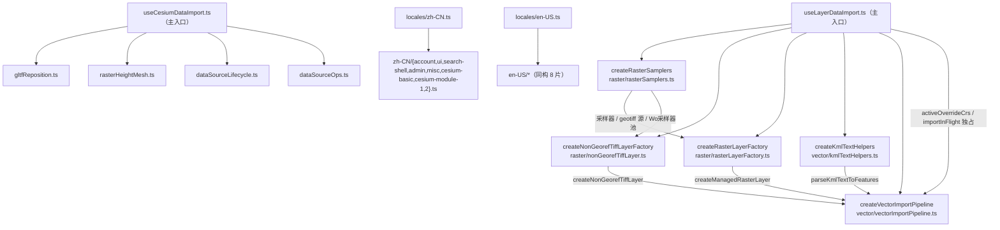

# 暂存区代码审查 · 版本整合 3.6.45 · JS→TS 与 500 行拆分

- **日期与时间**：2026-11-13 10:40
- **任务等级**：L3（跨模块重构 + 文件重命名 + 目录新增）
- **版本**：V3.6.45（本批统一整合，原 3.6.46 条目并入）

---

## 一、需求与问题分析

### 用户诉求

1. code review 暂存区全部代码，**版本整合为 3.6.45**（不再保留 3.6.46）。
2. 库/逻辑文件**单文件不超过 500 行**，超限者做解耦重组。
3. 暂存区内的 JS **全部改写为 TS**（针对 26 个暂存文件中的 js/ts 部分）。

### 事实基线（动手前实测）

| 项 | 事实 |
|---|---|
| 暂存文件总数 | 26（其中 js/ts 17 个） |
| 超 500 行的 js/ts | `zh-CN.js` 2396、`en-US.js` 2179、`useLayerDataImport.js` 1772、`useCesiumDataImport.js` 904、`layerExportService.js` 501 |
| 类型基线 | `tsc --noEmit` 0 error；`tsconfig` `strict:false` / `noImplicitAny:false`，`include` 含 `src/**/*.ts` |
| 显式 `.js` 导入 | 5 处指向待改名文件（`loaders/utils.js`×2、`geojsonLoader.js`、`shpLoader.js`、`locales/*.js`） |
| 结构树门禁 | 原 527/527，改名/拆分后必须同步 `frontend-structure.md` |

### 根因

代码按「一个 composable / 一个字典一个文件」演进，职责随功能叠加持续堆进单文件；JS 无类型约束，闭包变量靠人读注释维护。行数与语言两个问题耦合在同一批文件上，必须一次处理。

---

## 二、解决方案

### 1. 版本整合

- README 三处（简介 / 版本演进表 / 页脚）统一为 **V3.6.45**，版本表恢复恒定 3 行（45/44/43）。
- CHANGELOG：删除 `### V3.6.46` 一级标题，内容降为 V3.6.45 条目的 ⑦⑧；新增 ⑨ 记录本次 JS→TS 与拆分。
- 原「导出数据子菜单」日志版本号改为 3.6.45；本文件为本次整理的全貌记录。

### 2. JS→TS（14 个文件）

全部为**改名 + 补类型 + 修显式 `.js` 导入后缀**，对外导出签名不变：

`protocol`、`menu/contextMenu`、`menu/commandDispatcher`、`actions/layerExportService`、`data-import/dataDispatcher`、`data-import/vectorUtils`、`loaders/{geojsonLoader,shpLoader,utils}`、`core/useCesiumInfoBoxTheme`、`dataImport/useCesiumDataImport`、`ol/…/useLayerDataImport`，以及两个语言字典。

新增类型：`menu/types.ts`（`TocMenuItem` / `TocMenuCapabilities` / `TocSelectionState` / `TocMenuNode`）、各 loader/composable 的入参 interface。

### 3. 超 500 行拆分（低风险手法）

| 原文件 | 拆分结果 | 关键手法 |
|---|---|---|
| `layerExportService.ts` 501 | `exportFormatting.ts` + 服务本体（270/261） | 纯函数（顶点展开 / CSV 单元 / 下载）下沉 |
| `useCesiumDataImport.ts` 904 | `gltfReposition.ts`、`rasterHeightMesh.ts`、`dataSourceLifecycle.ts`、`dataSourceOps.ts` + 主入口 391 | **工厂 + 依赖注入**：状态 ref 仍由主入口持有并注入，函数体逐字搬迁 |
| `useLayerDataImport.ts` 1772 | `raster/{rasterSamplers,rasterLayerFactory,nonGeorefTiffLayer}.ts`、`vector/{kmlTextHelpers,vectorImportPipeline}.ts` + 主入口 391 | 同上；`activeOverrideCrs` / `importInFlight` 仍由主入口独占，管线经 `getActiveOverrideCrs()` 读取 |
| `zh-CN` / `en-US` 2396/2179 | 入口 `zh-CN.ts` + `zh-CN/*.ts`（8 片），en 同构 | **acorn AST 取属性 range** 后按命名空间切片；`cesium.module` 单独两片，入口用 spread 合并 |

**为何用工厂注入而非重写**：函数体逐字搬迁可保证行为不变；漏注入的闭包变量会被 `tsc` 报 `Cannot find name`，相当于免费的静态校验。

**为何语言包用 AST 切分**：早期按行号/花括号计数切分在字符串含 `{count}` 占位符时失准，出现「切成半个对象」；改用 acorn 解析对象字面量、按 `Property.range` 切片后零语法错误。

### 4. 数据流（改动后）

---

## 三、code review 结论（暂存区）

逐文件复核了 26 个暂存文件的逻辑，重点核对以下不变量，**未发现阻断级缺陷**：

| 复核点 | 结论 |
|---|---|
| 导出子菜单容器 key 是否会被前缀规则兜底成 CSV | 已在分发器最前拦截，脚本断言 `[]` |
| CSV 标准列与 `tabularParser` 解析契约是否一致（导出→导入闭环） | 列名/编码（UTF-8 BOM）/分环闭合一致 |
| SHP 无 `.prj` 且判定为平面坐标时是否报可操作错误 | 是，且带 `[SHP][CRS]` 提示 |
| `PROJ:` 别名大小写是否被 `normalizeCrs` 破坏 | 前缀大写 + 散列小写，`proj4.defs` 可命中 |
| `reprojectGeoJSON` 的 `onInvalid` / 统计 | 有，供 UI 提示无效点 |
| 3D 导入配色是否残留半透明 | 已统一 alpha=1 |
| InfoBox 高度是否可能自激循环 | `ResizeObserver` 仅对宽度变化重算 |

**遗留观察（不改，已记录）**：`cesiumLayerSerialization.ts` 仍为 459 行接近上限；`TOCPanel.vue` / `MapContainer.vue` / `CesiumContainer.vue` 为 Vue 组件（非本次 js/ts 范围），仍在 2000+ 行，按 §3 只出不进。

---

## 四、修改内容

### 新增

| 文件 | 说明 |
|---|---|
| `frontend/src/domains/common/layer-tree/menu/types.ts` | 菜单项/能力/多选上下文类型 |
| `frontend/src/domains/common/layer-tree/actions/exportFormatting.ts` | 导出格式化工具（顶点展开 / CSV 单元 / 下载 / 属性列并集） |
| `frontend/src/domains/cesium/composables/dataImport/gltfReposition.ts` | GLTF 坐标弹窗与重定位（失败回滚） |
| `.../dataImport/rasterHeightMesh.ts` | 单波段 GeoTIFF → 高程网格 |
| `.../dataImport/dataSourceLifecycle.ts` | 数据源移除 / 清空 |
| `.../dataImport/dataSourceOps.ts` | 外部注册 / 远程 GLB / 定位 / 贴地高度 |
| `frontend/src/domains/ol/data-import/raster/rasterSamplers.ts` | 栅格采样 / 投影换算 / geotiff 源与池缓存 |
| `.../raster/rasterLayerFactory.ts` | 受管 GeoTIFF 图层构造 |
| `.../raster/nonGeorefTiffLayer.ts` | 无坐标参考 TIF 兜底 |
| `frontend/src/domains/ol/data-import/vector/kmlTextHelpers.ts` | KML 命名空间 / 绘制顺序 / 要素解析 |
| `.../vector/vectorImportPipeline.ts` | 单文件解析入库 + dispatch 逐包入库 |
| `frontend/src/locales/{zh-CN,en-US}/*.ts` | 各自 8 个命名空间分片 |
| `Docs/LLM_record/.../2026-11-13-js-ts-refactor-and-500line-split.md` | 本文件 |

### 删除 / 改名

14 个 `.js` → `.ts`（含两个语言字典改为「入口 + 分片目录」）。

### 文档

`README.md`（三处版本 + 合并条目）、`Docs/Guide/CHANGELOG.md`（合并 3.6.46 条目 + 新增 ⑨）、`Docs/Guide/frontend-structure.md`（545 条，改名 + 新增子树）。

---

## 五、影响范围

| 维度 | 说明 |
|---|---|
| 数据导入 | OL/Cesium 两侧 composable 拆分为工厂 + 子模块；导出 API 与事件名不变 |
| 导出链路 | 无行为变化（仅文件拆分与类型化） |
| i18n | 语言包拆分合并，键路径与取值不变；`useLocale` 动态导入改为无后缀 |
| 构建 | 新增 19 个 ts 模块 + 16 个语言分片，全部纳入 `tsconfig` |
| 后端 / 配置 / 鉴权 | 无影响 |

---

## 六、性能指标

未实测（无运行时热点变化）。构建体积：语言包 chunk 内容不变，仅切分为多个模块，最终仍由入口合并为同一对象。

---

## 七、测试方案

### Agent 已执行

| 项 | 方式 | 结果 |
|---|---|---|
| 类型检查 | `npx tsc --noEmit` | ✅ 0 error（改造前基线 0，改造后仍 0） |
| Lint | `npx eslint src/domains/{common/layer-tree,common/data-import,cesium/composables,ol/data-import} src/locales` | ✅ 0 error |
| 语言包等价 | 旧文件（git index）与新入口分别 esbuild 打包为 CJS → 逐键比对 | ✅ 键集合/值/层级一致（仅键顺序变化，长度相同 65154 / 99774） |
| 生产构建 | `npx vite build` | ✅ 成功（仅 chunk 体积警告） |
| 结构树门禁 | `python Scripts/CheckStructureTree.py` | ✅ 545/545，漏登记 0、幽灵 0 |
| 配置登记门禁 | `python Scripts/CheckConfigRegistry.py` | ✅ 全绿 |
| 红线自查 | `grep -RIlE --exclude-dir=.venv <§11.2 模式串> …` + `deploy/.env` 基线 | ✅ 无命中 |
| 行数复核 | `wc -l` 全部新模块 | ✅ 最大 466 行（`vectorImportPipeline.ts`），语言分片最大 410 行 |

### 待用户实机验证

1. **数据导入**：分别导入 GeoJSON / SHP / KML / CSV / TXT(WKT) / GeoTIFF / GLB / 3D Tiles，确认图层正常入库、贴地、配色与导入前一致。
2. **KML 专项**：带 `<Folder>` 层级与样式的 KML，确认绘制顺序与样式仍生效。
3. **GeoTIFF 专项**：有坐标参考的 TIF（受管）与无坐标参考的 TIF（按视图中心落图）各一份。
4. **GLTF 专项**：本地 GLB 走坐标弹窗导入 + 「调整位置」重定位 + 取消。
5. **导出**：CSV / TXT / KML / GeoJSON 各导出一次并回读导入。
6. **i18n**：中英文切换后各页面文案齐全（重点 `cesium.*` 与 `admin.*`）。

---

## 八、变更文件清单

前端（前端根 `frontend/src/`）：

- `domains/common/layer-tree/menu/{protocol.ts,contextMenu.ts,commandDispatcher.ts,types.ts}`
- `domains/common/layer-tree/actions/{layerExportService.ts,exportFormatting.ts}`
- `domains/common/data-import/{dataDispatcher.ts,vectorUtils.ts}`
- `domains/common/app/useLocale.js`（动态导入去后缀）
- `domains/cesium/composables/core/useCesiumInfoBoxTheme.ts`
- `domains/cesium/composables/dataImport/{useCesiumDataImport.ts,gltfReposition.ts,rasterHeightMesh.ts,dataSourceLifecycle.ts,dataSourceOps.ts}`
- `domains/cesium/composables/dataImport/loaders/{geojsonLoader.ts,shpLoader.ts,utils.ts}`
- `domains/cesium/composables/index.js`（barrel 后缀）
- `domains/cesium/composables/dataImport/useCesiumCrsRedeclare.js`（导入后缀）
- `domains/ol/data-import/composables/useLayerDataImport.ts`
- `domains/ol/data-import/raster/{rasterSamplers.ts,rasterLayerFactory.ts,nonGeorefTiffLayer.ts}`
- `domains/ol/data-import/vector/{kmlTextHelpers.ts,vectorImportPipeline.ts}`
- `locales/{zh-CN.ts,en-US.ts}` + `locales/zh-CN/*.ts`（8）+ `locales/en-US/*.ts`（8）
- `locales/zh-CN.js`、`locales/en-US.js` 删除

文档：`README.md`、`Docs/Guide/CHANGELOG.md`、`Docs/Guide/frontend-structure.md`、本日志。

---

## 九、遗留与风险

| # | 内容 | 处置 |
|---|---|---|
| 1 | 语言包分片后**对象键顺序**与原先不同 | 运行时按 key 查表，顺序无意义；如需逐字一致可回退（不必要） |
| 2 | geotiff 源/Worker 池缓存由「每个 composable 实例一份」改为**模块级共享** | 解码器本身无状态，跨实例复用无副作用；已在 `rasterSamplers.ts` 注释说明 |
| 3 | 拆分为工厂注入后，子模块不再能直接访问主入口私有状态 | 属预期解耦；新增依赖需在 interface 与装配处同时登记（tsc 会拦截漏项） |
| 4 | `cesiumLayerSerialization.ts` 459 行、`TOCPanel.vue` 等巨型组件未动 | 前者在 500 行内；后者为 Vue 组件，按 §3 只出不进 |
| 5 | 本次未做浏览器真机验证 | 导入/导出的运行时行为仅经静态检查与构建验证，需用户按第七节实测 |
| 6 | 宿主编辑器会自动把改动加入 git 暂存区（非 Agent 执行 `git add`） | 交接块已注明，如需审阅工作区 diff 请自行 `git restore --staged` |
